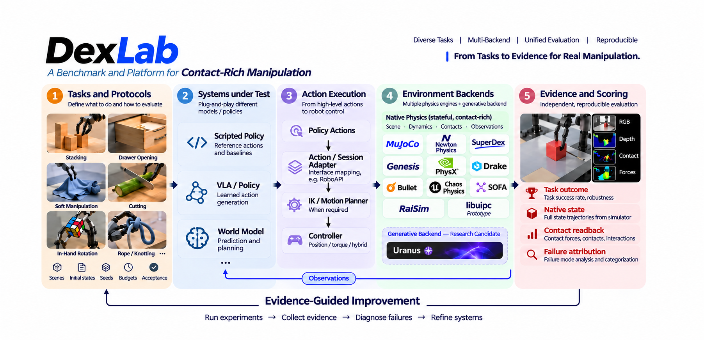

# DexLab

DexLab is my personal research project exploring how Agent Skills and simulation can improve each other.

A grasp can fail because of the policy or because the simulator does not handle contact and friction accurately.

DexLab starts with concrete problems like this. **Use tasks to expose problems, run controlled experiments to identify their causes, then improve the relevant part of the simulation.**

The improved simulation helps the Agent learn new Skills. With those Skills, the Agent can take on harder tasks and probe the limits of the simulation.

## [📖 Read the Blog →](https://huangkiki.github.io/Dexlab/en/latest/#blog)

[Research findings](https://huangkiki.github.io/Dexlab/en/latest/experience.html) · [Experiments](https://huangkiki.github.io/Dexlab/en/latest/experiments.html) · [Learn simulation](https://huangkiki.github.io/Dexlab/en/latest/learning.html) · [简体中文](README.md)

<a id="architecture"></a>
<a href="https://huangkiki.github.io/Dexlab/en/latest/#blog"></a>

## Citation

If you use DexLab in your work, please cite the repository:

```bibtex
@misc{huang2026dexlab,
  author = {Kiki Huang},
  title = {DexLab: Robotics Simulation Solver Diagnosis and Selection},
  year = {2026},
  url = {https://github.com/huangkiki/Dexlab},
  note = {GitHub repository}
}
```

GitHub also reads [`CITATION.cff`](CITATION.cff) to provide its one-click citation entry.
