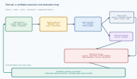

# DexLab

## Contact-rich robotics, beyond rigid-body simulation.

DexLab is a physics-centric research platform for robot manipulation involving contact, deformation, and material separation.

[简体中文](README.md) · [Experiments](https://huangkiki.github.io/Dexlab/en/latest/experiments.html) · [Research protocol](https://huangkiki.github.io/Dexlab/en/latest/model-evaluation.html) · [Quick start](#quickstart) · [Architecture](#architecture) · [Uranus backend](https://huangkiki.github.io/Dexlab/en/latest/uranus-backend.html)

> Native commands, contact readback, independent scoring, offline evidence, and several contact experiments are available today. Remote model execution, a public leaderboard, and cross-task unified conclusions are still being built.

## Research vision: Simulation–Learning Co-evolution

> **Models expose simulation gaps; more trustworthy simulation then produces better models.**

The near-term center is a **Physics Research Platform**: contact, deformation, and material separation become observable, attributable, and rescorable experiments. The long-term loop feeds model failures back into simulation, then uses improved simulation to train and evaluate models.

<a id="architecture"></a>
## Architecture



The task protocol fixes scenes and budgets. A model emits actions, a controller maps them to native physics or a candidate generative backend, and an independent evidence layer records native state, contact readback, and outcomes. The feedback loop is credited only when the corresponding evidence exists.

## What's new

- **2026-10-31 · Uranus generative backend:** added the candidate backend contract, candidate tasks, paired native/generative evaluation plan, and evidence boundaries. It is documented, not yet a DexLab runner. [Details](https://huangkiki.github.io/Dexlab/en/latest/uranus-backend.html)
- **2026-10-31 · Poke RoboAPI adapter:** added model discovery, schema/session handling, action validation, execution feedback, and a credential-safe CLI. Per-task observation/action mappings remain pending. [Details](docs/roboapi-poke.md)
- **2026-10-31 · Model-evaluation protocol:** added the public evaluation, anti-gaming, evidence-state, and hidden-layout protocol. Remote execution and the public leaderboard are still under construction. [Details](https://huangkiki.github.io/Dexlab/en/latest/model-evaluation.html)

[All releases](https://github.com/huangkiki/Dexlab/releases)

## Demo gallery

These animations come from DexLab simulation recordings or recorded-state replays. Every result applies only to its reported version, material assumptions, and acceptance protocol.

<table>
<tr>
<td width="50%">
<a href="https://huangkiki.github.io/Dexlab/en/latest/wuji-contact.html">

</a>
<strong>Grasp and slip resistance</strong><br>
Under the same control, replacing point contact with synthetic torsional contact reduces two-second hold drift from <strong>2.734 mm</strong> to <strong>1.025 mm</strong>.
</td>
<td width="50%">
<a href="https://huangkiki.github.io/Dexlab/en/latest/rss-wiping.html">

</a>
<strong>Sponge wiping and grasp dependence</strong><br>
Assisted retention passes <strong>3/3</strong>; removing assistance gives <strong>0/3</strong>, with final cleaning around <strong>95.47% / 39.92%</strong>.
</td>
</tr>
<tr>
<td width="50%">
<a href="https://huangkiki.github.io/Dexlab/en/latest/cloth-comparison.html">

</a>
<strong>Deformable manipulation</strong><br>
The robot can pinch and move a cloth patch, but complete folding still fails: the current record reaches <strong>12.55%</strong> edge strain against a 5% limit.
</td>
<td width="50%">
<a href="https://huangkiki.github.io/Dexlab/en/latest/cut-push.html">

</a>
<strong>Cutting and topology change</strong><br>
Continuous cutting and blade-face pushing create real topology changes; the full report records contact force, material separation, and retained failures beyond the visual replay.
</td>
</tr>
</table>

## Why DexLab?

When a robot policy fails in simulation, we see one failure. It may come from the policy, controller, scene, contact discretization, material model, or numerical solver.

> **When a robot fails in simulation, is it the policy that fails, or the physics we trusted?**

DexLab makes these questions testable:

- Under matched geometry, load, and control, does the contact model change whether an object is held, slips, or releases?
- Do smaller timesteps, finer meshes, or more iterations approach the physical answer, or merely change numerical behavior?
- When can a robot grasp a cloth, and when can it actually fold, transfer, and release it?
- How should cutting, friction, and material separation be recorded and accepted beyond a video?
- Does a policy or API ranking survive replacement of the physics backend?

## Research areas

| Area | Research question | Current entry |
| --- | --- | --- |
| **Contact physics** | Are normal response, friction, retention, sliding, impulse, and release independently checkable? | [Contact mechanics](https://huangkiki.github.io/Dexlab/en/latest/contact-response.html) · [Hold and slip](https://huangkiki.github.io/Dexlab/en/latest/wuji-contact.html) |
| **Deformable objects** | Can grasp, sag, stretch, layer contact, and release be scored separately? | [Cloth comparison](https://huangkiki.github.io/Dexlab/en/latest/cloth-comparison.html) · [Replay rendering](https://huangkiki.github.io/Dexlab/en/latest/studio-rendering.html) |
| **Topology-changing interaction** | How should cutting and material separation record contact, connectivity, and material response? | [Cutting and pushing](https://huangkiki.github.io/Dexlab/en/latest/cut-push.html) |
| **Cross-backend evaluation** | When can engines, integrators, and solvers be compared under matched physical inputs? | [Engines and solvers](https://huangkiki.github.io/Dexlab/en/latest/engines.html) · [Selection](https://huangkiki.github.io/Dexlab/en/latest/selection.html) |
| **Policy and API evaluation** | How can model, adapter, and invalid-physics failures be separated? | [Evaluation protocol](https://huangkiki.github.io/Dexlab/en/latest/model-evaluation.html) · [RoboAPI adapter](docs/roboapi-poke.md) |

## What is implemented

- **Task execution:** fixed robots, scenes, control rates, physics versions, seeds, budgets, and acceptance conditions.
- **Native measurement:** states, velocities, commands, contact forces, impulses, constraint state, and solver results, not only video.
- **Independent scoring:** task outcome, numerical consistency, physical reference, and record integrity are judged separately.
- **Rescorable evidence:** trajectories, source snapshots, configuration, hashes, and offline scorers remain with each result.
- **Cross-backend experiments:** MuJoCo, SuperDex, Genesis, Newton Physics, PhysX, and Drake have different task coverage; engine count is not task qualification.
- **Model integration:** the Poke RoboAPI adapter exists; remote execution, the Uranus backend, and public leaderboards remain under construction.

## Experiments and findings

These findings guide the research direction; they are not merged into one aggregate score.

| Experiment | Condition | Result and meaning |
| --- | --- | --- |
| **Contact representation changes the grasp verdict** | Wuji two-pad sphere pinch under the same control and hold window | `condim=3` drifts **2.734 mm**, above 2 mm; `condim=4` reaches **1.025 mm**. The contact model is part of the result. |
| **Wiping success depends on grasp assistance** | RoboSimStudio `wipe_the_bar`, matched records and scoring | Assisted **3/3**, cleaning around **95.47%**; unassisted **0/3**, around **39.92%**. Original success cannot be attributed to policy alone. |
| **Surface discretization changes the failure boundary** | Same cylinder, mass, force command, and 0.5 ms step; only triangle count changes | `256 → 1,024 → 4,096` triangles gives peak penetration **2.267 → 0.858 → 0.481 mm**; the intermediate mesh still fails. |
| **Grasp behavior can depend on the backend** | Apple-stem grasp over ten paired regression scenes | The current default passes MuJoCo **1/10** and SuperDex **10/10**; smaller timesteps do not monotonically improve penetration. |
| **A stable cloth grasp is not a fold** | OpenArm + Wuji, passive cloth with no adhesion or cloth actuators | Single-hand pinch, lift, and release pass; complete folding fails on strain, residual contact, and final geometry. |

Together, these results show why a success video is insufficient: **material models, contact response, and downstream policy transfer must be checked separately.**

[Full experiments](https://huangkiki.github.io/Dexlab/en/latest/experiments.html) · [All results and failures](https://huangkiki.github.io/Dexlab/en/latest/results.html) · [Research findings](https://huangkiki.github.io/Dexlab/en/latest/experience.html)

<a id="quickstart"></a>
## Quick start

The shortest simulation entry is apple-stem grasping. On Linux x86_64 with [uv](https://docs.astral.sh/uv/getting-started/installation/):

```bash
git clone https://github.com/huangkiki/Dexlab.git
cd Dexlab
bash scripts/setup.sh --mujoco-profile historical-3.11.0
bash demos/apple-stem-grasp/run.sh \
  --backend mujoco \
  --output demos/apple-stem-grasp/runs/first-mujoco
.venv/bin/python demos/apple-stem-grasp/src/verify_sdf_grasp.py \
  demos/apple-stem-grasp/runs/first-mujoco
```

The verifier writes `summary.json`; when all checks pass, `passed: true`. Fourteen seconds is simulation time, not expected wall time. Add `--headless` without a display and use a fresh output directory for every run.

To inspect the evidence chain without installing a simulator, start with the [GPU-free wiping rescore](https://huangkiki.github.io/Dexlab/en/latest/rss-wiping.html#offline-evidence). Full dependencies, assets, and commands are in the [installation guide](https://huangkiki.github.io/Dexlab/en/latest/quickstart.html).

## Research roadmap

1. **Contact and material response:** calibrate stiffness, damping, friction, and real measurements before ranking engines.
2. **Deformable manipulation:** extend from pinch, transfer, and release to auditable folding geometry, self-contact, and material-point tracking.
3. **Topology-changing tasks:** define continuous geometry, contact-force, and outcome criteria for cutting, separation, and adhesion.
4. **Cross-backend attribution:** distinguish solver, integrator, collision geometry, precision, timestep, and framework wrapper.
5. **Policy and neural backends:** test whether API rankings and task conclusions transfer from native physics to learned world models.
6. **Co-evolution:** after evidence supports it, use model failures to improve simulation and improved simulation to train and evaluate better models.

The actual status, blockers, and next-stage entry remain in [Current Work](docs/current-work.md); it is not a completed roadmap.

## Ecosystem backend: Uranus

[Uranus](https://arxiv.org/abs/2609.24815) is a D-Robotics robot video world model that generates multi-view observations from future `qpos`, cameras, and robot geometry. It is currently a **documented candidate generative backend**, not a verified physics backend.

The integration path is `RoboAPI → IK/controller → qpos → Uranus → RGB → task scorer`. Uranus supplies visual observations; it does not provide native contact state, task success, or physical truth. [Read the full introduction, candidate tasks, and evidence boundary](https://huangkiki.github.io/Dexlab/en/latest/uranus-backend.html).

## Evidence and boundaries

- Task success is not physical truth; numerical consistency is not real-world accuracy.
- A simulation pass is not hardware success; a rendered replay is not visual control.
- Engine coverage differs by task, material model, and acceptance condition; DexLab does not publish a universal engine ranking.
- Failures, invalid runs, and missing readouts remain visible; thresholds are not relaxed and counterexamples are not deleted.
- Uranus and remote model evaluation are candidates; an upstream paper or interface does not establish a DexLab reproduction.

## Documentation and citation

[Documentation](https://huangkiki.github.io/Dexlab/en/latest/) · [Experiments](https://huangkiki.github.io/Dexlab/en/latest/experiments.html) · [Findings](https://huangkiki.github.io/Dexlab/en/latest/experience.html) · [Solver roles](https://huangkiki.github.io/Dexlab/en/latest/solver-taxonomy.html) · [Coverage](https://huangkiki.github.io/Dexlab/en/latest/coverage.html) · [Contributing](https://huangkiki.github.io/Dexlab/en/latest/contributing.html)

No companion paper is published yet. When citing the repository, use its URL and a specific commit or release rather than attributing unpublished paper results.

```bibtex
@software{dexlab2026,
  author  = {DexLab contributors},
  title   = {DexLab: A Physics-Centric Research Platform for Contact-Rich Robot Manipulation},
  year    = {2026},
  url     = {https://github.com/huangkiki/Dexlab}
}
```
