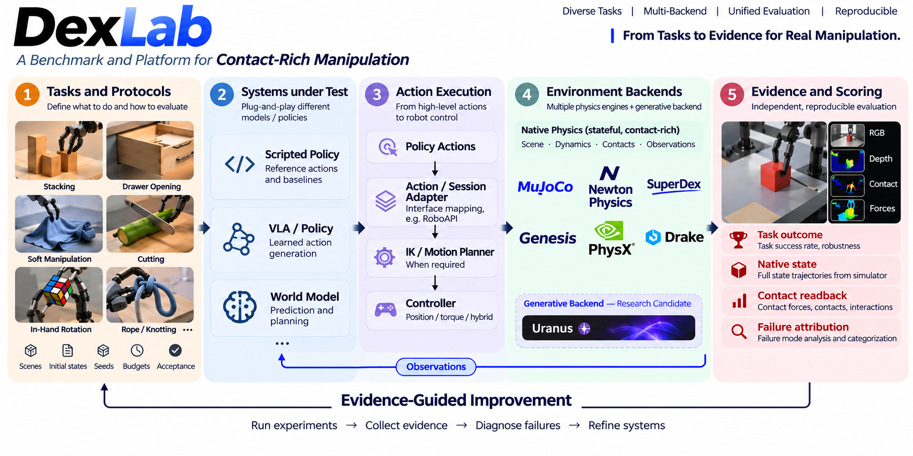

<h1 align="center">DexLab</h1>

<strong>Agents and simulation, improving together through experiments.</strong>

DexLab is my personal research project on robotic manipulation and physics simulation: learning from task failures and using controlled experiments to improve skills and simulation models.

<h2 align="center"><a href="https://huangkiki.github.io/Dexlab/en/latest/#blog">Read the Blog →</a></h2>

  <a href="https://huangkiki.github.io/Dexlab/en/latest/experience.html">Research findings</a> ·
  <a href="https://huangkiki.github.io/Dexlab/en/latest/experiments.html">Experiments</a> ·
  <a href="https://huangkiki.github.io/Dexlab/en/latest/learning.html">Learn simulation</a> ·
  <a href="README.md">简体中文</a>

