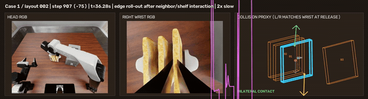
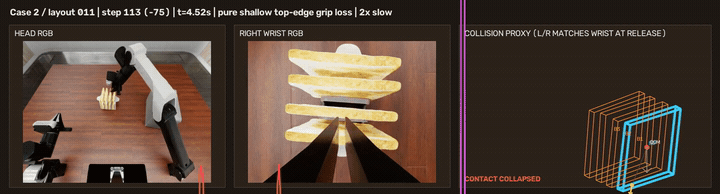

<h1 align="center">DexLab</h1>

<p align="center"><strong>Experiments and Evaluation for Contact-Rich Manipulation</strong></p>

<p align="center">
  <a href="https://huangkiki.github.io/Dexlab/en/latest/">Documentation</a> ·
  <a href="#architecture">Architecture</a> ·
  <a href="#findings">Findings</a> ·
  <a href="#quickstart">Quick start</a> ·
  <a href="README.md">简体中文</a>
</p>

**DexLab is an open-source platform for studying contact-rich robotic manipulation.** It connects task scenes, control, native physics records and independent scoring to determine whether a simulation failure comes from the policy, controller, geometry, contact model or numerical solver.

<a id="architecture"></a>
## Architecture

<p align="center">
  <a href="docs/site/_static/images/dexlab-architecture.png">
    
  </a>
</p>

Scripts, policies and models connect to environments through action adapters and controllers, with observations fed back to the system under test. Native state and contact records support independent scoring, and diagnosis guides the next experiment.

This is a conceptual architecture overview. See the [coverage matrix](https://huangkiki.github.io/Dexlab/en/latest/coverage.html) for implemented and validated task, model and backend coverage; the generative backend is a research candidate.

<a id="findings"></a>
## What we have learned

**The practical finding is to locate the first failing layer before changing the policy, contact model or solver.** The evidence does not yet support a universal engine ranking or hardware-accuracy claim.

| Finding | Evidence and scope | Development implication |
| --- | --- | --- |
| **Contact modeling can change the verdict for the same grasp.** | In the synthetic Wuji pinch, adding only torsional contact reduces two-second maximum hold displacement from **2.734 → 1.025 mm**, crossing the original 2 mm limit; slow drift remains. [Report](https://huangkiki.github.io/Dexlab/en/latest/wuji-contact.html) | Check contact modeling first; this establishes neither solver failure nor real fingertip calibration. |
| **Task completion does not establish the intended physical mechanism.** | RSS wiping passes **3/3** with auxiliary retention and **0/3** when only that assistance is removed; LIBERO completes **10/10** original tasks while physical diagnostics pass **5/10**. [Wiping](https://huangkiki.github.io/Dexlab/en/latest/rss-wiping.html) · [LIBERO](https://huangkiki.github.io/Dexlab/en/latest/experience.html) | Report task scores separately from contact, assistance and record checks. |
| **Tuning one condition does not establish transfer.** | Three frozen profiles pass **0/30** combined synthetic-response targets across ten mass/size cases, without mass or area compensation. [Report](https://huangkiki.github.io/Dexlab/en/latest/experience.html#mass-size-transfer) | Recheck parameter mapping and scope; these failures do not identify an engine algorithm error. |
| **Lower prediction error does not establish contact-loss prediction.** | In 100 ms offline diagnostics from six existing Wuji episodes, constant velocity reduces position error, but contact-persistence baselines still miss release/unloading losses. [Report](https://huangkiki.github.io/Dexlab/en/latest/contact-response.html) | Test contact events and action response separately; overlapping windows are not independent trials, and no learned-model or control benefit is established. |
| **A closed command does not establish a valid grasp.** | In two local RoboDojo toast failures, the command stays closed while bilateral normal impulse drops from about **0.25 N·s** to near zero. One case is amplified by neighbor contact; the other slips directly from a top-edge pinch. [Report](https://huangkiki.github.io/Dexlab/en/latest/robodojo-bread-slip.html) | Fix grasp depth, regrasp criteria and clearance before controlled A/B tests of material readback, compliance and tangential impulse; do not attribute the whole batch to the simulator. |

[Full results, failures and open gaps →](https://huangkiki.github.io/Dexlab/en/latest/results.html)

## Representative experiments

These animations show simulation recordings or recorded-state replays. Click through for experimental conditions, full results and reproduction instructions.

<table>
<tr>
<td width="50%" valign="top">
<a href="https://huangkiki.github.io/Dexlab/en/latest/wuji-contact.html">

</a>
<strong>Grasping: how does contact modeling affect slip?</strong><br>
Under the same control, replacing point contact with synthetic torsional contact reduces two-second hold drift from <strong>2.734 mm</strong> to <strong>1.025 mm</strong>.
</td>
<td width="50%" valign="top">
<a href="https://huangkiki.github.io/Dexlab/en/latest/rss-wiping.html">

</a>
<strong>Wiping: does it still work without assistance?</strong><br>
Assisted retention passes <strong>3/3</strong>; removing assistance gives <strong>0/3</strong>, with final cleaning around <strong>95.47% / 39.92%</strong>.
</td>
</tr>
<tr>
<td width="50%" valign="top">
<a href="https://huangkiki.github.io/Dexlab/en/latest/robodojo-bread-slip.html">

</a>
<strong>RoboDojo toast: why does a neighbor knock the slice out?</strong><br>
The close command is correct, but neighbor/shelf interaction amplifies a shallow pinch; the slice rolls out after bilateral normal load reaches zero.
</td>
<td width="50%" valign="top">
<a href="https://huangkiki.github.io/Dexlab/en/latest/robodojo-bread-slip.html#case-2">

</a>
<strong>RoboDojo toast: why can it fall without a collision?</strong><br>
Contact lies only about 1.4 cm below the top edge; with no measured pre-release external impact, normal load vanishes and the slice drops.
</td>
</tr>
</table>

More experiments and failures: [Cloth folding](https://huangkiki.github.io/Dexlab/en/latest/cloth-comparison.html) · [Cutting and pushing](https://huangkiki.github.io/Dexlab/en/latest/cut-push.html) · [All experiments →](https://huangkiki.github.io/Dexlab/en/latest/experiments.html)

## Three milestones in the research direction

- **2026-10-26 | Explain why a grasp changes:** the [Wuji contact comparison](https://github.com/huangkiki/Dexlab/commit/c8d4e29586a140a7df241b928720e82ed6008f3a), independent scorer and offline bundle turn an apparent grasp into checkable contact evidence.
- **2026-10-27 | Ask whether a model can anticipate failure:** [contact-response diagnostics](https://github.com/huangkiki/Dexlab/commit/b1cb02561e0e291bdbc1ac232a46c352dd48e946) deliver offline baselines and retain the finding that lower position error still misses contact loss; native action interventions remain unverified.
- **2026-11-02 | Connect learning to physical attribution:** [CHORD preparation](https://github.com/huangkiki/Dexlab/commit/1a8855ccfd26ff6f1434a109954190c2775a8167) freezes three tasks, asset preflight and finite-budget commands. Main has no completed native task migration; see [current work](docs/current-work.md) for the training candidate and blockers.

Next: **research question → audit scoring semantics → minimal comparison → failure attribution → revised finding**. The [development workflow and next steps](docs/autoresearch.md#research-loop) draw on the latest Discussions; persistent contact sequences remain a proposed experiment.

<a id="quickstart"></a>
## Quick start

Start with apple-stem grasping. On Linux x86_64 with [uv](https://docs.astral.sh/uv/getting-started/installation/):

```bash
git clone https://github.com/huangkiki/Dexlab.git
cd Dexlab
bash scripts/setup.sh --mujoco-profile historical-3.11.0
bash demos/apple-stem-grasp/run.sh \
  --backend mujoco \
  --output demos/apple-stem-grasp/runs/first-mujoco
.venv/bin/python demos/apple-stem-grasp/src/verify_sdf_grasp.py \
  demos/apple-stem-grasp/runs/first-mujoco
```

The verifier writes `summary.json`, with `passed: true` when all checks pass. Fourteen seconds is simulation time; wall time is usually longer. Add `--headless` without a display and use a fresh output directory for every run.

[Installation guide](https://huangkiki.github.io/Dexlab/en/latest/quickstart.html) · [Offline rescoring without a GPU](https://huangkiki.github.io/Dexlab/en/latest/rss-wiping.html#offline-evidence)

## Documentation and contributing

The website maintains full experiment reports, usage guides and research material:

- **Explore experiments:** [Experiment gallery](https://huangkiki.github.io/Dexlab/en/latest/experiments.html) · [Results and coverage](https://huangkiki.github.io/Dexlab/en/latest/results.html) · [Failure audit](https://huangkiki.github.io/Dexlab/en/latest/solver-failure-audit.html)
- **Research guide:** [What are we discussing when we discuss dexterous manipulation simulation?](https://huangkiki.github.io/Dexlab/zh-cn/latest/_static/research/dexterous-simulation.html) (Chinese original), with an [English companion](https://huangkiki.github.io/Dexlab/en/latest/dexterous-hand-simulation.html).
- **Understand the methods:** [Solvers and contact models](https://huangkiki.github.io/Dexlab/en/latest/solver-taxonomy.html) · [Papers and references](https://huangkiki.github.io/Dexlab/en/latest/references.html)
- **Contribute:** [Contribution guide](https://huangkiki.github.io/Dexlab/en/latest/contributing.html) · [Current work](docs/current-work.md) · [Issues and suggestions](https://github.com/huangkiki/Dexlab/issues)

Code is licensed under [Apache-2.0](LICENSE); third-party assets retain their own licenses. See the [citation guide](https://huangkiki.github.io/Dexlab/en/latest/index.html#documentation-and-citation) for research use.
