# DexLab

**Use established physical laws and empirical relations in reproducible experiments to study how contact and friction affect robotic grasping, and assess the trustworthiness of physics simulation.**

The research serves two goals:

| Your question | What DexLab provides |
| --- | --- |
| **A scene performs poorly. What should improve?** | Locate departures from physical expectations, separate parameters, integration, model assumptions and solving mechanisms, and identify evidenced configuration fixes and solver improvement directions. |
| **A new scene needs an engine/solver. Where should I start?** | Use evidence from similar contact/friction conditions to choose candidate configurations, understand sensitivity, limits, stability and cost, and build practical scenario-selection knowledge. |

[简体中文](README.md) · [Documentation](https://huangkiki.github.io/Dexlab/en/latest/index.html) · [Research experience](docs/site/en/experience.md) · [Diagnosis and trials](docs/site/en/diagnosis.md) · [Scenario guide](docs/site/en/selection.md)

## RSS wiping: grasp assistance and slippage

Reproducing RoboSimStudio (RSS) wiping: one gripper holds the bar while the other wipes its ink with a sponge. **Left: the original's compliant node constraints retain the sponge. Right: removing those constraints lets the sponge slip out during wiping.**

A **continuous 10–30 s excerpt from paired trial 01, played at 2× speed**. Both panels share the simulation clock and preserve the native collision view and measured annotations. Click for full recordings and curves. [Preview provenance and processing](docs/evidence/rss-wiping/preview.md).

Across three paired repetitions with frozen collision geometry and initial states, the original passed **3/3 tasks, cleaning 95.5–95.9%**; no-latch passed **0/3, cleaning 39.9–41.2%**. This supports the contribution of grasp assistance in this configuration; in-hand rotation remains unimplemented.

[Complete comparison and reproduction limits](https://huangkiki.github.io/Dexlab/en/latest/rss-wiping.html) · [Reproduction code and frozen geometry](demos/rss-wiping/README.md) · [Full original video](docs/evidence/rss-wiping/original.mp4) · [Full no-latch video](docs/evidence/rss-wiping/no-latch.mp4)

[Start with the basics: do solvers wait for each other, and what does preCICE do?](#solver-coupling)

## Finish the last cut, then push with the blade

Two tofu cuts create three pieces; three banana cuts create four. After the last cut, the blade lifts just clear of the board, stays inside the kerf, pushes sideways, then withdraws. Every frame shows measured knife contact force and each material region’s x displacement from its initial position.

<table>
<tr><th>Tofu: two cuts → three pieces · surface</th><th>Tofu: two cuts → three pieces · particles</th></tr>
<tr><td></td><td><a href="https://huangkiki.github.io/Dexlab/en/latest/cut-push.html">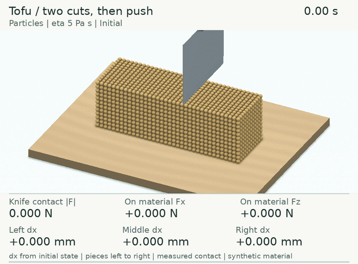</a></td></tr>
<tr><th>Banana: three cuts → four pieces · surface</th><th>Banana: three cuts → four pieces · particles</th></tr>
<tr><td></td><td><a href="https://huangkiki.github.io/Dexlab/en/latest/cut-push.html">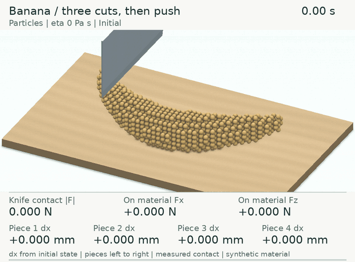</a></td></tr>
</table>

Force and displacement come from saved simulation states; no direct material velocity increment. Tofu uses Newtonian viscosity η=5 Pa·s at 0.125 ms; banana retains η=0 at 0.25 ms. Matched viscosity results, jitter and costs are on the validation page. Synthetic materials, without real-food calibration.

Banana surface seams, frame measurements and complete-task scoring now share the recorded blade path: each straight seam and scored region is generated from the actual cutting phase instead of preset −30/0/+30 mm locations. A path that sweeps laterally by more than half a material spacing is rejected as a single-plane replay. This remains a planar approximation, not the paper's Hermite/local dual-contouring reconstruction. Incomplete resource probes use only their manifest-declared planned planes for failed-run diagnostics and cannot qualify the complete task.

The paper's banana values are now available as a **separate material mode**: E=0.4 MPa, ν=0.45, ρ=1,100 kg/m³, 30 kPa yield stress, 0.1 kg knife, friction 0.2, Gc=700 J/m² and sharpness 0.9. The paper omits the exact von Mises projection; DexLab independently chooses a perfect-J2 radial return in principal logarithmic strain and verifies loading, unloading, rigid rotation, volume and dissipation analytically. The [frozen material protocol](demos/banana-force/material-protocol.json) qualifies only this constitutive implementation. The single-cut force run, 20 samplings and 64×-particle refinement have not run, and the GIFs above remain the original synthetic records.

**One recording, two views:** each frame shows contact force |F|, Fx and Fz (N), plus Δx (mm) for every piece. At the same timestep over 5.4–6.0 s, changing tofu viscosity from η=0 to 5 Pa·s lowers the particle jitter metric from **0.0323 to 0.0140 mm** and centroid x peak-to-peak motion from **0.0711 to 0.0384 mm**. Residual motion remains; playback is not smoothed.

[▶ Surface / particle videos, contact force and complete validation](https://huangkiki.github.io/Dexlab/en/latest/cut-push.html)

## Do cut pieces stay independent?

The following is the historical v0.66.0 two-cut baseline, recorded separately from the new continuous side push above. Its values correspond to these three videos.

<table><tr><th>BladeMaster</th><th>CRESSim-MPM</th><th>DexLab</th></tr><tr><td> Author reference video</td><td> Author reference video</td><td> DexLab tofu · knife push and measurements</td></tr></table>

**Numerical comparison of the three methods**

| Measurement event and quantity | BladeMaster¹ | CRESSim-MPM¹ | DexLab² |
| --- | ---: | ---: | ---: |
| First cut at half depth: mean opening (mm) | 0.654 | 4.059 | 0.496 (0.82 s) |
| Both cuts withdrawn: middle-piece contraction (%) | 0.506 | 8.746 | 2.509 (4.00 s) |
| After knife-face push: left x displacement (mm) | Different input | Different input | -11.128 |
| Same window: middle / right x displacement (mm) | Different input | Different input | -0.038 / -0.015 |
| Push phase: net leftward contact impulse (N·s) | Different input | Different input | 0.105801 |

**Different final inputs:** author clips initialize left-piece velocity; DexLab now pushes through native knife contact with no direct material velocity increment. The first two cutting metrics remain side by side; the last three rows describe only DexLab’s knife-push phase, not a matched-input comparison.

¹ Values reported by the [BladeMaster project / paper Fig. 5](https://jango6324.github.io/blademaster/#comparison), including its CRESSim-MPM comparison. ² [DexLab event measurements from saved states](demos/tofu-knife-push/evidence.json): 5 mm grid, 0.25 ms timestep and 0.5 mm blade; displacements cover 4.00–7.00 s; contact impulse is integrated over 4.00–6.60 s. The half-depth event occurs at 0.82375 s; the table uses the nearest saved frame, 0.82 s. Openings use affine material faces and volumes use interior middle-piece tetrahedra; contraction is the negative relative volume change (-ΔV/V₀). These are **reported / measured values side by side**. Complete author settings and sampling remain [unmatched](https://github.com/huangkiki/Dexlab/issues/200), so the table does not establish a controlled accuracy ranking.

The first two clips are the BladeMaster authors’ comparison. The third is DexLab’s two-cut tofu experiment. All three cut a soft block twice; final inputs differ and complete author configurations remain unmatched, so no controlled performance ranking is implied. [→ Three-column playback and protocol](https://huangkiki.github.io/Dexlab/en/latest/cutting-comparison.html) · [BladeMaster](https://jango6324.github.io/blademaster/#comparison) · [CRESSim-MPM](https://arxiv.org/abs/2502.18437)

The GIF displays cut openings, middle-volume change, knife contact force and post-cut displacement at each recorded frame. Negative x force indicates a leftward push. [Measurement definitions and paper audit](https://huangkiki.github.io/Dexlab/en/latest/cutting-fidelity.html).

## Cross scoring: two incisions, one connected base

The blade makes a shallow incision, withdraws, then turns 90° for a second stroke. The replay shows blade depth, both openings and connected-component count.

<table><tr><th>Material surface (elastic recoil)</th><th>Native cut histories (colour)</th></tr><tr><td></td><td></td></tr></table>

The elastic surface nearly recloses after withdrawal; particle colours show both recorded cut histories, while the uncut lower bridge stays cream.

[Surface/particle videos, measurements and reproduction](https://huangkiki.github.io/Dexlab/en/latest/tofu-scoring.html)

<!-- visual-research:start -->
## What experiments have we run?

| Experiment / figure | Comparisons and findings |
| --- | --- |
| <a href="https://huangkiki.github.io/Dexlab/en/latest/cut-push.html">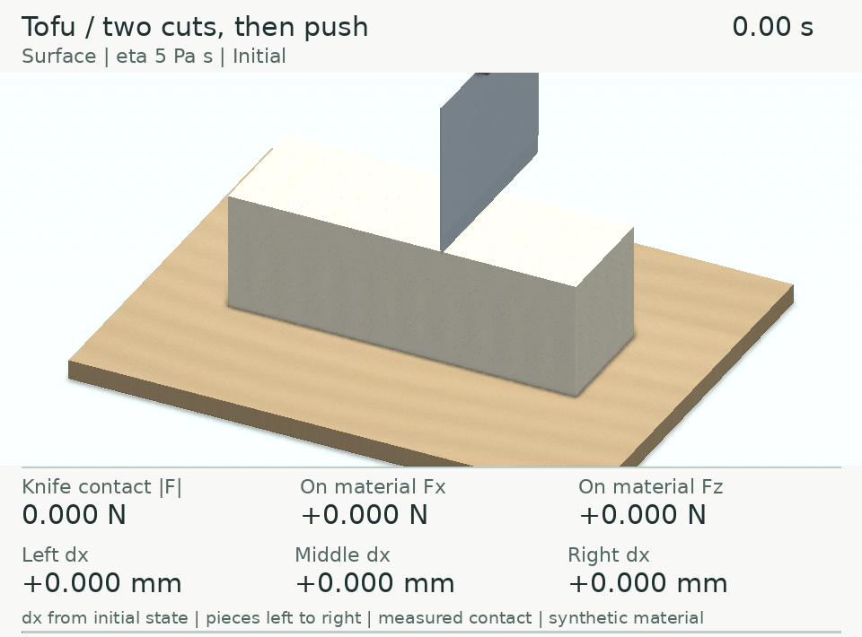</a> | **[Final cut directly into a side push: tofu and banana](https://huangkiki.github.io/Dexlab/en/latest/cut-push.html)** CPU TLMPM / measured knife contact Does visible blade-face contact drive the final piece apart? Three tofu pieces and four banana pieces; the final cut transitions directly to a face push, displaying contact force and motion. Tofu adds Newtonian viscosity with retained elastic, half-step and no-push controls. |
| <a href="https://huangkiki.github.io/Dexlab/en/latest/cutting.html">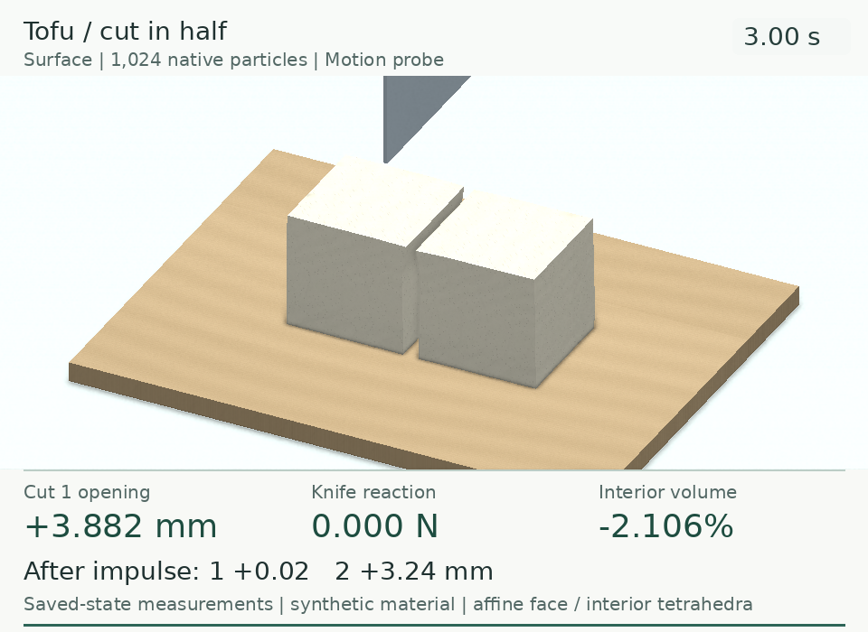</a> | **[Historical: Synthetic tofu halving](https://huangkiki.github.io/Dexlab/en/latest/cutting.html)** CPU TLMPM / BladeMaster v2 reference Do the two cut pieces move independently after withdrawal? Three full-cut cases yield 50% mass pieces; negative controls stay connected. Force convergence and real-tofu calibration are unproven. |
| <a href="https://huangkiki.github.io/Dexlab/en/latest/cutting-comparison.html">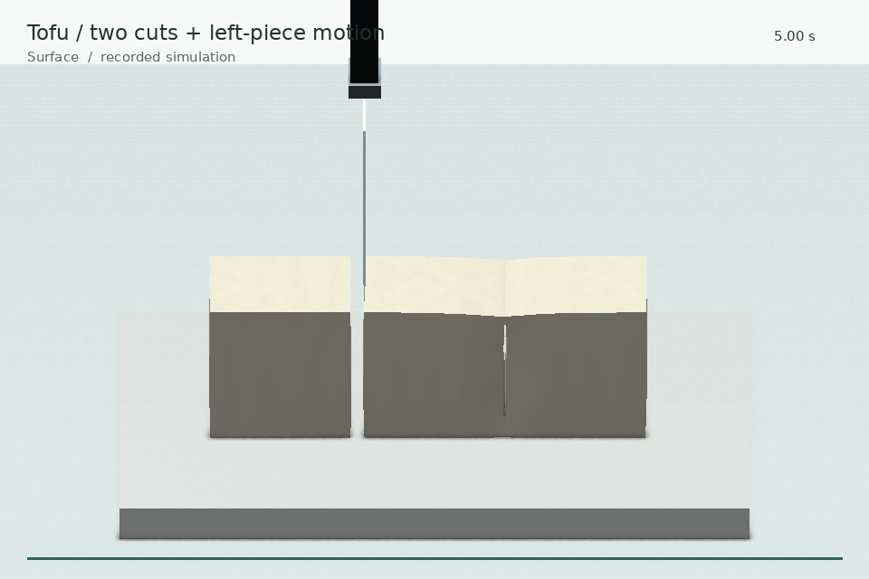</a> | **[Historical: Two tofu cuts: three-method view](https://huangkiki.github.io/Dexlab/en/latest/cutting-comparison.html)** CPU TLMPM / author reference videos Can the left piece move independently after two cuts? Two cuts form three pieces; native knife contact pushes the left piece, with measured force and displacement. Author clips use a final velocity input, so inputs differ. |
| <a href="https://huangkiki.github.io/Dexlab/en/latest/tofu-scoring.html">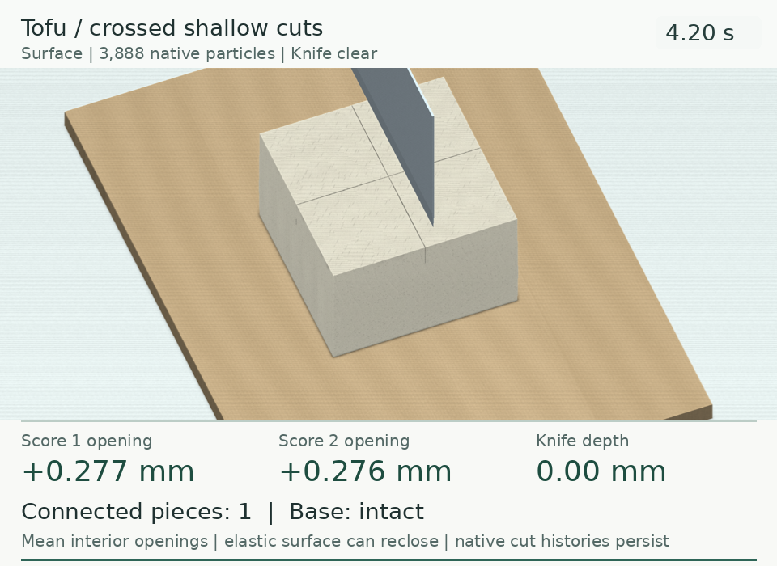</a> | **[Crossed shallow tofu cuts](https://huangkiki.github.io/Dexlab/en/latest/tofu-scoring.html)** CPU TLMPM / guided orthogonal scoring Does the lower bridge remain connected after crossing incisions? Default and half-step cases form two shallow cuts while retaining one native component; the uncut control is rejected. Synthetic material, not food calibration. |
| <a href="https://huangkiki.github.io/Dexlab/en/latest/banana-cutting.html">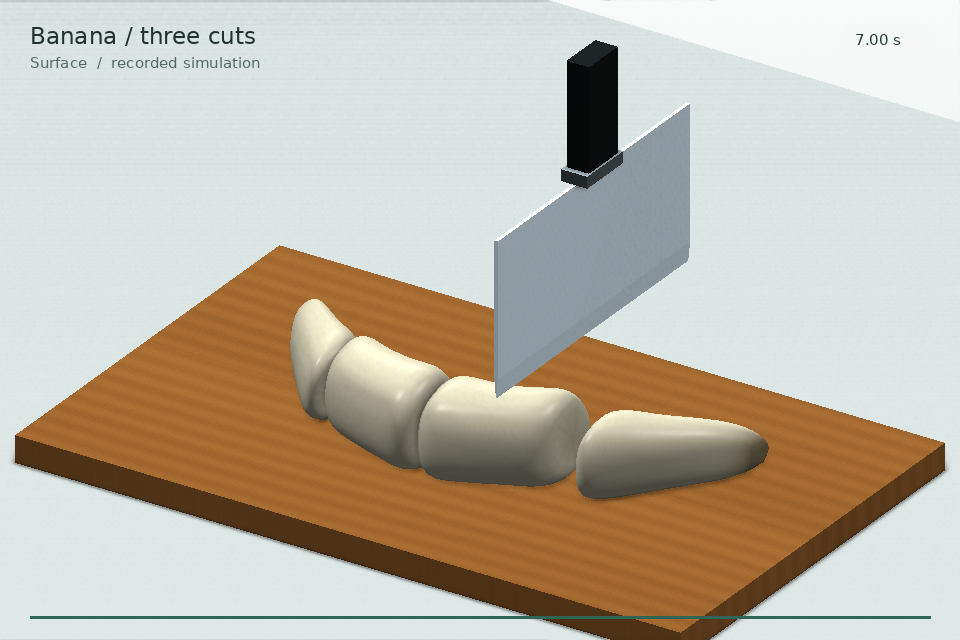</a> | **[Historical: Three sequential banana cuts](https://huangkiki.github.io/Dexlab/en/latest/banana-cutting.html)** CPU TLMPM / persistent cut history Do subsequent cuts preserve earlier discontinuities? Progressive separation and complete controls in the experiment record. Surface/particles share physical states; no real-banana calibration. |
|  | **[Native LIBERO: diagnosis and change](https://huangkiki.github.io/Dexlab/en/latest/libero-workflow.html)** LIBERO / robosuite 1.4.0 / MuJoCo 2.3.7 · Newton / elliptic How can an existing benchmark expose and validate a change? Stale observations identified; timestep trials retain successes, failures and regressions. |
| <a href="https://huangkiki.github.io/Dexlab/en/latest/experience.html#normal-response">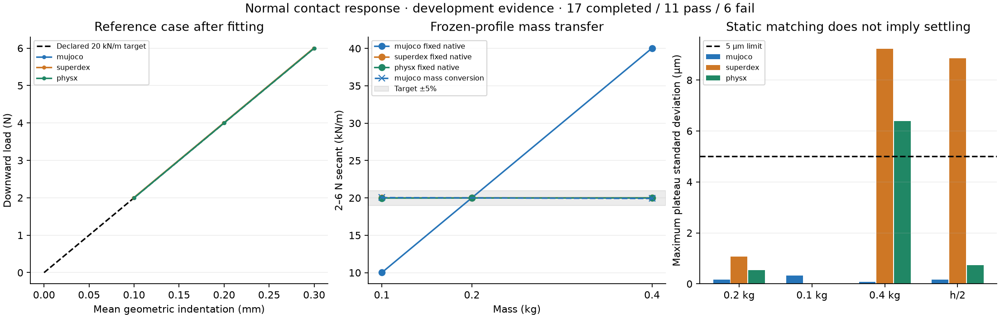</a> | **[Normal & transient response](https://huangkiki.github.io/Dexlab/en/latest/experience.html#normal-response)** MuJoCo · SuperDex · historical PhysX How do parameters change loading, unloading and transients? Static calibration works; dynamics and mass transfer need separate checks. |
| <a href="https://huangkiki.github.io/Dexlab/en/latest/visual-comparisons.html#incline">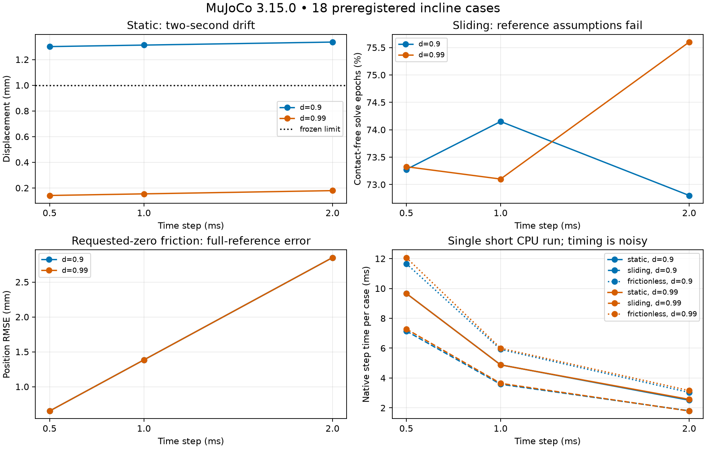</a> | **[Six-engine incline & friction](https://huangkiki.github.io/Dexlab/en/latest/visual-comparisons.html#incline)** MuJoCo · SuperDex · Genesis · Newton Physics · PhysX · Drake Where do static, sliding and low-friction cases differ? Fixed-profile outcomes and observation validity are separate; failures remain. |
| <a href="https://huangkiki.github.io/Dexlab/en/latest/results.html">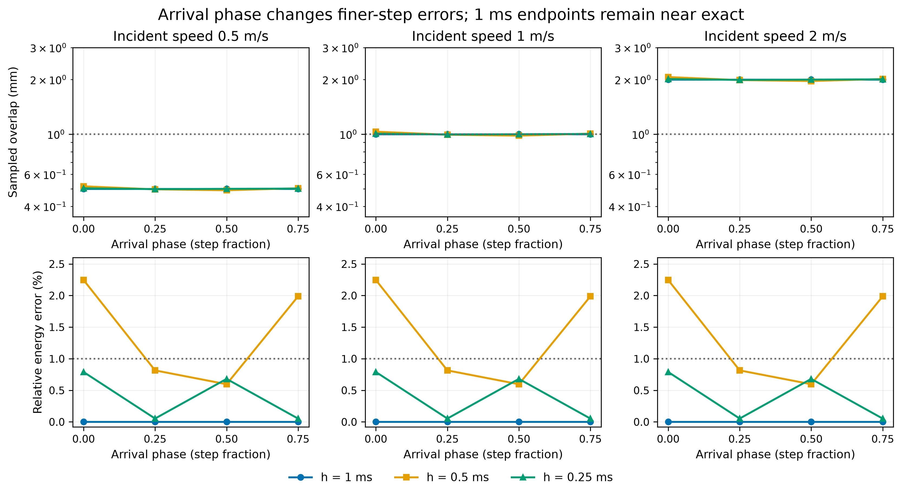</a> | **[Impact & contact onset](https://huangkiki.github.io/Dexlab/en/latest/results.html)** MuJoCo · SuperDex How do timestep, stiffness and impact phase affect transients? Existing phase/stiffness sweeps; smaller steps do not automatically remove model differences. |
| <a href="https://huangkiki.github.io/Dexlab/en/latest/visual-comparisons.html#pinch">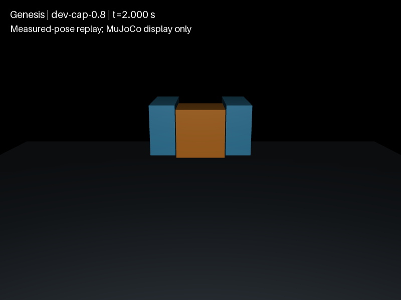</a> | **[Fixture pinch, lift & release](https://huangkiki.github.io/Dexlab/en/latest/visual-comparisons.html#pinch)** Genesis · MuJoCo · SuperDex (separate protocols) Why does the grasp hold or slip? Genesis 0.4 N and 0.8 N configurations have different retention outcomes. |
| <a href="https://huangkiki.github.io/Dexlab/en/latest/experiments.html#apple-replays">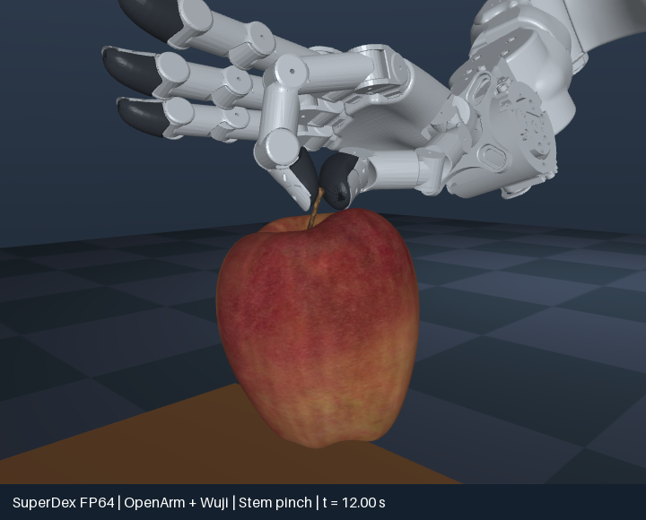</a> | **[Apple-stem grasp · SDF contact](https://huangkiki.github.io/Dexlab/en/latest/experiments.html#apple-replays)** MuJoCo · SuperDex · historical PhysX Can a grasp maintain contact on complex geometry? Native continuous replays and historical independent checks; cohorts stay separate. |
| <a href="https://huangkiki.github.io/Dexlab/en/latest/coverage.html">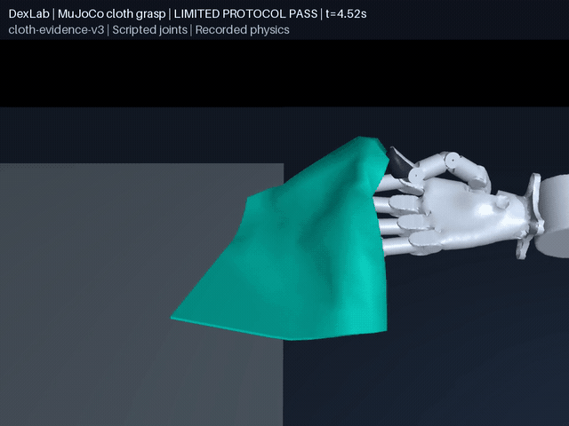</a> | **[Cloth mechanics & robot grasp](https://huangkiki.github.io/Dexlab/en/latest/coverage.html)** MuJoCo · SuperDex · Newton Physics · Genesis · historical PhysX When do deformation, contact and retention fail? Historical compliant-grasp frame; mechanics, drop and grasp retain separate protocols and failures. |
| <a href="https://huangkiki.github.io/Dexlab/en/latest/experience.html#mass-size-transfer">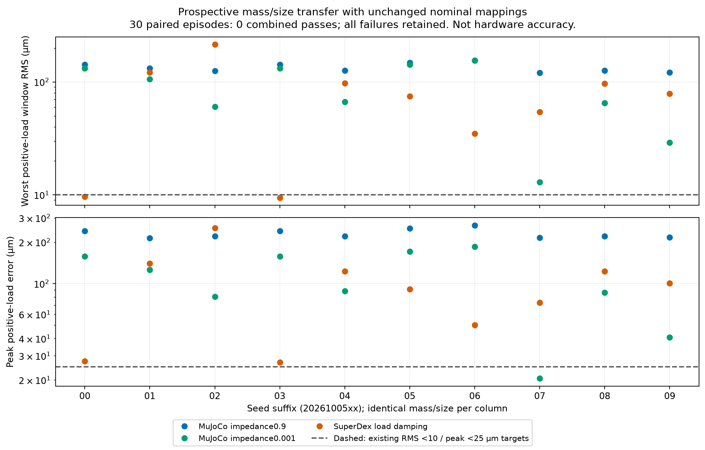</a> | **[Mass / size transfer](https://huangkiki.github.io/Dexlab/en/latest/experience.html#mass-size-transfer)** MuJoCo · SuperDex Do fixed parameters transfer to nearby scenes? 30 historical transfer records, 0/30 joint passes; failures guide selection. |
| <a href="https://huangkiki.github.io/Dexlab/en/latest/experience.html#transient-cost">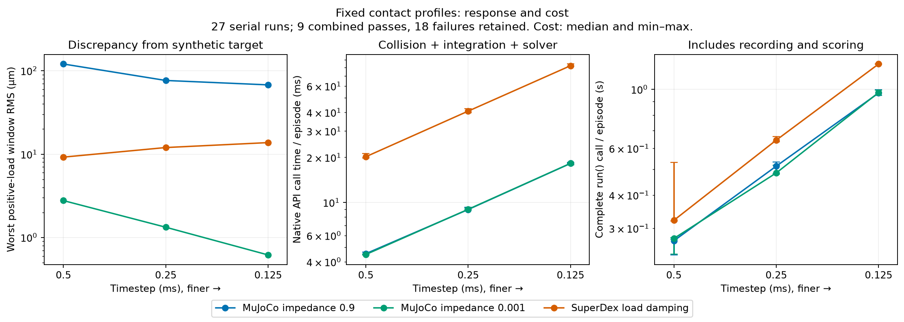</a> | **[Response error & cost](https://huangkiki.github.io/Dexlab/en/latest/experience.html#transient-cost)** MuJoCo · SuperDex What does lower error cost? 27 records separate native computation, recording and scoring costs. |
| <a href="https://huangkiki.github.io/Dexlab/en/latest/experience.html#framework-path">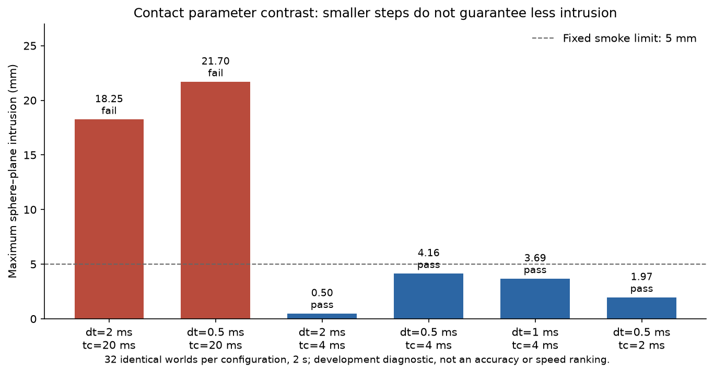</a> | **[Native & framework paths](https://huangkiki.github.io/Dexlab/en/latest/experience.html#framework-path)** MuJoCo / MJWarp · Newton / Isaac Sim Why can matching cores still produce different trajectories? GPU field differences remain after CPU alignment; parameter-map thumbnail is not trajectory evidence. |

**Pending / incomplete:** pushing, in-hand rotation, active folding and broader grasp transfer remain in their existing Issues. Folded drop is not active folding; repeats, timestep sweeps and framework switches do not add task types.

## What we already know

### Six-engine incline: shared conditions, different responses

A 40 mm, 64 g cube; static, sliding and nominal-zero-friction conditions at three timesteps. Curves and replays retain the original passes, failures and invalid records.

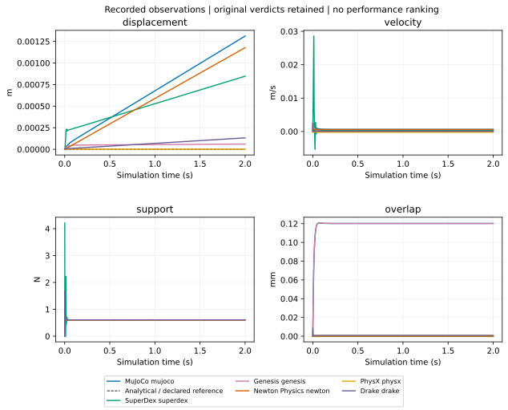

[Synchronized replay, full-rate curves, parameters and original evidence](https://huangkiki.github.io/Dexlab/en/latest/visual-comparisons.html#incline)

### Normal response: change parameters or the solver?

The same MuJoCo fixture moves from about 80 kN/m toward the synthetic 20 kN/m target. Inspect loaded-window indentation, then the complete unloading trace; success belongs to the stated checks and conditions.

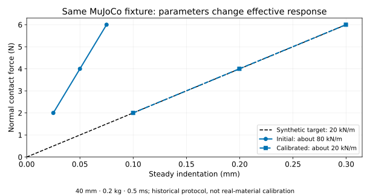

[Synchronized replay, full-rate curves, parameters and original evidence](https://huangkiki.github.io/Dexlab/en/latest/visual-comparisons.html#normal)

### Pinch: 0.4 N slips, 0.8 N holds

The same Genesis fixture and object, changing the finger-joint force limit. Compare complete closing, lifting, holding and release, with an open-gripper negative control retained.

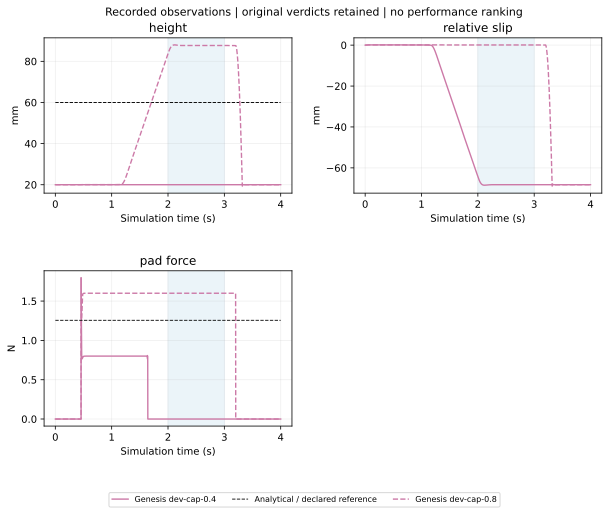

[Synchronized replay, full-rate curves, parameters and original evidence](https://huangkiki.github.io/Dexlab/en/latest/visual-comparisons.html#pinch)

### LIBERO: native task, timestep control and observation fix

Same actions, initial state, Panda and native success; original 2 ms versus unqualified 1 ms control. Heldout task success stays 10/10, screens change from 5/10 to 3/10, and cost doubles. Policy effects of observation refresh remain unverified.

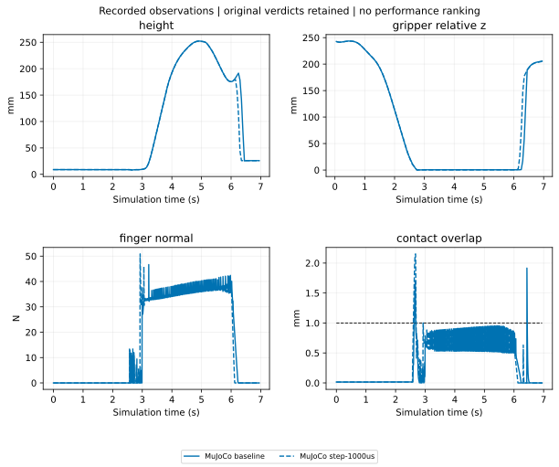

[Synchronized replay, full-rate curves, parameters and original evidence](https://huangkiki.github.io/Dexlab/en/latest/visual-comparisons.html#libero)

## Which engines and solvers are compared?

| Engine | Roles in registered profiles (not peer algorithms) | Experiment versions and paths |
| --- | --- | --- |
| **MuJoCo** | Constraint method: CG (nonlinear) · Newton · PGS Friction cone: elliptic · pyramidal Integration: Euler · implicitfast Unresolved role/identity: SolverMuJoCo; algorithm unqualified | 3.11.0, 3.14.0, 3.15.0; native / historical paths in matrix |
| **SuperDex** | Deformable implementation: experimental-shell Outer nonlinear: BFGS · Newton · SR1 Inner linear: ASYNC_CG · AUGMENTED_CG · CG · CUDA_CG · CUDA_GMRES · EXPERIMENTAL_CUDA_SPARSE_CHOLESKY · EXPERIMENTAL_CUDA_SPARSE_LDLT · EXPERIMENTAL_CUDA_SPARSE_LU · GMRES · LDLT · LU · MINRES · PARALLEL_CG Linear selection: AUTO Friction regularization/model: C1_REGULARIZED · CINF_REGULARIZED Precision in label: FP64 | 1.0.0; native / historical paths in matrix |
| **Genesis** | Deformable implementation: PBD Constraint method: CG (nonlinear) · Newton Friction cone: elliptic · pyramidal Contact model: Signorini · convex Coupling path: rigid coupling Integration: approximate_implicitfast | 1.4.3; native / historical paths in matrix |
| **Newton Physics** | Implementation/system: Featherstone · Kamino · SemiImplicit · VBD · VBD compliant · VBD legacy · XPBD Deformable implementation: ImplicitMPM · Style3D Dynamics backend: DVI · PADMM Integration: Euler Update/budget options: 100 sweeps | 1.6.1 / Warp 1.18.0, 1.7.0.dev0 @ 2dee3234; native / historical paths in matrix |
| **PhysX** | Deformable implementation: surface cloth Constraint method: PGS · TGS Friction regularization/model: patch friction Update/budget options: external forces every iteration · friction every iteration Unresolved role/identity: historical readback incomplete (#126) · pending qualification | 5.9.0; native / historical paths in matrix |
| **Drake** | Constraint method: SAP Contact model: hydroelastic · point Discrete contact approximation: kLagged · kSap · kSimilar Unresolved role/identity: not qualified | 1.57.0; native / historical paths in matrix |

Native and framework **MJWarp** are separate paths with their actual core identified. Newton Physics is an engine project; Newton is also an algorithm name. Tested SuperDex BFGS/SR1 with assembly period=1 execute Newton-equivalent steps; configuration names are not independent algorithm counts.

This is a research inventory including failures and unqualified entries. Execution, CPU/GPU, precision, full profiles and unsupported reasons:  [完整矩阵 / Full matrix](https://huangkiki.github.io/Dexlab/en/latest/coverage.html)。

Roles interpret recorded names within each engine, not identical mathematical problems or evidence that every combination ran. AUTO is a selection policy; missing identities are not filled from defaults.

**Comparison boundary:** distinguish system-profile selection from controlled algorithm attribution. Read record integrity, numerical consistency, physical references and task outcomes separately; original scores and failure denominators are unchanged. [Roles and evidence guide](docs/solver-taxonomy.md)。

Thin-feature SDF geometry/response qualification remains [#178](https://github.com/huangkiki/Dexlab/issues/178); cloth material, collision/coupling and grasp baselines remain [#179](https://github.com/huangkiki/Dexlab/issues/179). Existing development passes are not calibrated cross-engine material comparisons.

**MJWarp path comparison (MuJoCo core)**

| Runtime path | Actual physics core | Solver / contact path | Task acceptance |
| --- | --- | --- | --- |
| Isaac Sim6.1.0 local tag build / Newton1.5.0 / vendor Warp1.16.0 | MuJoCo 3.11.0 | MJWarp Newton / pyramidal / Newton contacts | [not-run](https://huangkiki.github.io/Dexlab/en/latest/coverage.html) |
| Isaac Sim6.1.0 local tag build / Newton1.5.0 / vendor Warp1.16.0 | MuJoCo 3.11.0 | MJWarp Newton / pyramidal / MJWarp contacts | [not-run](https://huangkiki.github.io/Dexlab/en/latest/coverage.html) |
| Native matched core / vendor Warp1.16.0; original and four-field aligned | MuJoCo 3.11.0 | MJWarp Newton / pyramidal / MJWarp contacts | [not-run](https://huangkiki.github.io/Dexlab/en/latest/coverage.html) |

Model/clock diagnostics already exist; task acceptance retains the matrix state. [Path differences #152](https://github.com/huangkiki/Dexlab/issues/152) remain a separate research question.

<!-- visual-research:end -->

MuJoCo 3.16.0's [isolated qualification record](docs/engine-qualification.md) verifies the official environment, native compatibility and complete 2-second cloth settling trace; the first sampled midsurface intrusion is 0.049681 mm, with material and grasp still unqualified. Complete task admission is tracked separately in [#202](https://github.com/huangkiki/Dexlab/issues/202). Historical results retain their versions, and LIBERO keeps its separately qualified 2.3.7 path.

LIBERO offline scorer v2 checks per-contact distances, target identity and summary overlap for consistency; refreshed local hashes cannot make contradictory records valid. Original evidence and diagnostic thresholds remain unchanged. [Scoring fix and regression](https://huangkiki.github.io/Dexlab/en/latest/libero-workflow.html#scoring-integrity) · [#183](https://github.com/huangkiki/Dexlab/issues/183)

All ten LIBERO Object tasks and 500 official demonstrations have valid records (403 development, 97 predetermined validation): 495 native successes, 5 retained failures, and 0 records passing every numerical diagnostic. Physical references, source history, visual-policy evaluation and full 130-task coverage remain open. [Results and evidence boundaries](https://huangkiki.github.io/Dexlab/en/latest/libero-workflow.html) · [#181](https://github.com/huangkiki/Dexlab/issues/181)

## How do solvers synchronize, and what does preCICE do?

Imagine one solver computing **finger motion** and another computing **sponge deformation**. Both must cover simulation time **0–10 ms** in this round: the finger runs first and takes 1 ms of computer time; the sponge then takes 100 ms. These are teaching assumptions, not engine benchmarks.

| Elapsed computer time | Finger's computed simulation time | Sponge's computed simulation time |
| --- | --- | --- |
| 0 ms | 0 ms | 0 ms |
| 1 ms | 10 ms, waiting | 0 ms |
| 101 ms | 10 ms | 10 ms |

**The user waits 101 ms, but the simulated world advances only 10 ms.** Taking a minute to generate one second of animation does not add 59 seconds to the animation. Offline, with the controller following simulation time, this waiting mainly reduces throughput; hardware control has additional real-time deadlines.

Internal steps may differ: the finger takes ten 1 ms steps, the sponge takes two 5 ms steps, and both meet at simulation time 10 ms. **Ten internal finger steps do not mean ten fresh sponge-force updates.** Computer time, internal integration steps and coupling exchange intervals are different quantities. [Aligning different step sizes](https://precice.org/couple-your-code-time-step-sizes)

Even when their times align, ask: **which sponge force did the finger use to compute that motion?**

- **Compute once and advance (one explicit coupling arrangement):** the finger reaches 10 ms using the old reaction force; the sponge computes a new force from that motion; the finger uses it in the next round. Errors from stale forces can remain even if computation is instantaneous.
- **Correct the same interval repeatedly (implicit coupling):** the sponge returns a new force, the finger recomputes 0–10 ms, and the sponge updates again until the exchanged results meet convergence requirements. Every correction concerns the same interval; it must not add another 10 ms to simulation time. Failure to converge is not a valid converged result.

Running solvers sequentially or simultaneously is separate from deciding whether to repeat an interval. Shorter exchange intervals and additional corrections may improve the interaction at a cost in computation or communication; smaller internal steps in one solver do not automatically refresh feedback from the other. [Coupling schemes](https://precice.org/configuration-coupling)

**preCICE is an open-source multiphysics coupling library—a coordinator between solvers.** Once connected, it coordinates time, communicates data, maps data between different meshes and organizes iterative corrections as configured. For water hitting a flexible plate, a fluid program computes pressure and a structural program computes deformation; preCICE coordinates their exchange. The solvers and their integration still determine the physical equations, contact and friction. [Official introduction](https://precice.org/docs.html)

For grasping, old forces may remain close to current forces when contact changes slowly; rolling, slipping and finger changes need timely, complete feedback. Slow computation alone does not establish that in-hand manipulation is impossible, and successful holding does not establish reliable finger changes. preCICE is a methodological reference here: connecting MuJoCo, SuperDex or other engines still requires adapters and validation. This primer does not establish a DexLab preCICE integration or imply that RSS uses it. [RSS coupling source analysis and discussion](https://github.com/huangkiki/Dexlab/discussions/220#discussioncomment-19056253)

## How to diagnose a poorly performing scene

For an abnormal contact, declare the physical reference and assumptions, then check geometry, mass/inertia, frames, control epochs, effective parameters and contact readbacks. Fix the scene and objective, propose a testable hypothesis, run bounded parameter trials and independently score improvements and costs. Study the remaining differences through contact generation, friction representation, constraints, stopping rules, integration and precision.

One PhysX case exposed incorrect negative-control mass caused by the order of inertia initialization and collision disabling. Correcting the integration left other numerical residuals unresolved. Record configuration improvements, integration fixes, algorithm research directions and open questions separately. [Diagnosis method and commands](docs/site/en/diagnosis.md)

**AI parameter exploration is a research method.** AI uses prior experience to propose hypotheses and candidates; existing execution, accounting and independent scoring retain every attempt, failure, effective configuration and cost. An unsuccessful finite search establishes only that its tested range did not succeed. Freeze new transfer conditions beforehand; historical logs cannot become new holdouts.

## How to choose for a new scene

Describe contact scale and load, sticking/sliding, contact switches, geometry and compliance, then find nearby experiments. Every starting candidate states version/path, parameter sources, errors and failure boundaries, plus the first checks required in your scene.

| Main difficulty | Starting evidence |
| --- | --- |
| Normal compliance, loading/unloading or transients | [Normal/transient experience](docs/site/en/selection.md): check the synthetic target and contact law, then mass/size transfer. |
| Support, incline sliding or low friction | [Six-engine inclines](https://huangkiki.github.io/Dexlab/en/latest/experience.html#six-engine-incline): validate observations before comparing nearby configurations. |
| Finite-pad pinch, lift and release | [Pinch and SDF starting points](docs/site/en/selection.md): check drives, inertia, slip and negative controls. |
| Framework changes or asset import | [Native/framework comparison](https://huangkiki.github.io/Dexlab/en/latest/experience.html#framework-path): inspect conversion, effective parameters and epochs. |

Recommendations depend on evidence relevant to the target scene, considering **physical credibility, stability and cost** together. Broader validated coverage extends known scope; the coverage table alone does not choose the best solution for a new scene.

## Research scope and reproduction

| Existing scope | Evidence |
| --- | --- |
| Six-engine basic contact/inclines and applicable solvers; collision, fixture pinch and robot grasp | [Full configuration matrix and protocol states](docs/site/en/coverage.md) |
| Cloth mechanics, folded drop and robot cloth grasp | [Historical protocols and failures](docs/site/en/coverage.md); folded drop is not successful active folding. |
| Pushing, in-hand rotation and grasp extensions | [Research roadmap](docs/site/en/dexterity.md); not run, blocked and unsupported remain distinct. |

The matrix preserves core, solver, runtime path, version, passed/partial/failed/not-run/blocked/unsupported states and evidence. Repetitions, step scans and framework changes do not add task types; historical protocols are not pooled. New coverage-v1 reliability is not yet admitted; historical capabilities retain their original scope.

[Installation and reproduction](docs/installation.md) · [All reports](docs/site/en/results.md) · [Raw data and releases](https://github.com/huangkiki/Dexlab/releases) · [Research Project](https://github.com/users/huangkiki/projects/4)

This round reuses evidence and fills concrete diagnosis gaps before transfer to pinch/grasp. The six-engine matrix and 594-episode pinch study remain. **Scheduled development stays paused.** [Development and acceptance](docs/autoresearch.md)

[Current work and pause state](docs/current-work.md)

**Read related work:** [External references](docs/references/README.md) · [Manda Robotics engine-comparison guide](docs/references/manda-physics-engines.md). External findings are distinct from DexLab experiments.
