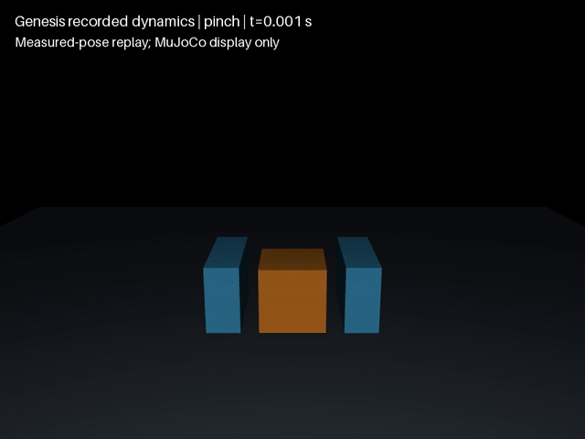

# DexLab

**A failure-attribution bench for contact simulation.**

DexLab separates a robot's "why did it fail to grasp or start slipping?" and "why is this collision response wrong?" result into five layers: geometry and input, control, contact model, solver, and scoring/recording. It uses frozen conditions, native readback, independent scoring, negative controls, and downloadable raw records to find the **first failing layer** instead of guessing which engine is better from one successful video.

[简体中文](README.md) · [Live Lab](https://huangkiki.github.io/Dexlab/en/latest/index.html#live-lab) · [Full experiment index](https://huangkiki.github.io/Dexlab/en/latest/experiments.html) · [Reports](https://huangkiki.github.io/Dexlab/en/latest/results.html) · [Quickstart](#quickstart)

## Start with one complete case


[Wuji sphere pinch](https://huangkiki.github.io/Dexlab/en/latest/wuji-contact.html): under the same control and commands, changing point contact to synthetic torsional contact reduces two-second hold displacement from **2.734 mm to 1.025 mm**, passing the original 2 mm limit. The record can be rescored offline; this shows that the contact term changed in this fixture, **not solver failure or hardware validation**.

## Research depth is more than a replay

These four studies answer different questions. Their denominators, profiles, and references differ, so they cannot be merged into one success rate or engine leaderboard.

| Question studied | Frozen experiment | Key measured result | What it does not establish |
| --- | --- | --- | --- |
| **What changes when the solver profile changes on the same physical problem?** | 40 mm, 64 g cube; 15° static friction, 35° sliding, nominal zero friction; 0.5/1/2 ms. [Paired incline study](https://huangkiki.github.io/Dexlab/en/latest/results.html) | MuJoCo 3.15.0 `Newton / Euler / elliptic` drifts **1.301–1.336 mm** in the static case, passing 0/3; SuperDex 1.0.0 FP64 drifts **0.708–1.132 mm**, passing 2/3. MuJoCo's sliding cases also rotate and lose contact substantially. | A difference between fixed baselines is not a universal engine ranking; a historical MuJoCo `impedance=0.99` profile drifted less. |
| **Does a smaller timestep or tighter tolerance automatically fix it?** | 16 contact-onset timestep runs plus 12 independent tolerance controls. [Contact-onset refinement](https://github.com/huangkiki/Dexlab/blob/main/demos/contact-benchmark/REFINEMENT.md) | After SuperDex's stopping tolerance was tightened, the frictional `0.5 vs 0.125 ms` position difference remained about **3.206 mm**. Refinement is not automatically ground truth; timestep, tolerance, and physical model must be separated. | A finer grid is not a truth reference, and `CONVERGED` alone does not establish cross-timestep convergence. |
| **Can one passing scene be transferred directly?** | Three fixed profiles × ten mass/size conditions, 30 paired runs. [Transfer report](https://github.com/huangkiki/Dexlab/blob/main/demos/contact-benchmark/TRANSFER.md) | Engineering checks pass **1/30**; transient targets pass **0/30**; the joint target passes **0/30**. Every failure remains. | This does not show that every mapping is impossible or that one engine algorithm is wrong. It shows that these fixed parameters did not transfer. |
| **How does numerical diagnosis connect back to robot contact?** | Wuji grasp, hold, unload, and synthetic torsional-contact controls. [Full protocol and evidence](https://github.com/huangkiki/Dexlab/blob/main/docs/site/en/wuji-contact.md) | The point-to-synthetic-torsional change reduces two-second hold displacement from **2.734 to 1.025 mm**; scoring also retains the slow-drift condition. | A grasp pass is not completed in-hand manipulation, and it is not measured pad-material calibration. |


## How a conclusion is established

DexLab distinguishes "it runs," "the numbers are consistent," "the physical reference applies," "the task passes," and "the attribution is credible." Competitive explanations are excluded in this order:

1. **Freeze the problem.** Declare the physical reference, geometry, mass/inertia, initial state, control epochs, metrics, thresholds, versions, budget, and stop conditions.
2. **Preserve native evidence.** Save actual parameters, states, velocities, contact forces/impulses, solver status, raw records, and source/asset hashes. Missing measurements remain unknown, never zero.
3. **Score independently.** Use analytical relations, force/momentum balance, no-contact/zero-friction/release controls, and injected failures to check both the record and the scorer. Do not trust one final state or one success video.
4. **Run controlled sensitivity studies.** Change timestep, tolerance, load, mass, or contact scale separately. Variables must be isolated before claiming an algorithm difference; changing geometry, controller, and solver together does not do that.
5. **Retain failures and transfer limits.** Publish raw data, failure denominators, cost, unobserved fields, and recovery conditions. A profile's result belongs only to that version, scene, and acceptance rule.

### Do not flatten names into one "algorithm"

| Layer that must remain separate | Examples | Why it cannot be one row |
| --- | --- | --- |
| Time integration | MuJoCo Euler; SuperDex backward Euler | Integration, timestep, and state-update epochs change contact transients. |
| Outer constraint/nonlinear solver | MuJoCo PGS/CG/Newton; SuperDex Newton; PhysX PGS/TGS | PGS, Newton, and TGS are not all at the same mathematical layer; equal iteration counts do not imply equal work. |
| Inner linear solver | SuperDex GMRES/LDLᵀ options | `AUTO` is a selection policy, not evidence of the branch actually executed. |
| Contact and friction model | elliptic/pyramidal cones, C1 regularization, PhysX patch friction | Equal nominal μ does not guarantee equal low-speed response, stick-slip, or combination law. |
| Precision and budget | FP32/FP64, 0.125–2 ms, iteration caps, absolute/relative tolerance | Precision and stopping conditions change the error/cost relation. |
| Runtime path | native engine, MJWarp, Isaac Sim adapters | Importing or converting the same core through different state layouts can still change the effective model. |

Those six layers define the compared profile. See [solver configuration roles](https://huangkiki.github.io/Dexlab/en/latest/solver-taxonomy.html) for source-backed terminology and unknown identities, and the [full matrix](https://huangkiki.github.io/Dexlab/en/latest/coverage.html) for per-profile coverage and failures.

## What can already be run and inspected

This is a representative set. Click an experiment or GIF for frozen parameters, raw evidence, failure records, and reproduction steps. Nothing without a full result is implied to have passed a complete benchmark.

| Experiment | Recorded behavior |
| --- | --- |
| **[RSS wiping](https://huangkiki.github.io/Dexlab/en/latest/rss-wiping.html)**<br>Complete latch-assisted records and a no-latch control are preserved; offline rescoring gives a holding-displacement difference of 0.061/449.981 mm. | <a href="https://huangkiki.github.io/Dexlab/en/latest/rss-wiping.html"></a> |
| **[Contact-fixture diagnostics](https://github.com/huangkiki/Dexlab/blob/main/demos/contact-benchmark/README.md)**<br>Planar sliding, normal loading, cylindrical pinching, release, penetration, momentum, and cost are diagnosed separately; failures remain. | <a href="https://huangkiki.github.io/Dexlab/en/latest/visual-comparisons.html#pinch"></a> |
| **[Cutting and pushing](https://huangkiki.github.io/Dexlab/en/latest/cut-push.html)**<br>Soft-body deformation, blade contact, piece pushing, and surface reconstruction; viscosity, half-step, and no-push controls are retained. | <a href="https://huangkiki.github.io/Dexlab/en/latest/cut-push.html"></a> |
| **[Cloth engines and robot cloth grasp](https://huangkiki.github.io/Dexlab/en/latest/cloth-comparison.html)**<br>Sag, stretch, sphere coverage, folded drop, and robot cloth grasp are evaluated separately; penetration and failures remain. | <a href="https://huangkiki.github.io/Dexlab/en/latest/cloth-comparison.html"></a> |
| **[G1 landing contact](demos/landing-contact/README.md)**<br>A fixed RTX 4090 reference passes support checks and three complete policy repeats; the historical anomaly lacks its original model and remains unattributed. | <a href="demos/landing-contact/README.md"></a> |
| **[AMP lift probe](docs/site/en/amp-lift.md)**<br>The 0.2 s record-parity check failed, so the full lift evaluation did not run; the failed evidence remains. | <a href="docs/site/en/amp-lift.md"></a> |

[Full experiment index](https://huangkiki.github.io/Dexlab/en/latest/experiments.html) · [All results and failures](https://huangkiki.github.io/Dexlab/en/latest/results.html). GIFs show actual simulation or recorded-state replay; results apply only to each report's version, profile, and acceptance rule.

<a id="quickstart"></a>

## Rescore one recorded pair first (no GPU)

The commands below download one matched **latch / no-latch raw pair** and recompute slip and cleaning from particle and ink states. Only [uv](https://docs.astral.sh/uv/getting-started/installation/) is required; the first run needs network access. The evidence archive is about **126 MiB**, expanding to **349 MiB**; allow 2 GB. Rescoring needs no simulator, GPU, or model API key.

```bash
git clone --depth 1 --filter=blob:none --sparse https://github.com/huangkiki/Dexlab.git
cd Dexlab
git sparse-checkout init --cone
git sparse-checkout set scripts demos/rss-wiping
uv run --no-project --isolated --python 3.12 \
  --with-requirements demos/rss-wiping/offline-requirements.txt \
  python scripts/download_assets.py \
  --manifest demos/rss-wiping/evidence-bundle.json \
  --destination downloads/rss-wiping-v1
uv run --offline --no-project --isolated --python 3.12 \
  --with-requirements demos/rss-wiping/offline-requirements.txt \
  python demos/rss-wiping/rescore_bundle.py downloads/rss-wiping-v1 \
  --output results/rss-wiping-v1
```

Open `results/rss-wiping-v1/comparison.png` to inspect the curves. The directory also contains two CSV files and `report.json`. This pair has a maximum holding-patch centroid displacement of **0.061/449.981 mm** and final cleaning of **95.47%/39.92%**. The no-latch `task_pass: false` is a retained experimental failure, not a failed download or rescore.

[Raw data and per-file licensing](https://github.com/huangkiki/Dexlab/releases/tag/rss-wiping-evidence-v1) · [Rescoring scope and failure index](https://huangkiki.github.io/Dexlab/en/latest/rss-wiping.html#offline-evidence)

## To rerun a simulation: apple-stem grasp

After installing dependencies in the checkout above, run the pinned MuJoCo historical baseline. Linux x86_64 and `uv` are required; no model API key is needed. This is a fixed-version historical demo, not a latest-version six-engine comparison environment.

```bash
git sparse-checkout disable
bash scripts/setup.sh --mujoco-profile historical-3.11.0
bash demos/apple-stem-grasp/run.sh --backend mujoco \
  --output demos/apple-stem-grasp/runs/first-mujoco
.venv/bin/python demos/apple-stem-grasp/src/verify_sdf_grasp.py \
  demos/apple-stem-grasp/runs/first-mujoco
```

The viewer shows the stem grasp, lift, and hold; outputs go to `demos/apple-stem-grasp/runs/first-mujoco/`. Add `--headless` without a display. Select SuperDex with `--backend superdex` and a new output directory. An explicit directory must be empty; successful and failed records are never overwritten.

The verifier writes `summary.json`. When every check passes, `passed` is `true`; otherwise individual checks remain and the command exits nonzero. The 14 s field is simulation time; wall time is longer.

[Installation and asset provenance](docs/installation.md) · [Task interface and commands](demos/apple-stem-grasp/README.md)

## When a scene behaves unexpectedly

Check geometry, mass/inertia, control timing, and actual contact readback before changing parameters. Do not sweep solver settings first and then look for a result that explains the failure. See the [diagnostic workflow](https://huangkiki.github.io/Dexlab/en/latest/diagnosis.html) for retained failures, controlled fixes, and next decisions.

## Choosing an engine and profile for a new task

Find nearby experiments by load, contact scale, sticking/sliding, contact transitions, and compliance, then validate candidate profiles. The research covers MuJoCo, SuperDex, Genesis, Newton Physics, PhysX, and Drake, but task coverage, versions, and acceptance differ. Start from [scenario selection](https://huangkiki.github.io/Dexlab/en/latest/selection.html), not from an engine name.

For background, follow the [Sim Learning Physics-Based Simulation route](https://github.com/huangkiki/sim-learning/blob/main/docs/physics-based-simulation.md) and then the [solver guide](https://github.com/huangkiki/sim-learning/tree/main/docs/solver-guide). Course source checks and DexLab experimental qualification are recorded separately.

## Current limits

Success applies only to each experiment's versions, scene, and acceptance rule. Task success, numerical diagnostics, physical references, and real-system accuracy are reported separately. In-hand rotation, active folding, real-material calibration, and broad vision-policy evaluation still need independent validation; grasp, cutting, or cloth replays above do not establish them.

[Research findings](https://huangkiki.github.io/Dexlab/en/latest/experience.html) · [Solver configuration roles](https://huangkiki.github.io/Dexlab/en/latest/solver-taxonomy.html) · [Research directions](https://huangkiki.github.io/Dexlab/en/latest/dexterity.html) · [External references](https://huangkiki.github.io/Dexlab/en/latest/references.html) · [Data and releases](https://github.com/huangkiki/Dexlab/releases)

[Development and acceptance](docs/autoresearch.md) · [Current work and pause state](docs/current-work.md)
