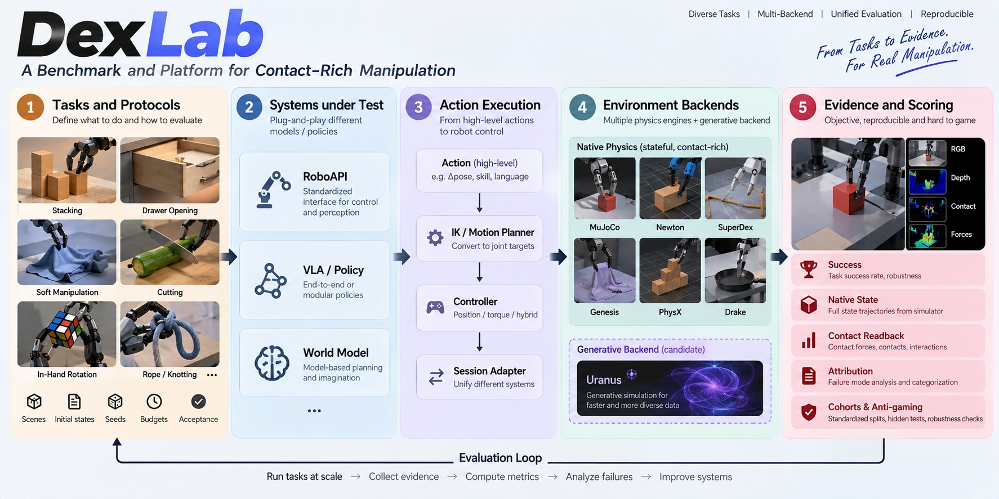
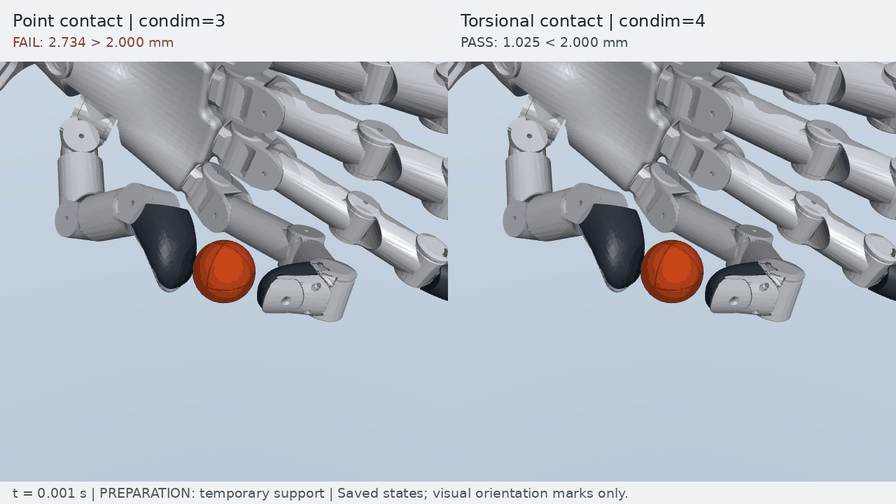
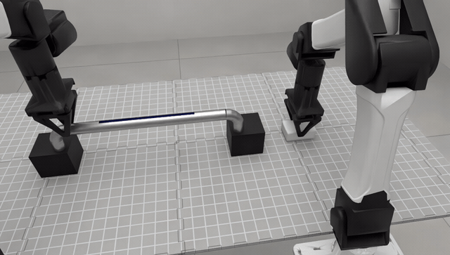
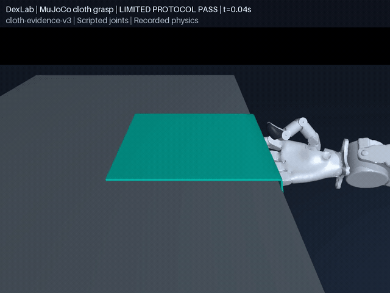
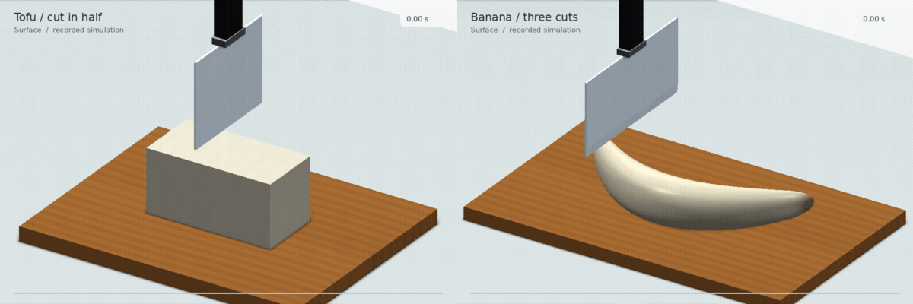

<h1 align="center">DexLab</h1>

<p align="center"><strong>Experiments and Evaluation for Contact-Rich Manipulation</strong></p>

<p align="center">
  <a href="https://huangkiki.github.io/Dexlab/en/latest/">Documentation</a> ·
  <a href="https://huangkiki.github.io/Dexlab/en/latest/index.html#live-lab">Try in browser</a> ·
  <a href="#quickstart">Quick start</a> ·
  <a href="#whats-new">What's new</a> ·
  <a href="README.md">简体中文</a>
</p>

**DexLab is an open-source platform for studying contact-rich robotic manipulation.** Reproduce grasping, wiping, cloth manipulation and cutting experiments, inspect contact and motion, compare physics configurations, and investigate why a task succeeds or fails. Each experiment connects its scene, controller, simulation records and scoring so that results can be checked again.

<a id="architecture"></a>
<p align="center">
  <a href="docs/site/_static/images/dexlab-architecture.jpg">
    
  </a>
</p>

The platform follows a complete manipulation workflow: **define a task → execute actions → simulate → record contact → evaluate**. Scripts, policies and models connect to physical environments through the action-execution layer; task protocols define how outcomes are scored. The illustration includes planned capabilities; see the [coverage matrix](https://huangkiki.github.io/Dexlab/en/latest/coverage.html) for actual task and backend status.

## Experiments

These animations show simulation recordings or recorded-state replays. Click through for experimental conditions, full results and reproduction instructions.

<table>
<tr>
<td width="50%" valign="top">
<a href="https://huangkiki.github.io/Dexlab/en/latest/wuji-contact.html">

</a>
<strong>Grasping: how does contact modeling affect slip?</strong><br>
Under the same control, replacing point contact with synthetic torsional contact reduces two-second hold drift from <strong>2.734 mm</strong> to <strong>1.025 mm</strong>.
</td>
<td width="50%" valign="top">
<a href="https://huangkiki.github.io/Dexlab/en/latest/rss-wiping.html">

</a>
<strong>Wiping: does it still work without assistance?</strong><br>
Assisted retention passes <strong>3/3</strong>; removing assistance gives <strong>0/3</strong>, with final cleaning around <strong>95.47% / 39.92%</strong>.
</td>
</tr>
<tr>
<td width="50%" valign="top">
<a href="https://huangkiki.github.io/Dexlab/en/latest/cloth-comparison.html">

</a>
<strong>Cloth: does grasping lead to a successful fold?</strong><br>
The robot can pinch and move a cloth patch, but complete folding still fails: the current record reaches <strong>12.55%</strong> edge strain against a 5% limit.
</td>
<td width="50%" valign="top">
<a href="https://huangkiki.github.io/Dexlab/en/latest/cut-push.html">

</a>
<strong>Cutting: deformation, separation and contact forces</strong><br>
Continuous cutting and blade-face pushing change the simulated topology; the full report records contact force, material separation, and retained failures beyond the visual replay.
</td>
</tr>
</table>

Results apply to their specific simulation configurations; they do not establish hardware validity or a universal engine ranking. [Browse all experiments →](https://huangkiki.github.io/Dexlab/en/latest/experiments.html)

## Why DexLab?

A failed grasp might need a better policy, different collision geometry, a different friction model or a change in control. **DexLab aims to help researchers decide what to change and determine whether that change actually helps.**

- **Study physics through manipulation tasks.** Investigate why an object slips or a cloth stretches by testing contact models and solver configurations in the task itself.
- **Explain experimental outcomes.** Examine control commands, object motion and native contact records together to locate the first point of failure.
- **Build on reproducible experiments.** Use the scenes, runnable examples, raw records and independent scoring to rerun tasks or rescore downloaded evidence offline.

The long-term goal is to improve simulation and models together: use model failures to expose simulation gaps, then evaluate models in better-tested simulation. Native physics experiments, recording and scoring are available today. RoboAPI session support is implemented; per-task model integration and the public leaderboard are in progress, while [Uranus](https://huangkiki.github.io/Dexlab/en/latest/uranus-backend.html) is a candidate generative backend. [Model-evaluation direction →](https://huangkiki.github.io/Dexlab/en/latest/model-evaluation.html)

<a id="whats-new"></a>
## What's new

- **2026-11-03** — Try [the claw machine in your browser](https://huangkiki.github.io/Dexlab/en/latest/index.html#live-lab): aim, drop, and collect six Nai-family toys.
- **2026-11-03** — Published the [original dexterous simulation review](https://huangkiki.github.io/Dexlab/zh-cn/latest/_static/research/dexterous-simulation.html) with 14 relevant October works and one background reference organized by its six layers.
- **2026-11-02** — Added a [dexterous-hand simulation guide](https://huangkiki.github.io/Dexlab/en/latest/dexterous-hand-simulation.html) and a [topic guide to 35 Newton papers](https://huangkiki.github.io/Dexlab/en/latest/newton-reading-guide.html).
- **2026-10-31** — Released the [RoboAPI session adapter](docs/roboapi-poke.md): model discovery, continuous sessions and action receipts; task mappings remain pending.
- **2026-10-26** — Published the [Wuji sphere-pinch comparison](https://huangkiki.github.io/Dexlab/en/latest/wuji-contact.html), independent scoring and an offline rescore bundle.

<a id="quickstart"></a>
## Quick start

**Try it without installing anything:** open the [live lab](https://huangkiki.github.io/Dexlab/en/latest/index.html#live-lab) to play a MuJoCo claw machine: aim, drop, and collect toys that land in the prize bin.

**Run your first local task:** start with apple-stem grasping. On Linux x86_64 with [uv](https://docs.astral.sh/uv/getting-started/installation/):

```bash
git clone https://github.com/huangkiki/Dexlab.git
cd Dexlab
bash scripts/setup.sh --mujoco-profile historical-3.11.0
bash demos/apple-stem-grasp/run.sh \
  --backend mujoco \
  --output demos/apple-stem-grasp/runs/first-mujoco
.venv/bin/python demos/apple-stem-grasp/src/verify_sdf_grasp.py \
  demos/apple-stem-grasp/runs/first-mujoco
```

The verifier writes `summary.json`, with `passed: true` when all checks pass. Fourteen seconds is simulation time; wall time is usually longer. Add `--headless` without a display and use a fresh output directory for every run.

[Installation guide](https://huangkiki.github.io/Dexlab/en/latest/quickstart.html) · [Offline rescoring without a GPU](https://huangkiki.github.io/Dexlab/en/latest/rss-wiping.html#offline-evidence)

## Documentation and contributing

The website maintains full experiment reports, usage guides and research material:

- **Explore experiments:** [Experiment gallery](https://huangkiki.github.io/Dexlab/en/latest/experiments.html) · [Results and coverage](https://huangkiki.github.io/Dexlab/en/latest/results.html) · [Failure audit](https://huangkiki.github.io/Dexlab/en/latest/solver-failure-audit.html)
- **Research guide:** [What are we discussing when we discuss dexterous manipulation simulation?](https://huangkiki.github.io/Dexlab/zh-cn/latest/_static/research/dexterous-simulation.html) (Chinese original), preserving its layout, text and filters, with [October papers](https://huangkiki.github.io/Dexlab/zh-cn/latest/_static/research/dexterous-simulation.html#october-2026) added to the six-layer framework. [English companion](https://huangkiki.github.io/Dexlab/en/latest/dexterous-hand-simulation.html).
- **Understand the methods:** [Solvers and contact models](https://huangkiki.github.io/Dexlab/en/latest/solver-taxonomy.html) · [Papers and references](https://huangkiki.github.io/Dexlab/en/latest/references.html)
- **Contribute:** [Contribution guide](https://huangkiki.github.io/Dexlab/en/latest/contributing.html) · [Current work](docs/current-work.md) · [Issues and suggestions](https://github.com/huangkiki/Dexlab/issues)

Code is licensed under [Apache-2.0](LICENSE); third-party assets retain their own licenses. See the [citation guide](https://huangkiki.github.io/Dexlab/en/latest/index.html#documentation-and-citation) for research use.
