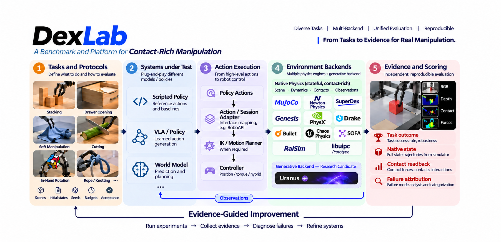
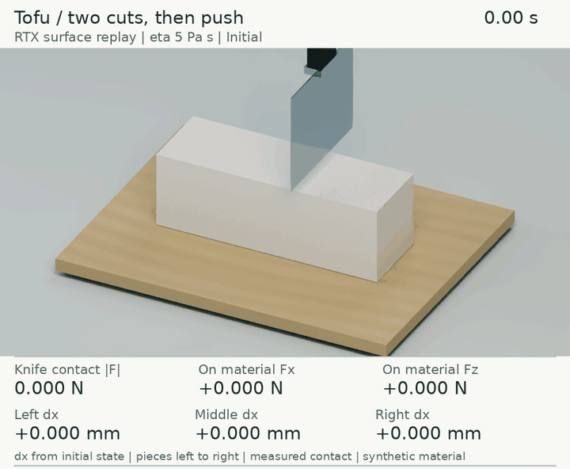
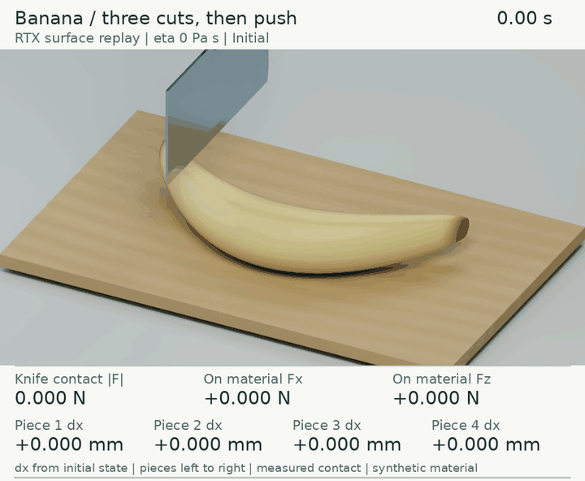
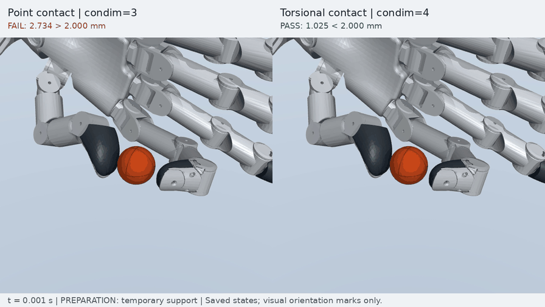
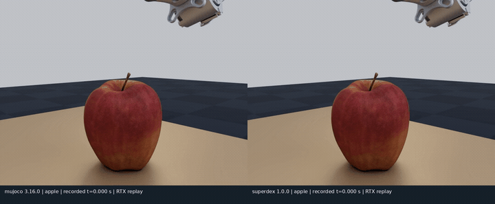
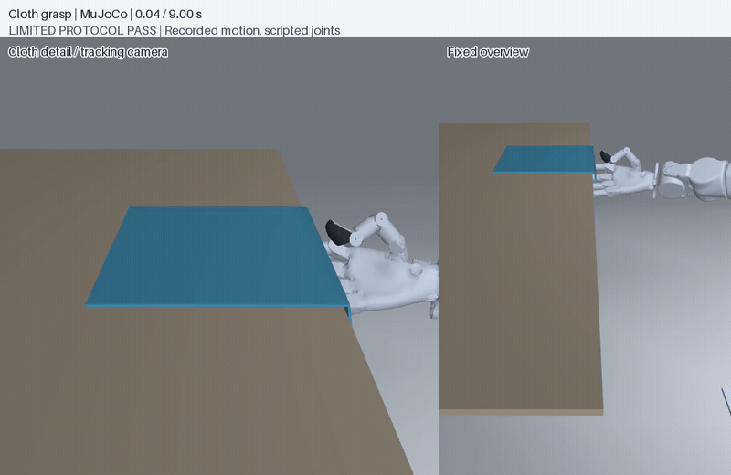
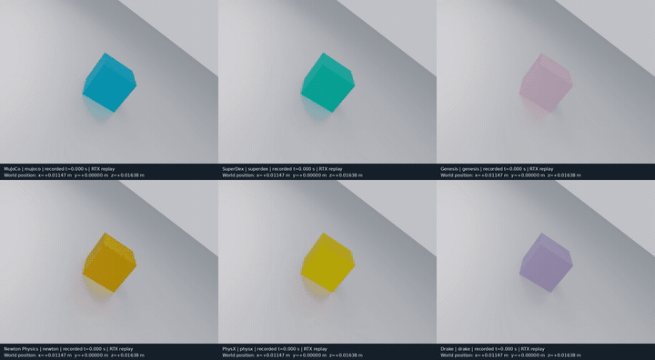

# DexLab

**A benchmark and platform for contact-rich manipulation.**

I study how agents and simulation can improve each other through experiments. Tasks expose a problem; controlled comparisons locate the first failing layer; the fix is then retested independently.

## [Explore DexLab on GitHub →](https://github.com/huangkiki/Dexlab)

This repository is the main entry to the project. It includes the architecture, experiment records, results, solver notes and learning material below.

[简体中文](README.zh-CN.md)

## Architecture

<p align="center">
  <a href="docs/site/_static/images/dexlab-architecture.png">
    
  </a>
</p>

Tasks and protocols move through systems under test, action execution, environment backends, and independent evidence and scoring. Observations and failures return to improve both skills and simulation.

## Representative experiments

<p align="center">
  <strong>Cutting and pushing</strong><br>
  <a href="docs/site/en/cut-push.md">
    
  </a>
  <a href="docs/site/en/cut-push.md">
    
  </a>
  <br>
  <sub>Latest records: tofu becomes three pieces after two cuts; banana becomes four after three.</sub>
</p>

| Experiment | Controlled variable | Key readback | Result |
| --- | --- | --- | --- |
| Cutting and pushing | Tofu 0.125 ms, η=5 Pa·s; banana 0.25 ms, η=0 | Active-piece displacement; knife–material impulse | **Pass** · 11.096 / 10.209 mm |
| Contact torque | Only point contact changed to torsional contact | Retention displacement; peak angular velocity | **2.734 → 1.025 mm** · 29.336 → 0.024992 rad/s |
| Apple-stem grasp | Same set of ten fixed regression scenes | Lift, support, retention, penetration and release | **MuJoCo 1/10 · SuperDex 10/10** |
| Cloth | Same frozen holdout set | Deformation, sag, penetration, residual motion and cost | **52 / 105 pass** |
| Six-engine incline | Static, sliding and nominal zero friction; three steps | Displacement, velocity, force and numerical consistency | **Per-profile verdicts, not a composite ranking** |

<table>
  <tr>
    <td width="50%" align="center" valign="top">
      <strong>Wuji contact torque</strong><br>
      <a href="docs/site/en/wuji-contact.md"></a>
    </td>
    <td width="50%" align="center" valign="top">
      <strong>Apple-stem grasp</strong><br>
      <a href="docs/site/en/benchmark.md"></a>
    </td>
  </tr>
  <tr>
    <td width="50%" align="center" valign="top">
      <strong>Cloth manipulation</strong><br>
      <a href="docs/site/en/cloth-comparison.md"></a>
    </td>
    <td width="50%" align="center" valign="top">
      <strong>Six-engine incline</strong><br>
      <a href="docs/site/en/visual-comparisons.md"></a>
    </td>
  </tr>
</table>

## Three conclusions

| Experiment findings | Solver understanding | Failure causes |
| --- | --- | --- |
| Results are failure boundaries, not engine rankings. Contact model, geometry, coupling and assisted retention can change the verdict. | Separate engine, model, coupling and numerical configuration. Profiles become comparable only after versions, contact representation and budgets are frozen. | Many “solver failures” are decided before iteration. Check task, geometry, control and coupling before residuals. |
| [Experiment catalogue](docs/site/en/experiments.md) | [Solver taxonomy](docs/solver-taxonomy.md) | [Failure atlas](docs/site/en/failure-root-cause-atlas.md) |

## Continue by need

- [All experiments](docs/site/en/experiments.md)
- [Research guide](docs/site/en/_static/research/dexterous-simulation.html)
- [Learn simulation](docs/site/en/learning.md)

## Contact

Questions about reproduction, corrections or collaboration are welcome.

[Email](mailto:huangyue0719@outlook.com) · [GitHub](https://github.com/huangkiki)

## Citation

```bibtex
@misc{huang2026dexlab,
  author = {Kiki Huang},
  title = {DexLab: A Benchmark and Platform for Contact-Rich Manipulation},
  year = {2026},
  url = {https://github.com/huangkiki/Dexlab},
  note = {GitHub repository}
}
```
