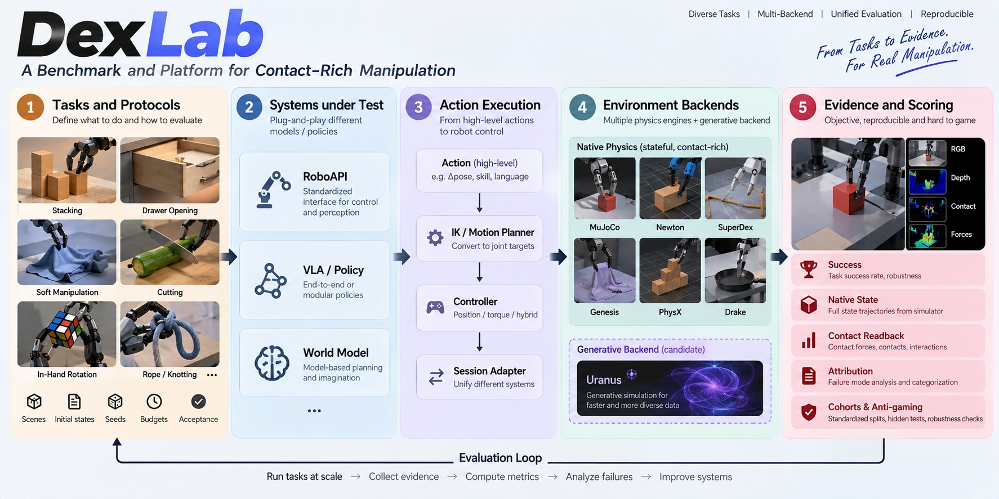
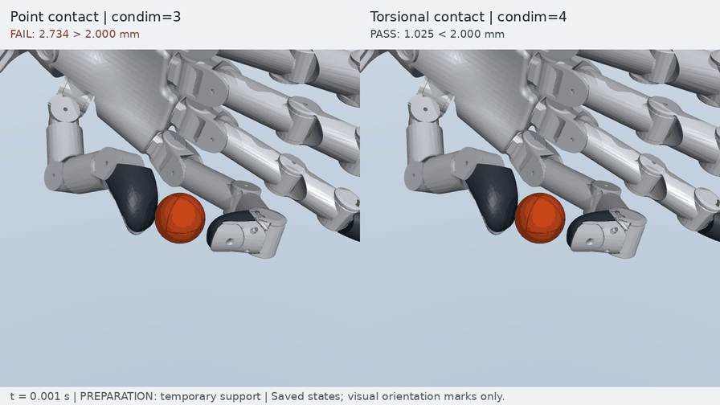
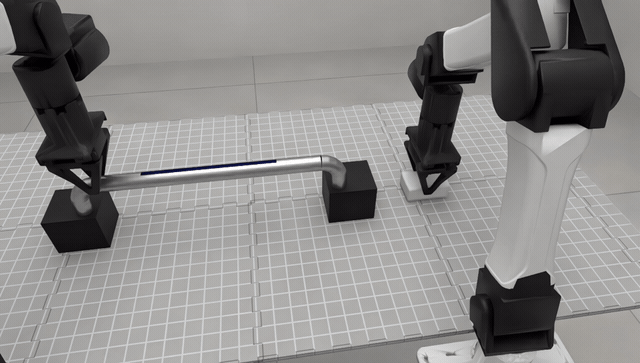
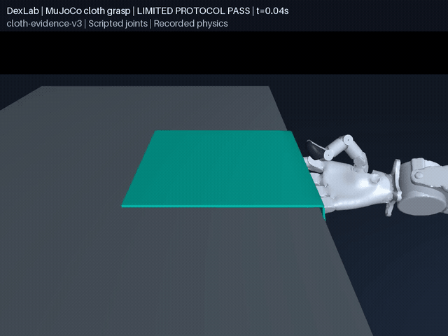
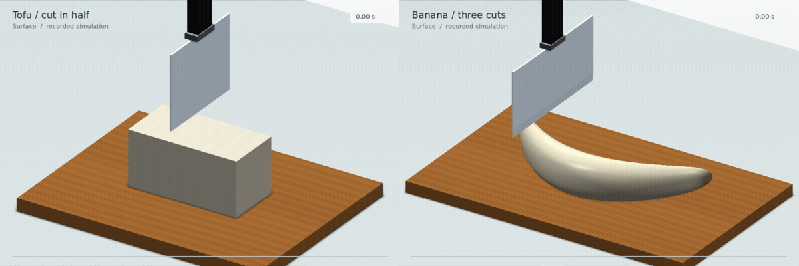

<a id="architecture"></a>
<p align="center">
  <a href="docs/site/_static/images/dexlab-architecture.jpg">
    
  </a>
</p>

<p align="center">
  <strong>从操作任务到物理证据，让仿真与模型共同改进。</strong><br>
  Contact-rich manipulation · Reproducible experiments · Failure attribution
</p>

<p align="center">
  <a href="README.en.md">English</a> ·
  <a href="https://huangkiki.github.io/Dexlab/zh-cn/latest/">文档网站</a> ·
  <a href="#why-dexlab">Why DexLab</a> ·
  <a href="#whats-new">What's new</a> ·
  <a href="#quickstart">快速开始</a>
</p>

DexLab 面向抓取、擦拭、柔性物体操作与切割研究，把**任务执行、原生接触记录和独立评分**连在一起，帮助研究者判断一次失败发生在哪一层、下一步应该改什么。

## 从任务到证据

上图从左到右描述了这条研究链路：

1. **任务与协议**：先固定场景、初态、随机种子、预算和验收条件，明确“怎样才算完成”。
2. **被测系统**：接入脚本、策略或模型；RoboAPI 负责模型调用与会话协议，任务侧负责观测和动作语义。
3. **动作执行**：将高层动作经 IK、规划与控制转成机器人输入，分别记录发出的命令和实际反馈。
4. **环境后端**：在对应物理后端推进接触与运动，按任务记录引擎版本、接触模型和求解配置。
5. **证据与评分**：保存状态、接触和失败轨迹，用独立判据检验结果，再决定改模型、控制还是物理配置。

*图中任务缩略图表示研究范围，真实运行见下方实验预览。当前已有原生实验、接触读回、独立评分与离线复算；远程模型执行和公开榜单仍在建设。[Uranus](https://huangkiki.github.io/Dexlab/zh-cn/latest/uranus-backend.html) 是候选生成式后端，各任务的实际覆盖见[覆盖矩阵](https://huangkiki.github.io/Dexlab/zh-cn/latest/coverage.html)。*

## Why DexLab?

同一个“没抓住”，可能是策略没有学会、动作没有执行到位，也可能是碰撞几何或接触模型不合适。只看成功率或视频，很难判断下一步该改哪一层。

- **解释失败。** 把控制命令、原生接触与物体运动对上，区分任务失败、接入错误和物理计算问题。
- **让比较有条件可查。** 固定任务、版本与预算，保留失败和未覆盖项；每个结论都能回到具体实验。
- **让改进可以复核。** 从原始记录独立评分；改变模型或仿真配置后，用新的对照检查收益。

这也是 DexLab 的研究方向：**用模型暴露仿真缺口，再用更可信的仿真改善模型。** [灵巧手仿真导读](https://huangkiki.github.io/Dexlab/zh-cn/latest/dexterous-hand-simulation.html)解释其中的问题，[失败复盘](https://huangkiki.github.io/Dexlab/zh-cn/latest/solver-failure-audit.html)给出已有证据。

<a id="whats-new"></a>
## What's new

- **2026-11-02 · 研究导读** — 上线[灵巧手仿真六层问题](https://huangkiki.github.io/Dexlab/zh-cn/latest/dexterous-hand-simulation.html)与 [Newton 35 篇论文分类](https://huangkiki.github.io/Dexlab/zh-cn/latest/newton-reading-guide.html)，连接概念、论文和实验。
- **2026-10-31 · RoboAPI 适配** — 加入模型发现、连续会话、动作校验与执行回执；逐任务观测／动作映射仍待接入。[适配说明](docs/roboapi-poke.zh-CN.md)
- **2026-10-28 · 浏览器实验** — 在网页中运行 MuJoCo，交互查看不同求解配置的接触行为。[打开 live lab](https://huangkiki.github.io/Dexlab/zh-cn/latest/index.html#live-lab)
- **2026-10-26 · Wuji 接触证据** — 发布双指夹球的点接触／抗扭接触对照、独立评分和离线复算包。[实验报告](https://huangkiki.github.io/Dexlab/zh-cn/latest/wuji-contact.html)

## 实验预览

以下动图来自 DexLab 的真实仿真录像或记录状态回放。每项结果只适用于对应版本、材料假设和验收协议。

<table>
<tr>
<td width="50%">
<a href="https://huangkiki.github.io/Dexlab/zh-cn/latest/wuji-contact.html">

</a>
<strong>抓取与抗滑移</strong><br>
相同控制下，点接触改为合成抗扭接触，两秒保持漂移从 <strong>2.734 mm</strong> 降至 <strong>1.025 mm</strong>。
</td>
<td width="50%">
<a href="https://huangkiki.github.io/Dexlab/zh-cn/latest/rss-wiping.html">

</a>
<strong>海绵擦拭与接触依赖</strong><br>
辅助保持下 <strong>3/3</strong> 通过；去掉辅助后 <strong>0/3</strong>，最终清洁率约 <strong>95.47% / 39.92%</strong>。
</td>
</tr>
<tr>
<td width="50%">
<a href="https://huangkiki.github.io/Dexlab/zh-cn/latest/cloth-comparison.html">

</a>
<strong>柔性物体操作</strong><br>
机器人能够夹住并移动布片，但完整折叠仍失败：当前记录的最大边长应变为 <strong>12.55%</strong>，超过预设 5% 上限。
</td>
<td width="50%">
<a href="https://huangkiki.github.io/Dexlab/zh-cn/latest/cut-push.html">

</a>
<strong>切割与拓扑变化</strong><br>
连续切割与刀面推动会产生仿真状态的拓扑变化；视觉回放之外，完整报告还记录接触力、材料分离与失败。
</td>
</tr>
</table>

<a id="quickstart"></a>
## 开始使用

最短的仿真入口是苹果抓梗。Linux x86_64 上安装 [uv](https://docs.astral.sh/uv/getting-started/installation/) 后：

```bash
git clone https://github.com/huangkiki/Dexlab.git
cd Dexlab
bash scripts/setup.sh --mujoco-profile historical-3.11.0
bash demos/apple-stem-grasp/run.sh \
  --backend mujoco \
  --output demos/apple-stem-grasp/runs/first-mujoco
.venv/bin/python demos/apple-stem-grasp/src/verify_sdf_grasp.py \
  demos/apple-stem-grasp/runs/first-mujoco
```

验收器会写出 `summary.json`；全部检查通过时 `passed: true`。14 秒是仿真时长，实际计算通常更久。无桌面环境添加 `--headless`，每次运行使用新输出目录。

如果只想检查证据链、不安装仿真器，可从[无需 GPU 的擦拭复算](https://huangkiki.github.io/Dexlab/zh-cn/latest/rss-wiping.html#offline-evidence)开始。完整依赖、资产和命令见[安装指南](https://huangkiki.github.io/Dexlab/zh-cn/latest/quickstart.html)。

## 在网站继续阅读

- [实验目录](https://huangkiki.github.io/Dexlab/zh-cn/latest/experiments.html) · [完整结果](https://huangkiki.github.io/Dexlab/zh-cn/latest/results.html)：条件、指标、失败、原始记录与复现入口。
- [模型评测协议](https://huangkiki.github.io/Dexlab/zh-cn/latest/model-evaluation.html) · [求解配置分层](https://huangkiki.github.io/Dexlab/zh-cn/latest/solver-taxonomy.html)：怎样定义可比较的模型与物理实验。
- [灵巧手仿真导读](https://huangkiki.github.io/Dexlab/zh-cn/latest/dexterous-hand-simulation.html) · [论文与参考资料](https://huangkiki.github.io/Dexlab/zh-cn/latest/references.html)：研究问题、阅读路线与原始来源。

各项结果限定于对应配置与协议，不代表真机验证或统一引擎排名。网站集中维护研究与使用细节；[贡献方式](https://huangkiki.github.io/Dexlab/zh-cn/latest/contributing.html) · [当前工作](docs/current-work.zh-CN.md) · [引用方式](https://huangkiki.github.io/Dexlab/zh-cn/latest/index.html#documentation-and-citation)。
