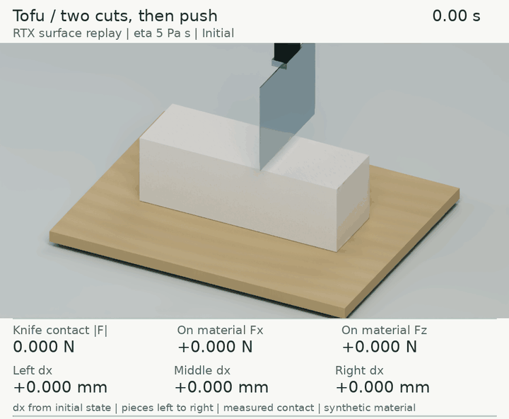
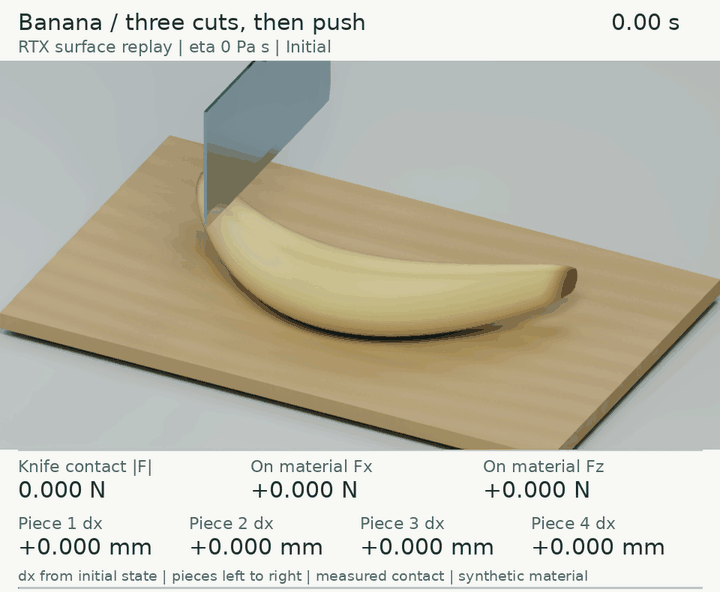
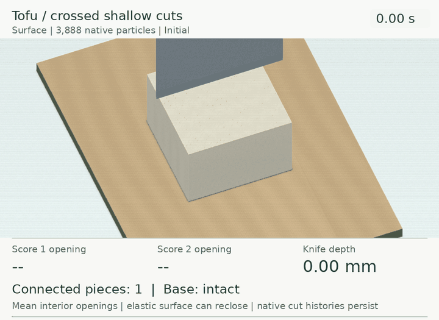
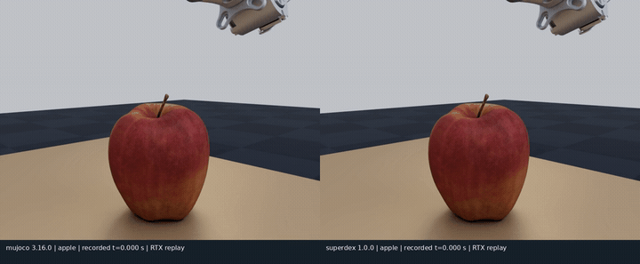
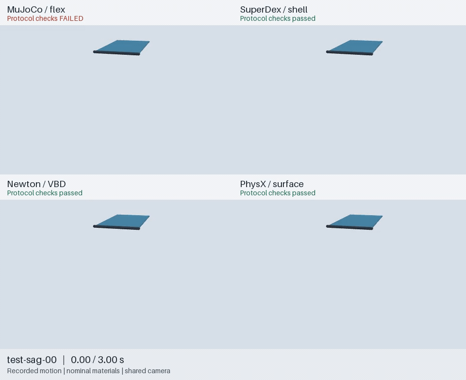
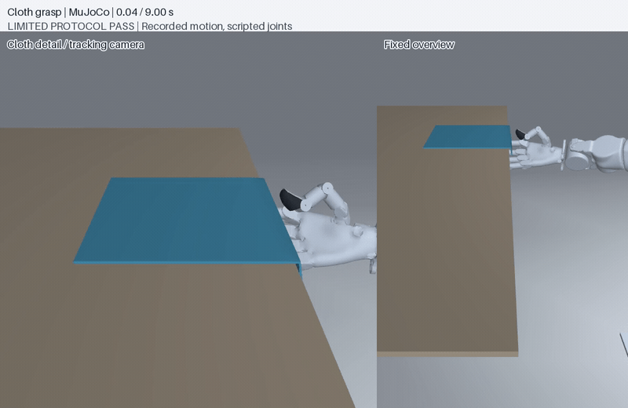
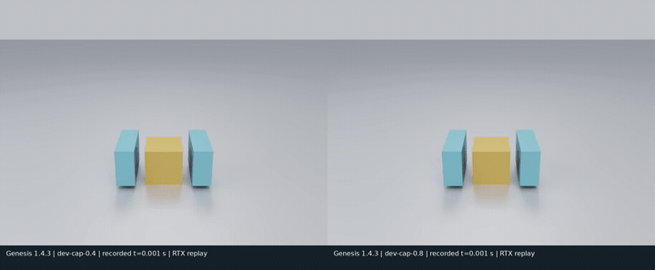
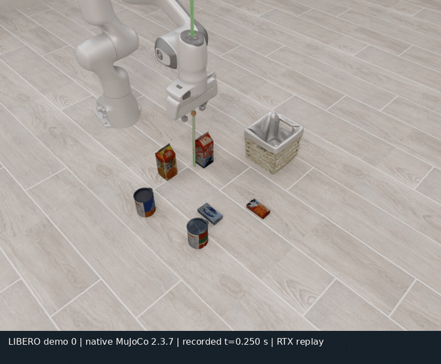
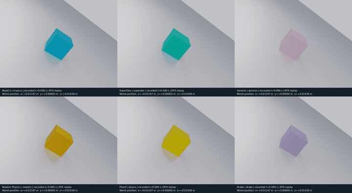
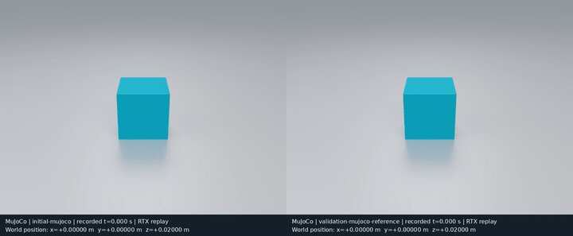

# DexLab

**用可复现的接触、摩擦与操作实验，研究机器人为什么抓得住、会滑脱，以及怎样选择和调整物理仿真。**

[English](README.en.md) · [快速开始](#quickstart) · [完整实验目录](https://huangkiki.github.io/Dexlab/zh-cn/latest/experiments.html) · [全部报告](https://huangkiki.github.io/Dexlab/zh-cn/latest/results.html)

<a id="research-findings"></a>

## 做了哪些实验

<span id="visual-experiment-catalogue"></span>

点击实验名或动图查看完整报告与复现方法。

| 实验 | 动图预览 |
| --- | :---: |
| <a id="rss"></a>**[RSS 擦拭](https://huangkiki.github.io/Dexlab/zh-cn/latest/rss-wiping.html)**<br>使用 latch 辅助固定：夹稳后用柔顺约束带动海绵局部随手运动，松开时解除。成功不代表纯摩擦保持；[查看无 latch 对照](https://huangkiki.github.io/Dexlab/zh-cn/latest/rss-wiping.html#latch)。 | <a href="https://huangkiki.github.io/Dexlab/zh-cn/latest/rss-wiping.html#latch"></a> |
| <a id="cut-push"></a><a id="banana-force"></a>**[连续切割与推动](https://huangkiki.github.io/Dexlab/zh-cn/latest/cut-push.html)** | <a href="https://huangkiki.github.io/Dexlab/zh-cn/latest/cut-push.html"></a> <a href="https://huangkiki.github.io/Dexlab/zh-cn/latest/cut-push.html"></a> |
| <a id="scoring"></a>**[交叉浅划](https://huangkiki.github.io/Dexlab/zh-cn/latest/tofu-scoring.html)** | <a href="https://huangkiki.github.io/Dexlab/zh-cn/latest/tofu-scoring.html"></a> |
| <a id="apple"></a>**[苹果抓梗](https://huangkiki.github.io/Dexlab/zh-cn/latest/experiments.html#apple-replays)** | <a href="https://huangkiki.github.io/Dexlab/zh-cn/latest/studio-rendering.html"></a> |
| <a id="cloth-comparison"></a>**[布料引擎对比](https://huangkiki.github.io/Dexlab/zh-cn/latest/cloth-comparison.html)** | <a href="https://huangkiki.github.io/Dexlab/zh-cn/latest/cloth-comparison.html"></a> |
| <a id="cloth"></a>**[机器人夹布](https://huangkiki.github.io/Dexlab/zh-cn/latest/experiments.html)** | <a href="https://huangkiki.github.io/Dexlab/zh-cn/latest/experiments.html"></a> |
| <a id="visual-highlight-pinch"></a>**[夹持力对照](https://huangkiki.github.io/Dexlab/zh-cn/latest/visual-comparisons.html#pinch)** | <a href="https://huangkiki.github.io/Dexlab/zh-cn/latest/studio-rendering.html"></a> |
| <a id="visual-highlight-libero"></a>**[LIBERO 回放](https://huangkiki.github.io/Dexlab/zh-cn/latest/libero-workflow.html)** | <a href="https://huangkiki.github.io/Dexlab/zh-cn/latest/studio-rendering.html"></a> |
| <a id="visual-highlight-incline"></a>**[六引擎斜面滑动](https://huangkiki.github.io/Dexlab/zh-cn/latest/visual-comparisons.html#incline)** | <a href="https://huangkiki.github.io/Dexlab/zh-cn/latest/studio-rendering.html"></a> |
| <a id="visual-highlight-normal"></a>**[法向接触标定](https://huangkiki.github.io/Dexlab/zh-cn/latest/visual-comparisons.html#normal)** | <a href="https://huangkiki.github.io/Dexlab/zh-cn/latest/studio-rendering.html"></a> |

[完整实验目录](https://huangkiki.github.io/Dexlab/zh-cn/latest/experiments.html) · 动图来自实际仿真或记录回放；结果仅适用于各报告的配置与条件。

[高质量回放与复现](https://huangkiki.github.io/Dexlab/zh-cn/latest/studio-rendering.html) · [切割表面重建与限制](https://huangkiki.github.io/Dexlab/zh-cn/latest/cutting-surface.html)

<a id="quickstart"></a>

## 先运行苹果抓梗

推荐从已有安装脚本覆盖的 MuJoCo 苹果抓梗开始。需要 Linux x86_64 和 [uv](https://docs.astral.sh/uv/getting-started/installation/)；不需要模型 API key。该入口复现固定版本的历史演示，不是六引擎最新版本比较环境。

```bash
git clone https://github.com/huangkiki/Dexlab.git
cd Dexlab
bash scripts/setup.sh
bash demos/apple-stem-grasp/run.sh --backend mujoco
```

等待 SDF 准备、静置与规划后，窗口会显示抓梗、抬升和保持。输出保存在 `demos/apple-stem-grasp/runs/latest-mujoco-sdf/`；无桌面时在运行命令后加 `--headless`，切换后端用 `--backend superdex`。14 s 是仿真时长，实际计算会更久。

```bash
.venv/bin/python demos/apple-stem-grasp/src/verify_sdf_grasp.py \
  demos/apple-stem-grasp/runs/latest-mujoco-sdf
```

验收器会写出 `summary.json`；全部检查通过时 `passed` 为 `true`，失败时保留具体检查项并返回非零退出码。

[安装、依赖与资产来源](docs/installation.zh-CN.md) · [任务接口与命令](demos/apple-stem-grasp/README.zh-CN.md)

<a id="research-diagnosis"></a>

## 场景不对时，先查什么

先核对几何、质量／惯量、控制时刻和实际接触读回，再围绕一个明确问题调整参数，用原始记录和独立评分检查结果。已有失败、修正和下一步判断见[诊断方法](https://huangkiki.github.io/Dexlab/zh-cn/latest/diagnosis.html)。

<a id="research-selection"></a>

## 新任务怎样选引擎和配置

按载荷、接触尺度、粘着／滑动、接触切换和柔顺性找相近实验，再验证候选配置。研究涉及 MuJoCo、SuperDex、Genesis、Newton Physics、PhysX 和 Drake，但各任务覆盖与验收不同；完整配置、版本和失败见[覆盖矩阵](https://huangkiki.github.io/Dexlab/zh-cn/latest/coverage.html)，具体起点见[场景选型](https://huangkiki.github.io/Dexlab/zh-cn/latest/selection.html)。

<a id="solver-coupling"></a>

## 多个求解器怎样协同

仿真时间、电脑耗时和数据交换周期是三个不同的量。求解器之间等待会影响运行速度，反馈延迟还会影响相互作用。[用手指与海绵理解同步、迭代与 preCICE](https://huangkiki.github.io/Dexlab/zh-cn/latest/solver-coupling.html)；preCICE 在这里是方法参考，尚未接入 DexLab。

<a id="research-scope"></a>

## 当前边界与深入阅读

以经典物理规律和已有经验关系为参照。实验成功只适用于各自版本、场景和验收条件；任务成功、数值诊断与真实物理准确性分别报告。手内旋转、主动折布、真实材料标定和视觉策略能力仍需各自验证，不能从上面的动图推出。

[研究经验](https://huangkiki.github.io/Dexlab/zh-cn/latest/experience.html) · [求解配置如何分类](https://huangkiki.github.io/Dexlab/zh-cn/latest/solver-taxonomy.html) · [研究路线](https://huangkiki.github.io/Dexlab/zh-cn/latest/dexterity.html) · [外部参考](https://huangkiki.github.io/Dexlab/zh-cn/latest/references.html) · [数据与版本](https://github.com/huangkiki/Dexlab/releases)

[开发与验收约定](docs/autoresearch.zh-CN.md) · [当前工作与暂停状态](docs/current-work.zh-CN.md)
