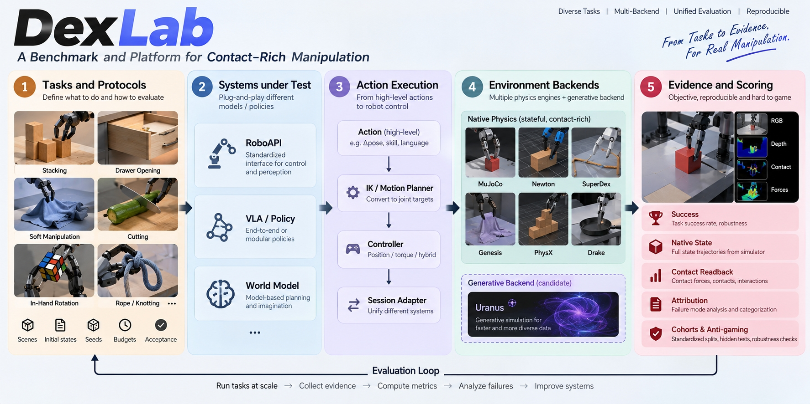
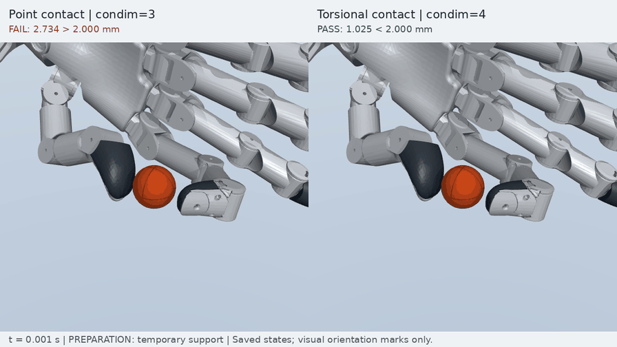
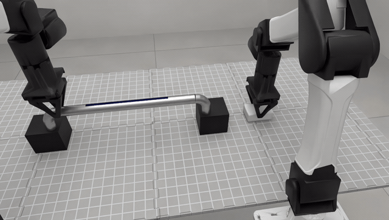
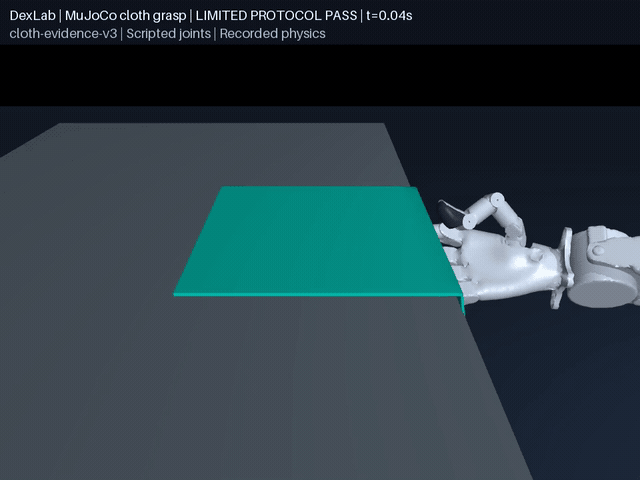
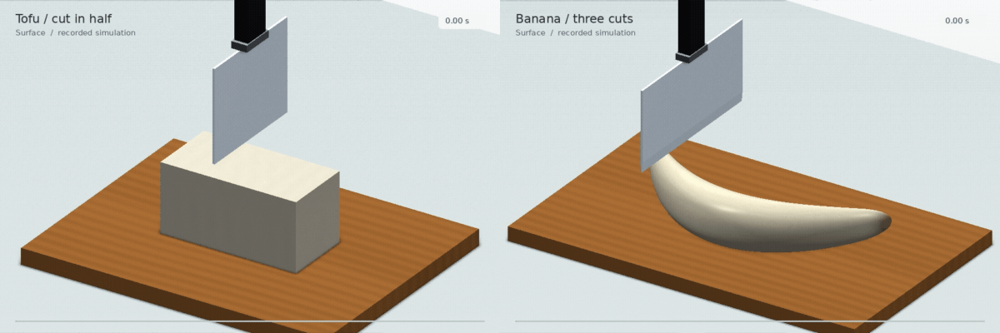

# DexLab

## Contact-rich robotics, beyond rigid-body simulation.

DexLab 是一个以物理为中心的研究平台，用于研究接触、形变和材料分离条件下的机器人操作。

[English](README.en.md) · [实验目录](https://huangkiki.github.io/Dexlab/zh-cn/latest/experiments.html) · [研究协议](https://huangkiki.github.io/Dexlab/zh-cn/latest/model-evaluation.html) · [快速开始](#quickstart) · [系统结构](#architecture) · [Uranus 后端](https://huangkiki.github.io/Dexlab/zh-cn/latest/uranus-backend.html)

> 当前已有原生命令、接触读回、独立评分、离线证据与多项接触实验；远程模型执行器、公开 leaderboard 和跨任务统一结论仍在建设中。

## Research vision: Simulation–Learning Co-evolution

> **用模型暴露仿真缺口，再用更可信的仿真改善模型。**

近期以 **Physics Research Platform** 为主体：把接触、形变和材料分离做成可观察、可归因、可复算的实验。长期再用模型失败反馈仿真器，用改进后的仿真器训练和评测模型。

<a id="architecture"></a>
## Architecture



任务协议固定场景与预算；模型输出动作，经控制器映射到物理后端或候选生成式后端；原生状态、接触读回与结果由独立证据层记录和评分。反馈回路只有在对应证据成立后才算完成。

*架构图中的任务缩略图用于说明任务类型；真实实验录像和证据见下方 Demo gallery。*

## What's new

- **2026-10-31 · Uranus generative backend:** added the candidate backend contract, candidate tasks, paired native/generative evaluation plan, and evidence boundaries. It is documented, not yet a DexLab runner. [Details](https://huangkiki.github.io/Dexlab/zh-cn/latest/uranus-backend.html)
- **2026-10-31 · Poke RoboAPI adapter:** added model discovery, schema/session handling, action validation, execution feedback, and a credential-safe CLI. Per-task observation/action mappings remain pending. [Details](docs/roboapi-poke.zh-CN.md)
- **2026-10-31 · Model-evaluation protocol:** added the public evaluation, anti-gaming, evidence-state, and hidden-layout protocol. Remote execution and the public leaderboard are still under construction. [Details](https://huangkiki.github.io/Dexlab/zh-cn/latest/model-evaluation.html)

[All releases](https://github.com/huangkiki/Dexlab/releases)

## Demo gallery

以下动图来自 DexLab 的真实仿真录像或记录状态回放。每项结果只适用于对应版本、材料假设和验收协议。

<table>
<tr>
<td width="50%">
<a href="https://huangkiki.github.io/Dexlab/zh-cn/latest/wuji-contact.html">

</a>
<strong>抓取与抗滑移</strong><br>
相同控制下，点接触改为合成抗扭接触，两秒保持漂移从 <strong>2.734 mm</strong> 降至 <strong>1.025 mm</strong>。
</td>
<td width="50%">
<a href="https://huangkiki.github.io/Dexlab/zh-cn/latest/rss-wiping.html">

</a>
<strong>海绵擦拭与接触依赖</strong><br>
辅助保持下 <strong>3/3</strong> 通过；去掉辅助后 <strong>0/3</strong>，最终清洁率约 <strong>95.47% / 39.92%</strong>。
</td>
</tr>
<tr>
<td width="50%">
<a href="https://huangkiki.github.io/Dexlab/zh-cn/latest/cloth-comparison.html">

</a>
<strong>柔性物体操作</strong><br>
机器人能够夹住并移动布片，但完整折叠仍失败：当前记录的最大边长应变为 <strong>12.55%</strong>，超过预设 5% 上限。
</td>
<td width="50%">
<a href="https://huangkiki.github.io/Dexlab/zh-cn/latest/cut-push.html">

</a>
<strong>切割与拓扑变化</strong><br>
连续切割与刀面推动会产生真实的状态拓扑变化；视觉回放之外，完整报告还记录接触力、材料分离与失败。
</td>
</tr>
</table>

## Why DexLab?

机器人策略在仿真中失败时，我们通常只看到一次失败。它可能来自策略、控制器、场景配置、接触离散、材料模型或数值求解。

> **When a robot fails in simulation, is it the policy that fails, or the physics we trusted?**

DexLab 的核心工作不是给单一引擎或模型打总分，而是让下面这些问题可以被实验和证据回答：

- 相同几何、载荷和控制下，不同接触模型会改变“抓住、滑动、释放”的判断吗？
- 更小步长、更密网格或更多迭代，真的更接近物理，还是只改变了数值行为？
- 机器人能夹住布片，何时才会真正完成折叠、送布和正确释放？
- 切割、摩擦和材料分离应该怎样记录和验收，而不是只看一段视频？
- 一个 policy 或 API 的排名，能否在替换物理后端后保持不变？

## Research areas

| 方向 | 研究问题 | 当前入口 |
| --- | --- | --- |
| **Contact physics** | 法向响应、摩擦、保持、滑动、冲量和释放是否能被独立复核？ | [接触力学](https://huangkiki.github.io/Dexlab/zh-cn/latest/contact-response.html) · [保持与滑移](https://huangkiki.github.io/Dexlab/zh-cn/latest/wuji-contact.html) |
| **Deformable objects** | 夹持、垂坠、拉伸、层间接触和脱手如何分别验收？ | [布料对比](https://huangkiki.github.io/Dexlab/zh-cn/latest/cloth-comparison.html) · [双臂布料](https://huangkiki.github.io/Dexlab/zh-cn/latest/studio-rendering.html) |
| **Topology-changing interaction** | 切割和材料分离如何记录接触、连通性与材料响应？ | [切割与推动](https://huangkiki.github.io/Dexlab/zh-cn/latest/cut-push.html) |
| **Cross-backend evaluation** | 相同物理目标和控制下，不同引擎、积分器与求解器何时可以比较？ | [引擎与求解器](https://huangkiki.github.io/Dexlab/zh-cn/latest/engines.html) · [选型](https://huangkiki.github.io/Dexlab/zh-cn/latest/selection.html) |
| **Policy and API evaluation** | 模型失败、适配器失败和物理无效运行如何分开？ | [模型评测协议](https://huangkiki.github.io/Dexlab/zh-cn/latest/model-evaluation.html) · [RoboAPI 适配](docs/roboapi-poke.zh-CN.md) |

## What is implemented

- **任务执行：** 固定机器人、场景、控制频率、物理版本、seeds、预算和验收条件。
- **原生测量：** 保存状态、速度、命令、接触力、冲量、约束状态和求解结果，而不是只保存视频。
- **独立评分：** 任务结果、数值一致性、物理参照和记录完整性分开判定。
- **可复算证据：** 原始轨迹、源码快照、配置、哈希和离线评分器随结果保留。
- **跨后端实验：** MuJoCo、SuperDex、Genesis、Newton Physics、PhysX 和 Drake 的研究覆盖不同，不能用一个引擎数替代任务资格。
- **模型接入：** Poke RoboAPI 已有接口适配；远程模型执行、Uranus backend 和公开榜单仍在建设。

## Experiments and findings

这里展示影响研究方向的结果，不把所有检查合并成一个“成功率”。

| 实验 | 条件 | 结果和解释 |
| --- | --- | --- |
| **接触表示改变抓取结论** | Wuji 双指夹球，相同控制和保持窗口 | `condim=3` 漂移 **2.734 mm**，超过 2 mm；`condim=4` 为 **1.025 mm**。结果说明接触模型本身就是模型结论的一部分。 |
| **擦拭成功率依赖辅助保持** | RoboSimStudio `wipe_the_bar`，固定记录与评分 | 原版 **3/3**，清洁率约 **95.47%**；去掉辅助后 **0/3**，约 **39.92%**。不能把原版通过直接归因于策略。 |
| **接触离散改变失效边界** | 同一圆柱、质量、力命令和 0.5 ms 步长；只改变表面三角数 | `256 → 1,024 → 4,096` 三角形时，峰值穿透为 **2.267 → 0.858 → 0.481 mm**；中间分辨率仍失败。 |
| **同场景抓取可能依赖于后端** | 苹果抓梗，10 个配对回归场景 | 当前默认配置 MuJoCo 通过 **1/10**，SuperDex 通过 **10/10**；更小步长没有单调改善穿透。 |
| **夹住布不等于完成折叠** | OpenArm + Wuji，布料无粘附、无执行器 | 单手夹点抬升与释放通过；完整折叠因应变、残余接触和最终几何未达标而失败。 |

这些结果共同指向一个问题：**成功视频不足以证明材料模型、接触响应和下游策略都可迁移。**

[完整实验目录](https://huangkiki.github.io/Dexlab/zh-cn/latest/experiments.html) · [全部结果与失败](https://huangkiki.github.io/Dexlab/zh-cn/latest/results.html) · [研究经验](https://huangkiki.github.io/Dexlab/zh-cn/latest/experience.html)

<a id="quickstart"></a>
## Quick start

最短的仿真入口是苹果抓梗。Linux x86_64 上安装 [uv](https://docs.astral.sh/uv/getting-started/installation/) 后：

```bash
git clone https://github.com/huangkiki/Dexlab.git
cd Dexlab
bash scripts/setup.sh --mujoco-profile historical-3.11.0
bash demos/apple-stem-grasp/run.sh \
  --backend mujoco \
  --output demos/apple-stem-grasp/runs/first-mujoco
.venv/bin/python demos/apple-stem-grasp/src/verify_sdf_grasp.py \
  demos/apple-stem-grasp/runs/first-mujoco
```

验收器会写出 `summary.json`；全部检查通过时 `passed: true`。14 秒是仿真时长，实际计算通常更久。无桌面环境添加 `--headless`，每次运行使用新输出目录。

如果只想检查证据链、不安装仿真器，可从[无需 GPU 的擦拭复算](https://huangkiki.github.io/Dexlab/zh-cn/latest/rss-wiping.html#offline-evidence)开始。完整依赖、资产和命令见[安装指南](https://huangkiki.github.io/Dexlab/zh-cn/latest/quickstart.html)。

## Research roadmap

1. **Contact and material response：** 将接触刚度、阻尼、摩擦与真实测量分开校准，再讨论 engine ranking。
2. **Deformable manipulation：** 从夹持、送布和释放扩展到可复核的折叠几何、自接触和材料点跟踪。
3. **Topology-changing tasks：** 为切割、分离和粘连建立连续几何、接触力与结果判据。
4. **Cross-backend attribution：** 区分 solver、integrator、collision geometry、precision、timestep 和 framework wrapper。
5. **Policy and neural backends：** 检查 API 排名和任务结论能否从原生物理迁移到 learned world model。
6. **Co-evolution：** 在证据支持后，用模型失败推动仿真改进，再用改进的仿真产生更可信的策略训练与评测。

当前状态、阻塞和下一阶段入口在 [Current Work](docs/current-work.zh-CN.md) 中维护；它不是已完成的 roadmap。

## Ecosystem backend: Uranus

[Uranus](https://arxiv.org/abs/2609.24815) 是 D-Robotics 的机器人视频世界模型，从未来 `qpos`、相机和机器人结构生成多视角观测。它目前作为 **documented candidate generative backend** 出现在 DexLab，而不是已验证物理后端。

接入链路为 `RoboAPI → IK/controller → qpos → Uranus → RGB → task scorer`。它提供视觉观测，不提供原生接触状态、任务 success 或物理真值。[阅读完整介绍、候选任务和证据边界](https://huangkiki.github.io/Dexlab/zh-cn/latest/uranus-backend.html)。

## Evidence and boundaries

- 任务成功不等于物理真实；数值一致不等于现实正确。
- 仿真通过不等于真机成功；渲染通过不等于视觉控制。
- 不同引擎覆盖的任务、材料模型和验收条件不同，不是统一排行榜。
- 失败、无效运行和缺失读数都必须保留；不通过放宽阈值或删除反例制造成功。
- Uranus 和远程模型评测仍是候选能力，不应从论文或接口存在推断 DexLab 已完成复现。

## Documentation and citation

[文档首页](https://huangkiki.github.io/Dexlab/zh-cn/latest/) · [实验目录](https://huangkiki.github.io/Dexlab/zh-cn/latest/experiments.html) · [研究经验](https://huangkiki.github.io/Dexlab/zh-cn/latest/experience.html) · [求解配置](https://huangkiki.github.io/Dexlab/zh-cn/latest/solver-taxonomy.html) · [覆盖矩阵](https://huangkiki.github.io/Dexlab/zh-cn/latest/coverage.html) · [参与贡献](https://huangkiki.github.io/Dexlab/zh-cn/latest/contributing.html)

项目尚未发布配套论文；引用本仓库时请使用仓库 URL 和具体 commit / release，而不是引用尚未存在的论文结果。

```bibtex
@software{dexlab2026,
  author  = {DexLab contributors},
  title   = {DexLab: A Physics-Centric Research Platform for Contact-Rich Robot Manipulation},
  year    = {2026},
  url     = {https://github.com/huangkiki/Dexlab}
}
```
