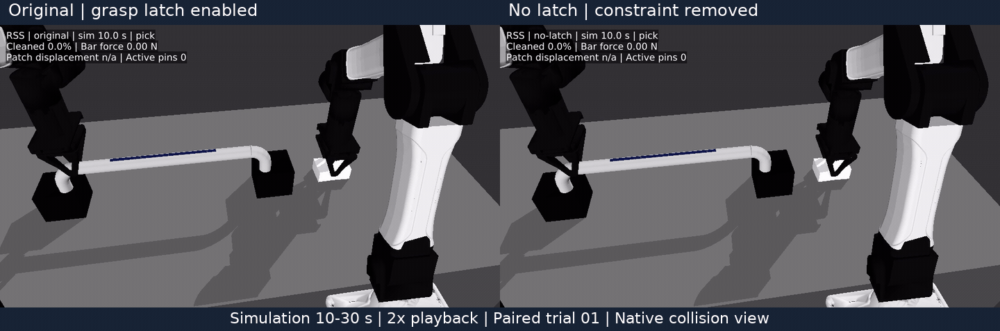
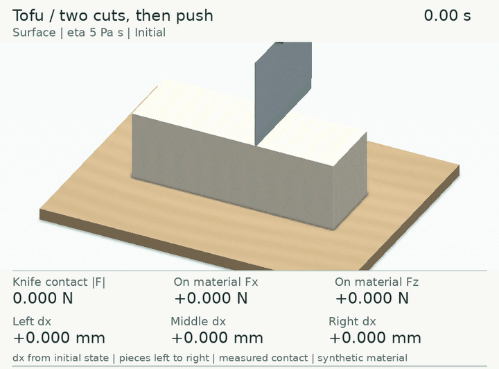
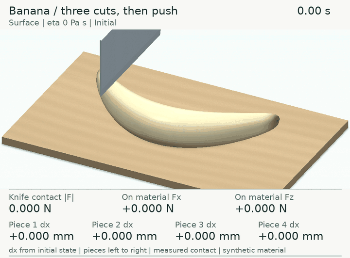
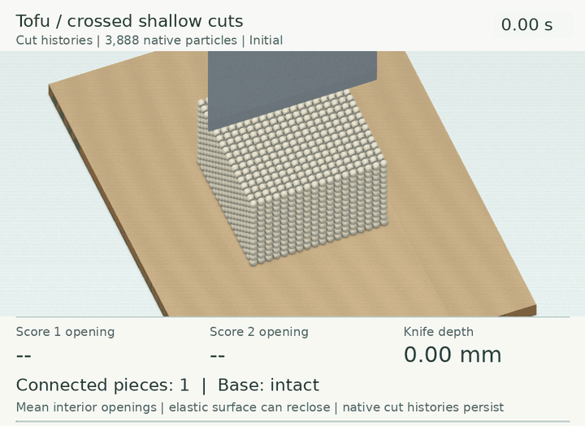
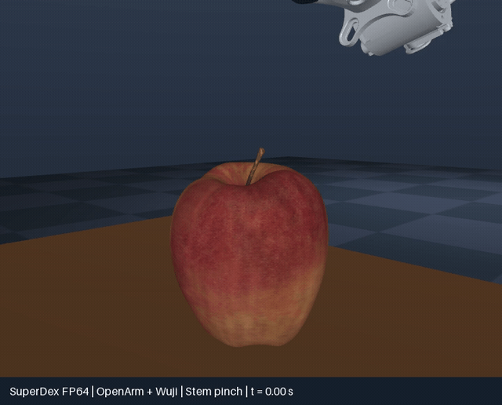
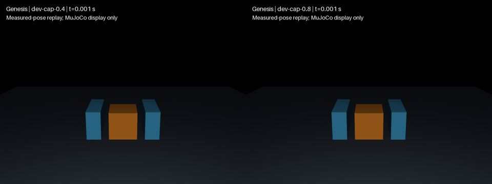
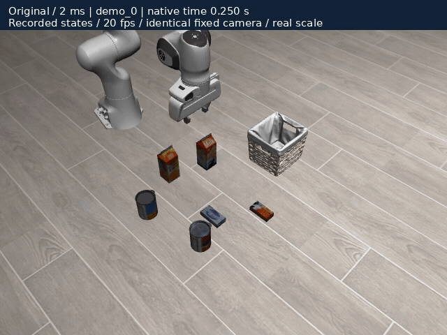
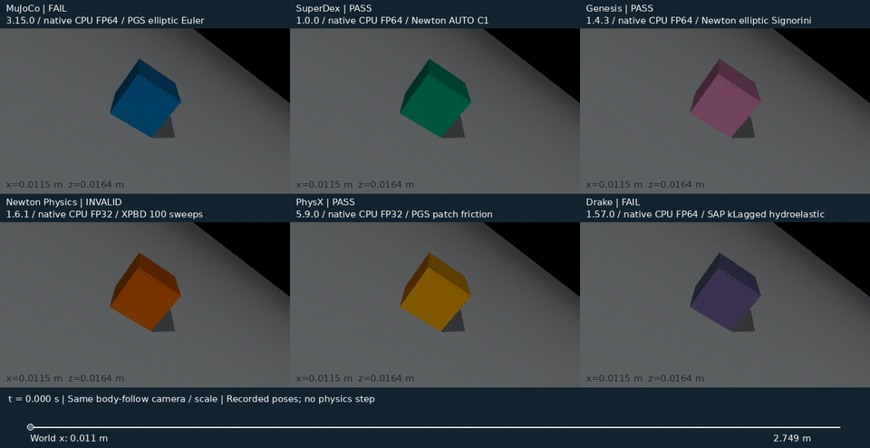
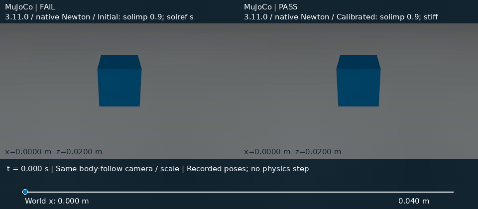

# DexLab

**用可复现的接触、摩擦与操作实验，研究机器人为什么抓得住、会滑脱，以及怎样选择和调整物理仿真。**

[English](README.en.md) · [快速开始](#quickstart) · [完整实验目录](https://huangkiki.github.io/Dexlab/zh-cn/latest/experiments.html) · [全部报告](https://huangkiki.github.io/Dexlab/zh-cn/latest/results.html)

<a id="research-findings"></a>

## 做了哪些实验

<span id="visual-experiment-catalogue"></span>

点击真实动图查看完整录像、曲线与复现方法；成功、失败和适用条件一起保留。

<a id="rss"></a>

### RSS 擦拭：海绵为什么会滑脱？

一只夹爪固定杆件，另一只夹持海绵擦去墨迹。左侧保留 RSS 的辅助节点约束，右侧关闭该约束。

<a href="https://huangkiki.github.io/Dexlab/zh-cn/latest/rss-wiping.html"></a>

固定几何与初态的三组重复中，原版 3/3 通过，清洁率 95.5%–95.9%；关闭约束后 0/3 通过，清洁率 39.9%–41.2%。这说明当前配置依赖辅助保持，尚未复现手内旋转。动图为第 1 组的 10–30 s 同步片段，2 倍速，保留原生碰撞几何视图。

[完整结果与复现](https://huangkiki.github.io/Dexlab/zh-cn/latest/rss-wiping.html)

<a id="cut-push"></a>

### 连续切割：最后一刀直接推开切块

豆腐状软块切成三块，香蕉状材料切成四块；最后一刀后稍抬刀刃，再由刀面接触侧推。

<a href="https://huangkiki.github.io/Dexlab/zh-cn/latest/cut-push.html"></a>
<a href="https://huangkiki.github.io/Dexlab/zh-cn/latest/cut-push.html"></a>

切块的运动来自刀面接触，没有直接给材料速度增量。画面显示记录中的接触力与各块位移，表面与粒子视图可在报告中对照。这里使用合成材料；尚未完成真实食材标定或论文测力实验。

[完整结果与复现](https://huangkiki.github.io/Dexlab/zh-cn/latest/cut-push.html)

<a id="banana-force"></a>

### 香蕉单刀测力：粒子细化后是否收敛？

采用论文公开的香蕉材料数值，独立实现理想 J2 回归，并冻结单刀轨迹、采样、步长与接触敏感性协议。

<a href="https://huangkiki.github.io/Dexlab/zh-cn/latest/banana-force.html"></a>

20 次基准运行的切板前材料峰值为 **0.8469 ± 0.1511 N**，材料冲量为 **0.07341 ± 0.01249 N·s**。64× 粒子运行完整结束，但冻结的 0.5 s 刀路内没有接触砧板，峰值升至 **4.3059 N**，相对基准均值的归一化 RMSE 为 **2.051**，因此没有证明步长、接触或粒子细化收敛，也不能据此声称真实香蕉测力精度。材料、支撑、总阻力、执行器和导向力分别记账。

[完整结果、冻结协议与限制](https://huangkiki.github.io/Dexlab/zh-cn/latest/banana-force.html)

<a id="scoring"></a>

### 交叉浅划：留下切口，底部仍然相连

浅切一次，撤刀并转过 90° 后再切一次，观察切口和材料连通性。

<a href="https://huangkiki.github.io/Dexlab/zh-cn/latest/tofu-scoring.html"></a>

默认与半步长记录均形成两条浅切，底部保持连接；未切负例被拒绝。动图中的颜色表示原生切割历史。当前纯弹性表面撤刀后会回弹，不能把颜色当成永久张开的切口。

[完整结果与复现](https://huangkiki.github.io/Dexlab/zh-cn/latest/tofu-scoring.html)

<a id="apple"></a>

### 苹果抓梗：两指接触能否持续保持？

OpenArm＋Wuji 用拇指和食指夹住苹果梗，抬升并保持。左为 MuJoCo，右为 SuperDex FP64 的历史开发记录。

<a href="https://huangkiki.github.io/Dexlab/zh-cn/latest/experiments.html#apple-replays"></a>
<a href="https://huangkiki.github.io/Dexlab/zh-cn/latest/experiments.html#apple-replays"></a>

两条已记录的 14 s 轨迹均通过完整 3 s 保持检查。动作来自已知位姿和固定关节目标，苹果无附着约束；这是固定场景的仿真验收，尚未验证视觉策略或真机精度。

[完整结果与复现](https://huangkiki.github.io/Dexlab/zh-cn/latest/experiments.html#apple-replays)

<a id="cloth"></a>

### 机器人夹布：抬起之后还能保持和释放吗？

机器人依靠接触和摩擦夹住布料，再执行抬升、保持和释放。

<a href="https://huangkiki.github.io/Dexlab/zh-cn/latest/experiments.html"></a>

修复几何与柔顺设置后，一个 9 s 开发场景通过固定 v3 标准；历史桌体相交失败仍保留，自接触穿透仍接近阈值。动图展示夹布，不代表主动折布成功或跨材料鲁棒性。

[完整结果与复现](https://huangkiki.github.io/Dexlab/zh-cn/latest/experiments.html)

<a id="visual-highlight-pinch"></a>

### 夹持力限额：0.4 N 滑脱，0.8 N 保持

在同一 Genesis 夹具和物体上改变指关节驱动力限额，比较闭合、抬升、保持和释放。

<a href="https://huangkiki.github.io/Dexlab/zh-cn/latest/visual-comparisons.html#pinch"></a>

该协议中，0.4 N 配置滑脱，0.8 N 配置保持；张开负例和偏移场景一并记录。驱动力限额不是实测接触力，结果不能直接换算成真机夹持力。

[完整结果与复现](https://huangkiki.github.io/Dexlab/zh-cn/latest/visual-comparisons.html#pinch)

<a id="visual-highlight-libero"></a>

### LIBERO：任务成功之后，物理诊断是否也通过？

回放官方动作，保留成功与失败，再检查接触和状态记录。下面展示 demo 0 的原生基线状态回放。

<a href="https://huangkiki.github.io/Dexlab/zh-cn/latest/libero-workflow.html"></a>

Object 套件十项任务的 500 条官方示范已有有效记录：495 条原生任务成功、5 条失败，0 条通过全部数值诊断。动图只是其中一个已有回放，不能代表 500 条全部成功；这也不是视觉策略闭环评测。

[完整结果与复现](https://huangkiki.github.io/Dexlab/zh-cn/latest/libero-workflow.html)

<a id="visual-highlight-incline"></a>

### 六引擎斜面：同一方块，为什么滑动不同？

比较同一尺寸与质量的方块在斜面上的静止、滑动和名义零摩擦响应。动图为 1 ms 步长的滑动记录。

<a href="https://huangkiki.github.io/Dexlab/zh-cn/latest/visual-comparisons.html#incline"></a>

MuJoCo、SuperDex、Genesis、Newton Physics、PhysX 和 Drake 的响应按各自配置记录，保留失败与无效观测。参数数值相同不代表接触模型等效；完整曲线用于区分运动差异和观测问题。

[完整结果与复现](https://huangkiki.github.io/Dexlab/zh-cn/latest/visual-comparisons.html#incline)

<a id="visual-highlight-normal"></a>

### 法向接触：调过加载曲线，卸载表现如何？

在同一个 MuJoCo 场景中调整接触参数，比较压入、保持和卸载。

<a href="https://huangkiki.github.io/Dexlab/zh-cn/latest/visual-comparisons.html#normal"></a>

相对合成的 20 kN/m 目标，加载响应可以改善，但完整卸载、动态响应和质量迁移需要分别验证。回放保持实际几何比例，微小位移需结合报告曲线阅读；合成参照不等于真实材料标定。

[完整结果与复现](https://huangkiki.github.io/Dexlab/zh-cn/latest/visual-comparisons.html#normal)

更多历史切割、碰撞、布料力学、质量／尺寸迁移和误差—成本扫描见[完整实验目录](https://huangkiki.github.io/Dexlab/zh-cn/latest/experiments.html).

[新增动图的来源与转换记录](docs/evidence/visual/homepage-previews.json)。

<a id="quickstart"></a>

## 先运行苹果抓梗

推荐从已有安装脚本覆盖的 MuJoCo 苹果抓梗开始。需要 Linux x86_64 和 [uv](https://docs.astral.sh/uv/getting-started/installation/)；不需要模型 API key。该入口复现固定版本的历史演示，不是六引擎最新版本比较环境。

```bash
git clone https://github.com/huangkiki/Dexlab.git
cd Dexlab
bash scripts/setup.sh
bash demos/apple-stem-grasp/run.sh --backend mujoco
```

等待 SDF 准备、静置与规划后，窗口会显示抓梗、抬升和保持。输出保存在 `demos/apple-stem-grasp/runs/latest-mujoco-sdf/`；无桌面时在运行命令后加 `--headless`，切换后端用 `--backend superdex`。14 s 是仿真时长，实际计算会更久。

```bash
.venv/bin/python demos/apple-stem-grasp/src/verify_sdf_grasp.py \
  demos/apple-stem-grasp/runs/latest-mujoco-sdf
```

验收器会写出 `summary.json`；全部检查通过时 `passed` 为 `true`，失败时保留具体检查项并返回非零退出码。

[安装、依赖与资产来源](docs/installation.zh-CN.md) · [任务接口与命令](demos/apple-stem-grasp/README.zh-CN.md)

<a id="research-diagnosis"></a>

## 场景不对时，先查什么

先核对几何、质量／惯量、控制时刻和实际接触读回，再围绕一个明确问题调整参数，用原始记录和独立评分检查结果。已有失败、修正和下一步判断见[诊断方法](https://huangkiki.github.io/Dexlab/zh-cn/latest/diagnosis.html)。

<a id="research-selection"></a>

## 新任务怎样选引擎和配置

按载荷、接触尺度、粘着／滑动、接触切换和柔顺性找相近实验，再验证候选配置。研究涉及 MuJoCo、SuperDex、Genesis、Newton Physics、PhysX 和 Drake，但各任务覆盖与验收不同；完整配置、版本和失败见[覆盖矩阵](https://huangkiki.github.io/Dexlab/zh-cn/latest/coverage.html)，具体起点见[场景选型](https://huangkiki.github.io/Dexlab/zh-cn/latest/selection.html)。

<a id="solver-coupling"></a>

## 多个求解器怎样协同

仿真时间、电脑耗时和数据交换周期是三个不同的量。求解器之间等待会影响运行速度，反馈延迟还会影响相互作用。[用手指与海绵理解同步、迭代与 preCICE](https://huangkiki.github.io/Dexlab/zh-cn/latest/solver-coupling.html)；preCICE 在这里是方法参考，尚未接入 DexLab。

<a id="research-scope"></a>

## 当前边界与深入阅读

以经典物理规律和已有经验关系为参照。实验成功只适用于各自版本、场景和验收条件；任务成功、数值诊断与真实物理准确性分别报告。手内旋转、主动折布、真实材料标定和视觉策略能力仍需各自验证，不能从上面的动图推出。

[研究经验](https://huangkiki.github.io/Dexlab/zh-cn/latest/experience.html) · [求解配置如何分类](https://huangkiki.github.io/Dexlab/zh-cn/latest/solver-taxonomy.html) · [研究路线](https://huangkiki.github.io/Dexlab/zh-cn/latest/dexterity.html) · [外部参考](https://huangkiki.github.io/Dexlab/zh-cn/latest/references.html) · [数据与版本](https://github.com/huangkiki/Dexlab/releases)

[开发与验收约定](docs/autoresearch.zh-CN.md) · [当前工作与暂停状态](docs/current-work.zh-CN.md)
