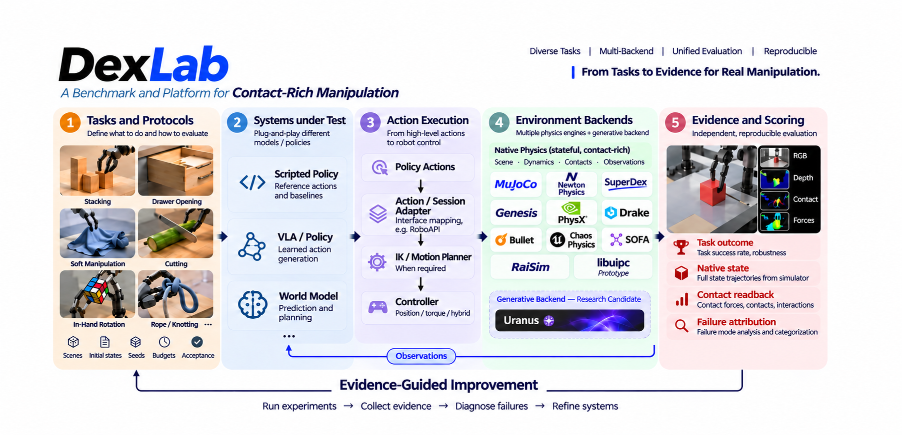

# DexLab

DexLab 是我的个人研究项目，探索 Agent Skills 与仿真如何相互改进。

用任务暴露问题，用对照实验定位原因，再改进对应的仿真。

## [打开 DexLab 研究目录 →](https://huangkiki.github.io/Dexlab/zh-cn/latest/blog.html)

目录直接展开研究导读、接触与物理、失败与诊断、策略与评测、仿真学习，不需要逐类点开才能看到文章标题。

[English](README.md)

<a id="architecture"></a>


## 引用

如果你在研究中使用了 DexLab，请引用本仓库：

```bibtex
@misc{huang2026dexlab,
  author = {Kiki Huang},
  title = {DexLab: A Benchmark and Platform for Contact-Rich Manipulation},
  year = {2026},
  url = {https://github.com/huangkiki/Dexlab},
  note = {GitHub repository}
}
```

GitHub 也会读取 [`CITATION.cff`](CITATION.cff) 提供一键引用。
