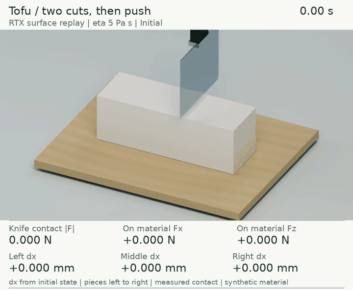
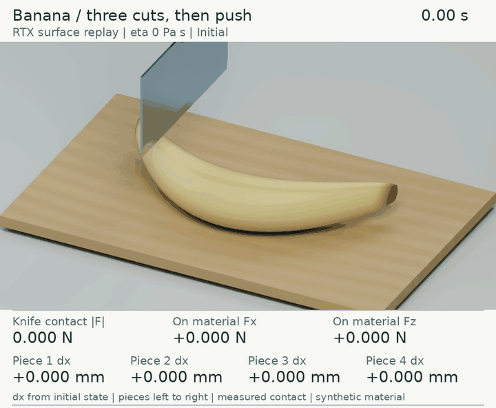
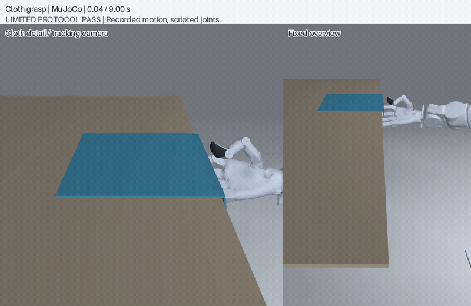
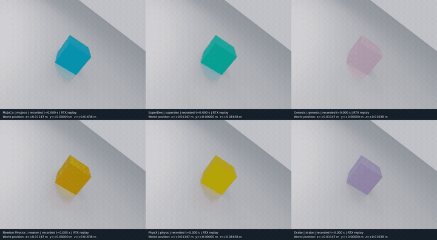

# DexLab

**面向富接触操作的基准与研究平台。**

我关注智能体与仿真如何通过实验相互改进。任务暴露问题，对照实验定位第一失效层，修复后再放回独立条件中复验。

## [Blog](https://huangkiki.github.io/Dexlab/zh-cn/latest/blog.html) · [打开 DexLab 研究总览 →](https://huangkiki.github.io/Dexlab/zh-cn/latest/index.html)

研究总览是 DexLab 的统一入口；本页同步展示项目架构、代表性实验、结果、Solver 说明与学习材料。

[English](README.md)

## 验证边界

当前**没有任何真机实验**。这里的“物理正确”只表示冻结仿真模型内的可复验一致性：输入可审计、有解析或工程参照、正负对照成立、守恒检查闭合，并且每次声明参数改动后都重跑完整回归。它不代表真实材料已经标定，也不代表已经通过 sim-to-real。

[物理验证区](https://huangkiki.github.io/Dexlab/zh-cn/latest/index.html#physical-validity)逐项列出代表实验的测试设计与证据边界。

## 架构

<p align="center">
  <a href="docs/site/_static/images/dexlab-architecture.png">
    
  </a>
</p>

任务与协议经过被测系统、动作执行和环境后端，最终进入独立证据与评分。观测和失败再返回技能与仿真，推动下一轮改进。

## 代表性实验

<p align="center">
  <strong>切割与侧推</strong><br>
  <a href="docs/site/zh/cut-push.md">
    
  </a>
  <a href="docs/site/zh/cut-push.md">
    
  </a>
  <br>
  <sub>最新记录：豆腐两刀三块，香蕉三刀四块。</sub>
</p>

| 实验 | 控制变量 | 关键读回 | 结果 |
| --- | --- | --- | --- |
| 切割与侧推 | 豆腐 0.125 ms、η=5 Pa·s；香蕉 0.25 ms、η=0 | 活动块相对位移；刀面接触冲量 | **通过** · 11.096 / 10.209 mm |
| 接触力矩 | 只把点接触改为抗扭接触 | 保持位移；峰值角速度 | **2.734 → 1.025 mm** · 29.336 → 0.024992 rad/s |
| 苹果梗抓取 | 同一组 10 个固定回归场景 | 离桌、支撑、保持、穿透与释放 | **MuJoCo 1/10 · SuperDex 10/10** |
| 布料 | 同一冻结留出集 | 形变、下垂、穿透、残余运动与成本 | **52 / 105 通过** |
| 六引擎斜面 | 静止、滑动与名义零摩擦；三个步长 | 位移、速度、力与数值一致性 | **逐配置判定，不合并为引擎排名** |

<table>
  <tr>
    <td width="50%" align="center" valign="top">
      <strong>Wuji 接触力矩</strong><br>
      <a href="docs/site/zh/wuji-contact.md"></a>
    </td>
    <td width="50%" align="center" valign="top">
      <strong>苹果梗抓取</strong><br>
      <a href="docs/site/zh/benchmark.md"></a>
    </td>
  </tr>
  <tr>
    <td width="50%" align="center" valign="top">
      <strong>布料操作</strong><br>
      <a href="docs/site/zh/cloth-comparison.md"></a>
    </td>
    <td width="50%" align="center" valign="top">
      <strong>六引擎斜面</strong><br>
      <a href="docs/site/zh/visual-comparisons.md"></a>
    </td>
  </tr>
</table>

## 三个判断

| 实验结论 | Solver 认知 | 失败根因 |
| --- | --- | --- |
| 结果是失效边界，不是引擎排行榜。接触模型、几何、耦合和辅助保持都可能改变任务判定。 | 先分清引擎、模型、耦合和数值配置；只有冻结版本、接触表示和预算后，配置之间才可能比较。 | 很多“solver 失败”在迭代前已经注定。应先查任务、几何、控制和耦合，再查残差。 |
| [实验目录](docs/site/zh/experiments.md) | [求解配置分层](docs/solver-taxonomy.zh-CN.md) | [失败根因图谱](docs/site/zh/failure-root-cause-atlas.md) |

## 按需要继续

- [全部实验](docs/site/zh/experiments.md)
- [研究导读](docs/site/_static/research/dexterous-simulation.html)
- [仿真学习](docs/site/zh/learning.md)

## 联系作者

[邮件](mailto:huangyue0719@outlook.com) · [GitHub](https://github.com/huangkiki)

## 引用

```bibtex
@misc{huang2026dexlab,
  author = {Kiki Huang},
  title = {DexLab: A Benchmark and Platform for Contact-Rich Manipulation},
  year = {2026},
  url = {https://github.com/huangkiki/Dexlab},
  note = {GitHub repository}
}
```
