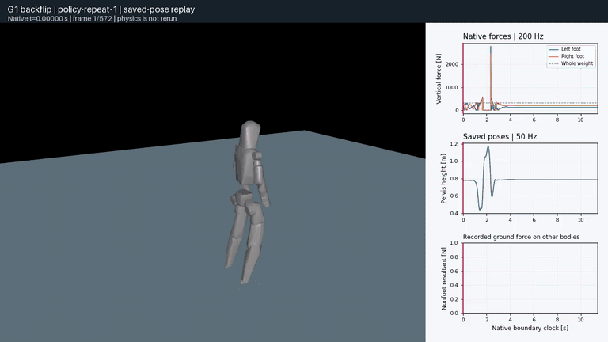

# 核对 G1 落地接触记录

[English](README.md) | [简体中文](README.zh-CN.md)

检查保存姿态上的几何相交与原生接触力是否对应同一状态、碰撞几何和物理子步。审计保留上游任务评分，不用 CPU 重新求解的力替换 GPU 记录。

固定参考栈已在 RTX 4090 上通过原生支撑／记录器检查和 **三次完整策略复跑**。每次包含 571 个控制步、2284 个物理子步及末尾 5 秒保持，均通过未修改的上游 `strict_v3` 和 legacy 判据。独立重建在这些新记录中均未发现非脚部穿透或有承载的非脚部接触。



第 1 次复跑的完整原速回放，保留全部 572 个状态边界及首末端点。原生模型每只脚用四个半径 5 mm 的接触球表示，没有完整脚部外观网格。仅改变显示灯光、颜色和视角，不重新积分。[50 Hz 视频 1](../../docs/evidence/landing/replays/policy-repeat-1/replay.mp4) · [视频 2](../../docs/evidence/landing/replays/policy-repeat-2/replay.mp4) · [视频 3](../../docs/evidence/landing/replays/policy-repeat-3/replay.mp4) · [力曲线](../../docs/evidence/landing/replays/policy-repeat-1/curves.svg)。

[完整原生记录（17.75 MB ZIP）](../../docs/evidence/landing/native-v1.zip) · [批次报告](../../docs/evidence/landing/native-summary.json) · [归档身份与离线验收](../../docs/evidence/landing/native-bundle.json) · [资产来源](../../docs/evidence/landing/asset-lineage.json)。

| 相同种子的独立进程 | 上游严格判据 | 末尾两秒水平漂移 | 导出／原始候选接触样本 |
| --- | --- | --- | --- |
| 1 | 通过 | 1.416 mm | 17,014 / 17,014 |
| 2 | 通过 | 1.207 mm | 17,013 / 17,013 |
| 3 | 通过 | 1.335 mm | 17,015 / 17,015 |

支撑夹具测得平均竖直承重为体重的 98.69%，双脚均有正承载；接触力合计与根部约束力最大差为 0.000835 N，记录器引入的轨迹差异满足原始阈值。夹具使用水平／姿态稳定、竖直辅助力为零，策略复跑中没有该夹具。

在步前／步后共享相同原生接触对集合的 6,428 个子步中，6,427 个的记录距离更接近**步前几何**。步前距离最大误差为 2.38e-7 m，步后误差达到 0.0202 m。这为当前记录的接触／姿态时序差异提供了证据，不能据此解释下述历史异常。相同种子的三次复跑不是随机初态可靠性试验；按协议报告的 0/3 失败、双侧 95% 二项模型区间为 [0, 0.7076]，没有确立独立性假设。

每次复跑都有 74 个标量关节的执行器力样本恰好达到保存的 CPU 模型限值，没有超出。单执行器／控制限值未启用，关节限值独立声明。GPU 限幅分支和整机质心动量不可观测，因此不宣称已确定饱和原因或通过整机动量平衡检查；原始控制量与广义力完整保留。

## 复算新的原生记录

归档保留三次完整记录、原生模型、支撑资格证据、原始预算账本、资源收据和许可。清单的 99 个条目通过字节／CRC 核验，解压后重新计算的三份几何审计与原结果完全一致。ZIP SHA-256 为 `70c7a6f6c4119a13cb3d20b33348d859a8e89dc00cf3aad35cc17a1098772802`。使用新的 `OUT` 目录，以及记录时的 MuJoCo 3.15.0 解释器，并将当前仓库加入 `PYTHONPATH`：

```bash
python -m zipfile -e docs/evidence/landing/native-v1.zip "$OUT"
"$NATIVE_PYTHON" -m dexlab.landing_audit "$OUT/policy-repeat-1" \
  --protocol "$OUT/protocol.json" --geometry --output "$OUT/recomputed-1.json"
"$NATIVE_PYTHON" -m dexlab.landing_replay "$OUT/policy-repeat-1" \
  --protocol "$OUT/protocol.json" --output "$OUT/new-replay-1"
```

对第 2、3 次记录执行同样命令即可覆盖整批。审计需要 NumPy 和原生 MuJoCo；回放另需 Matplotlib、Pillow、系统 FFmpeg 及可用渲染上下文。历史调用中的绝对路径为保持字节身份而保留，不能直接作为当前执行路径。`landing_report` 可从原始 campaign 目录布局和账本重建批次报告。所有输出拒绝覆盖。

38 个源网格与固定官方 Unitree Git blob 一致；上游固定 URDF 与官方文件有六个关节力／速度限值、两个手掌属性、mid360 变换及材质内联差异。保留这些冻结仿真输入，不将它们称为已核实的硬件设置。[来源声明](NOTICE)与许可文件覆盖转换模型及评测中裁剪／补静态帧后的参考样本；不分发权重或原始动作 NPZ。

## 历史差异单独保留

公开的首次评测包包含 571 个控制步、2284 个物理子步。DexLab 独立核对了全部 29 个关节及控制边界状态：关节位置完全一致，根部角速度最大差为 2.39e-6 rad/s。作者保存的几何分类在第 119 帧（2.38 s）标记非脚部接触，但记录中的非脚部有受力接触对计数始终为零。这排除了**这份记录**的简单关节错序，尚未确定接触缓存的计算时刻，也未解释差异。公开包缺少原生模型和完整接触对；作者另一次通过的复评仍单独保留。

## 独立复算历史公开记录

使用 Python 3.12 和已安装的 DexLab/NumPy。将 `OUT` 设为数据盘上的新目录，保留至少 50 GiB 空间。下载入口保存原始 ZIP，核验源端 SHA-256、大小、CRC 及解压路径。共享研究主机上的传输应套用仓库 `research_guard.py` 和 `bounded_run.py` 的 archive 限额。

```bash
python demos/landing-contact/fetch_release.py --output "$OUT"
python -m dexlab.landing_audit "$OUT/evaluation" \
  --protocol demos/landing-contact/protocol.json --output "$OUT/audit.json"
```

预期 JSON 为 `state_alignment.aligned: true`、`upstream_geometric_nonfoot_frames: [119]`、`native_pairs: "unavailable"`、`task_success: null`，并记录输入和协议哈希。`unavailable` 不是零接触。输出拒绝覆盖。该入口复算下载的记录，不执行策略。

## 获取新的原生参考记录

已通过资格的本地参考栈使用 Linux/NVIDIA、Isaac Lab `46d6cc3`、Newton `71eeba1`、MuJoCo/MuJoCo Warp 3.15.0、Warp 1.17.0+cu12、Torch 2.11.0+cu128。该 RTX 4090 批次与作者 RTX 5090、DexLab 3.17.0 提交门禁环境分别保留。按[固定上游准备说明](https://github.com/liudi159/supermimic-backflip-5090/blob/5b313d75e804cdd2ff1ce9bdcfa899a98eca856b/docs/REPRODUCE.zh-CN.md)新建隔离环境，不运行其中的训练命令。代码、机器人资产、动作和权重保留各自来源与许可，DexLab 不重新授予其许可。

全部 217 条原始依赖 pin 均匹配，但原清单自身仍有 7 项涉及 MuJoCo/USD 转换与 NumPy 使用方的依赖声明冲突。保留版本后，原始转换及本批原生任务均实际运行成功；其他已安装包的调用路径仍未验证。应保留元数据诊断，不能静默改变参考栈。

`run.py` 核验上游提交、受跟踪源码无改动和发布权重哈希，仅向原资格脚本或评测脚本注入记录器。显式设置单卡 `CUDA_VISIBLE_DEVICES`、`MUJOCO_EGL_DEVICE_ID`，使用新的输出目录。正式运行需套用冻结的 adaptive 资源方案与共享研究锁，并用已有 `MigrationBudget` 账本计入[协议](protocol.json)规定的最多 6 次尝试、累计 3600 秒。

```bash
python demos/landing-contact/init_budget.py "$BUDGET"
"$NATIVE_PYTHON" demos/landing-contact/run.py --upstream "$UPSTREAM" \
  --mode probe --case support-probe --budget "$BUDGET" --output "$PROBE_OUT"
# 仅在静态支撑资格通过后执行：
"$NATIVE_PYTHON" demos/landing-contact/run.py --upstream "$UPSTREAM" \
  --mode evaluate --case policy-repeat-1 --budget "$BUDGET" \
  --checkpoint "$CHECKPOINT" --output "$RUN_OUT"
"$NATIVE_PYTHON" -m dexlab.landing_audit "$RUN_OUT" \
  --protocol demos/landing-contact/protocol.json --geometry --output "$RUN_OUT/audit.json"
```

原生解释器需能导入本工作树的 `src`，例如为审计命令设置 `PYTHONPATH="$DEXLAB/src"`。初始化、失败和超时都消耗尝试。资格脚本包含两次无记录器对照和一次带记录器对照；资格失败则停止依赖的策略试验。完整 321 帧动作与 250 步保持不可裁剪。三个独立进程采用匹配初态，保留全部失败；该失败频率不代表随机初态可靠性。条件干预须在执行前登记唯一变化和配对对照。

记录器保存：

- 每个子步的原格式状态、控制、执行器和力数组，以及 Newton 刷新输入后、MuJoCo Warp 核心步前/步后的状态和原生时钟。
- `get_data_into` 导出的每个接触的局部力、坐标系、带符号距离和约束地址；另存过滤前的全部 Warp 候选接触。接触/约束容量溢出直接报错。
- 原生几何过滤、margin、执行器范围、分别记录的 CPU 模型与实际 GPU 参数、原生状态精度、迭代数和复制函数源码哈希。残差与收敛状态记 unavailable，不从迭代数推断。

`--geometry` 要求记录时的原生版本、模型及接触对。它仅执行 `mj_kinematics` 和 `mj_collision`，对步前/步后相同几何对比较距离，并将接触对缺失与零距离分开。原生时钟对齐本身不能确定碰撞缓存的计算时刻。CPU 接触复制测试不等于 Warp 记录器资格。

## 范围与证据

[Issue #260](https://github.com/huangkiki/Dexlab/issues/260) 跟进 PR 交付与未解决的历史解释。源端 Warp 路径已在固定本地批次通过支撑夹具及完整重复任务；其余五引擎及直接 MuJoCo profiles 缺少相同 G1 资产/策略的合格适配器。这不是六引擎比较、真机验证或生产 UniSim 适配器。历史差异未在当前批次复现并定位，因此未运行条件干预。现有账本记录四次原生启动、156.07 秒；两个条件槽位和原始 3600 秒上限保持不变，包含身份检查的完整受限窗口时间另外报告。

[独立历史记录审计](../../docs/evidence/landing/historical-audit.json) · [源端评测与边界](https://github.com/liudi159/supermimic-backflip-5090/blob/5b313d75e804cdd2ff1ce9bdcfa899a98eca856b/docs/EVALUATION.zh-CN.md) · [原始下载包](https://github.com/liudi159/supermimic-backflip-5090/releases/tag/v14-baseline-9029)
