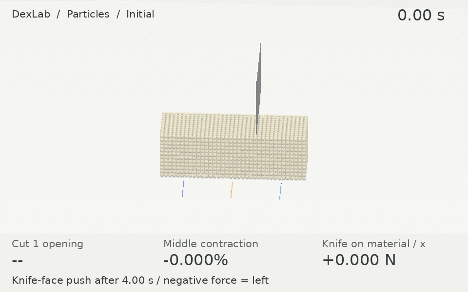

# Two sequential tofu cuts

This directory retains the historical velocity-probe protocol. The current homepage knife push uses a [separate new record](../tofu-knife-push/README.md).

[English](README.md) | [简体中文](README.zh-CN.md)

[Three-column comparison / 三列对比](https://huangkiki.github.io/Dexlab/en/latest/cutting-comparison.html)

Two cuts make three block pieces; after withdrawal, only the left piece receives an initial leftward velocity. This matches the task in the BladeMaster/CRESSim-MPM author comparison. Banana slicing is separate. Task and known blade thickness are aligned; complete author configurations remain unmatched, so no controlled performance ranking is implied.

Use `python -m dexlab.tofu_cut --task tofu-sequential --motion-protocol impulse --output RUN` inside the repository resource guard. Score with `python -m dexlab.cutting_score RUN`; render with `python -m dexlab.cutting_showcase RUN --output MEDIA`.

[Evidence](evidence.json) · [Raw archives](https://github.com/huangkiki/Dexlab/releases/tag/v0.62.0)
