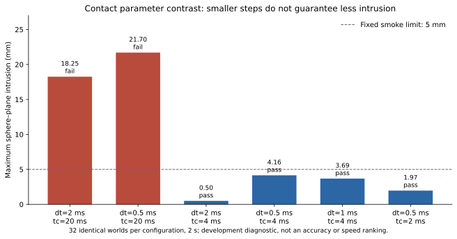

# Stable engine qualification

[English](engine-qualification.md) | [简体中文](engine-qualification.zh-CN.md)

Current Newton core evidence is separate from the historical `sim`-extra constraint table below: the official 1.6.1 / Warp 1.18.0 CPU XPBD sphere–plane profile passed positive, rebuild and collision-disabled controls. This does not upgrade the pinned UniSim SolverMuJoCo adapter or qualify SDF/grasp. [Protocol and complete raw evidence](newton-contact.md).

Release metadata, successful import, device smoke, and full task qualification are different evidence stages. A compatible package combination does not qualify an apple or cloth scene.

## MuJoCo 3.16.0 qualification (2026-10-14)

The official 3.16.0 wheel became available during the frozen 3.15.0 gate for [#198](https://github.com/huangkiki/Dexlab/issues/198). That gate passed its unit, documentation and two full apple regressions, then failed the latest-stable package admission. Its source, runtime, results and costs remain historical evidence. [#202](https://github.com/huangkiki/Dexlab/issues/202) tracks the new version's qualification before #198 resumes.

The isolated candidate has verified official wheel-to-installed-code identities for all five participating packages, the loaded 3.16.0 native library and actual-interpreter dependency compatibility. [Environment evidence](evidence/native316-environment.json) records the retained preparation-check failure and subsequent verification. Environment readiness does not qualify an experiment. `DEXLAB_MUJOCO_PROFILE=qualification-3.16.0` retains candidate status and `formal_batch_qualified: false`; historical defaults and frozen runs are unchanged. LIBERO remains on its separately qualified 2.3.7 runtime.

The [official release notes](https://github.com/google-deepmind/mujoco/releases/tag/3.16.0) describe changes to flex contact reduction, interpolated-flex stiffness, `mj_setConst` bounds and model-saving APIs. These upstream changes motivate native response and first-intrusion checks; they do not establish a DexLab improvement. Complete apple admission and repository delivery are tracked separately in [#202](https://github.com/huangkiki/Dexlab/issues/202); material and grasp qualification remains [#179](https://github.com/huangkiki/Dexlab/issues/179).

The [initial native API diagnostic](evidence/native316-api.json) reproduced the compiler's rejection of `implicitfast` for flex elasticity. The existing candidate-only migration now selects `discrete` for 3.16.0, preserving the historical profile. Targeted checks passed 67 of 68 tests, with one intentional skip for the pinned LIBERO 2.3.7 contract. Native force-driven displacement, fixed vertices, dynamic mass, MjSpec/MJB behavior and the 3.16.0 initialization rejection boundary are covered; this is not material calibration.

The [complete diagnostic packet](evidence/native316-validation.json) retains the original failed test, XML export controls, full passive trace and independent geometry audit. An original zero-tilt fixture lost `3.33333333334e-11 kg m²` in each nonzero principal inertia when exported and reloaded, exceeding the unchanged `1e-12` numerical export tolerance. The same loss exists in historical 3.15.0 records. A synthetic unit-inertia control round-trips without a detected difference. Incline integration uses the original model, never that compiled XML; this export observation does not establish a dynamics regression.

The inherited, uncalibrated 169-vertex panel completed all 4,000 settling steps at 0.5 ms, yielding 4,001 finite state frames over 2 seconds with no native warnings. The independent table audit first observed midsurface intrusion at sample 45 (22.5 ms): **0.049681 mm**. Sample 44 had no detected intrusion at the existing numerical zero tolerance. The audit stops at the first witness; this is neither a maximum-depth estimate nor a continuous-time onset bound. All raw state/model hashes, sampling and topology were rechecked, and the independent audit reproduced exactly.

Targeted validation, its retained failure, the export probe and final verification consumed **35.48 service seconds** within the frozen 720-second budget; the successful unit/settling package peaked at 600,784,896 bytes. These costs include setup, recording and offline auditing, and are not engine-throughput measurements. The full trace is a version-specific development diagnostic: it does not qualify real material response, robot contact, grasp or a causal improvement over earlier engines.

## Historical 3.14.0 migration evidence

The remainder of this page retains the dated migration observations and their then-pending checks. It is not the current queue or qualification status; use the linked Issues and recorded versions for subsequent delivery.

The migration gate at tree `8ac3d71b27145ec664af37728b676dd6c8dd1f38` passed 335 tests and both complete 14-second apple episodes with separate acceptance. Later provenance additions pass 346 tests; the final submitted-tree gate remains pending. No held-out scenes have been dispatched.

| Migration measurement | MuJoCo 3.14.0 | SuperDex FP64 1.0.0 |
|---|---:|---:|
| Maximum penetration (mm) | 0.1150 | 0.4523 |
| Minimum hold clearance (mm) | 125.6343 | 115.2156 |
| Maximum wrist-relative displacement (mm) | 0.1319 | 0.0399 |
| Complete 14-second independent acceptance | Pass | Pass |

These are one-scene development measurements with different engine settings; wrist-relative motion is not material-point slip. Cloth remains failed, as detailed below. The official archive hashes and installed-code linkage for all five participating distributions were verified separately: [provenance receipt](evidence/native-official-wheels.json).

Candidate `autoresearch.py check/submit` requires `DEXLAB_QUALIFICATION_WHEELS` to point to a private wheel directory. After both episodes and scorers it rehashes/rescores raw records, checks official archive-to-installed code identity, freezes observed source/runtime/settings, and refreshes releases before allowing submission. A failed or newly outdated qualification prevents commit/push. Old runtime-only records cannot satisfy this gate. Final results will be bound to the submitted tree and release evidence.

## Frozen inventory

Official releases and PyPI metadata were checked on 2026-10-04 UTC (2026-10-05 local). MuJoCo 3.14.0, MuJoCo Warp 3.14.0 and Warp 1.17.0 are the isolated GPU probe candidates. The historical demo installer remains unchanged; its old results stay historical.

| Profile | Status | Boundary |
|---|---|---|
| MuJoCo 3.14.0 native | Partial | Paired migration apple pass; cloth failed; final provenance gate pending |
| MuJoCo Warp 3.14.0 + Warp 1.17.0 | Pending | Per-device runtime/contact probe is not SDF grasp qualification |
| Newton 1.6.0 `sim` | Blocked combination | Its MuJoCo and MJWarp ~3.12 requirements conflict with latest 3.14 |
| Genesis 1.4.3 | Pending | Separate rigid and cloth qualification, issue #42 |
| SuperDex FP64 1.0.0 | Migration apple passed | Final submitted-source provenance gate pending |
| Isaac Sim 6.1.0 | Pending | Embedded PhysX and complete task runtime still need verification |
| ovphysx 0.6.3 | Excluded from stable primary comparison | Distribution classifier is Alpha |

## Reproducible GPU smoke

`scripts/probe_mjwarp.py` runs 32 independent copies of a synthetic 0.1 kg, 0.05 m sphere dropping onto a plane, 1,000 steps at 2 ms. It checks native/binding identity, finite state, complete elapsed simulation time, gross crossing, final support and settling. Every step is sampled. The 5 mm gross-crossing, 2 mm final-height and 0.02 m/s settling bounds are smoke diagnostics, not grasp acceptance or calibrated material tolerances. Outputs include exact model/source hashes, versions, precision, solver and failures.

Run one process per available device with explicit GPU isolation. Warmup uses disposable state. Kernel compilation, every-step host copies and concurrent work make the wall time unsuitable for engine speed ranking. Use the existing research guard and resource envelope, not a second scheduler. Refuse occupied devices or insufficient memory/storage. Official wheels and installed files must be checked before execution; no engine patches or dependency overrides.

## Measured development results

Six devices first ran 32 identical initial-state replicas each. All six default-parameter records agreed and failed intrusion acceptance. A subsequent six-device parameter contrast had **four passing and two failing configurations**. These are not 192 independent random trials, a held-out evaluation, or an engine ranking.

| Step (ms) | Contact time constant (ms) | Maximum geometric intrusion (mm) | Complete smoke |
|---:|---:|---:|---|
| 2 | 20 | 18.254 | fail |
| 0.5 | 20 | 21.703 | fail |
| 2 | 4 | 0.498 | pass |
| 0.5 | 4 | 4.157 | pass |
| 1 | 4 | 3.686 | pass |
| 0.5 | 2 | 1.972 | pass |

Native MuJoCo with the identical default XML measured 18.254210 mm intrusion versus MJWarp's 18.254361 mm. This supports a soft-contact-parameter explanation for this failure, not a GPU-specific penetration claim. Four shorter-time-constant configurations passed, but timestep effects are nonmonotonic; lower penetration alone establishes neither accuracy nor convergence. Engine code and thresholds were unchanged. CUDA state precision is float32; versions, model/source and official native hashes accompany the records.

[All results and native counterpart trace](evidence/engine-qualification/contact-probes.json) · [Original probe v1](evidence/engine-qualification/probe-v1.py) · [Parameter contrast v2](evidence/engine-qualification/probe-v2.py) · [Official wheel hashes](evidence/engine-qualification/official-wheel-manifest.json) · [Plot provenance](evidence/engine-qualification/plot-provenance.json)

## Remaining admission work

`engine_versions.validate_versions` establishes metadata compatibility only. Apple dispatch now connects raw-record rescoring and native/source freezes, described below. Current complete task validation, publication rechecks and unsupported-profile audits remain #41; failed cloth evidence remains unqualified.

[Official MJWarp usage](https://mujoco.readthedocs.io/en/stable/mjwarp/index.html) · [MuJoCo release](https://github.com/google-deepmind/mujoco/releases/tag/3.14.0) · [MJWarp release](https://github.com/google-deepmind/mujoco_warp/releases/tag/v3.14.0) · [Warp release](https://github.com/NVIDIA/warp/releases/tag/v1.17.0)

## Native candidate profile

The first full-suite run on 3.14.0 encountered four failures and eighteen errors because cloth/contact adapters hard-coded 3.11.0; apple regressions had not started. Failed logs are retained.

`DEXLAB_MUJOCO_PROFILE=qualification-3.14.0` explicitly selects the candidate profile and requires both package and loaded-native versions to match 3.14.0. Metadata retains candidate status and `formal_batch_qualified: false`. The default `historical-3.11.0` still rejects silent upgrades. This switch permits qualification work; it does not replace official release checks, hashes, task scoring or formal dispatch admission. Collision, controller, solver parameters and physical thresholds are unchanged.

## Native apple result and remaining failures

The explicit candidate suite ran 311 tests with **1 failure and 2 errors**. Both cloth errors reject flex elasticity with `implicitfast`; the official engine requires a declared integration migration. The cylinder test measured 3.9903707646 N against its unchanged 4 N ± 0.001 N check. These failures are retained; thresholds and official binaries were not changed.

An apple-only run then completed both 14-second episodes and separate scoring, with the 11–14 s hold checked at every physics step. [Machine-readable scores](evidence/native314-apple-qualification.json) bind this evidence to source tree `2fd01ed93ac9a67e9286dcaed413c4566d9481c1`.

| Metric | MuJoCo 3.14.0 | SuperDex 1.0.0 FP64 |
| --- | ---: | ---: |
| Maximum penetration (mm) | 0.1165 | 0.4523 |
| Minimum hold clearance (mm) | 125.6668 | 115.2155 |
| Maximum wrist-relative displacement (mm) | 0.3355 | 0.0399 |
| Independent apple acceptance | Pass | Pass |

Each column is one development scene, with engine-specific settings. Wrist-relative displacement is not material-point slip. This is neither a held-out benchmark nor an accuracy ranking; full-suite and formal dispatch admission remain pending. Control uses known poses and explicit coordination, with rigid stems and no hardware validation.

The first apple-only attempt timed out under a 12 GiB memory high watermark. The same source passed after raising only that watermark to 15 GiB, retaining the 16 GiB hard limit and zero swap. Failed outputs remain preserved. This resource-constrained run is not a simulation-speed measurement.

## Local migration diagnosis (2026-10-05)

The earlier local migration passed 315 unit tests, with an explicit discrete cloth-integrator migration and the historical implicitfast profile retained. The development drape still reaches 2.656 mm sphere intrusion, exceeding the existing 1.5 mm limit: cloth remains unqualified. The cylinder test now distinguishes normal-force projection from total squeeze force; engine code and physical acceptance bounds are unchanged. Earlier paired 14-second apple evidence belongs to the earlier source tree; full regression of these changes and formal dispatch admission remain pending.

The original 311-test and local 314/315-test failures remain recorded. Two integration errors were resolved by explicitly selecting `discrete` only for the candidate profile; experimental IPC was not enabled. Missing optional contact-adapter imports now produce an archived failure instead of escaping before the receipt is written.

In the unchanged 64-facet cylinder fixture, MuJoCo 3.14 measures 3.990371 N normal x-projection plus 0.009629 N friction x-projection, totaling 4.000000 N per pad. The normal projection agrees with the facet approximation `4*cos(pi/64)^2 = 3.990369 N`. The matched historical 3.11 run reports 4 N normal projection and zero tangential x-component. This observation does not establish why native contact normals changed. The unit assertion now checks total horizontal force at its original 0.001 N tolerance; independent normal-load checks are unchanged.

The 3-second `dev-drape` run completed with finite states and source/hash checks, but failed obstacle penetration: 2.655568 mm maximum, versus the unchanged 1.5 mm limit. No sampled self-intersections were found in 301 audited frames; this is not a continuous-time guarantee. This development diagnostic neither fixes the robot-cloth scene nor qualifies a held-out batch.

The complete 9-second robot-cloth candidate also failed: maximum edge strain was 5.48%, above the original 5% bound. Independent table geometry auditing found cloth inside the table in 219 of 225 saved frames, starting at the first frame. Maximum triangle-interior depth was 3.0 mm (distance to the nearest boundary inside the 6 mm thick table, not total crossing distance). Online contact depths do not refute this geometric failure. Hold lift was 12.12 cm, two-pad contact fraction 100%, and maximum material-anchor error 2.34 mm; these do not establish overall acceptance. The audit covers 25 Hz zero-thickness triangles, not between-frame separation or independent hand-surface collision.

[Local migration evidence / 本机迁移证据](evidence/native314-local-migration.json)

## Production dispatch admission

Apple `benchmark run --split test` requires `--qualification-records`, a private JSON mapping profile keys (`apple_admission.profile_key`) to original qualification-run directories. The task records source and observed runtime identities before/after execution. The reader hashes raw inputs/models again and calls the independent scorer; legacy records without these observations are not silently promoted. Each new freeze refreshes official PyPI stable releases and distribution hashes for five participating packages. Loaded payload ownership, native FP64 and binary RECORD entries are checked. MuJoCo is located through actual process mappings. SuperDex has no native semantic-version API exposed here: payload hashes and precision are recorded explicitly instead.

The freeze enters `run.json` without private qualification-directory paths. Resume retains that freeze; workers compare source/native artifacts and settings before/after execution. Direct held-out workers cannot omit admission. `publication_status` refreshes releases and classifies a completed batch as historical if upstream changes, requiring new qualification without rewriting old results. This publication check still needs final delivery verification. New complete paired records for this source remain pending; no successful formal batch is claimed.

Both cloth batches and single held-out cases reject dispatch; development diagnosis and archived scoring remain available. There is no qualification bypass switch. `scripts/autoresearch.py check` now honors the same explicit `SUPERDEX_PYTHON` as the demo launcher (default: worktree `.venv`), preventing a new-engine run from being scored with an unintended interpreter.

For bounded local qualification, set `DEXLAB_RUN_ROOT` to an absolute private data-volume directory; gate output directories retain unique run IDs. This redirects artifacts without changing the worktree or replacing existing outputs.

A later local gate was interrupted during preparation after measured full memory pressure reached 56.61% over60s under a16GiB hard/15GiB high envelope. No physics acceptance result was produced; the termination and original source tree are retained. The completed migration gate used a 24 GiB hard/23 GiB high envelope after measured admission with an unchanged 8 GiB desktop reserve; CPU stays2 cores and swap0. Resource-constrained qualification times are not engine throughput comparisons.

New apple qualification additionally requires `--qualification-wheels`: a private directory of exact official wheels. Admission hashes each archive against fresh official release metadata, then compares its Python/native payload hashes with the observed installation. A self-consistent local RECORD alone is insufficient. The frozen receipt retains only filenames and hashes; resume rejects missing or changed provenance. All five real distributions have now passed this archive-to-code comparison; final submitted-source qualification remains pending.

Historical demo/source-build execution does not emit qualification observations or acquire formal admission. Only an explicit candidate compatibility profile enables the observation step; formal batch dispatch still requires complete independently verified evidence.
