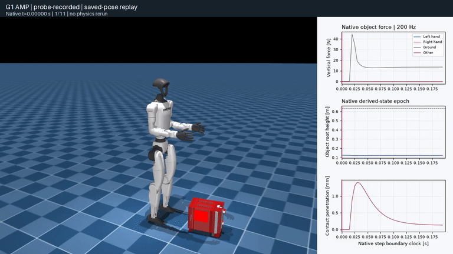

# Public AMP lift: recorder parity failed

**The two 0.2 s AMP probes completed, but recording parity failed. The three full lift seeds and the no-hand-contact control have not run.** This preserves a qualification failure, not a policy failure or a completed lift result.

The public `Mjlab-G1-DualArm` checkpoint uses Toaster003. It is distinct from the same repository's SuperMimic/PPO-Sim tracking task and its 1.5 kg box; unavailable tracking weights cannot be replaced by AMP scores.



The GIF shows all 11 saved pose boundaries at 50 fps: 0.2 s of native motion plus one endpoint frame (0.22 s presentation). The object remains ground-supported in this short probe. This interval cannot assess a 60 s lift. No dynamics were rerun for playback.

<video controls preload="metadata" style="width:100%;max-width:100%;height:auto"><source src="_static/amp-lift/probe-replay.mp4" type="video/mp4"></video>

## What passed and what stopped

Both fresh-process runs used seed 137, the released actor, one world, 5 ms physics and four substeps per action. Initial state, effective randomized model, source/runtime identity and first policy input matched exactly. Play mode retained source initialization and mass/COM/friction randomization, while disabling virtual PD and observation corruption. The recorded object's mass was 1.376522779 kg; 1.30 kg is only the source's nominal inertial sum.

| Check | Observed result |
| --- | --- |
| Native execution | Both 10-action probes completed with final resource telemetry and no OOM or sampled GPU stop |
| First control endpoint | Maximum qvel component difference 2.861023e-6, within the frozen 1e-5 tolerance |
| First failed endpoint | Action index 1, at 0.04 s: qvel difference 2.193451e-5, above 1e-5; relative tolerance remains zero |
| Largest qvel difference | 5.917549e-4 at action index 8, 0.18 s |
| Recorded-trace integrity | All 40 native substeps and 10 control endpoints passed continuity and independent force decoding; maximum force-component error 1.525879e-5 |
| Full evaluations | Three 60 s seeds and one paired no-hand-contact control: **not run** |

The qpos/qvel comparisons use the original arrays; generalized coordinates mix translational and rotational components, so these maxima are not a single physical displacement or speed metric. One unrecorded/recorded pair cannot distinguish native repeat variability from an observer effect. The unchanged qualification remains **failed**. Additional diagnostic repeats require a separately frozen decision; unused full-case slots are not silently reassigned.

The first offline scoring attempt also found a separate classifier defect: terrain belongs to a named fixed child body, not body 0. The scorer now recognizes planes on bodies welded to world, while keeping fixed boxes as other support. The original failure is retained, a compiled-model regression covers this case, and rescoring uses the same immutable native record. This fix does not repair or override parity.

## Recompute the evidence

Download the [numerical evidence archive](../../evidence/amp-lift/probe-v1.zip), [result and archive hashes](../../evidence/amp-lift/summary.json), and [replay provenance](../../evidence/amp-lift/probe-replay.json). The archive includes both complete control streams, 40 recorded substeps, effective model arrays, source snapshots, failed qualification, resource receipts and corrected offline diagnostics. Every entry hash and ZIP CRC was verified; rescoring extracted data reproduced the report and all series arrays exactly.

```bash
unzip probe-v1.zip -d probe-v1
python demos/amp-box-lift/score.py   --run probe-v1/runs/probe-recorded-1 --output probe-rescore
```

Use the reviewed checkout and a fresh output directory. This command performs no physics. Compiled MJB files, meshes, policy weights and motion clips are not redistributed in the archive. Rendered assets come from [humanoid-amp-ppo 4889389](https://github.com/shuayyy/humanoid-amp-ppo/tree/4889389118e0c88d3945dff54d2cd3f992ed815e): Unitree G1 (BSD-3-Clause) and RoboCasa Toaster003 (CC BY 4.0), with the source task's model adaptations. [Exact asset lineage and modifications](https://github.com/huangkiki/Dexlab/blob/main/demos/amp-box-lift/provenance.json). Original motion-capture and checkpoint-training lineage remains unverified.

## Runtime and remaining scope

The isolated candidate uses MuJoCo 3.10.0, MuJoCo Warp 3.8.0.3, Warp 1.15.0 and Torch 2.13.0. The selected Warp runtime subtree matches the source's locked 3.8.0.2 commit. Two headless probes executing successfully does not establish compatibility with every dependency declaration: five known declarations remain inconsistent. The [case README](https://github.com/huangkiki/Dexlab/blob/main/demos/amp-box-lift/README.md) documents exact installation, official archive/code checks and the retained failed installation.

The native ledger is **2/6 starts, 92.084833/5,400 s**, with the original failed qualification intact. Enclosing service wall times are separate (88.988194 s and 11.104492 s). The measured 32 GiB / 4 CPU / zero-swap plan reserves 8 GiB desktop memory. Whole-device GPU usage is sampled every 2 s against 20,480 MiB with at least 2,048 MiB reserve; intervening peaks are not observed and this is not a hard allocation cap.

[#259](https://github.com/huangkiki/Dexlab/issues/259) retains recorder qualification, complete positive/negative evaluations, continuous full-episode video, physical interpretation and the separate missing tracking/squat/comparison inputs. The 2 s carrying diagnostic, source success flags and contact/gravity momentum residuals do not establish physical task success. This case adds no completed cross-engine coverage entry.
