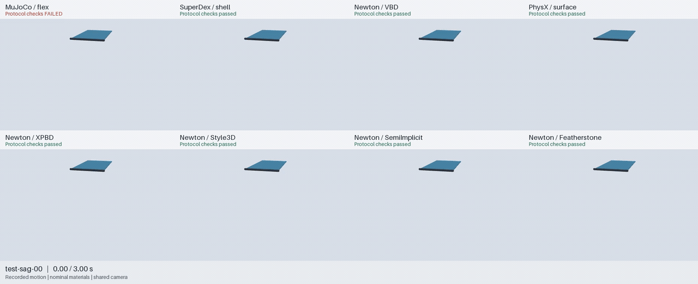
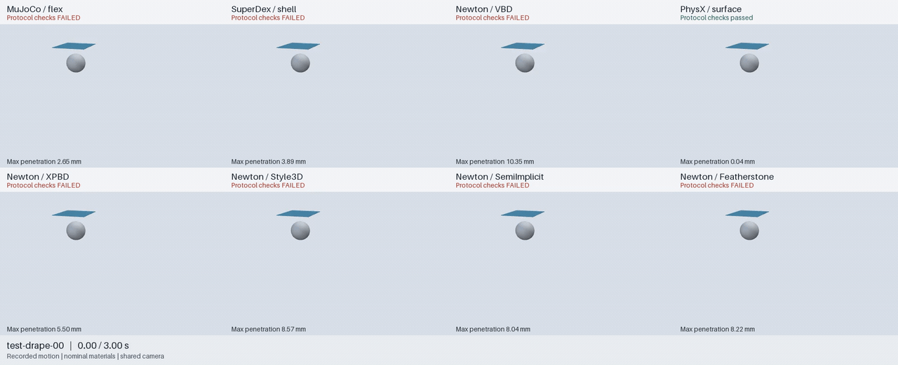

# Cloth: one scene, different engines

Watch the motion before reading the checks. These historical recordings replay their actual vertices with shared lighting, a fixed camera and synchronized time. No dynamics were rerun, vertices moved to remove penetration, or extra folds added to the mesh.

## Sag: fix one edge and release the strip

```{image} ../../../docs/evidence/cloth-studio/sag.gif
:alt: Complete three-second sag recordings across four representative engine configurations
:width: 1280px
```

```{raw} html
<p><a href="_static/cloth-studio/sag.mp4">Full video</a> · <a href="_static/cloth-studio/sag.json">Frame times and provenance</a></p>
```

Compare hanging shape, oscillation and surface crossings. Each panel shows the protocol result for its complete recording. Green means the specified checks passed, not that its material matches real fabric. The light floor is a backdrop and the short rail marks the existing fixed edge. Neither participates in physics; this experiment has no ground contact.

## Sphere drape: inspect contact as well as the silhouette

```{image} ../../../docs/evidence/cloth-studio/drape.gif
:alt: The same free sheet drapes over a sphere, retaining failures and maximum penetration labels
:width: 1280px
```

```{raw} html
<p><a href="_static/cloth-studio/drape.mp4">Full video</a> · <a href="_static/cloth-studio/drape.json">Frame times and provenance</a></p>
```

The sheet starts at rest above a 60 mm-radius sphere and ground. Every panel also reports maximum penetration over the complete recording; cloth below the ground is never moved back onto it. Animation cannot check collisions between displayed frames. Independent scoring remains the basis for the results.

## Keep the other Newton solvers visible

The first views compare MuJoCo, SuperDex, Newton VBD and PhysX so the cloth remains readable. These expanded views retain all eight configurations, including all five Newton solvers, with a shared camera and timeline within each view.





```{raw} html
<p><a href="_static/cloth-studio/sag-profiles.mp4">Full sag video</a> · <a href="_static/cloth-studio/sag-profiles.json">Provenance</a> · <a href="_static/cloth-studio/drape-profiles.mp4">Full drape video</a> · <a href="_static/cloth-studio/drape-profiles.json">Provenance</a></p>
```

## What is covered across six engines?

| Engine / historical configuration | Existing cloth evidence | Matched playback |
| --- | --- | --- |
| MuJoCo 3.11.0 flex | 4/15 pass; sag has surface crossings and sphere drape has penetration | Sag and sphere drape |
| SuperDex 1.0.0 FP64 shell | 7/15 pass; sphere drape still fails | Sag and sphere drape |
| Newton Physics 1.7.0.dev0, `2dee3234` | XPBD / VBD / SemiImplicit / Featherstone each 8/15; Style3D 9/15. These are five profiles of one engine | All five profiles |
| PhysX surface deformables, Isaac Sim 5.1.0.0 | Separate 15-case batch: 10 pass, 1 surface-crossing failure, 4 unsupported nodal-force cases | Corresponding final-batch records |
| Genesis 1.4.3 PBD | Contact, momentum-exchange and grasp diagnostics exist; no matched records for this input protocol | No matched record |
| Drake | No qualified thin-cloth record for this protocol in the current repository | No matched record |

This is a **historical four-engine response comparison with six-engine coverage**, not a complete six-engine cloth benchmark. PhysX's host version is not its native core version; the historical “107.3” label does not establish core identity. See the [version audit](https://github.com/huangkiki/Dexlab/blob/main/docs/physx-solver-audit.md) and [Genesis cloth diagnostics](https://github.com/huangkiki/Dexlab/blob/main/docs/genesis-cloth.md).

The previews select `test-sag-00` and `test-drape-00` by manifest order, showing the complete 0–3 s at normal speed, without selecting the best outcome. The full historical cohorts remain [105 runs / seven profiles](https://github.com/huangkiki/Dexlab/blob/main/demos/cloth-benchmark/evidence/heldout-v1.json) and the [separate PhysX batch](https://github.com/huangkiki/Dexlab/blob/main/demos/physx-contact/evidence/cloth-v1.json); these are not new holdouts. Materials are not calibrated across engines, and iteration budgets and precision differ. Neither appearance nor pass counts rank physical accuracy or speed.

## What we borrowed from RSS

[RSS's cloth example](https://github.com/robosimstudio/robosimstudio/blob/23417de77edf59d614531a833334ed4e2206fc2c/examples/01_cloth/02_engines.py) switches the same sheet between Newton, SuperDex and Genesis. Its [rendering presets](https://github.com/robosimstudio/robosimstudio/blob/23417de77edf59d614531a833334ed4e2206fc2c/robosimstudio/core/render/look.py) provide an environmental background with key and fill lights. We borrowed those presentation ideas, using shared framing while retaining the recorded coarse geometry. Fabric texture and smooth normals affect lighting only.

RSS's [pinch example](https://github.com/robosimstudio/robosimstudio/blob/23417de77edf59d614531a833334ed4e2206fc2c/examples/01_cloth/00_towel.py) uses one-way coupling: the arm feels no cloth reaction. It is not evidence of DexLab frictional grasp success. [Robot cloth grasping](experiments.md) keeps its own model, records and scoring.

## Regenerate

Prepare matching records from the [cloth benchmark](https://github.com/huangkiki/Dexlab/blob/main/demos/cloth-benchmark/README.md) and [PhysX raw archive](https://github.com/huangkiki/Dexlab/releases/download/v0.11.0/v0.11.0-physx-cloth-evidence.tar.gz), then run in the repository environment:

```bash
.venv/bin/python demos/cloth-benchmark/src/render.py \
  /path/to/test-sag-00-mujoco \
  /path/to/test-sag-00-superdex-shell \
  --output /path/to/new-comparison
```

Pass one to eight recordings. Mismatched inputs, initial positions, rest meshes or timelines are rejected. Output must be a new directory outside all recordings. PNG inspection frames, MP4, GIF and provenance are generated together. The renderer checks input hashes before and after playback and executes zero physics steps.
