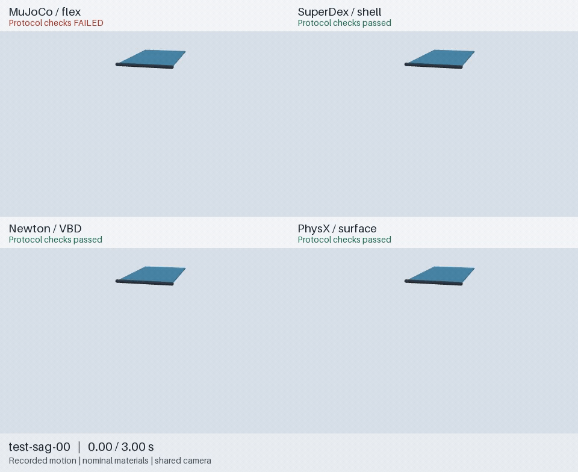
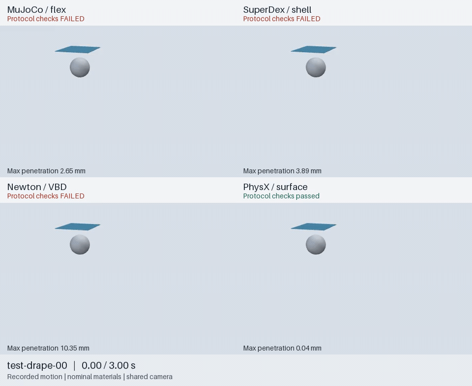

# Cloth: one scene, different engines

**A strip that hangs freely can bend under its own weight. Draping a sheet over a sphere asks a second question: can contact support it?** In these historical recordings, the same Newton VBD profile passed the fixed-edge sag checks and reached **10.35 mm** of sphere penetration in the drape case.

## Sag: fix one edge and release the strip



Release a horizontal strip with one edge fixed and watch gravity pull the free end down. Check how far it drops, how it oscillates and whether the fixed points move. The floor here is a backdrop. This isolates the hanging response.

## Sphere drape: inspect contact as well as the silhouette



Release a free sheet from rest above a **60 mm** radius sphere and a floor. Watch the sphere support the sheet and the layers pass over each other. A final silhouette can hide penetration earlier in the motion.

In the Newton VBD record, cloth self-crossing first appeared in the sampled frames at **0.21 s**. Peak sphere penetration reached **10.35 mm**, exceeding the **1.5 mm** limit. Sphere penetration had returned to zero by the final state, while the full-motion check still failed. The observed failure is in contact response. The record does not resolve the contributions of contact generation, material response and integration. A follow-up should keep the mesh, initial state and material fixed, log first contact and first penetration, then vary the step size alone.

These are historical profiles with matched input meshes and initial states within each scene. Material response has not been calibrated across engines, and the profiles use different precision, iteration settings and implementations. Comparing the two motions helps locate where the behavior first changes. Real fabric would need its own measurements.

```{raw} html
<span id="keep-the-other-newton-solvers-visible"></span>
<span id="what-is-covered-across-six-engines"></span>
<span id="what-we-borrowed-from-rss"></span>
<span id="regenerate"></span>
```

## Experiment records

[Eight profiles, scoring and replay generation](cloth-comparison-report.md) · [Sag frame mapping](https://huangkiki.github.io/Dexlab/zh-cn/latest/_static/cloth-studio/sag.json) · [Drape frame mapping](https://huangkiki.github.io/Dexlab/zh-cn/latest/_static/cloth-studio/drape.json)
