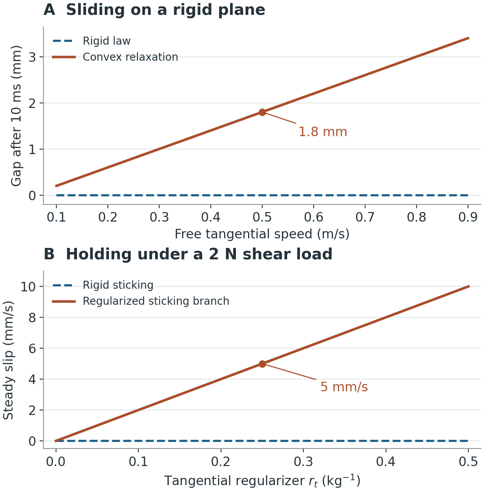

# Why can a converged contact solver lift a block off the table?

Push a sliding block across a level table. The ideal rigid-contact law lets the table support the block while it slides horizontally. One convex relaxation gives it an **upward velocity**, even when the solver drives its own residual to zero. The separation is a solution of the relaxed equation.

Beker et al. organize five equivalent statements of the rigid law and show where alternative formulations change the physics. A single-contact block gives concrete numbers for two of those changes. [Tutorial v1](https://arxiv.org/html/2611.26600v1) · [Figure 5](https://arxiv.org/html/2611.26600v1#S3.F5)

## One simulation step

Consider a rigid block constrained to translate, with a single point of contact. Compute the end-of-step velocity without contact, then add the velocity change caused by the contact impulse:

$$
v^+=v_f+Gp,\qquad G=JM^{-1}J^\top.
$$

Here $p$ is the step impulse, $J$ maps generalized velocity to relative contact velocity, and $M$ is the generalized inertia. For this block, $G$ is $1/m$ along each of the two axes. In a grasp, off-diagonal blocks of $G$ can describe how an impulse at one finger changes the relative velocity at another. [Tutorial §2](https://arxiv.org/html/2611.26600v1#S2)

Let $d$ be the initial gap, $h$ the step size and $s=v_n^++d/h$. For this linearized step, $hs$ is the predicted final gap.

| Mode | Rigid law |
| --- | --- |
| Separation | Positive gap, zero normal and tangential impulses |
| Loaded sticking | Zero gap and slip speed. Tangential impulse magnitude can be as large as $\mu p_n$ |
| Loaded sliding | Zero gap. Tangential impulse reaches $\mu p_n$ and opposes slip |

Here $p_n\ge0$ is normal impulse, and $\mu$ is the friction coefficient. The boundary can have both zero gap and zero normal impulse. [Equation (39)](https://arxiv.org/html/2611.26600v1#S4.E39) · [Figure 6](https://arxiv.org/html/2611.26600v1#S3.F6)

## How sliding becomes lift-off

The friction cone limits the tangential impulse. The dual cone requires $y_n\ge\mu\lVert y_t\rVert$, and the impulse must be orthogonal to $y$. In loaded sliding the impulse reaches the cone boundary, so $y_n=\mu\lVert v_t^+\rVert$.

$$
\begin{aligned}
y_n=s+\mu\lVert v_t^+\rVert &\quad\Rightarrow\quad s=0,\\
y_n=s &\quad\Rightarrow\quad s=\mu\lVert v_t^+\rVert .
\end{aligned}
$$

The **de Saxcé correction** supplies the extra normal component in the exact formulation on the first line, through the variable $y$. The block can still have purely horizontal velocity. Removing the correction makes the problem convex and puts that normal component into the predicted contact velocity. With zero initial gap, the relaxed step opens a gap. [Tutorial §4.1.2](https://arxiv.org/html/2611.26600v1#S4.SS1.SSS2) · [§6.2](https://arxiv.org/html/2611.26600v1#S6.SS2)

Take $m=1\,\mathrm{kg}$, $g=10\,\mathrm{m/s^2}$, $h=0.01\,\mathrm{s}$, and $\mu=0.5$. The block starts flush with the table. The free velocities are $0.50\,\mathrm{m/s}$ tangentially and $-0.10\,\mathrm{m/s}$ normally. Both solutions slide with $p_t=-0.5p_n$.

| Contact law | Normal impulse (N·s) | Final slip speed (m/s) | Final normal speed (m/s) | Final gap (mm) |
| --- | ---: | ---: | ---: | ---: |
| Exact rigid contact | 0.10 | 0.45 | 0.00 | 0.0 |
| Unregularized convex relaxation | 0.28 | 0.36 | 0.18 | 1.8 |

For the second row, $-0.10+0.28=0.5(0.50-0.5\times0.28)=0.18$. A contact can lose support on a later step as a result. For an engine diagnosis, read impulse, normal and tangential velocity, and gap for the same contact pair and time step. Control for geometry, restitution, compliance and stabilization before attributing the separation to the contact law. Then check whether the relationship persists when the iteration budget increases.

*Original analytical examples. A shows speeds for which both models are on the sliding branch. In B, the tangential regularizer maps impulse to velocity. The inputs and equations below and above the figure reproduce its marked values.*

## How a sustained load can produce creep

Start the same block from rest with a constant $2\,\mathrm N$ horizontal force. The rigid static friction limit is $\mu mg=5\,\mathrm N$. The rigid law can balance the load with $p_t=-Fh$ at zero slip speed.

Keep the normal law rigid and introduce a fixed tangential regularizer $r_t$. With zero tangential reference bias, the simplified convex model satisfies $v_t^++r_tp_t=0$ on the cone-interior branch. Steady force balance requires the same impulse $p_t=-Fh$. The block therefore slips at $v_t^+=r_tFh$. At $r_t=0.25\,\mathrm{kg^{-1}}$, the steady speed is $5\,\mathrm{mm/s}$. This can accumulate enough displacement to invalidate a hold. [Tutorial §6.2](https://arxiv.org/html/2611.26600v1#S6.SS2)

For diagnosis, verify the effective friction bound and match the shear impulse to the slip trace. Change only the iteration budget first. If the drift converges, vary the effective tangential regularizer separately. Rotating objects, material response and models with tangential state need separate controls.

## What changed, and what should be measured?

| Change | What it affects | Discriminating measurement |
| --- | --- | --- |
| More iterations on a fixed problem | Numerical error | Compare impulses, velocities and residuals at identical inputs |
| Remove the de Saxcé term | Sliding couples to normal separation | Read separation and slip speeds at a loaded sliding contact |
| Add a fixed regularizer | Compliance, and potentially sticking | Measure steady drift under a known subthreshold load |
| Use a polyhedral cone | Friction depends on direction | Rotate slip relative to the tangent basis with load and geometry held fixed |
| Update a proximal anchor | Preserves conditioning inside each subproblem and can recover the original law at a fixed point | Read the inner and outer residuals and evaluate the original contact conditions |

Algorithm 14 adds $R(p-z_k)$ during each convex subproblem. The outer loop updates the impulse anchor $z_k$ and the velocity-dependent correction. At a fixed point, $p=z_k$ cancels the proximal term and the correction matches the new velocity. Finite-budget convergence requires separate evidence. [Algorithm 14](https://arxiv.org/html/2611.26600v1#alg14)

Redundant contacts can distribute different impulses across the fingers while giving the same aggregate generalized impulse and body motion. Record individual loads alongside the net wrench and trajectory when touch matters. For gradient-based action selection, also check directions across contact transitions and replay the selected action with the hard forward model. [Tutorial §6.1](https://arxiv.org/html/2611.26600v1#S6.SS1) · [§7.2](https://arxiv.org/html/2611.26600v1#S7.SS2)

## How this applies to DexLab

The {ref}`six-engine incline records <incline>` already distinguish sticking, sliding and nominal zero friction. A single-contact sliding step and a subthreshold hold give two small references for distinguishing solver residual from contact law. Match geometry, frames, step and impulse sampling before using the signals on existing records. Differences in geometry, integration, effective parameters or record validity still require their own evidence. [DexLab Discussion #421](https://github.com/huangkiki/Dexlab/discussions/421) · [ContactBench study](https://arxiv.org/abs/2304.06372v3)

The exact reference uses a chosen discrete rigid law. Soft pads can deform. Experiments that depend on contact area, unloading or tangential hysteresis need independent physical measurements. Engine documentation identifies possible execution paths. A native trace establishes which path actually ran in a given comparison. [MuJoCo soft contact](https://mujoco.readthedocs.io/en/stable/computation/index.html#soft-contact-model) · [Drake discrete contact](https://drake.mit.edu/doxygen_cxx/group__mbp__discrete.html)

## Read alongside the original

| Question | Source |
| --- | --- |
| How do dynamics and geometry produce the solver input? | [§2](https://arxiv.org/html/2611.26600v1#S2) · [Figs. 1](https://arxiv.org/html/2611.26600v1#S2.F1) and [2](https://arxiv.org/html/2611.26600v1#S2.F2) |
| What do the cones and the correction do? | [§3](https://arxiv.org/html/2611.26600v1#S3) · [Figs. 3](https://arxiv.org/html/2611.26600v1#S3.F3), [4](https://arxiv.org/html/2611.26600v1#S3.F4), [7](https://arxiv.org/html/2611.26600v1#S4.F7) and [8](https://arxiv.org/html/2611.26600v1#S4.F8) |
| Which transcriptions preserve the law? | [Figs. 5](https://arxiv.org/html/2611.26600v1#S3.F5) and [6](https://arxiv.org/html/2611.26600v1#S3.F6) · [§4](https://arxiv.org/html/2611.26600v1#S4) |
| How do formulations, solvers and engine paths compare? | [Tables 1](https://arxiv.org/html/2611.26600v1#S6.T1), [2](https://arxiv.org/html/2611.26600v1#S6.T2) and [3](https://arxiv.org/html/2611.26600v1#S6.T3) |
| What changes with polyhedral friction or smooth derivatives? | [Fig. 9 and Appendix A](https://arxiv.org/html/2611.26600v1#A1.F9) · [§7.2](https://arxiv.org/html/2611.26600v1#S7.SS2) |

The original tutorial is by Onur Beker, A. René Geist, Michael Posa, Marc Toussaint, Justin Carpentier and Georg Martius. This reading guide uses independently derived examples and an original figure. [Tutorial and version history](https://arxiv.org/abs/2611.26600v1)

[Paper Sharing: the original paper and full Chinese translation](paper-sharing.md).
