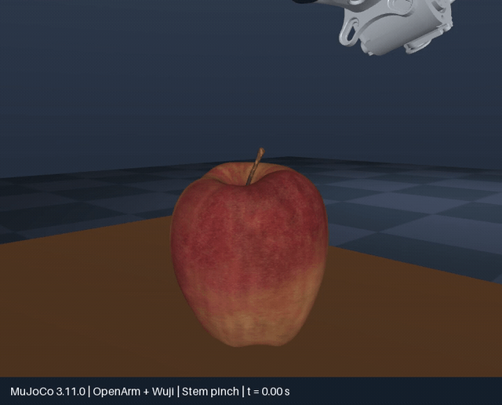
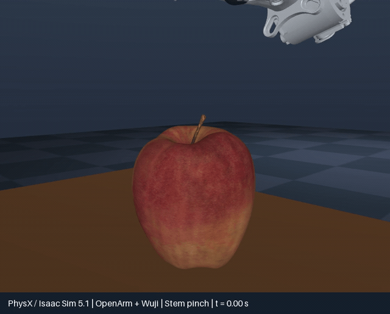
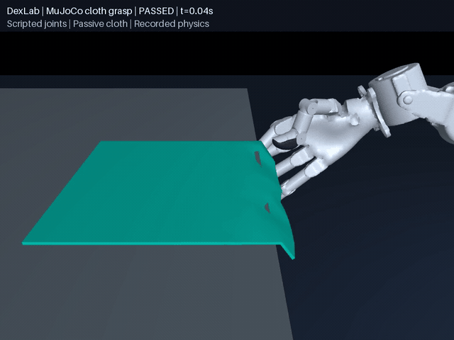
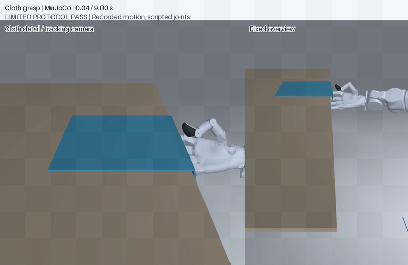

# Experiments by task

Each entry shows the task, the simulation it used and the measured outcome. Follow a task to its conditions, plots and original records.

[Solver and version matrix](coverage.md) · [Side-by-side replays](visual-comparisons.md) · [Failure analysis](failure-root-cause-atlas.md)

```{toctree}
:maxdepth: 1
:hidden:
:caption: In this section

Wuji grasp and torsional contact <wuji-contact>
Sponge wiping and grasp-assistance comparison <rss-wiping>
RoboDojo bread-slip diagnosis <robodojo-bread-slip>
Cloth engine comparison <cloth-comparison>
Cutting & pushing <cutting-experiments>
Native LIBERO workflow <libero-workflow>
AMP recorder parity failure <amp-lift>
```

<!-- visual-research:start -->
(full-experiment-catalogue)=
[Rigid contact and friction](#tasks-rigid-contact) · [Grasping and manipulation](#tasks-grasping) · [Cloth and soft manipulation](#tasks-deformables) · [Cutting and blade-driven pushing](#tasks-cutting) · [Simulation execution paths](#tasks-execution)

(tasks-rigid-contact)=
## Rigid contact and friction

```{raw} html
<div class="task-register">
<div class="task-register-labels" aria-hidden="true"><span>Task and simulator</span><span>Observed outcome</span></div>
<article class="task-register-entry" id="experiment-highlight-incline">
<div><h3><a href="visual-comparisons.html#incline">Resting and sliding on an incline</a></h3>
<p class="task-register-engines">MuJoCo · SuperDex · Genesis · Newton Physics · PhysX · Drake · Chaos · Bullet · SOFA · RaiSim</p></div>
<p class="task-register-result">Ten profiles ran nine cases each. RaiSim passed 3/3 static and 3/3 nominal-zero-friction cases. Its three frictional sliding cases exceeded the rotation limit.</p>
</article>
<article class="task-register-entry" id="experiment-highlight-normal">
<div><h3><a href="experience.html#normal-response">Normal &amp; transient response</a></h3>
<p class="task-register-engines">MuJoCo · SuperDex · PhysX (historical path)</p></div>
<p class="task-register-result">Static calibration works; dynamics and mass transfer need separate checks.</p>
</article>
<article class="task-register-entry">
<div><h3><a href="results.html">Impact &amp; contact onset</a></h3>
<p class="task-register-engines">MuJoCo · SuperDex</p></div>
<p class="task-register-result">Existing phase/stiffness sweeps; smaller steps do not automatically remove model differences.</p>
</article>
<article class="task-register-entry">
<div><h3><a href="experience.html#mass-size-transfer">Mass / size transfer</a></h3>
<p class="task-register-engines">MuJoCo · SuperDex</p></div>
<p class="task-register-result">30 historical transfer records, 0/30 joint passes; failures guide selection.</p>
</article>
<article class="task-register-entry">
<div><h3><a href="experience.html#transient-cost">Response error &amp; cost</a></h3>
<p class="task-register-engines">MuJoCo · SuperDex</p></div>
<p class="task-register-result">27 records separate native computation, recording and scoring costs.</p>
</article>
</div>
```

(tasks-grasping)=
## Grasping and manipulation

```{raw} html
<div class="task-register">
<div class="task-register-labels" aria-hidden="true"><span>Task and simulator</span><span>Observed outcome</span></div>
<article class="task-register-entry">
<div><h3><a href="wuji-contact.html">Wuji two-finger sphere hold</a></h3>
<p class="task-register-engines">MuJoCo</p></div>
<p class="task-register-result">Torsional contact reduced peak angular speed from 29.336 to 0.025 rad/s over the two-second hold. Release passed.</p>
</article>
<article class="task-register-entry">
<div><h3><a href="experiments.html#apple-replays">Apple-stem grasp · SDF contact</a></h3>
<p class="task-register-engines">MuJoCo · SuperDex · PhysX</p></div>
<p class="task-register-result">All three paths have fixed-scene grasp evidence and close-up replays. PhysX was evaluated in a separate setup.</p>
</article>
<article class="task-register-entry" id="experiment-highlight-pinch">
<div><h3><a href="visual-comparisons.html#pinch">Fixture pinch, lift &amp; release</a></h3>
<p class="task-register-engines">Genesis · MuJoCo · SuperDex (separate protocols)</p></div>
<p class="task-register-result">In the same Genesis fixture, 0.4 N slipped. At 0.8 N the box held and was released.</p>
</article>
<article class="task-register-entry" id="experiment-highlight-libero">
<div><h3><a href="libero-workflow.html">Native LIBERO: diagnosis and change</a></h3>
<p class="task-register-engines">MuJoCo 2.3.7 / robosuite 1.4.0</p></div>
<p class="task-register-result">Original and half-step runs both completed 10/10 held-out tasks. Physical checks dropped from 5/10 to 3/10. A separate stale-observation bug was fixed.</p>
</article>
<article class="task-register-entry">
<div><h3><a href="robodojo-bread-slip.html">RoboDojo bread grasp</a></h3>
<p class="task-register-engines">PhysX · offline analysis of external runs</p></div>
<p class="task-register-result">The published batch succeeded in 19/100 runs. Two slip cases were traced to contact from neighboring pieces and rotation at a shallow grasp.</p>
</article>
<article class="task-register-entry">
<div><h3><a href="amp-lift.html">AMP box lift</a></h3>
<p class="task-register-engines">MuJoCo Warp</p></div>
<p class="task-register-result">Both short probes ran. Recorded and unrecorded states disagreed beyond tolerance. Full lift episodes remain unrun.</p>
</article>
</div>
```

(tasks-deformables)=
## Cloth and soft manipulation

```{raw} html
<div class="task-register">
<div class="task-register-labels" aria-hidden="true"><span>Task and simulator</span><span>Observed outcome</span></div>
<article class="task-register-entry">
<div><h3><a href="cloth-comparison.html">Cloth sag and sphere drape</a></h3>
<p class="task-register-engines">MuJoCo · SuperDex · Newton Physics · PhysX</p></div>
<p class="task-register-result">The same Newton VBD configuration passed edge-clamped sag but reached 10.35 mm penetration when draped over a sphere, above the 1.5 mm limit.</p>
</article>
<article class="task-register-entry">
<div><h3><a href="experiments.html#cloth-grasp-replay">Robot cloth grasp, lift and release</a></h3>
<p class="task-register-engines">MuJoCo</p></div>
<p class="task-register-result">One repaired 9-second case passed. Self-contact penetration remained near its limit. An earlier table-intersection failure is retained.</p>
</article>
<article class="task-register-entry">
<div><h3><a href="rss-wiping.html">Sponge wiping</a></h3>
<p class="task-register-engines">Newton Physics / MuJoCo Warp + SuperDex</p></div>
<p class="task-register-result">The original assisted retention passed 3/3 runs. Removing the assistance caused slips and failed 3/3 runs.</p>
</article>
</div>
```

(tasks-cutting)=
## Cutting and blade-driven pushing

```{raw} html
<div class="task-register">
<div class="task-register-labels" aria-hidden="true"><span>Task and simulator</span><span>Observed outcome</span></div>
<article class="task-register-entry">
<div><h3><a href="cut-push.html">Final cut directly into a side push: tofu and banana</a></h3>
<p class="task-register-engines">CPU TLMPM / measured knife contact</p></div>
<p class="task-register-result">Three tofu pieces and four banana pieces; the final cut transitions directly to a face push, displaying contact force and motion. Tofu adds Newtonian viscosity with retained elastic, half-step and no-push controls.</p>
</article>
<article class="task-register-entry">
<div><h3><a href="banana-force.html">Banana single-cut force: 20 samplings and 64× particles</a></h3>
<p class="task-register-engines">CPU TLMPM / independent paper-value protocol</p></div>
<p class="task-register-result">Twenty baseline runs qualify numerically; the 64× case misses support contact within 0.5 s and gives 2.051 RMSE, so convergence and real-force accuracy remain unsupported.</p>
</article>
<article class="task-register-entry">
<div><h3><a href="cutting.html">Historical: Synthetic tofu halving</a></h3>
<p class="task-register-engines">CPU TLMPM / BladeMaster v2 reference</p></div>
<p class="task-register-result">Three full-cut cases yield 50% mass pieces; negative controls stay connected. Force convergence and real-tofu calibration are unproven.</p>
</article>
<article class="task-register-entry">
<div><h3><a href="cutting-comparison.html">Historical: Two tofu cuts: three-method view</a></h3>
<p class="task-register-engines">CPU TLMPM / author reference videos</p></div>
<p class="task-register-result">Two cuts form three pieces; native knife contact pushes the left piece, with measured force and displacement. Author clips use a final velocity input, so inputs differ.</p>
</article>
<article class="task-register-entry">
<div><h3><a href="tofu-scoring.html">Crossed shallow tofu cuts</a></h3>
<p class="task-register-engines">CPU TLMPM / guided orthogonal scoring</p></div>
<p class="task-register-result">Default and half-step cases form two shallow cuts while retaining one native component; the uncut control is rejected. Synthetic material, not food calibration.</p>
</article>
<article class="task-register-entry">
<div><h3><a href="banana-cutting.html">Historical: Three sequential banana cuts</a></h3>
<p class="task-register-engines">CPU TLMPM / persistent cut history</p></div>
<p class="task-register-result">Progressive separation and complete controls in the experiment record. Surface/particles share physical states; no real-banana calibration.</p>
</article>
</div>
```

(tasks-execution)=
## Simulation execution paths

```{raw} html
<div class="task-register">
<div class="task-register-labels" aria-hidden="true"><span>Task and simulator</span><span>Observed outcome</span></div>
<article class="task-register-entry">
<div><h3><a href="experience.html#framework-path">Native &amp; framework paths</a></h3>
<p class="task-register-engines">MuJoCo Warp / Newton Physics / Isaac Sim</p></div>
<p class="task-register-result">After aligning four GPU fields, native support still failed the momentum check and its trajectory still differed from Isaac Sim.</p>
</article>
<article class="task-register-entry">
<div><h3><a href="https://github.com/huangkiki/Dexlab/blob/main/demos/raisim-bumi-mimic/README.md">Bumi motion imitation</a></h3>
<p class="task-register-engines">RaiSim 2.16.0 · CPU FP64</p></div>
<p class="task-register-result">The frozen MuJoCo checkpoint completed 5/6 clips in RaiSim. After training through update 15,000, the final checkpoint completed 0/6.</p>
</article>
</div>
```

[All cutting tasks](cutting-experiments.md) · [Complete task inventory](https://github.com/huangkiki/Dexlab/blob/main/docs/inventory/README.md)

<!-- visual-research:end -->

(experiment-reproduction)=
## Reproduction and historical records

## Apple control and dynamics

The right thumb/index pinch the stem while the left arm remains parked. Apple and stem form a 0.2 kg free rigid body. Known poses, IK and fixed joint targets drive the robot; the engine integrates actual object motion without attachment or object-position actuation. The continuous hold window is 11–14 s, with fruit contact allowed during approach.

The display camera follows recorded apple poses for playback only. There is no validated visual controller, stem fracture or hardware accuracy claim.

[Implementation and parameters](https://github.com/huangkiki/Dexlab/blob/main/docs/sdf-backends.md) · [Full inventory](https://github.com/huangkiki/Dexlab/blob/main/docs/inventory/README.md)

(apple-replays)=
## Continuous close-up records

These are development-scene replays at the original pinned versions, not held-out success rates. The cloth recording preserves the detected table-intersection failure.

::::{grid} 1 1 2 2
:gutter: 3
:::{grid-item-card} MuJoCo

:::
:::{grid-item-card} SuperDex FP64

:::
:::{grid-item-card} PhysX

:::
:::{grid-item-card} Cloth: geometric failure

:::
::::

## Hardware acquisition preparation

The [protocol, empty template and log validator](https://github.com/huangkiki/Dexlab/blob/main/docs/hardware/README.md) cover two UR7e arms and two identical CTAG2F90D grippers. Commands, measured feedback and independent references remain separate; unknown data stays unknown. The tool only reads files and does not control hardware. Format validity does not establish calibration.

## Friction response development

The [16-run planar report](https://github.com/huangkiki/Dexlab/blob/main/demos/contact-benchmark/FRICTION_RESPONSE.md) retains all paired MuJoCo 3.14.0 / SuperDex FP64 outcomes, measured initial states, speed-bin force ratios and costs. Every run passes existing plane checks, while low-speed resistance differs. This is not matched material calibration or an engine-accuracy ranking.

(cloth-grasp-replay)=
## Repaired cloth development case



One 9 s candidate passes the fixed v3 criteria; self penetration remains close to its limit. [Metrics, failed controls, video provenance and exact command](https://github.com/huangkiki/Dexlab/blob/main/demos/cloth-folding/SETTLING.md). This does not replace the historical failure above or establish robustness.

## Initial Drake incline qualification

Official 1.57.0 / SAP / kLagged / hydroelastic: all six static and frictionless cases pass, three sliding cases fail, and the no-floor negative is rejected. The original coplanar failure is retained; 1 µm clearance belongs to a separate protocol. Reliable coverage under the new protocol remains unqualified. [报告 / Report](https://github.com/huangkiki/Dexlab/blob/main/docs/drake-incline-results.md).
