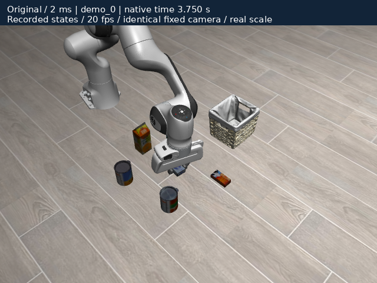

# LIBERO: from a native task to a verifiable change

**First case: LIBERO-Object, “pick up the cream cheese and place it in the basket.”** Panda, assets, controller, demonstration initial states and the native success predicate remain intact. Complete action sequences include release and final state. Only this task dataset is used. mjlab is deferred; scheduled development remains paused.

## What this round establishes

- **Reproduction:** the original configuration completes all three development and ten heldout demonstrations. Lift-and-slip was not reproduced. These are action-execution outcomes, not learned-policy benchmark scores.
- **Verified workflow defect:** the independent evaluator discards five settling observations, while the training evaluator refreshes them. During a native 0.25 s audit, the largest end-effector position-component change is **4.481 mm**, and one finger-joint position changes **12.143 mm**. A reversible one-line patch refreshes the observation without changing the five zero actions.
- **An unsuccessful optimization:** smaller timesteps do not consistently reduce penetration. Heldout numerical screens pass **3/10** at 1 ms versus **5/10** at the original 2 ms, with about **2.00×** native stepping cost. This change is not recommended; screening limits remain fixed.
- **A concrete remaining question:** the 12.163 mm maximum occurs at `floor ↔ cream_cheese_1_g1` in demo_8 at native time 2.940 s, before the first measured lift. Its mixed time constant is 10.5 ms, so the 4 ms refsafe floor at h=2 ms is inactive. Geometry, drive and contact-response attribution continue in [#174](https://github.com/huangkiki/Dexlab/issues/174).



[Synchronized replay, frame-linked curves and three conditions](libero) · [All results JSON](https://huangkiki.github.io/Dexlab/en/latest/_static/libero/summary.json) · [Full records](https://github.com/huangkiki/Dexlab/releases/download/v0.60.0/libero-native-v1.tar.gz)

The modified video is a timestep control, not a successful optimization. Refreshing observations cannot change prerecorded demonstration actions; these videos do not establish improved policy success from the patch.

## Frozen execution and physical reference

| Item | Executed configuration |
| --- | --- |
| Native path | LIBERO `8f1084e3132a39270c3a13ebe37270a43ece2a01` → robosuite 1.4.0 → MuJoCo 2.3.7 |
| Solver / contact / integration | Newton / elliptic / Euler; 100 iterations, tolerance=1e-8, impratio=20 |
| Control | Native OSC_POSE at 20 Hz; original servos, friction, mass and geometry |
| Target mass | 0.012337579236976485 kg; full inertia, COM offset, actuation and contact readbacks retained |
| Dataset | One official HDF5 with pinned revision and SHA-256; demo_0..2 development, demo_3..12 unseen validation, from 50 demonstrations |
| Initialization | Published states[0] time/qpos/qvel plus native controller reset; not exact recovery of historical controller memory |
| Acceptance | Original task, observation integrity, numerical screening, stability and cost are separate; reliable coverage unchanged |

Independent scoring compares **world COM momentum change with contact plus gravity impulse**, accounting for local free-joint angular velocity and COM offset. Declared screens are maximum target overlap ≤1 mm and p99 momentum residual ≤5% of weight. They are numerical diagnostics, not official LIBERO success criteria or measured material accuracy. Full rotational balance is not certified. Gripper-frame relative height includes rotation and release; it is not pure slip.

Constraint forces read after `mj_step` belong to the pre-integration epoch; states are post-integration. Curves retain actual timestamps and every peak. Videos display recorded states at 20 Hz without advancing physics. [Full units, frames and control semantics](https://github.com/huangkiki/Dexlab/blob/main/demos/libero-contact/semantics.json).

(scoring-integrity)=
## Scoring integrity

Scorer v2 independently recomputes each substep's maximum overlap as `max(0, -distance)` across its recorded target contacts. The serialized overlap must match exactly: both channels originate from the same native values, so this check introduces no physical tolerance. Contact distances, force vectors and epochs must be finite; counts must match exactly, and exactly one geometry in each contact must belong to the target. Empty contacts require zero overlap and zero summed contact force.

A disposable-copy regression showed that the previous scorer could accept a zeroed overlap summary after refreshing the local trajectory hash while the contact distances still showed penetration. The separately published package manifest would reject that changed trajectory. This defect does not establish historical data corruption. V2 rejects the contradictory record without changing native task success or the historical numerical thresholds. Its output includes `scoring_version: 2`; archived v0.60.0 scores predate that field and remain immutable. Track acceptance in [#183](https://github.com/huangkiki/Dexlab/issues/183).

Offline rescoring preserves all historical values for **40/40 records**, apart from the new version field, and verifies every original per-case file hash. The same summary-only mutation is now rejected despite valid refreshed local hashes. [Regression receipt](https://github.com/huangkiki/Dexlab/blob/main/docs/evidence/libero-score-v2.json). This is record validation, not a new simulation run or material-accuracy claim.

## All development controls and failures

| Development configuration | Step | Positive reference floor | Native task | Physics screen | Maximum overlap | Native stepping, three demos |
| --- | --- | --- | --- | --- | --- | --- |
| baseline | 2 ms | original | 3/3 | 0/3 | 4.882 mm | 0.694 s |
| step-1000us | 1 ms | original | 3/3 | 0/3 | 4.997 mm | 1.360 s |
| step-500us | 0.5 ms | original | 3/3 | 0/3 | 5.011 mm | 2.710 s |
| aligned-2000us | 2 ms | 4 ms | 3/3 | 0/3 | 5.304 mm | 0.710 s |
| aligned-1000us | 1 ms | 4 ms | 3/3 | 0/3 | 5.407 mm | 1.387 s |
| aligned-500us | 0.5 ms | 4 ms | 3/3 | 0/3 | 6.362 mm | 2.780 s |

Recording-off and settling audits bring the total to eight candidates, not eight solvers or task types. The original timestep sweep changes integration and some contact responses: positive-format MuJoCo references with refsafe enabled use `max(timeconst, 2h)`. [Pinned 2.3.7 implementation](https://github.com/google-deepmind/mujoco/blob/2.3.7/src/engine/engine_core_constraint.c#L1045-L1048)

The aligned family floors positive geom/pair time constants at 4 ms before varying h. It is a **different contact configuration**; within-family timestep attribution does not imply material equivalence to the original. Geometry, mass, friction, control period, drive limits and native success remain unchanged.

Before heldout execution, selection requires valid observations and task success on every development demonstration, preferring all-screen-pass configurations and then the smallest worst overlap and cost. If none passes all screens, the least-overlap nonbaseline candidate becomes an **unqualified diagnostic challenger**, not a recommendation. This rule selected 1 ms to test transfer of the negative development result.

| Heldout demo_3..12 | Native final success | Physics screen | Maximum overlap | Native stepping total |
| --- | --- | --- | --- | --- |
| Original 2 ms | 10/10 | 5/10 | 12.163 mm | 2.239 s |
| Control 1 ms | 10/10 | 3/10 | 12.212 mm | 4.481 s |

These are ten paired demonstrations at one fixed seed. No fitting follows heldout inspection. Costs are serial same-host native stepping; import, recording and scoring costs remain separately recorded. They are not training throughput or a cross-engine ranking. The JSON and archive retain every success, failure and regression.

## From observations to a change

1. Execute the full original action prefix, recording goals, actual actuator output, contacts, states and effective parameters; localize contact, lift, release and basket events.
2. Validate instrumentation: control-rate states, actions, observations, controller targets and success sequences are exactly equal with recording enabled/disabled. Independent-process baseline repeats also match exactly.
3. Inspect actual peak-contact pairs and epochs. The demo_0 peak is object/basket contact during placement; the demo_8 peak is object/floor contact during grasp preparation. They need separate explanations.
4. Six configurations and independent scoring do not support “reduce the timestep to fix it.” Preserve this negative result and bound further mechanism research.
5. Deliver the [reversible observation-refresh patch](https://github.com/huangkiki/Dexlab/blob/main/demos/libero-contact/patches/refresh-settle-observation.patch), supported by source and native observation differences. A compatible fixed checkpoint is still needed to test closed-loop consequences; **neither a changed first policy action nor higher policy success is claimed**.

Event labels localize hypotheses rather than assign causes: no finger contact, no measured lift, transport contact and placement failure are distinct. Post-lift contact loss still requires action/geometry review to distinguish slip from intentional release. No simplified fixture or mid-episode restore is qualified; this round executes full tasks.

## Reproduction and boundaries

[Setup, run, independent score, patch/undo and render commands](https://github.com/huangkiki/Dexlab/blob/main/demos/libero-contact/README.md) · [Frozen candidates and selection rule](https://github.com/huangkiki/Dexlab/blob/main/demos/libero-contact/protocol.json) · [Independent evaluator](https://github.com/Lifelong-Robot-Learning/LIBERO/blob/8f1084e3132a39270c3a13ebe37270a43ece2a01/libero/lifelong/evaluate.py#L260-L273) · [Training evaluator](https://github.com/Lifelong-Robot-Learning/LIBERO/blob/8f1084e3132a39270c3a13ebe37270a43ece2a01/libero/lifelong/metric.py#L117-L136)

Native simulation uses an isolated Python 3.10 diagnostic environment. Upstream’s complete Python 3.8 / PyTorch 1.11 learning installation is not claimed as a qualified policy runtime here. The HDF5 lacks embedded historical BDDL text. Its canonical task and problem match pinned source, but its instruction matches `benchmark.Task.language` rather than the BDDL's distinct wording: “pick up the cream cheese…” versus “pick the cream cheese…”. Legacy `env_args` also retains an older BDDL filename. These declarations are preserved separately; neither missing embedded text nor an auxiliary filename establishes native environment equivalence. Dataset terminal reward/done values do not supply success evidence; runtime native queries do. [Input-identity follow-up #185](https://github.com/huangkiki/Dexlab/issues/185).

## Full-suite input admission

The input inventory preserves all **130 official tasks** in five groups (10/10/10/10/90), each source BDDL and initial-state hash, every native goal, and the pinned dataset's expected bytes and SHA-256. LIBERO-100 is the existing 90+10 partition, not an additional suite. Static identity, downloaded bytes, HDF5 content admission and native execution are separate states; [#181](https://github.com/huangkiki/Dexlab/issues/181) remains the full execution parent.

Use the Python 3.12 DexLab environment with its `libero-inputs` extra for offline data inspection; retain the separate legacy simulation environment. Freeze the inventory and deterministic split before reading new outcomes, then admit complete files through the existing archive resource envelope and shared research guard. The tool verifies the whole file before reading HDF5, rejects external/aliased content, and records every demonstration's action count, state width, initial-state and model XML identities. It reads finite action/state arrays in bounded chunks, without selecting demonstrations from rewards, done labels or images.

```bash
python -m pip install -e '.[libero-inputs]'
python -m dexlab.libero_dataset freeze LIBERO_SOURCE FROZEN_INPUTS
# Run complete-file reads inside scripts/research_guard.py + scripts/bounded_run.py:
python -m dexlab.libero_dataset admit LIBERO_SOURCE FROZEN_INPUTS TASK_ID TASK_HDF5 NEW_RECEIPT
python -m dexlab.libero_dataset aggregate LIBERO_SOURCE FROZEN_INPUTS DATA_ROOT RECEIPT_ROOT NEW_SUMMARY
```

`TASK_ID` is the exact `suite/task` key from the inventory. Store receipts as `RECEIPT_ROOT/suite/task.json` and data under the frozen official relative path. Aggregate output retains missing and invalid rows. Availability checks file size only; a prior admitted receipt proves the bytes at its recorded verification, not a fresh current hash. Re-admit changed or untrusted files; existing different receipts are never overwritten.

The receipt index rejects missing or contradictory task linkage, initial-state identity, exposure/split declarations and reader provenance. Invalid receipts do not contribute demonstrations to the admitted total; their expected tasks remain in the denominator. Numeric initial-state equality can legitimately have different byte representations, including signed zero or different floating dtypes, so hashes alone do not replace the original value comparison.

Source BDDL language and the pinned benchmark API language are compared independently: **29/130 source declarations differ**. Dataset text must match at least one of these explicit source declarations after case/whitespace normalization; arbitrary paraphrases fail. Missing embedded BDDL remains `not-provided`, while present text must match source bytes. Native/policy qualification must record the actual instruction and executed BDDL; input admission does not establish policy equivalence.

For each task, hash-rank previously unexposed demo IDs with the frozen salt and allocate `floor(unexposed_count / 5)` to validation; all remaining IDs go to development. Cohorts below five unexposed IDs have no validation cases. Historical cream-cheese demo_0…12 remain exposed development evidence. Every demo stays in the full baseline denominator, and the historical v1 campaign and its original split remain unchanged.

The serial download helper initially freezes a cumulative plan before retrieval: at most 390 attempts, three per file, 125 GiB of charged response-body bytes and 12 hours, with 600 seconds per attempt and an 8 MiB/s read throttle. Failed/interrupted transfers retain partials and consume their reserved allowance; a live recorded owner prevents recovery. Resumption checks exact Content-Range and unchanged strong ETag before appending, and publication requires the complete pinned hash. It never overwrites an existing final file or automatically retries. Use the same shared archive guard and finite resource envelope; download completion is not content or runtime admission. The pinned source README declares CC BY 4.0 for datasets, while the pinned dataset card declares Apache-2.0; retain both declarations without treating either as a resolved license for all data. Source-code MIT and upstream asset licenses remain separate. [Source notices](https://github.com/huangkiki/Dexlab/blob/main/demos/libero-contact/NOTICE.md).

Response reads and complete-file verification share the same attempt deadline. A detected late result remains a failed attempt with retained partials and charges, rather than being published as a completed download. Run each retrieval with a process timeout no larger than its reserved attempt window, in addition to the whole-package resource guard: deadline checks cannot preempt a blocking operating-system call.

A measured capacity shortfall can be handled by one explicit `amend-wall` operation in the same ledger, under the shared guard after the package and all recorded owners have stopped. Supply a reason and a JSON evidence report identifying `inventory_sha256`, `transfer_plan_sha256` and a positive `completed_successful_transfers` count, together with the measured costs supporting the change. The immutable amendment binds that evidence and every preceding attempt receipt, raising only the total wall ceiling to 24 hours and the per-attempt ceiling to 1800 seconds. All prior charges remain in those totals; attempt counts, body-byte allowance, throttling and task scope stay unchanged. Interrupted attempts are charged their own recorded ceiling, so old 600-second reservations are not reinterpreted. Repeated amendments, pending/live owners and altered evidence or receipt history are rejected. A byte-complete partial still requires full hash and HDF5 admission; file size alone cannot qualify it. Freeze new package/source identities before continuing, and keep each outer package within the existing 3600-second runner ceiling; one 1800-second file plus overhead fits, while five such windows do not.

DexLab now connects a benchmark observation to a concrete time, contact and code path, tests a plausible intervention, and delivers verified workflow corrections separately from unsuccessful physics tuning. For a new scene, check observation freshness, actual contact forces and actuation before recommending a configuration. This cohort does not establish a new recommended physics profile.

Resources and recovery: the native batch froze 16 GiB hard / 15 GiB high, four CPU equivalents, swap disabled and an additional 8 GiB desktop reserve. Maximum measured cgroup memory was about 1.218 GiB; limits did not change within the batch. The inherited ledger accounts for 46/64 starts and 363.07/21600 s of charged runtime, including early failures/diagnostics; this is not total development or tool time. A future comparable batch can admit the measured workload at the 8 GiB tier. Native package files were checked against wheel RECORD hashes after execution; this integrity check is not presented as pre-run binary telemetry.
