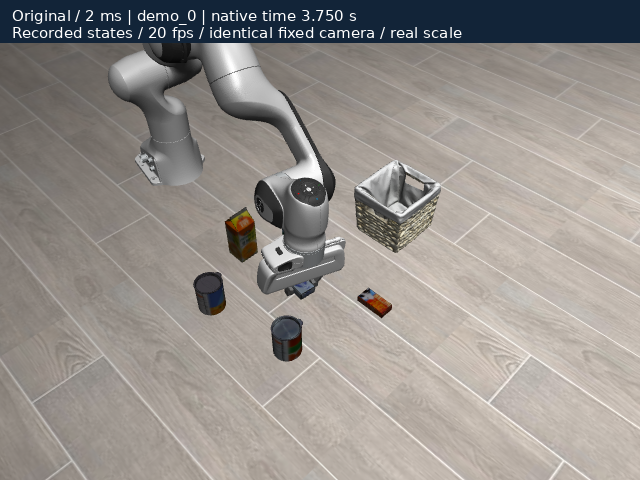

# LIBERO: from a native task to a verifiable change

All ten demonstrations of putting the cream cheese into the LIBERO basket completed the task. Halving the physics step from **2 ms to 1 ms** kept all ten completions, while the number passing the contact-related diagnostics fell from **5/10 to 3/10**. In this scene, task completion and contact quality answered different questions.



Both views use recorded native demonstration actions. The replay, curves and contact events can be inspected together. [Open the synchronized records](libero)

## Find the step where penetration begins

Both step sizes used the same ten held-out demonstrations. The diagnostic set capped target contact penetration at **1 mm** and checked whether recorded contact and gravity accounted for the object's momentum change.

| Physics step | Native task completion | Passed contact-related checks | Peak penetration | Total native stepping time |
| --- | ---: | ---: | ---: | ---: |
| 2 ms | 10/10 | 5/10 | 12.163 mm | 2.239 s |
| 1 ms | 10/10 | 3/10 | 12.212 mm | 4.481 s |

The worst baseline penetration occurred **2.940 s** into one demonstration. Before the object lifted off, the object and floor collision geometry already overlapped by **12.163 mm**. The effective contact time constant was **10.5 ms**, above the **4 ms** safety floor, so that floor did not activate for this contact. The earliest supported failure is the floor contact before lift-off. Geometry, actuation and contact response still need to be distinguished.

Rewind the same action to first contact, then check the gap, actuation, normal impulse and actual object motion together. That gives a clearer next test than the final frame in the basket. The diagnostic conditions were frozen for this simulation cohort. An independent reference would be needed to establish physical accuracy.

```{raw} html
<span id="additional-complete-object-cohorts"></span>
<span id="complete-affected-task-records-and-remaining-failures"></span>
<span id="what-explicit-gripper-memory-interventions-change"></span>
<span id="restored-controller-state"></span>
<span id="task-aware-recording-qualification-in-progress"></span>
<span id="object-task-path-qualification"></span>
<span id="what-the-original-case-establishes"></span>
<span id="mask-progress-signal-audit"></span>
<span id="frozen-execution-and-physical-reference"></span>
<span id="scoring-integrity"></span>
<span id="id1"></span>
<span id="all-development-controls-and-failures"></span>
<span id="from-observations-to-a-change"></span>
<span id="reproduction-and-boundaries"></span>
<span id="full-suite-input-admission"></span>
```

## Experiment records

[Full technical report and later Object task cohorts](libero-workflow-report.md) · [Raw records and patch documentation](https://github.com/huangkiki/Dexlab/blob/main/demos/libero-contact/README.md)
