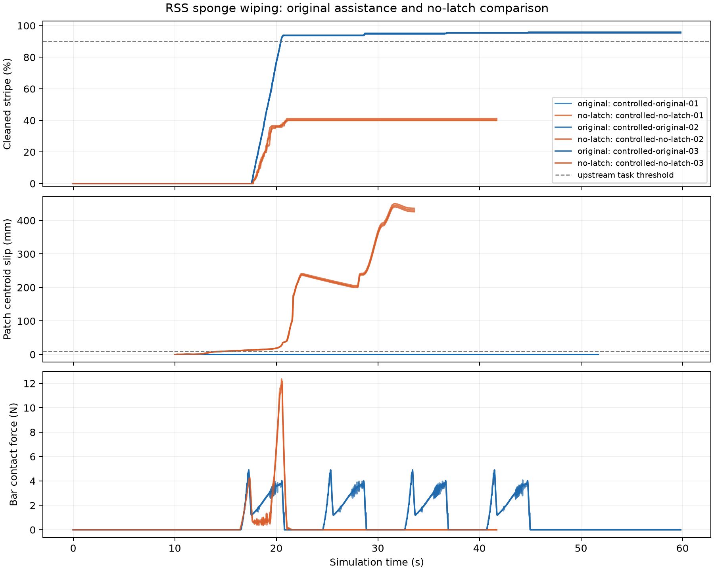
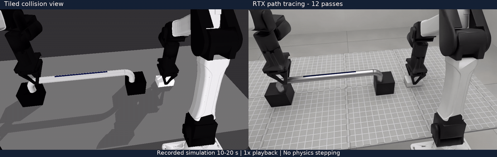
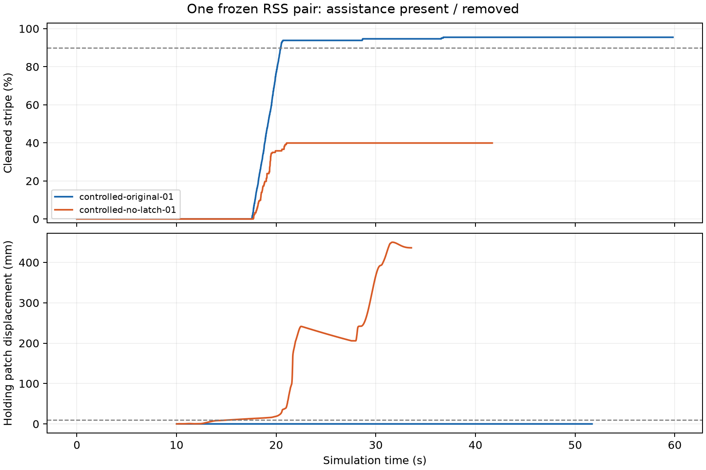

# RSS sponge wiping: reproduction and latch ablation

The unchanged RoboSimStudio wiping test passed **all nine assertions**. Its independent execution cleaned **95.5%** of the stripe, with **4.93 N** peak bar contact force and **0.061 mm** maximum held material-patch centroid displacement in the measured hand frame. **The original uses a latch to assist retention: this reproduces assisted wiping, not friction-only grasping.** In-hand rotation remains a separate task.

(latch)=

## What the latch does and why it matters

The latch is an auxiliary retention mechanism in the simulation. The jaws first squeeze the sponge through contact. Once grasp readiness is met, compliant position constraints are added to sponge nodes near the contact region, with targets that move with the hand; an open command releases them. The sponge can still deform, and constrained nodes can deviate slightly from their targets. The whole sponge is not rigidly welded to the hand.

The pinned version creates these constraints with `pin_nodes`, using stiffness **4000 N/m** and damping **20 N·s/m**. `ride` updates their moving targets at every soft-body substep. This supplies holding action beyond contact friction; it is neither a physical glue model nor an increased friction coefficient. [Upstream latch implementation](https://github.com/robosimstudio/robosimstudio/blob/23417de77edf59d614531a833334ed4e2206fc2c/examples/08_demos/wipe_the_bar/bar.py#L425-L559).

A successful latched run shows that the assisted configuration completes wiping; it does not establish retention by contact and friction alone. The no-latch comparison below keeps the same grasp-readiness conditions and contact settings while removing the assistance. **Slipping without the latch does not by itself establish a solver error:** actual loads, control, material behavior, friction modeling and coupling error still need separate checks.

## Controlled repetitions

<!-- rss-results:start -->
**Original: 3/3 task passes; no latch: 0/3.** All six records passed independent consistency checks. Compiled geometry, initial and settled particles, and tracked material-node indices are identical across the six runs.

| Run | Cleaned (%) | Held patch centroid (mm) | Max. node motion (mm) | Peak bar force (N) | Return XY error (mm) | Task |
| --- | ---: | ---: | ---: | ---: | ---: | --- |
| Original 1 | 95.473 | 0.0606 | 0.764 | 4.910 | 0.046 | Pass |
| No latch 1 | 39.918 | 449.9811 | 479.305 | 11.886 | 435.806 | Fail |
| Original 2 | 95.885 | 0.0606 | 0.760 | 4.895 | 0.059 | Pass |
| No latch 2 | 41.152 | 444.9449 | 467.222 | 12.261 | 430.553 | Fail |
| Original 3 | 95.473 | 0.0608 | 0.764 | 4.932 | 0.044 | Pass |
| No latch 3 | 40.329 | 440.4694 | 466.125 | 12.359 | 425.927 | Fail |

The no-latch sponge slips out during wiping. The controller later detects a failed press, leaves the wiping loop and returns home; its `done` message marks routine completion, while cleaning and sponge-return criteria fail. All no-latch pin counts remain zero.

The original cleaning range agrees with the author's reported 95.5–95.9%. This no-latch cohort performs worse than the reported 68.7–76.1%; the cross-cohort cause has not been isolated. The causal comparison here is between the two modes sharing our frozen geometry. [Author reference](https://github.com/robosimstudio/robosimstudio/blob/23417de77edf59d614531a833334ed4e2206fc2c/examples/08_demos/wipe_the_bar/README.md).

<!-- rss-results:end -->

The first repetition of each mode is the predetermined video pair. Both show the entire recorded task at 10 frames per simulation second, using RSS's native tiled collision view.

```{raw} html
<div style="display:grid;grid-template-columns:repeat(auto-fit,minmax(280px,1fr));gap:16px">
<section><h3>Original: compliant latch assistance</h3><video controls muted playsinline preload="metadata" style="width:100%" poster="_static/rss-wiping/original.png" src="_static/rss-wiping/original.mp4"></video></section>
<section><h3>No latch: contact alone</h3><video controls muted playsinline preload="metadata" style="width:100%" poster="_static/rss-wiping/no-latch.png" src="_static/rss-wiping/no-latch.mp4"></video></section>
</div>
```



## RTX appearance replay of the same trajectory

The original latched condition's first recording now has a **continuous 10–20 s replay**: 100 frames at 10 fps and 960×544 per view. Left is the tiled collision view; right is OVRTX path tracing. **Both views retain latch assistance**, using the same camera, timestamps and recorded state. Metal reflections, mat texture, robot-shell highlights and soft shadows come from the pinned RSS materials, room and lighting.



[Full comparison video](../../evidence/rss-wiping/rtx/comparison-labeled.mp4) · [Frame map, input hashes and state checks](../../evidence/rss-wiping/rtx/render.json) · [Media processing record](../../evidence/rss-wiping/rtx/media.json)

Replay executed **zero physics steps**. Maximum absolute loading error was zero for rigid poses, joints, sponge material points and ink; state and live colors remained unchanged after all 100 paired renders. Input file hashes also remained unchanged. The recorded ground-visibility toggle is restored before the complete compiled model is checked array by array and by hash; collision-bit changes are rejected. Replay neither interpolates nor smooths material points and produces no new task-success result.

In this bounded RTX 4090 job with four CPU equivalents, RTX calls at 12 passes averaged **81.75 ms/frame**, versus **3.61 ms/frame** for tiled; scene construction and warm-up took **9.80 s**. These are this job's rendering costs, excluding video encoding, not exclusive-hardware or end-to-end simulation throughput. The first pilot was rejected because the saved ground visibility had not been restored. After correction, the two-frame pilot and continuous segment passed; the failed attempt remains retained.

Reproduction requires complete raw `states/*.npz` and the pinned upstream RTX environment. The [bundle](#offline-evidence) supplies the first pair; summaries/CSV alone still cannot substitute for soft-body vertices. See the [replay command](https://github.com/huangkiki/Dexlab/blob/main/demos/rss-wiping/README.md#render-a-saved-trajectory--重渲染已有轨迹) and [rendering task #229](https://github.com/huangkiki/Dexlab/issues/229).

## What was held fixed

RSS commit [`23417de`](https://github.com/robosimstudio/robosimstudio/tree/23417de77edf59d614531a833334ed4e2206fc2c) supplies the two YAM arms, sponge, bar, materials and scripted controller. The locked combination is Newton 1.6.0, Warp 1.18.0, MuJoCo/MJWarp 3.12.0 and SuperDex 1.0.0. Native readback confirms single-precision SuperDex. The control rate is 60 Hz, with 16 rigid substeps and two SuperDex steps per control period. The authored foam has Young's modulus 80 kPa, Poisson ratio 0.3, density 110 kg/m³, friction 0.9 and friction falloff 0.1 mm/s. These are upstream example parameters, not measured sponge properties.

Repeated official CoACD preprocessing produced different compiled collision models: 499 versus 505 shapes. We retained the first instrumented run as an **unpaired reference**, then captured the official method's outputs once. Both controlled modes reuse the exact 49/48-piece decompositions. Input hashes, call order, cached-array hashes and the complete compiled-model hash agree. The source checkout and engine binaries are unchanged.

The no-latch variant preserves grasp readiness: 12 settled control steps, jaw variation at most 0.3 mm, at least 2 N normal force on each pad, and at least 2 mm squeeze. It tracks the same selected material patch but removes `pin_nodes` and `ride`; the routine proceeds on readiness rather than waiting for a constraint that was deliberately removed. Every recorded step checks the actual bridge pin count.

The displayed pin count is the number of registered constraint groups: the original has one group covering 106 material nodes; no-latch has zero groups.

## How to interpret the measurements

Independent NumPy scoring reconstructs material-point motion in the measured hand frame, normalizing the native quaternion before forming a rotation. Patch centroid displacement and maximum node displacement are separate: deformation can contribute to both, and opposing deformations can cancel in the centroid. Motion after deliberate opening is excluded from the holding maximum.

Cleaned fraction is recomputed from saved stripe ink; return and home errors are checked against saved positions. The task thresholds remain upstream's: at least 90% clean, bar force above 1 N, pressure above 5 kPa, sponge return within 20 mm horizontally and 3 mm vertically, arms within 6 mm of home, finite states and a completed routine. Missing pins are not themselves a failed no-latch task.

Cleaning is the upstream simulated wear metric, not measured removal of real ink. These are three development repetitions per mode, not held-out validation or a statistical estimate of deployment reliability. The comparison isolates grasp assistance for this geometry/configuration; it does not identify friction-law error, coupling-delay causality, material accuracy or engine superiority.

(offline-evidence)=
## Download raw records and rescore offline

The [evidence bundle](https://github.com/huangkiki/Dexlab/releases/tag/rss-wiping-evidence-v1) contains `controlled-original-01` and `controlled-no-latch-01` from the same frozen-geometry cohort. Its 159 files occupy about 126 MiB compressed / 349 MiB extracted, including observations, contacts, state arrays, continuous videos, effective parameters, historical sources, the current independent scorer and licenses. Each file has provenance, size, SHA-256, purpose and attempt ownership. Inputs remain unchanged; curves and reports go into a new output directory.

Follow the {ref}`homepage CPU quickstart <quickstart>`. The isolated environment was checked to contain no MuJoCo, SuperDex, Newton or Genesis. This pair was rescored offline with Python 3.12.12, NumPy 2.5.2 and Matplotlib 3.11.2. The curves below derive from saved particle and ink arrays; holding displacement excludes intentional release.



The [rescore report](https://github.com/huangkiki/Dexlab/blob/main/docs/evidence/rss-wiping/bundle-v1/rescore-report.json) gives original / no-latch maximum holding-patch centroid displacement of **0.060631 / 449.981051 mm**, and final cleaning of **95.473251% / 39.917695%**. Both records pass integrity checks; task results are pass / fail. File hashes and compiled-model array identity are checked separately. Missing files, wrong hashes, mixed attempts, summary-only substitutes and overwriting inputs are rejected.

`attempt-index.json` retains all **12 execution entries**: four probes (one interrupted during startup, three intentionally truncated at 3 s), the unchanged native test, one unpaired reference and six controlled runs. Preparation failure, three postprocessing attempts and the quaternion-scoring correction are listed separately. Only the first pair has complete raw data here; other records and cross-cohort interpretation remain in [#247](https://github.com/huangkiki/Dexlab/issues/247). This is not full RSS public reproduction. Three derived bytecode caches that can embed host paths are omitted; their source, excluded-file hashes and original local files are preserved.

### Then rerun the native simulation

The native path uses RSS commit `23417de77edf59d614531a833334ed4e2206fc2c`, its lockfile and the SuperDex extra. Recorded versions are SuperDex Physics 1.0.0 (single precision), Newton 1.6.0, MuJoCo / MuJoCo Warp 3.12.0, Warp 1.18.0 and CoACD 1.0.11; the bundled manifests retain the full package and physics settings. Use the [pinned-source rerun commands](https://github.com/huangkiki/Dexlab/blob/main/demos/rss-wiping/README.md#frozen-upstream--固定上游) in a separate environment. The apple-grasp environment, a CPU fallback or newer dependencies are not automatically the same cohort.

Historical physics recording used NVIDIA CUDA and tiled rendering; native reproduction requires a matching GPU, driver and upstream dependencies. RTX appearance replay additionally needs RT cores and [OVRTX 0.4.0.346409, under NVIDIA's proprietary software license](https://pypi.org/project/ovrtx/0.4.0.346409/). [SuperDex Physics 1.0.0](https://pypi.org/project/superdex-physics/1.0.0/) declares Apache-2.0 for first-party code, with separate third-party terms; do not conflate it with OVRTX licensing. No engine binaries are distributed in the bundle. The new download/rescore path was executed this round; native rerun instructions preserve the existing reproduction path, with no new RSS physics collection.

## Attempts, costs and reproduction

<!-- rss-attempts:start -->
The finite budget used **4 short probes, 1 unchanged upstream test and 7 full instrumented attempts**: one unpaired reference plus six controlled runs. The unpaired reference also cleaned 95.47% and passed task/record checks; it is excluded from the controlled denominator. Three probes deliberately ended at 3 simulated seconds; the first was interrupted during startup.

| Mode | Simulated duration (s) | Bounded wall cost (s) | Peak memory (MiB) |
| --- | ---: | ---: | ---: |
| original | 59.82–59.82 | 161.3–164.7 | 1441.9–1454.9 |
| no-latch | 41.68–41.70 | 106.5–109.4 | 1306.4–1312.5 |

The isolated installation cost 1072.2 s, separately from physics. The complete first controlled pair is now published in the bundle above; remaining raw records are retained, and existing per-step curves, summaries, manifests and hashes remain available.

<!-- rss-attempts:end -->

The initial RTX diagnostic was manually stopped after 539.8 wall seconds; its first frame completed immediately before termination. That supports a high initialization cost, not a deadlock claim. Subsequent recordings use the upstream tiled renderer, which displays collision geometry without RTX room materials. An earlier scoring discrepancy from unnormalized float32 quaternions was corrected and regression-tested; the rejected score is retained.

The controlled resource envelope is 8 GiB memory, four CPU equivalents, 128 tasks, zero swap and 8 GiB desktop reserve. Limits are enforced by the existing cgroup runner. Other host work was observed, so wall costs are workload costs, not exclusive throughput measurements.

[Per-run summaries, curve data, manifests and raw-file hashes](https://github.com/huangkiki/Dexlab/tree/autoresearch/issue-223/docs/evidence/rss-wiping).

[Code, frozen geometry and reproduction commands](https://github.com/huangkiki/Dexlab/tree/autoresearch/issue-223/demos/rss-wiping) · [Issue #223](https://github.com/huangkiki/Dexlab/issues/223) · [Discussion #220](https://github.com/huangkiki/Dexlab/discussions/220) · [Upstream unchanged test](https://github.com/robosimstudio/robosimstudio/blob/23417de77edf59d614531a833334ed4e2206fc2c/tests/test_demo_wipe_the_bar.py).
