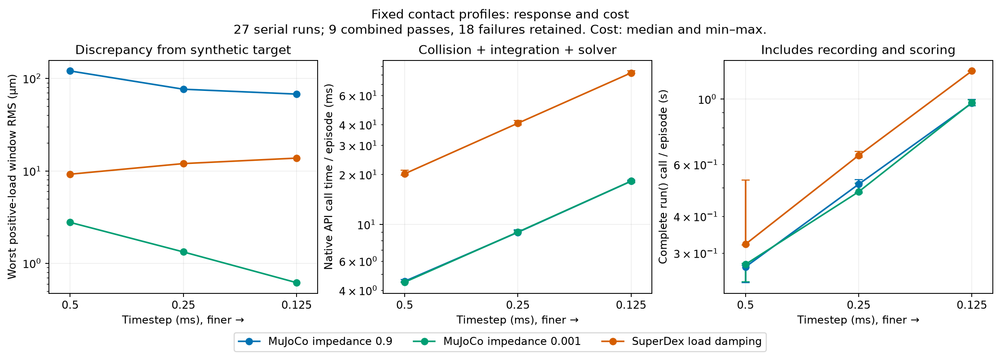
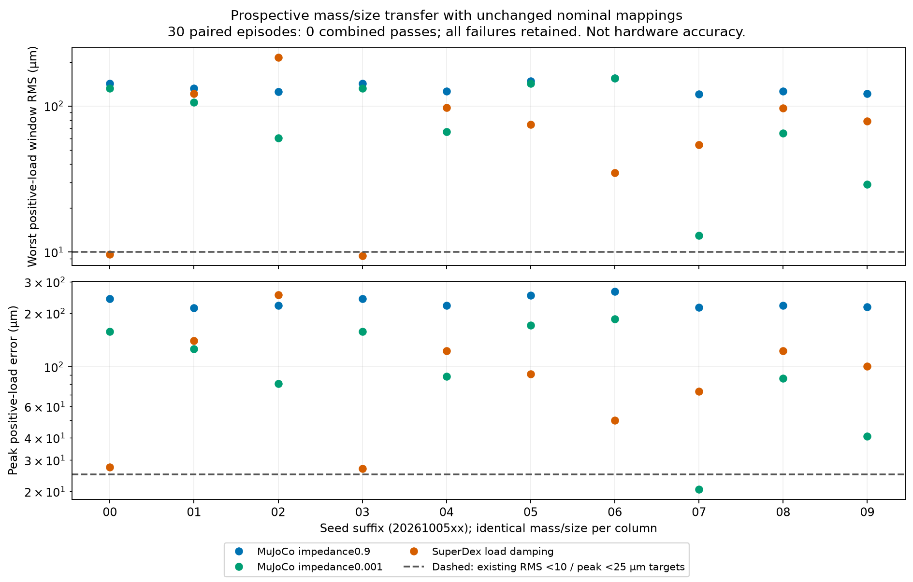

# Comparative experiments: from visible motion to criteria

Read every experiment in the same order: conclusion and criteria first, then the recorded GIF under shared conditions, then a result matrix that locates the differences. Protocols, explanation and limits follow.

Replay geometry keeps physical proportions; inspect small changes in the curves. Dashed lines are the declared analytical/engineering references, not measured material truth. Historical protocols do not form a universal engine ranking.

(incline)=
## Six-engine incline: shared conditions, different responses

A 40 mm, 64 g cube; static, sliding and nominal-zero-friction conditions at three timesteps. Curves and replays retain the original passes, failures and invalid records.

<div class="comparison-summary">
  <p class="comparison-claim"><strong>Conclusion</strong> Under these fixed settings, no engine passes all nine cases. The differences separate into static drift, sliding force response, and effective contact at nominal zero friction.</p>
  <div class="comparison-terms">
    <p><strong>Setup</strong> Native incline cohorts: MuJoCo 3.15.0, SuperDex 1.0.0, Genesis 1.4.3, Newton Physics 1.6.1, PhysX 5.9.0 and Drake 1.57.0; each records contact law, precision and applicable profiles.</p>
    <p><strong>Scope</strong> Cohort protocols and admission scope remain separate. The full matrix maps research scope, not universal rank. Numerical work remains in #157/#159/#163/#165.</p>
  </div>
</div>

<div class="replay-guide" aria-label="Recorded GIF guide">
  <p><strong>Pane order</strong> MuJoCo / SuperDex / Genesis / Newton Physics / PhysX / Drake</p>
  <p><strong>What to watch</strong> In the same two-second window, see whether the cube holds, rotates or loses support; each pane also reports its outcome.</p>
  <p><strong>Do not infer</strong> A similar GIF does not establish physical equivalence; force, displacement and velocity criteria on the shared clock decide the result.</p>
</div>

```{raw} html
<div class="gif-evidence">
<div class="visual-hero"></div>
<details class="replay-fallback"><summary>Static figures and full data (no JavaScript required)</summary><ul><li>Static · 1 ms: <a href="_static/visual/incline-static-0.001.json.gz">JSON.gz</a> · <a href="_static/visual/incline-static-0.001-curves.svg">SVG</a></li><li>Static · 2 ms: <a href="_static/visual/incline-static-0.002.json.gz">JSON.gz</a> · <a href="_static/visual/incline-static-0.002-curves.svg">SVG</a></li><li>Static · 0.5 ms: <a href="_static/visual/incline-static-0.0005.json.gz">JSON.gz</a> · <a href="_static/visual/incline-static-0.0005-curves.svg">SVG</a></li><li>Sliding · 1 ms: <a href="_static/visual/incline-sliding-0.001.json.gz">JSON.gz</a> · <a href="_static/visual/incline-sliding-0.001-curves.svg">SVG</a></li><li>Sliding · 2 ms: <a href="_static/visual/incline-sliding-0.002.json.gz">JSON.gz</a> · <a href="_static/visual/incline-sliding-0.002-curves.svg">SVG</a></li><li>Sliding · 0.5 ms: <a href="_static/visual/incline-sliding-0.0005.json.gz">JSON.gz</a> · <a href="_static/visual/incline-sliding-0.0005-curves.svg">SVG</a></li><li>Nominal zero friction · 1 ms: <a href="_static/visual/incline-frictionless-0.001.json.gz">JSON.gz</a> · <a href="_static/visual/incline-frictionless-0.001-curves.svg">SVG</a></li><li>Nominal zero friction · 2 ms: <a href="_static/visual/incline-frictionless-0.002.json.gz">JSON.gz</a> · <a href="_static/visual/incline-frictionless-0.002-curves.svg">SVG</a></li><li>Nominal zero friction · 0.5 ms: <a href="_static/visual/incline-frictionless-0.0005.json.gz">JSON.gz</a> · <a href="_static/visual/incline-frictionless-0.0005-curves.svg">SVG</a></li></ul></details>
</div>
```

<div class="comparison-matrix">
<table>
<caption>Published fixed configurations by condition (passes / three cases per condition)</caption>
<thead><tr>
<th scope="col">Engine and configuration</th>
<th scope="col">Static</th>
<th scope="col">Sliding</th>
<th scope="col">Nominal zero friction</th>
<th scope="col">Total</th>
</tr></thead>
<tbody>
<tr><th scope="row"><strong>MuJoCo</strong><small>3.15 · PGS / elliptic</small></th>
<td><span class="matrix-result fail">0 / 3</span></td>
<td><span class="matrix-result fail">0 / 3</span></td>
<td><span class="matrix-result pass">3 / 3</span></td>
<td><span class="matrix-result fail">3 / 9</span></td>
</tr>
<tr><th scope="row"><strong>SuperDex</strong><small>1.0 · Newton / AUTO / C1</small></th>
<td><span class="matrix-result mixed">2 / 3</span></td>
<td><span class="matrix-result pass">3 / 3</span></td>
<td><span class="matrix-result pass">3 / 3</span></td>
<td><span class="matrix-result mixed">8 / 9</span></td>
</tr>
<tr><th scope="row"><strong>Genesis</strong><small>1.4.3 · Newton / elliptic / Signorini</small></th>
<td><span class="matrix-result pass">3 / 3</span></td>
<td><span class="matrix-result pass">3 / 3</span></td>
<td><span class="matrix-result fail">0 / 3</span></td>
<td><span class="matrix-result mixed">6 / 9</span></td>
</tr>
<tr><th scope="row"><strong>Newton Physics</strong><small>1.6.1 · XPBD / 100 sweeps</small></th>
<td><span class="matrix-result mixed">1 / 3</span></td>
<td><span class="matrix-result invalid">0 / 3†</span></td>
<td><span class="matrix-result invalid">0 / 3†</span></td>
<td><span class="matrix-result invalid">1 / 9†</span></td>
</tr>
<tr><th scope="row"><strong>PhysX</strong><small>5.9.0 · PGS / patch friction</small></th>
<td><span class="matrix-result pass">3 / 3</span></td>
<td><span class="matrix-result mixed">2 / 3†</span></td>
<td><span class="matrix-result mixed">2 / 3</span></td>
<td><span class="matrix-result mixed">7 / 9†</span></td>
</tr>
<tr><th scope="row"><strong>Drake</strong><small>1.57 · SAP / kLagged / hydroelastic</small></th>
<td><span class="matrix-result pass">3 / 3</span></td>
<td><span class="matrix-result fail">0 / 3</span></td>
<td><span class="matrix-result pass">3 / 3</span></td>
<td><span class="matrix-result mixed">6 / 9</span></td>
</tr>
</tbody>
</table>
</div>
<p class="matrix-note">† Invalid records remain in the denominator; they are not passes and are not physical failures.</p>

**Conditions：** Native incline cohorts: MuJoCo 3.15.0, SuperDex 1.0.0, Genesis 1.4.3, Newton Physics 1.6.1, PhysX 5.9.0 and Drake 1.57.0; each records contact law, precision and applicable profiles.

**Observation：** All six have positive, negative and failed evidence. Genesis floors nominal-zero contact friction to .01; SuperDex BFGS/SR1 execute Newton-equivalent steps under assembly every step.

**Explanation：** Established effective-parameter/execution-path differences change the interpretation of same-named profiles. Initial pass rates do not replace equal-budget tuned comparisons.

**Advice：** Filter candidates by sticking/sliding, low friction and contact scale; inspect invalid records, physical error and cost together.

**Limits：** Cohort protocols and admission scope remain separate. The full matrix maps research scope, not universal rank. Numerical work remains in #157/#159/#163/#165.

Selection: MuJoCo uses the first frozen profile, PGS/elliptic. Other published baselines are SuperDex Newton/AUTO/C1, Genesis Newton/elliptic/Signorini, Newton Physics XPBD, PhysX PGS and Drake SAP/kLagged/hydroelastic. Selection does not use pass counts; all other profiles remain in the full matrix.

Reference: an ideal nonrotating Coulomb block with continuous contact has sliding acceleration a=g(sinθ−μcosθ); rest requires the static-friction inequality. Contact switching, geometry and model differences limit this reference. Drake’s initial 1 μm gap and Genesis’s native floor on nominal zero friction remain. Close-ups use the same body-follow camera rule and scale; the shared ruler retains world displacement. Invalid-record curves are diagnostic only.

**Evidence and all configurations:** [Complete solver matrix](coverage.md) · [Engine reports](engines.md) · Each replay dataset contains original scores and source hashes.

(normal)=
## Normal response: change parameters or the solver?

The same MuJoCo fixture moves from about 80 kN/m toward the synthetic 20 kN/m target. Inspect loaded-window indentation, then the complete unloading trace; success belongs to the stated checks and conditions.

<div class="comparison-summary">
  <p class="comparison-claim"><strong>Conclusion</strong> Parameter calibration brings this fixture&#x27;s loaded response close to the synthetic target, but fixed parameters do not transfer to other masses. A predeclared mass conversion restores both transfer loads.</p>
  <div class="comparison-terms">
    <p><strong>Setup</strong> A 40 mm cube, 0.2 kg, 0.5 ms; 2/4/6/−1 N loading. The 20 kN/m response is a synthetic target.</p>
    <p><strong>Scope</strong> This constant-impedance, four-point face-contact fixture does not supply a universal geometry formula or measured material calibration. Historical PhysX identity remains missing under the #126 audit.</p>
  </div>
</div>

<div class="replay-guide" aria-label="Recorded GIF guide">
  <p><strong>Pane order</strong> Initial MuJoCo / Calibrated MuJoCo</p>
  <p><strong>What to watch</strong> Inspect indentation during loading, then whether unloading, separation and other masses remain close to the target.</p>
  <p><strong>Do not infer</strong> The GIF does not establish real material stiffness; the response is limited to the declared fixture, loads and synthetic target.</p>
</div>

```{raw} html
<div class="gif-evidence">
<div class="visual-hero"></div>
<details class="replay-fallback"><summary>Static figures and full data (no JavaScript required)</summary><ul><li>Initial / calibrated · 0.2 kg · 0.5 ms: <a href="_static/visual/normal-calibration.json.gz">JSON.gz</a> · <a href="_static/visual/normal-calibration-curves.svg">SVG</a></li></ul></details>
</div>
```

<div class="comparison-matrix">
<table>
<caption>Effective loaded-window response against the synthetic 20 kN/m target</caption>
<thead><tr>
<th scope="col">Stage</th>
<th scope="col">Measured response</th>
<th scope="col">Target or check</th>
<th scope="col">Reading</th>
</tr></thead>
<tbody>
<tr><th scope="row"><strong>Initial</strong><small>MuJoCo · 0.2 kg</small></th>
<td>≈80 kN/m</td>
<td>20 kN/m</td>
<td><span class="matrix-result fail">uncalibrated</span></td>
</tr>
<tr><th scope="row"><strong>Calibrated</strong><small>same fixture and load</small></th>
<td>≈20 kN/m</td>
<td>20 kN/m</td>
<td><span class="matrix-result pass">target range</span></td>
</tr>
<tr><th scope="row"><strong>Direct transfer</strong><small>0.1 kg / 0.4 kg</small></th>
<td>10.01 / 40.04 kN/m</td>
<td>20 kN/m</td>
<td><span class="matrix-result fail">transfer fails</span></td>
</tr>
<tr><th scope="row"><strong>Mass conversion</strong><small>predeclared rule</small></th>
<td>20.04 / 19.93 kN/m</td>
<td>20 kN/m</td>
<td><span class="matrix-result pass">restored</span></td>
</tr>
</tbody>
</table>
</div>

**Conditions：** A 40 mm cube, 0.2 kg, 0.5 ms; 2/4/6/−1 N loading. The 20 kN/m response is a synthetic target.

**Observation：** MuJoCo initially measured about 80 kN/m and approached 20 kN/m after calibration. Fixed parameters gave 10.01/40.04 kN/m at 0.1/0.4 kg; the predeclared mass conversion gave 20.04/19.93 kN/m.

**Explanation：** Established in this fixture: reference-acceleration response depends on mass and impedance. Equal parameter names do not establish equal material stiffness across engines.

**Advice：** Check effective response on declared fitting loads, apply an explicit conversion hypothesis, and validate other loads and masses independently.

**Limits：** This constant-impedance, four-point face-contact fixture does not supply a universal geometry formula or measured material calibration. Historical PhysX identity remains missing under the #126 audit.

Effective parameters: shared solimp=[0.9,0.9,0.001,0.5,2]; initial/calibrated solref and full native settings are in effective_parameters and original run.json. The −1 N separation segment remains; a separate loaded-window plot exposes small indentation. Cost and transfer figures below belong to separate historical protocols and are not pooled with this case.

**Evidence and all configurations:** [Normal protocol, all 17 results and reproduction](https://github.com/huangkiki/Dexlab/blob/main/demos/contact-benchmark/NORMAL_RESPONSE.md) · [Transfer](mass-size-transfer) · [Cost boundaries](transient-cost)





(pinch)=
## Pinch: 0.4 N slips, 0.8 N holds

The same Genesis fixture and object, changing the finger-joint force limit. Compare complete closing, lifting, holding and release, with an open-gripper negative control retained.

<div class="comparison-summary">
  <p class="comparison-claim"><strong>Conclusion</strong> In this fixture, the retention boundary lies between 0.4 N and 0.8 N. A ±2 mm initial offset does not move that boundary.</p>
  <div class="comparison-terms">
    <p><strong>Setup</strong> A native Genesis finite fixture, four force caps and ±2 mm initial offsets: 16 fixed cases. Separate MuJoCo cube-pinch and robot SDF historical scenes also exist.</p>
    <p><strong>Scope</strong> This is not a unified cross-engine pinch ranking. #145 inertia/frames and #132→#134 shared-drive/594-episode research remain independently open.</p>
  </div>
</div>

<div class="replay-guide" aria-label="Recorded GIF guide">
  <p><strong>Pane order</strong> 0.4 N limit / 0.8 N limit</p>
  <p><strong>What to watch</strong> Watch closing, lift, hold and release in order, focusing on continued object slip relative to the fingers.</p>
  <p><strong>Do not infer</strong> Lifting or leaving the frame is not valid retention; the open negative and native object motion prevent false success.</p>
</div>

```{raw} html
<div class="gif-evidence">
<div class="visual-hero"></div>
<details class="replay-fallback"><summary>Static figures and full data (no JavaScript required)</summary><ul><li>Retention: 0.4 N / 0.8 N: <a href="_static/visual/pinch-retention.json.gz">JSON.gz</a> · <a href="_static/visual/pinch-retention-curves.svg">SVG</a></li><li>Open negative / 0.8 N: <a href="_static/visual/pinch-negative.json.gz">JSON.gz</a> · <a href="_static/visual/pinch-negative-curves.svg">SVG</a></li></ul></details>
</div>
```

<div class="comparison-matrix">
<table>
<caption>Finger-joint force limit and retention outcome</caption>
<thead><tr>
<th scope="col">Force limit</th>
<th scope="col">Retention</th>
<th scope="col">Release check</th>
<th scope="col">Reading</th>
</tr></thead>
<tbody>
<tr><th scope="row"><strong>0.2 N</strong></th>
<td>slips</td>
<td>no valid hold</td>
<td><span class="matrix-result fail">fail</span></td>
</tr>
<tr><th scope="row"><strong>0.4 N</strong></th>
<td>slips</td>
<td>no valid hold</td>
<td><span class="matrix-result fail">fail</span></td>
</tr>
<tr><th scope="row"><strong>0.8 N</strong></th>
<td>holds</td>
<td>released</td>
<td><span class="matrix-result pass">pass</span></td>
</tr>
<tr><th scope="row"><strong>10 N</strong></th>
<td>holds</td>
<td>released</td>
<td><span class="matrix-result pass">pass</span></td>
</tr>
</tbody>
</table>
</div>

**Conditions：** A native Genesis finite fixture, four force caps and ±2 mm initial offsets: 16 fixed cases. Separate MuJoCo cube-pinch and robot SDF historical scenes also exist.

**Observation：** Genesis cannot retain the object at 0.2/0.4 N caps; 0.8/10 N holds and releases. This result is limited to the reported fixture and drive.

**Explanation：** Established: drive caps change load capacity. Friction/torque balance starts diagnosis; small contact-force residuals alone do not establish grasp success.

**Advice：** Start with object load, each side’s normal force and effective friction, then check finite pads, slip and release alongside actual drive output.

**Limits：** This is not a unified cross-engine pinch ranking. #145 inertia/frames and #132→#134 shared-drive/594-episode research remain independently open.

Reference: ideal static flat-pad retention requires μΣN≥mg; here mg/μ≈1.256 N. The plotted Σ|Fx| is a pad-force projection proxy, not measured actuator output. The 60 mm height threshold during 2–3 s is one original check; all other checks remain.

**Evidence and all configurations:** [All 16 cases, failures and costs](https://github.com/huangkiki/Dexlab/blob/main/docs/force-limit-results.md) · [Historical solver audit](https://github.com/huangkiki/Dexlab/blob/main/docs/genesis-solver-audit.md)

(libero)=
## LIBERO: native task, timestep control and observation fix

Same actions, initial state, Panda and native success; original 2 ms versus unqualified 1 ms control. Heldout task success stays 10/10, screens change from 5/10 to 3/10, and cost doubles. Policy effects of observation refresh remain unverified.

<div class="comparison-summary">
  <p class="comparison-claim"><strong>Conclusion</strong> A 1 ms step does not improve native task success. It reduces physical screens from 5/10 to 3/10 and roughly doubles native stepping cost.</p>
  <div class="comparison-terms">
    <p><strong>Setup</strong> Official cream-cheese-to-basket, Panda / robosuite 1.4.0 / MuJoCo 2.3.7 Newton elliptic; 20 Hz control, original 2 ms step.</p>
    <p><strong>Scope</strong> Demonstration action execution only: no fixed-policy closed-loop effect, real-material accuracy or mid-episode restore qualification. Holdouts are ten demonstrations of one task, not new-task generalization.</p>
  </div>
</div>

<div class="replay-guide" aria-label="Recorded GIF guide">
  <p><strong>Pane order</strong> Original 2 ms / 1 ms control</p>
  <p><strong>What to watch</strong> First verify both timesteps complete the native task, then compare overlap, relative height and normal force under the same actions.</p>
  <p><strong>Do not infer</strong> Native task success does not replace physical screening, and the GIF does not uniquely explain the 5/10 → 3/10 regression.</p>
</div>

```{raw} html
<div class="gif-evidence">
<div class="visual-hero"></div>
<details class="replay-fallback"><summary>Static figures and full data (no JavaScript required)</summary><ul><li>Development demo_0: first frozen demo: <a href="_static/visual/libero-demo0.json.gz">JSON.gz</a> · <a href="_static/visual/libero-demo0-curves.svg">SVG</a></li><li>Heldout demo_4: first screen regression: <a href="_static/visual/libero-demo4.json.gz">JSON.gz</a> · <a href="_static/visual/libero-demo4-curves.svg">SVG</a></li><li>Heldout demo_8: maximum native overlap: <a href="_static/visual/libero-demo8.json.gz">JSON.gz</a> · <a href="_static/visual/libero-demo8-curves.svg">SVG</a></li></ul></details>
</div>
```

<div class="comparison-matrix">
<table>
<caption>Original 2 ms and 1 ms execution under the same actions</caption>
<thead><tr>
<th scope="col">Measure</th>
<th scope="col">Original 2 ms</th>
<th scope="col">1 ms control</th>
<th scope="col">Reading</th>
</tr></thead>
<tbody>
<tr><th scope="row"><strong>Heldout native task</strong></th>
<td>10 / 10</td>
<td>10 / 10</td>
<td><span class="matrix-result mixed">not discriminating</span></td>
</tr>
<tr><th scope="row"><strong>Physical screen</strong></th>
<td>5 / 10</td>
<td>3 / 10</td>
<td><span class="matrix-result fail">regression</span></td>
</tr>
<tr><th scope="row"><strong>Native stepping cost</strong></th>
<td>2.239 s</td>
<td>4.481 s</td>
<td><span class="matrix-result fail">≈2×</span></td>
</tr>
</tbody>
</table>
</div>

**Conditions：** Official cream-cheese-to-basket, Panda / robosuite 1.4.0 / MuJoCo 2.3.7 Newton elliptic; 20 Hz control, original 2 ms step.

**Observation：** Original and 1 ms heldout action executions both complete 10/10 tasks; numerical screens pass 5/10 and 3/10, with about double stepping cost. Five settling steps change one end-effector position component by 4.481 mm while the old observation is retained.

**Explanation：** Observation assignment omission is verified. Positive contact time constants couple to the timestep safety floor in pinned source. Smaller steps do not consistently help; the mechanism behind 12.163 mm floor overlap continues in #174.

**Advice：** Refresh observations first; distinguish controller goals, actuator output and contact forces. Retain failures and localize controlled experiments to the actual contact. No new physics profile is recommended.

**Limits：** Demonstration action execution only: no fixed-policy closed-loop effect, real-material accuracy or mid-episode restore qualification. Holdouts are ten demonstrations of one task, not new-task generalization.

Default: first frozen development demonstration, independent of outcome. Additional views show the first heldout screen regression and maximum baseline overlap, explicitly post-hoc diagnostic selections; all ten pairs remain in the full results. GIF rendering never integrates physics.

The 1 mm dashed line is a declared numerical screen. Relative height includes rotation; normal force is actual contact readback. Native time = display time + 0.25 s; channels retain their pre/post-integration epochs.

**Evidence and all configurations:** [Native task, all configurations, failures and reproduction](libero-workflow.md) · [Remaining attribution #174](https://github.com/huangkiki/Dexlab/issues/174)
