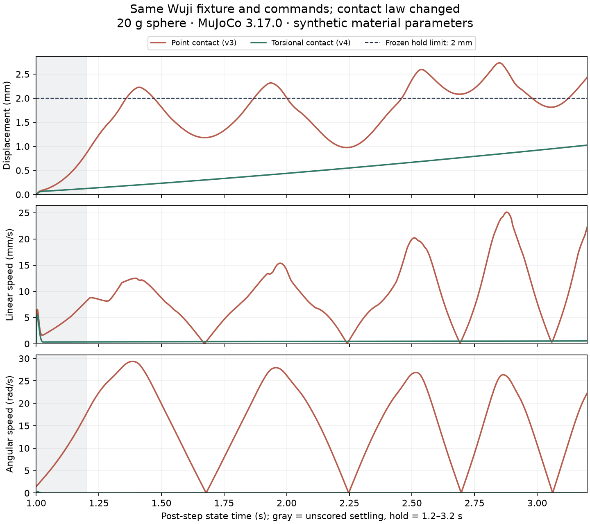

# Wuji sphere pinch: point contact versus torsional contact

**With the same hand, controller and commands, changing the contact model reduced maximum holding displacement from 2.734 mm to 1.025 mm, passing the original 2 mm limit.** This uses MuJoCo's existing torsional-contact capability; the solver was not modified. It demonstrates contact-model sensitivity in this synthetic fixture, not a qualified solver failure or a validated real fingertip material.


The point-contact hold fails; the torsional-contact hold and commanded release pass. Both show preparation, holding and release at original speed. Crosses are **orientation textures added only during replay**, without changing collision geometry or physics. Video is 30 fps and GIF is 15 fps; angular measurements come from the 2 kHz raw record, not the animation. [Full video](../../evidence/wuji-contact/comparison.mp4) · [Raw identities and frame map](https://github.com/huangkiki/Dexlab/blob/main/docs/evidence/wuji-contact/comparison.json).

## Rescore without installing a simulator

Install Git and [uv](https://docs.astral.sh/uv/getting-started/installation/). From a new directory, download the code and immutable evidence bundle, then rescore with isolated Python 3.12.12, NumPy and Matplotlib. No GPU, hardware, SuperDex, Torch or API key is needed. The archive is about **141 MiB**, expanding to **382 MiB**; allow 2 GB of free space.

```bash
git clone --depth 1 --filter=blob:none --sparse https://github.com/huangkiki/Dexlab.git Dexlab-wuji
cd Dexlab-wuji
git sparse-checkout init --cone
git sparse-checkout set scripts demos/wuji-contact
uv run --no-project --isolated --python 3.12.12 \
  --with-requirements demos/wuji-contact/offline-requirements.txt \
  python scripts/download_assets.py --manifest demos/wuji-contact/evidence-bundle.json \
  --destination downloads/wuji-contact-v1
uv run --offline --no-project --isolated --python 3.12.12 \
  --with-requirements demos/wuji-contact/offline-requirements.txt \
  python demos/wuji-contact/plot.py downloads/wuji-contact-v1/runs/03-v4-hold-release \
  --output results/wuji-contact-v4
```

Open `results/wuji-contact-v4/measurements.png`. CSV preserves the complete series; `report.json` should report `record_integrity_pass`, `numerical_balance_pass`, `hold_pass` and `release_pass` all `true`, with displacement about **0.001025 m**. Select input `02-v3-hold-release` and a fresh output directory to rescore the point-contact failure: about **0.002734 m**, with holding and qualified release both `false`. Retained experiment failures do not indicate failed downloads or rescoring.

[Raw data, per-file hashes and licenses](https://github.com/huangkiki/Dexlab/releases/tag/wuji-contact-evidence-v1) include four development cohorts, every executed/not-run case, historical and corrected scores, models and source. Never write outputs into an immutable input directory.

## What changed

The synthetic sphere has radius 10 mm, mass 20 g and inertia `2mr²/5`. The Wuji wrist is fixed. Close during 0.2–0.8 s, remove every preparation force at 1.0 s, score 1.2–3.2 s, then open and observe through 4.4 s. Displacement always refers to the **1.0 s** state; neither reference nor threshold moved.

| Cohort | Prospectively defined setting | Maximum hold displacement | Result |
| --- | --- | ---: | --- |
| v1 | Convex wrist, explicit sampled PD | 24.422 m | Initial self-penetration was already 4.981 mm; the controller linearization was also unstable. Inputs were unqualified. |
| v2 | Same-source native SDF wrist; implicit sampled PD, 2 ms control period | 2.459 mm | Continuous two-pad contact, but failed 2 mm holding. Two corrections do not isolate one causal effect. |
| v3 | Only shorten control period to 0.5 ms; native timestep unchanged | 2.734 mm | More grip force did not qualify holding; the control-rate hypothesis was not supported. |
| v4 | Retain v3, add a synthetic torsional law to object contacts | 1.025 mm | Original hold/release and the added angular-momentum check pass. |

v4 uses `condim=4`, with sliding coefficient still 1 and torsional friction length **0.002 m**; rolling friction is not active. An analytical uniform-pressure circular-patch approximation with synthetic radius `a=3 mm` and `mu=1` gives pure-twist limit `T/N=(2/3)*mu*a=0.002 m`. Its numerical equality to the 2 mm displacement threshold is coincidental: the parameters have different meanings.

No elastic volume or actual patch deformation is resolved; `a` is not measured. MuJoCo's combined sliding/twisting elliptic cone is a further approximation: the derivation establishes only the pure-twist intercept. Parameters were frozen before this batch, without an outcome-driven sweep. [v4 protocol](https://github.com/huangkiki/Dexlab/blob/main/demos/wuji-contact/PROTOCOL-v4.md) · [Native contact model](https://mujoco.readthedocs.io/en/stable/computation/index.html#condim).



**v4 still drifts slowly.** The green displacement curve continues rising; passing the two-second hold does not establish indefinitely stationary grasping. The frozen experiment was not extended to infer a long-duration outcome; that remains separate validation.

## Why sustained point contact still allowed rotation

Each of the 4,000 holding steps in both v2 and v3 had two active pad contacts and zero intrinsic contact moment. Arbitrary forces at two points cannot create a moment about their connecting line. The radius-scaled force-only grasp map `G=[I,I; skew(p1-c)/r,skew(p2-c)/r]` has rank 5.

In v3, the COM lay 0.310–0.985 mm from that line and gravity produced a nonzero moment about it. The midpoint of two fixed pad-reference markers moved at most about 0.093 mm, while the sphere moved about 2.696 mm relative to it. Increasing normal force does not supply the missing point-contact moment direction. This is post-hoc structural diagnosis, not proof that all rank-five grasps fail: special gravity-aligned equilibria remain possible, and these fingers/contact points move.

| Holding observation | Point contact v3 | Torsional contact v4 |
| --- | ---: | ---: |
| Bilateral active contact | 100% | 100% |
| Mean pad normal forces | 0.758 / 0.772 N | 0.815 / 0.829 N |
| Maximum linear speed | 25.110 mm/s | 0.539 mm/s |
| Maximum angular speed | 29.336 rad/s | 0.024992 rad/s |
| Maximum intrinsic moment at one contact | 0 | 0.022138 mN·m |
| Actuator saturation / other-body support | Both zero | Both zero |

v4 applies its contact law from preparation onward, so the state at support removal also changes. This development comparison supports qualification of the new contact configuration; it does not uniquely attribute all prior displacement to one freedom. Rotation path length is not controlled net rotation. [Executable diagnosis](https://github.com/huangkiki/Dexlab/blob/main/demos/wuji-contact/diagnose.py) · [Per-attempt diagnostics](https://github.com/huangkiki/Dexlab/blob/main/docs/evidence/wuji-contact/diagnosis.json).

## Controls beyond holding

| Control | Measurement | Verdict |
| --- | --- | --- |
| Hold and active release | Hold 1.025 mm; clear contact and fall after opening | Meets frozen criterion |
| Unload index | Selected pad late maximum normal 0 N; hold displacement 1.025 mm | Meets frozen criterion |
| Unload thumb | Selected pad late maximum normal 0 N; hold displacement 1.025 mm | Meets frozen criterion |
| Remain open | Hold rejected; maximum displacement 23.7456 m | Meets frozen criterion |
| Disable object contact | Hold rejected; maximum displacement 23.7456 m | Meets frozen criterion |
| Nominal zero friction | Hold rejected; maximum displacement 23.3643 m | Meets frozen criterion |

Nominal zero friction sets all three coefficients on every geom to zero; native contact readbacks retain a **1e-5** numerical floor, so this is not strict mathematical zero. Dropping after unloading one finger can be physically reasonable; unloading is judged separately by that pad's measured normal force. Each of v1–v3 stopped after its failed positive, leaving **15 cases not run**. v4 does not replace those historical outcomes. The original v1 score incorrectly counted falling clear as release; it is preserved alongside the correction requiring a preceding qualified hold. [All attempts and cost](https://github.com/huangkiki/Dexlab/blob/main/docs/evidence/wuji-contact/results.json).

## Numerical consistency, reproduction and limits

Independent scoring reconstructs native forces and checks `mΔv=Δt(Fcontact+mg+Fprep)`; v4's maximum residual is about `1.65e-17 N·s`. Angular balance includes contact lever arms, intrinsic moments and external moments, with maximum residual about `4.74e-22 N·m·s`. Free-joint angular velocity is rotated from body to world coordinates following the [official convention](https://mujoco.readthedocs.io/en/stable/overview.html#floating-objects). These check signs, epochs and record consistency, not real material accuracy or numerical convergence.

[Native execution and replay instructions](https://github.com/huangkiki/Dexlab/tree/main/demos/wuji-contact) provide pinned dependencies and verified assets. Physics uses unmodified MuJoCo 3.17.0, CPU/float64. Hand masses, inertias, joints and effort limits come from the pinned source asset; control/material settings are synthetic. The wrist uses native SDF, while other hand collision meshes remain convex approximations.

Entry-point fixes include whole-hand initial-penetration checks, the active-release predicate, asset-manifest format, state/force time labels, and core/binding/binary identity records. Original raw observations remain unchanged. When v3's outer observer exited, its bounded service still completed; accounting was recovered from final telemetry without rerunning. Subsequent accounting drivers run independently of the foreground session.

Cumulative use is **9 native starts / 3433.724 s**. The unchanged 12-start / 7,200 s package retains 3 starts / 3766.276 s; no allowance was reset. All six v4 development controls meet their respective frozen criteria. Historical not-run cases are not counted as completed.

This qualifies only the first native development path. The [applicability matrix](https://github.com/huangkiki/Dexlab/blob/main/demos/wuji-contact/applicability.json) retains other engines and historical configurations as not run. [#251](https://github.com/huangkiki/Dexlab/issues/251) delivery still requires merge, deployment and item-by-item acceptance; [#48](https://github.com/huangkiki/Dexlab/issues/48) contact switching, controlled rotation and ten new post-development validation conditions remain unfinished.
