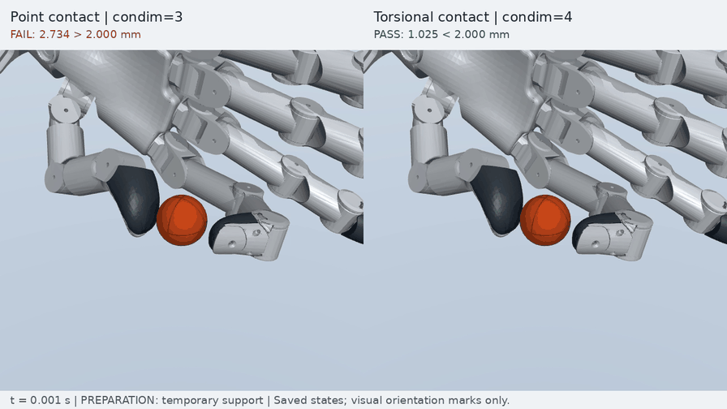
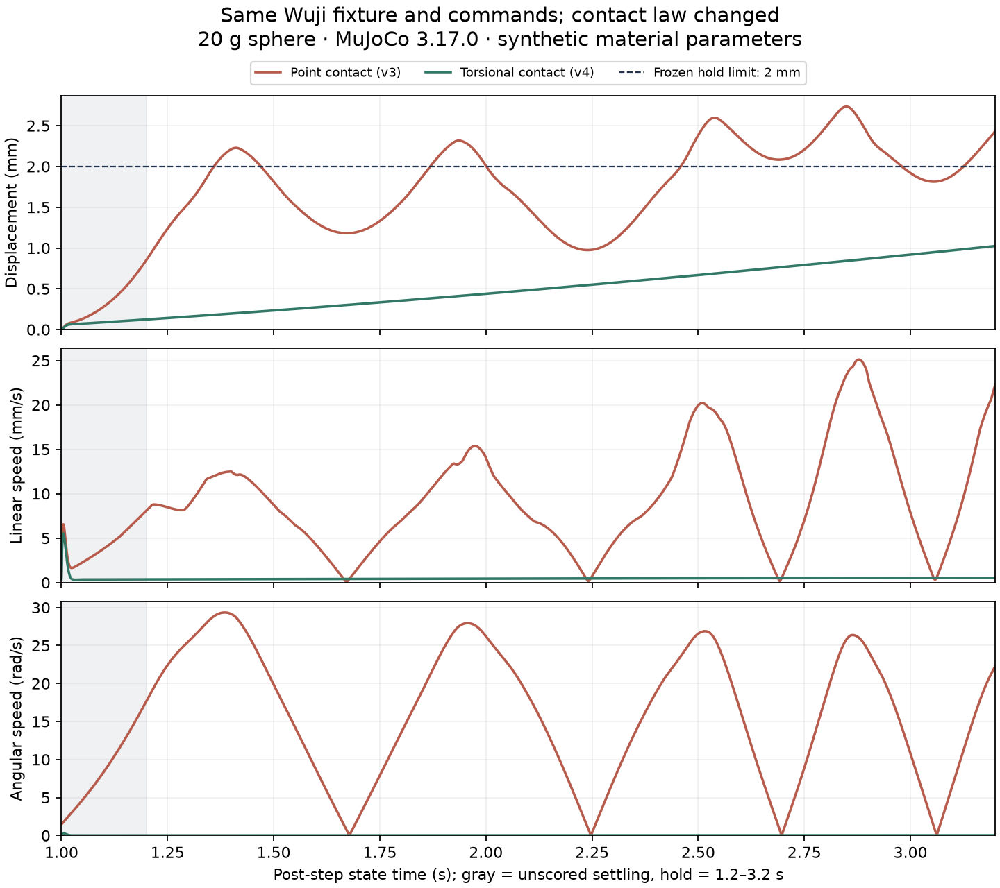

(wuji-sphere-pinch-point-contact-versus-torsional-contact)=
# Why does the ball still spin between two gripping fingers?

Both Wuji fingertips stayed in contact with the ball for the two-second hold. The ball still spun and moved up to **2.734 mm**, exceeding the preset **2 mm** limit. Adding synthetic torsional contact to the same hand and controller brought the displacement down to **1.025 mm**. The difference is in the directions of torque the contacts can supply.



The 4.4-second replay includes preparation, holding and release. The cross marks the ball's orientation. Rotation was measured from the simulator's 2 kHz record.

## Which axis is the ball rotating about?

Picture two fingertips applying forces at two ideal points on the ball. Their points of application lie on the line joining the points. Whatever directions the forces point in, **their torque about that line is zero**. This picture describes instantaneous point contact. A real pad has area and can deform.

After the preparation forces were removed in the point-contact run, the ball's center stayed **0.310–0.985 mm** off the grip line, so gravity exerted a torque about the line. Both pads stayed in contact throughout the hold, and the intrinsic torque read back from each contact was zero. The midpoint of the finger reference points moved about **0.093 mm** at most, while the ball moved up to **2.696 mm** relative to that midpoint. This separates the ball's movement from motion of the hand and identifies the missing torque direction.

## What changed when the contact could resist twist?

The revised setup used MuJoCo's existing torsional contact and kept the sliding friction coefficient. Peak angular speed during the hold fell from **29.336 rad/s to 0.024992 rad/s**. The revised setup met the hold criterion and released the ball when the fingers opened. The displacement curve still drifts. The result covers the scored two-second hold.



The new contact law was active during preparation, so it could also change the state at the start of the hold. The comparison supports the improvement in this synthetic grip. The torque a real fingertip pad can supply would need a separate measurement.

When a contacted object still spins, check the rotation axis and the directions of torque the contacts can supply. To isolate the torsional term further, start both holds from the same state and then switch the contact law.

```{raw} html
<span id="rescore-without-installing-a-simulator"></span>
<span id="what-changed"></span>
<span id="why-sustained-point-contact-still-allowed-rotation"></span>
<span id="controls-beyond-holding"></span>
<span id="numerical-consistency-reproduction-and-limits"></span>
```

## Experiment records

[Full report and offline rescoring](wuji-contact-report.md) · [Original trajectories and frame mapping](https://github.com/huangkiki/Dexlab/blob/main/docs/evidence/wuji-contact/comparison.json)
