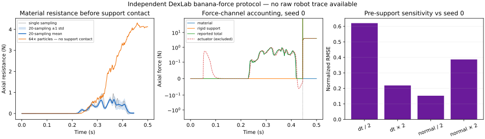

# 香蕉单刀测力：采样、敏感性与 64× 粒子细化

这组实验复现 BladeMaster Fig. 9 **公开描述的实验结构**：刀具竖直切入香蕉；分别显示单次采样、20 次不同粒子采样的逐时刻均值，以及把网格间距缩到四分之一、粒子数增至 64 倍的细化运行。作者没有公开原始机器人力曲线、香蕉几何、基础网格、采样分布、完整末端轨迹或接触尺度，因此结果只评价冻结 DexLab 模型的数值完整性、离散性与敏感性，不是作者代码或真实香蕉的精度复现。



## 先看结论

| 检查 | 正式结果 |
| --- | ---: |
| 20 次独立粒子采样：单次切板前材料峰值 | **0.8469 ± 0.1511 N** |
| 20 条曲线逐时刻均值：切板前峰值 | **0.6661 N** |
| 最大逐时刻标准差（切板前） | **0.2767 N** |
| 材料冲量（切板前） | **0.07341 ± 0.01249 N·s** |
| 64× 粒子：完整轨迹内材料峰值 | **4.3059 N** |
| 64× 粒子：完整轨迹内材料冲量 | **0.60183 N·s** |
| 64× 曲线相对 20 次均值的归一化 RMSE | **2.051** |
| 64× 冻结验收 | **失败：0.5 s 内未接触砧板** |

20 次采样均通过力通道恒等式、动量平衡、正 Jacobian、先材料接触后砧板接触和切割进度检查。不过，基准 `dt=0.125 ms` 的一因子敏感性仍然明显：`dt/2`、`dt×2`、法向尺度 `/2`、法向尺度 `×2` 相对 seed 0 的切板前归一化 RMSE 分别为 **0.621、0.219、0.153、0.387**。64× 运行也通过有限值、动量、正 Jacobian、材料接触和切割进度，但唯一失败项是冻结协议要求的砧板接触；因此本轮结论是“基准协议与数值记账合格，细化验收为负结果，力曲线没有表现出稳健的步长／接触／粒子细化收敛”，不能据此宣称真实力准确。

## 力是怎样记账的

| 通道 | 定义与用途 |
| --- | --- |
| 材料阻力 | 材料施加到刀具上的 `+z` 反力；用于切板前材料响应。 |
| 刚性支撑阻力 | 刀具—砧板冲量除以时间步；论文 Fig. 9 末段尖峰也包含该通道。 |
| 总阻力 | 材料阻力 + 刚性支撑阻力。 |
| 驱动力 | PD 执行器输入，单独记录，不计入阻力。导向力矩也单列。 |

后段约 `0.445 s` 开始的高峰来自刀具接触刚性支撑；它不能当作香蕉材料强度。图中第二栏使用对称对数轴，避免约 1 N 的材料响应被约几十牛的支撑峰值遮住。

## 对齐了什么，哪些仍是独立选择

论文公开并直接采用 E=0.4 MPa、ν=0.45、ρ=1,100 kg/m³、屈服应力 30 kPa、刀具质量 0.1 kg、摩擦 0.2、Gc=700 J/m² 和锋利度 0.9。20 次不同粒子采样、四分之一网格间距和精确 64× 粒子数也按原文验收。

DexLab 独立选择人工曲香蕉（120 × 60 × 30 mm 包围尺寸）、分层抖动采样、7.5 mm 基础网格、0.125 ms 基础时间步、平移刀具的竖直 PD 轨迹和接触尺度。塑性采用主对数应变空间的理想 J2 径向回归；论文未公开该投影。刀具仍是导向平移刚体，不是论文中的完整六自由度刚体接口。

切割带半宽按原文取 `6Δx`。论文没有公开粒子接触半径比例 `s_R`、切割带后缘／前缘尺度、最小切入速度或“完整材料近邻”的具体排除距离；本轮运行前的源码已固定为 `s_R=1`、`b_back=2Δx`、`b_lead=2R_p`、`u_min=0`、近邻阈值 `2Δx`，并由源码哈希绑定，但冻结 JSON 没有逐项列出它们，也没有为这些量单独做敏感性扫描。这是当前协议相对原文仍无法对齐的一项边界。

表面画面仍根据记录刀路重建平面切缝；它没有实现论文 III-F 的 linked volume、Hermite 数据和局部 dual contouring。力学成功、表面观感与真实标定继续分开评价。

## 复现

冻结协议和公开结果分别位于 [`demos/banana-force/force-protocol.json`](https://github.com/huangkiki/Dexlab/blob/main/demos/banana-force/force-protocol.json) 与 [`demos/banana-force/evidence.json`](https://github.com/huangkiki/Dexlab/blob/main/demos/banana-force/evidence.json)。完整运行必须在实际 cgroup CPU、内存、零 swap、任务数、运行时与 I/O 限制内执行；`runs/` 原始轨迹保留在本地实验存储，不作为 Git 体积提交。

```bash
python -m dexlab.banana_force --output <run-dir> --suite baseline
python -m dexlab.banana_force --output <run-dir> --suite sensitivity
python -m dexlab.banana_force --output <run-dir> --suite refined --segment-wall-s 3300
python scripts/build_banana_force_report.py \
  --baseline <baseline-dir> --sensitivity <sensitivity-dir> --refined <refined-dir> \
  --receipt <bounded-receipt> --evidence demos/banana-force/evidence.json \
  --figure docs/evidence/cutting/banana-force/force-protocol.svg
```

[材料与塑性细节](cutting-fidelity.md) · [历史香蕉三刀回放](banana-cutting.md) · [连续切割与刀面推动](cut-push.md) · [BladeMaster 论文](https://arxiv.org/html/2609.27342v2#S4.SS3)
