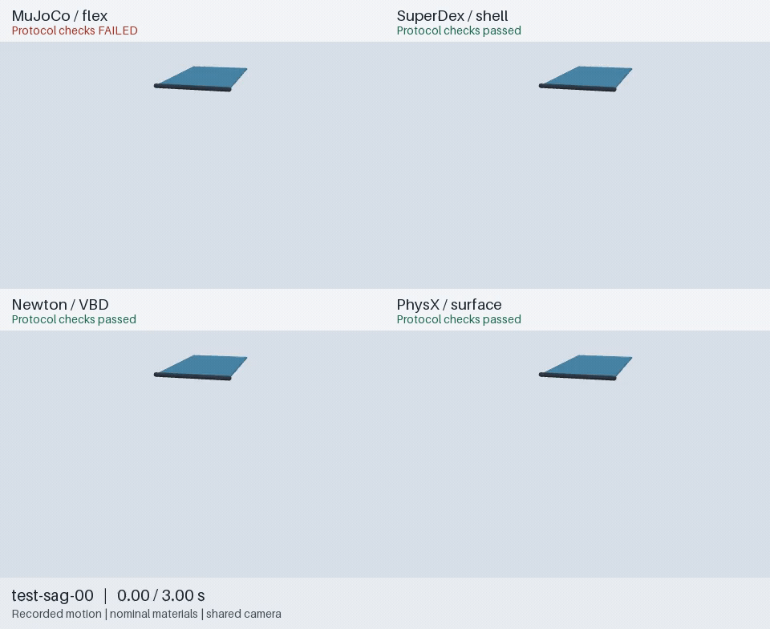
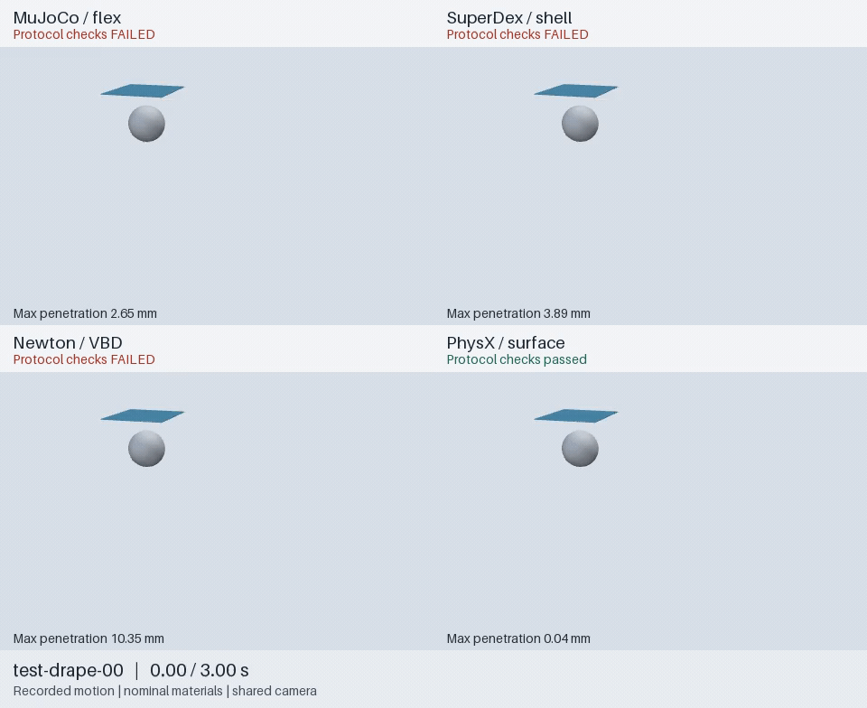

# 布料：同一场景，不同引擎

**布条在空中垂得下来，已经说明它会弯。把它放到球体上，还要另外证明碰撞能撑住它。** 在这组历史对照里，同一 Newton VBD 配置通过了固定边下垂检查，到了覆盖球体的场景却出现 **10.35 mm** 最大球面穿透。

## 下垂：固定一边，释放布条



把一边固定的水平布条放开，重力会让自由端往下落。看末端落了多少、布面还在怎样摆，以及固定点有没有跟着移动。这里的地面只是画面背景。这一步可以把下垂时的响应单独拿出来观察。

## 覆盖球体：看接触处，而不只看外轮廓



把一张自由布片从静止释放，下面只放一个半径 **60 mm** 的球和地面。观察球面怎样撑起布，以及布的两层怎样擦过。用同一帧看最后的轮廓，可能会漏掉中途发生的穿透。

Newton VBD 的这条记录里，布片下落后，**0.21 s** 首次在采样帧观察到布面自交，整段的最大球面穿透为 **10.35 mm**，超过 **1.5 mm** 门槛。积分结束时球面穿透读回已回到零，整段检查仍然失败。已测到的失效位于接触响应，现有记录还不足以区分接触何时生成、材料响应和步长分别贡献了多少。下一步是在同一网格、初态和材料下，记录首次接触与穿透的时间，再单独改步长做对照。

这里比较的是历史配置，每个场景对各引擎使用同一输入网格和初态。材料参数没有跨引擎标定，迭代、精度和物理实现也不同。两段回放适合用来区分问题出现在哪里。真实布料的拟合效果需要有实物测量才能判断。

```{raw} html
<span id="newton"></span>
<span id="rss"></span>
<span id="id5"></span>
```

## 实验记录

[八种配置、评分与生成方法](cloth-comparison-report.md) · [下垂帧映射](https://huangkiki.github.io/Dexlab/zh-cn/latest/_static/cloth-studio/sag.json) · [球面覆盖帧映射](https://huangkiki.github.io/Dexlab/zh-cn/latest/_static/cloth-studio/drape.json)
