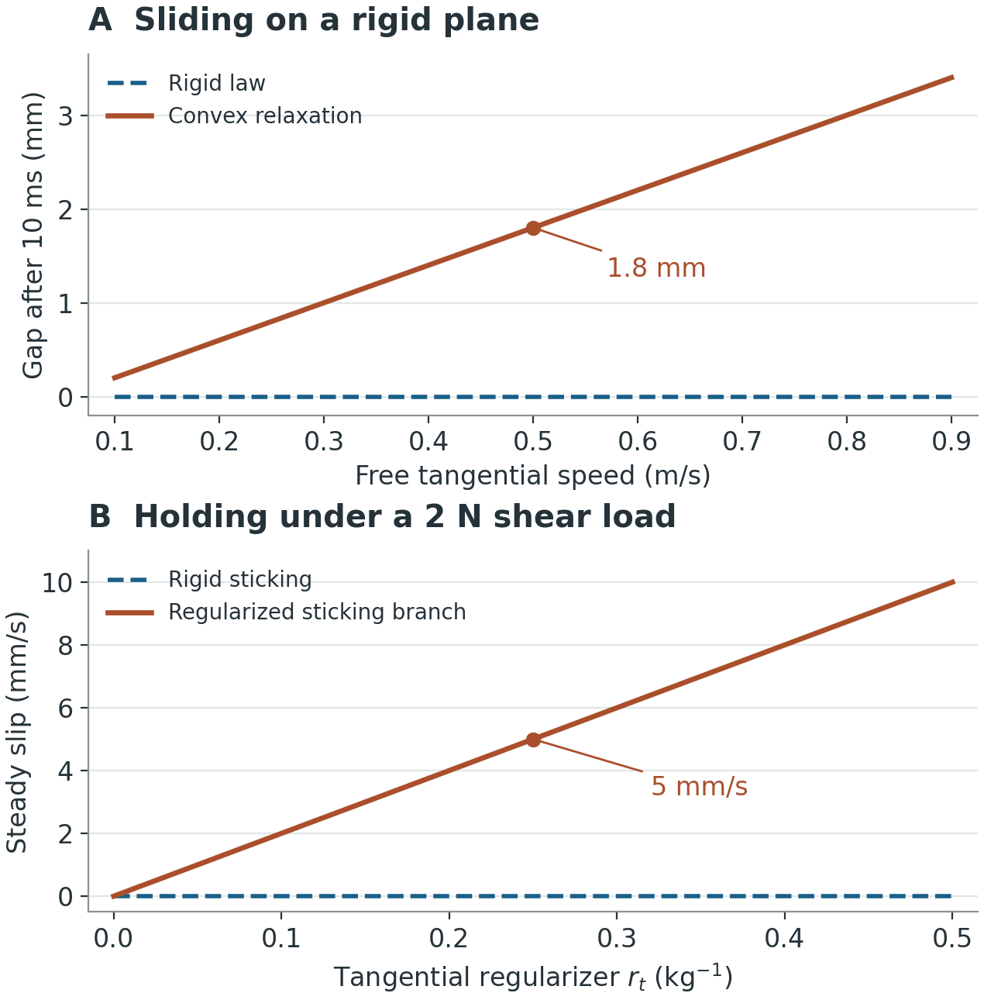

# 接触求解收敛了，滑块为什么还会离开桌面？

横推桌上的滑块。理想刚性模型里，桌面可以一边托住它，一边让它水平滑动。但有一类凸松弛会算出**向上的速度**。即使求解器把自己的方程解到很小的残差，向上的速度仍然存在。它是那条方程的解。

Beker 等人的《A Tutorial on Complementarity-Based Contact Models for Robotics》值得细读，正因为它能把这种现象追到一个数学选择。它把同一条刚性接触定律的五种写法放在一起，再指出哪些修改会改变物体实际怎样运动。下文用一个可手算的单点滑块，把这个区别变成能读回的量。 [教程 v1](https://arxiv.org/html/2611.26600v1) · [原文 Fig. 5](https://arxiv.org/html/2611.26600v1#S3.F5)

## 先看一次仿真步在算什么

设想一个只能平移的刚体，和桌面有一个候选接触点。仿真先算**没有接触冲量**时它这一小步会怎么走，再求桌面应给多大的冲量。只看接触坐标下的速度，可以写成

$$
v^+=v_f+Gp,qquad G=JM^{-1}J^\top.
$$

$v_f$ 是自由速度，$v^+$ 是步末速度，$p$ 是步内接触冲量，$J$ 把广义速度映射到各接触点的相对速度，$M$ 是刚体系统的广义惯量。举例中的滑块质量为 $1\,\mathrm{kg}$，坐标只包括法向与一个切向，所以 $G$ 就是两轴上的 $1/m$。多指夹持时，一个指尖的冲量能改变别的接触点的速度，这个耦合写在 $G$ 的非对角块。 [原文 §2](https://arxiv.org/html/2611.26600v1#S2)

令 $d$ 是步初间隙，$h$ 是步长，$s=v_n^++d/h$。在这一小步的线性近似里，$hs$ 是预测步末间隙。理想刚性接触相关的三条规则如下。

| 状态 | 对速度和冲量的要求 |
| --- | --- |
| 分离 | $s>0$，法向和切向冲量都为零 |
| 粘着 | 持续承载时 $s=0$，切向速度为零，切向冲量大小最多为 $\mu p_n$ |
| 滑动 | 持续承载时 $s=0$，切向冲量达到 $\mu p_n$，方向与滑动相反 |

其中 $p_n\ge0$，$\mu$ 为摩擦系数。$s$ 与 $p_n$ 都可为零，那是接触状态的边界。仿真求解这些约束时不必先猜好每一个点属于哪种状态。 [原文式 (39)](https://arxiv.org/html/2611.26600v1#S4.E39) · [Fig. 6](https://arxiv.org/html/2611.26600v1#S3.F6)

## 为什么删掉一项会抬离

摩擦锥约束 $\|p_t\|\le\mu p_n$。它的对偶锥要求速度量 $y$ 满足 $y_n\ge\mu\|y_t\|$。两者还要正交。活跃滑动时，$p_n>0$ 且切向冲量顶住锥边界，正交就要求 $y_n=\mu\|v_t^+\|$。

把这个条件写回接触速度时，有两种做法：

$$
\begin{aligned}
y_n=s+\mu\|v_t^+\| &\quad\Rightarrow\quad s=0,\\
y_n=s &\quad\Rightarrow\quad s=\mu\|v_t^+\|.
\end{aligned}
$$

第一行是精确转写，加上的项叫 **de Saxcé 修正**。它改变锥互补计算中的变量 $y$，物体仍能纯水平滑动。第二行删去这项，得到结构更容易处理的未正则化凸松弛。此时正的 $s$ 必须由接触速度给出。对于一开始恰好贴面的滑块，这就是一步后新增的法向间隙。 [原文 §4.1.2](https://arxiv.org/html/2611.26600v1#S4.SS1.SSS2) · [§6.2](https://arxiv.org/html/2611.26600v1#S6.SS2)

### 10 毫秒能差多少？

取 $m=1\,\mathrm{kg}$、$g=10\,\mathrm{m/s^2}$、$h=0.01\,\mathrm{s}$、$\mu=0.5$。初始贴面，横向自由速度 $0.50\,\mathrm{m/s}$，法向自由速度 $-0.10\,\mathrm{m/s}$。在两种模型的滑动分支均有 $p_t=-0.5p_n$。

| 同一个初始状态 | 法向冲量（N·s） | 步末切向速度（m/s） | 步末法向速度（m/s） | 步末间隙（mm） |
| --- | ---: | ---: | ---: | ---: |
| 精确刚性接触 | 0.10 | 0.45 | 0.00 | 0.0 |
| 未正则化凸松弛 | 0.28 | 0.36 | 0.18 | 1.8 |

第二行可以直接验算：$-0.10+0.28=0.5(0.50-0.5\times0.28)=0.18$。持续接触对贴面推送或换指很重要，因为支撑出现时间错位会影响物体下一步能从哪里受力。这个例子只给出**一步**参考。若要在引擎里归因，先读回相同接触对的法向冲量、法切速度和间隙，并控制初始相交、反弹、柔顺和位置稳定项。然后看这一关系在增加迭代预算后是否仍出现。

*自绘解析图。上图只画两种模型都在滑动的速度区间。下图的 $r_t$ 是冲量到速度的正则化系数。两图均为教学参考，可用文中参数复算。*

## 同一个滑块，轻推时为什么会慢滑

让滑块从静止开始，施加 $2\,\mathrm N$ 恒定横向推力。静摩擦上限是 $\mu mg=5\,\mathrm N$。理想刚性模型允许用 $p_t=-Fh$ 抵消外力，速度保持为零。

在法向保持刚性的简化凸模型里，只加固定的切向正则化 $r_t$。在摩擦锥内部，没有切向参考偏置的简化模型满足 $v_t^++r_t p_t=0$。稳态仍需要 $p_t=-Fh$ 来平衡外力，于是 $v_t^+=r_tFh$。取 $r_t=0.25\,\mathrm{kg^{-1}}$，稳态速度就是 $5\,\mathrm{mm/s}$。一旦进入稳态，每过一秒会再漂移约 $5\,\mathrm{mm}$。它从“静止时能抵住推力”变成了“需要持续小滑速才能产生同样的剪切力”。 [原文 §6.2](https://arxiv.org/html/2611.26600v1#S6.SS2)

判因时先查载荷是否始终低于原生有效摩擦上限，再看实际剪切冲量和滑移是否同步。固定几何、材料和载荷，增加同一模型的迭代预算。若位移仍收敛到稳定漂移，再单独改变有效切向正则化。物体转动、复杂材料或带切向历史的模型会引入额外机制，本例的线性关系适用于上述平移和锥内条件。

## 换求解器之前，先问换了哪条方程

| 改动 | 直接影响 | 该检查什么 |
| --- | --- | --- |
| 在固定方程上增加迭代预算 | 减少当前求解问题的数值残差 | 用相同输入看冲量与状态是否继续变化 |
| 删除 de Saxcé 修正 | 把活跃切滑耦合到法向速度，得到未正则化凸问题 | 同一步核对法向冲量、预测间隙和切向速度 |
| 加固定的正则化 | 让解更容易选定，引入柔顺并可能改变粘着 | 在已知亚阈值载荷下看稳态滑速和保持位移 |
| 用多面体代替圆锥 | 摩擦许可范围依赖切向方向 | 固定几何和载荷，旋转载荷方向或切向基，查摩擦方向与耗散是否跟着变 |
| 在外层更新近端锚 | 每个子问题仍有正则项，收敛固定点可消去附加项 | 同时看内层收敛、外迭代残差与原始接触条件 |

近端构造值得顺手读。每轮用 $R(p-z_k)$ 改善子问题的数值性质。外层更新参考冲量 $z_k$，并按新速度重算 de Saxcé 项，到固定点 $p=z_k$ 时，这个正则项消去。**固定点满足精确方程**是数学结论。实际给定预算能迭代多近，还需要看外层残差。 [原文 Alg. 14](https://arxiv.org/html/2611.26600v1#alg14)

另一处容易混淆的是逐点冲量与运动。多个冗余接触可以给出一样的总广义冲量、一样的刚体轨迹，却把载荷分配到不同指尖。对抓持策略，若观测包含各指触觉，就应把逐点载荷、合力矩和物体运动一并记录。若用梯度选动作，也应检查跨接触模式时的方向，并用硬前向回放验证得到的动作。 [原文 §6.1](https://arxiv.org/html/2611.26600v1#S6.SS1) · [原文 §7.2](https://arxiv.org/html/2611.26600v1#S7.SS2)

## DexLab 怎样使用这套诊断

{ref}`DexLab 六引擎斜面记录 <incline>` 已按静摩擦、滑动和名义零摩擦组织。新增诊断应先在单接触快照对齐几何、法线、力与冲量单位以及样本时刻，再独立分辨**同一模型的求解余量**和**模型之间的方程差异**。水平滑动和亚阈值保持足够作为第一对解析参考。现有跨引擎结果中还涉及碰撞、积分、有效参数和记录有效性，具体失败仍要回到对应时间线。 [DexLab Discussion #421](https://github.com/huangkiki/Dexlab/discussions/421) · [ContactBench 对照研究](https://arxiv.org/abs/2304.06372v3)

数学里的“精确”以选定的刚性离散模型为参考。真实手指垫可形变，实验若依赖软材料的接触面积、卸载或切向滞回，需要独立的物理测量。引擎文档可用来确认候选实现路径，运行记录才说明某一次执行实际走了哪条。 [MuJoCo 软接触说明](https://mujoco.readthedocs.io/en/stable/computation/index.html#soft-contact-model) · [Drake 离散接触文档](https://drake.mit.edu/doxygen_cxx/group__mbp__discrete.html)

## 对照原文精读

| 想弄清的问题 | 原文入口 |
| --- | --- |
| 仿真步和接触几何从哪来 | [§2](https://arxiv.org/html/2611.26600v1#S2) · [Fig. 1](https://arxiv.org/html/2611.26600v1#S2.F1) · [Fig. 2](https://arxiv.org/html/2611.26600v1#S2.F2) |
| 为什么需要锥、对偶锥和修正项 | [§3](https://arxiv.org/html/2611.26600v1#S3) · [Fig. 3](https://arxiv.org/html/2611.26600v1#S3.F3) · [Fig. 4](https://arxiv.org/html/2611.26600v1#S3.F4) · [Fig. 7](https://arxiv.org/html/2611.26600v1#S4.F7) · [Fig. 8](https://arxiv.org/html/2611.26600v1#S4.F8) |
| 哪些写法保留原接触定律 | [Fig. 5](https://arxiv.org/html/2611.26600v1#S3.F5) · [Fig. 6](https://arxiv.org/html/2611.26600v1#S3.F6) · [§4](https://arxiv.org/html/2611.26600v1#S4) |
| 如何比较模型、算法和引擎路线 | [表 1](https://arxiv.org/html/2611.26600v1#S6.T1) · [表 2](https://arxiv.org/html/2611.26600v1#S6.T2) · [表 3](https://arxiv.org/html/2611.26600v1#S6.T3) |
| 多面体摩擦与可微接触有什么代价 | [Fig. 9 与附录 A](https://arxiv.org/html/2611.26600v1#A1.F9) · [§7.2](https://arxiv.org/html/2611.26600v1#S7.SS2) |

原作作者为 Onur Beker、A. René Geist、Michael Posa、Marc Toussaint、Justin Carpentier 和 Georg Martius。本文为中文导读，图和数值例题为独立推导。 [原文与版本记录](https://arxiv.org/abs/2611.26600v1)
