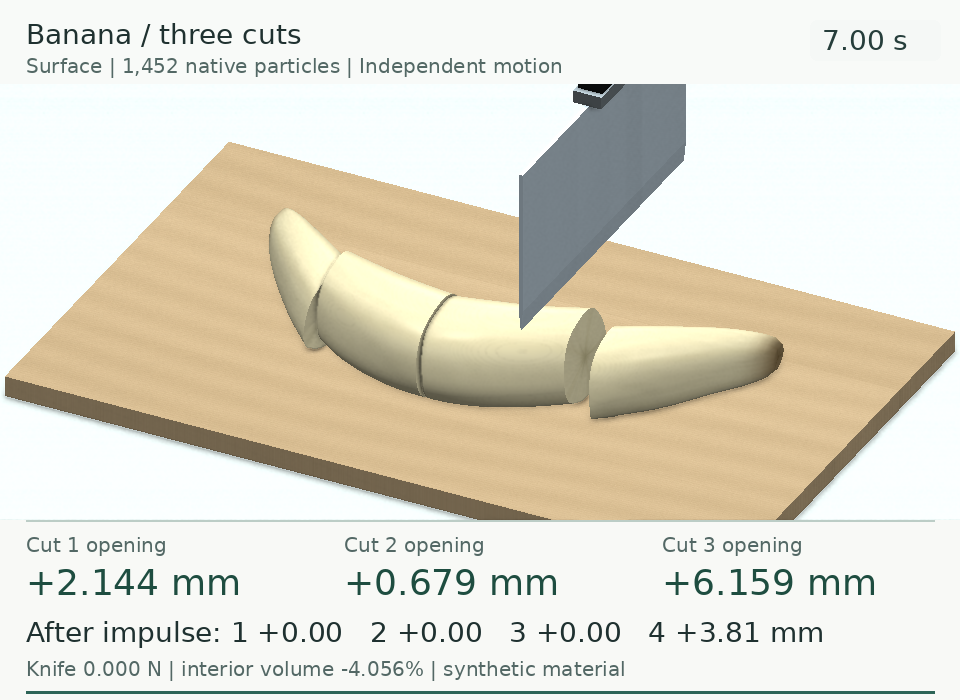

# 切割保真度与带数值回放

数值 GIF 显示保存的原生状态中的测量值，让差距可以检查。画面改善本身不代表已经复现 BladeMaster，也不代表真实食材标定。

## 细读论文后具体改了什么

[论文 v2](https://arxiv.org/html/2609.27342v2) 把材料动力学、持久切割历史、接触和表面重建分开。此次按这些边界检查实现：

| 论文细节 | DexLab 实现与剩余差距 |
| --- | --- |
| 式 1–4：固定参考插值与形变更新 | 固定参考插值模板、固定共旋弹性与 MUSL 更新；属于 CPU 独立实现，并非作者 GPU 代码。 |
| 式 5–6：方向性接触功与刀具扫掠侧标记 | 阻力使用正向推进接触功；几何侧标记与功累积进度分开。 |
| 式 7–9：持久三进制历史与相容动量交换 | 后续切割、撤刀都保留旧切口的侧标记；交换反对称且不交换质量；独立评分器检查实际传递图。 |
| 式 10–16：代理接触与等大反向刀具反力 | 球形材料代理、摩擦历史、反力及冲量记录；刀具受导向约束，不是论文中的自由旋转刀或机器人控制器。 |
| 附录式 17–18：PIC/FLIP 与 MUSL 动量平衡 | 公共混合比例、子步内固定质量和编码；测试与保存状态评分核对总动量和外部冲量。残差小表示数值一致性，不表示食材准确度。 |
| III-F：参考体元连接、Hermite 数据与局部对偶轮廓 | 豆腐提取暴露材料体元面；香蕉按每刀实际切割阶段的刀位中位数生成直线参考接缝，表面、数值测量与完整任务评分共用同一组记录切面，不再使用固定评分分区。原生侧标记冲突处逐步暴露切面，同一原生机械分量中的相容／未标记区域保留下部连接。横向扫动超过半个材料采样间距时拒绝单平面回放。精确变形后切割几何仍是近似，**没有完整复现论文 Hermite／局部对偶轮廓算法，也不支持任意刀路重建**。 |
| III-B：可选 von Mises 投影与 Newtonian viscosity | 香蕉论文参数模式采用主对数应变理想 J2 径向回归；默认屈服应力为 0，历史纯弹性记录不变。连续刀推豆腐仍采用 `σᵥ=2ηD`、η=5 Pa·s 的合成参数；[模型与结果](cut-push.md)。论文没有公开塑性投影、硬化或香蕉黏度细节，因此 J2 算法是独立选择，尚非作者代码复现或真实食材标定。 |
| III-G：GPU 紧凑活动编码 | 当前 CPU 使用稠密编码存储，不宣称 GPU 吞吐性能。 |

旧香蕉画面使用了 40 次几何平滑，并跨切口边缘混合法线；记录的显示顶点额外位移最大达 **2.358 mm**，导致切面像鼓起的圆头。新版**不再做几何平滑**，标记完整切面边缘并在尖锐边缘分离法线。表皮仍跟随保存的粒子位置和形变梯度，不额外添加分离位移。豆腐对比当前统一为中性灰场景与米白原生粒子，保留固定参考地面标记；橙色框投影中块粒子区域，收缩值来自内部四面体。

## 刀面推动取代直接速度输入

[历史豆腐两刀回放](tofu-comparison.md)在切完后重新进入左侧切缝，用刀面接触推动左块再撤刀。推动阶段不再改变切割历史，也不直接修改材料速度；画面显示保存的实际刀具位姿、接触力与位移。作者参考片仍使用原来的初速度输入，两种末尾输入明确区分。

[最新豆腐与香蕉展示](cut-push.md)在最后一刀的切缝内直接侧推，再撤刀。画面显示 |F|、Fx/Fz 和各块从初始状态起的位移；验收基准为最后一刀结束（3.30/5.30 s）。下方历史测量保留原有基准。

## 新增交叉浅切

[交叉浅切任务](tofu-scoring.md)在刀具局部坐标中计算接触和切面侧别，撤出后旋转 90° 再次浅切。原生位姿、姿态和材料反力均记录；切割历史延续，底部传递图单独验收。深度相对于初始上表面，完整回放显示连通块数与底部状态。它扩展了引导刀具的正交浅切，尚未实现原作的完整刀尖横向轨迹、自由旋转刀或对偶轮廓重建。

## 同一份状态，修正前后

| 原显示 | 修正后的显示 |
| --- | --- |
|  |  |

两帧均来自**原粗采样记录的 7.00 s 状态**，原始状态哈希一致，用于单独检查显示修改。新增细采样实验是另一份记录。<a href="_static/cutting/refinement/provenance.json">画面来源</a>。

## 数字怎么看

| 显示值 | 定义 |
| --- | --- |
| 切口宽度，mm | 同一参考面在两侧局部仿射运动下的有符号法向距离均值；交叉浅切第一刀沿 x、第二刀沿 y；只统计该刀原生侧标记非零且相反的配对。`--` 表示没有可用配对，不是切口为零。 |
| 中块收缩／体积，% | 中间三分之一内部固定参考四面体的有符号体积变化；每个完整原生格点单元分成六个四面体，排除跨计划切面的单元，单独统计翻转。对比 GIF 显示收缩量 -ΔV/V₀，JSON 保留有符号体积变化。 |
| 内部体积，% | 香蕉／对半豆腐采用相同估计器，对各块采样内部求和；不测装饰表皮的体积。 |
| 动作后位移，mm | 各固定材料区域的等质量原生粒子质心，相对于动作开始前精确保存帧的 x 位移；刀推协议以 4.00 s 为基准，历史初速度协议用原冲量时刻，按从左到右排列。 |
| 刀对材料 Fx，N | 刀具收到的材料反力 x 分量取负；负值表示刀向左推材料。取实际完成子步，排除驱动、导向与砧板力。 |
| 刀具反力，N | 保存的材料对刀具反力范数；导向、驱动和砧板力不包含在内。 |

每个媒体目录都有 `measurements.json`，包含单位、定义、帧索引和配对数量。GIF 放慢播放便于阅读，时钟与数值仍对应实际记录时间；`provenance.json` 保存帧映射、原始记录及渲染源码哈希。MP4 与 GIF 使用相同测量帧。

这是 DexLab 新增测量，**不宣称与作者未公开的采样实现完全相同**。论文报告 BladeMaster／CRESSim-MPM 首刀半深处平均切口为 0.654／4.059 mm，两刀后中块体积收缩为 0.506／8.746%。完整几何、驱动／接触设置、初速度和测量采样仍由 [#200](https://github.com/huangkiki/Dexlab/issues/200) 跟踪，不能据并排视频进行三方法数值排名。

## 香蕉论文参数模式已实现到哪一步

论文 IV-C 香蕉力实验使用 E=0.4 MPa、ν=0.45、密度 1,100 kg/m³、屈服应力 30 kPa、刀具质量 0.1 kg、摩擦 0.2、Gc=700 J/m²、锋利度 0.9。代码现已提供这组独立模式；公共香蕉动图与既有评分仍保持原 E=6 kPa、ν=0.35、纯弹性材料、刀具质量 0.2 kg、Gc=0.5 J/m²，不追溯改写。

论文只写“von Mises-type plasticity projection”，没有给出投影公式、屈服应力约定、硬化规律或代码。DexLab 明确选择常规等效应力 `q=√(3/2)||s||`，在主对数应变中径向回归并保留体积应变。解析测试覆盖屈服前加载、屈服后投影、卸载、叠加刚体转动、正 Jacobian 与非负塑性耗散；每个塑性记录必须保存逐子步耗散通道。[材料协议与源码身份](https://github.com/huangkiki/Dexlab/blob/main/demos/banana-force/material-protocol.json)同时列出论文未说明的字段。

这仍不等于完成香蕉力实验。单刀轨迹、稳定步长／接触敏感性、20 组粒子采样、四分之一网格间距的 64 倍粒子精化，以及材料力／砧板力／驱动与导向力的分离尚待 [#204](https://github.com/huangkiki/Dexlab/issues/204) 后续阶段。当前香蕉是人工建模，非扫描模型；真实食材标定、机器人推块及力值一致性仍未验证。

[交叉浅切记录](tofu-scoring.md) · [豆腐两刀记录](tofu-comparison.md) · [独立香蕉任务](banana-cutting.md) · [三列对比](cutting-comparison.md)
