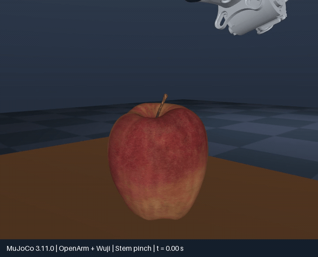
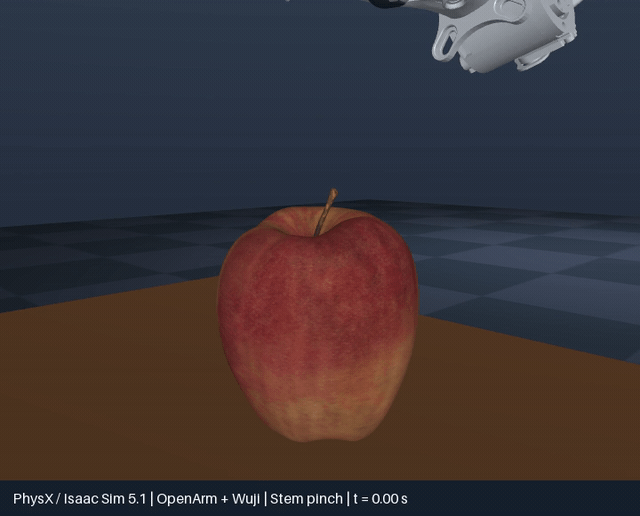
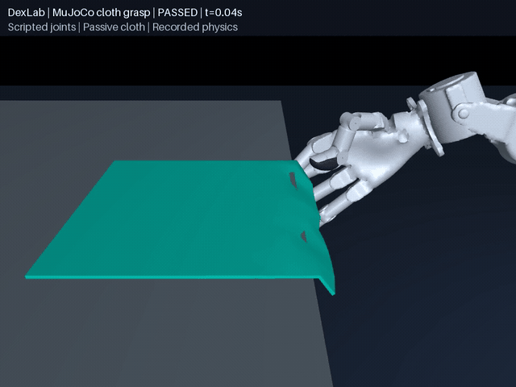
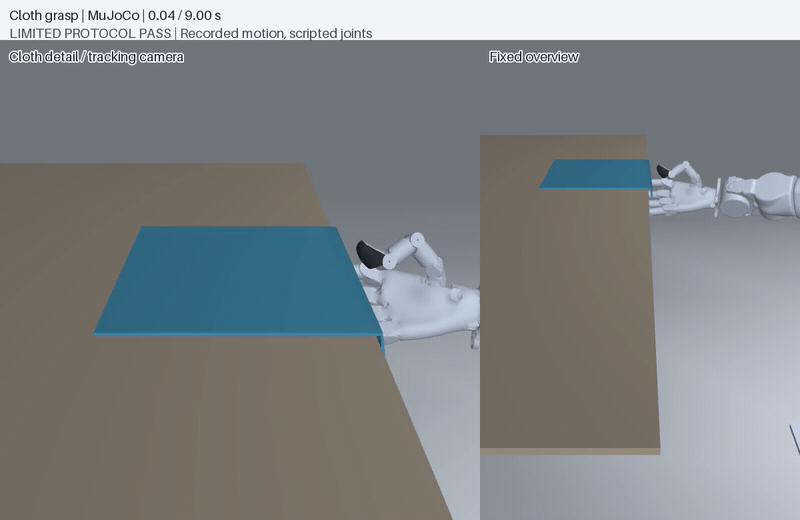

# 按任务查实验

每条记录列出任务、用过的仿真和已测到的结果。点任务名查看条件、曲线和原始记录。

[求解器与版本矩阵](coverage.md) · [并排回放](visual-comparisons.md) · [失败判因](failure-root-cause-atlas.md)

```{toctree}
:maxdepth: 1
:hidden:
:caption: 本栏目录

Wuji 抓持与抗扭接触 <wuji-contact>
海绵擦拭与辅助保持对照 <rss-wiping>
RoboDojo 面包脱落诊断 <robodojo-bread-slip>
布料引擎对比 <cloth-comparison>
翻花绳 Opening A <rope-opening-a>
切割与推动 <cutting-experiments>
LIBERO 原生流程 <libero-workflow>
AMP 记录器一致性失败 <amp-lift>
```

<!-- visual-research:start -->
(full-experiment-catalogue)=
[刚体接触与摩擦](#tasks-rigid-contact) · [夹持与灵巧操作](#tasks-grasping) · [布料与软体操作](#tasks-deformables) · [切割与刀面推动](#tasks-cutting) · [仿真运行路径](#tasks-execution)

(tasks-rigid-contact)=
## 刚体接触与摩擦

```{raw} html
<div class="task-register">
<div class="task-register-labels" aria-hidden="true"><span>任务与所用仿真</span><span>实验结果</span></div>
<article class="task-register-entry" id="experiment-highlight-incline">
<div><h3><a href="visual-comparisons.html#incline">斜面静止与滑动</a></h3>
<p class="task-register-engines">MuJoCo · SuperDex · Genesis · Newton Physics · PhysX · Drake · Chaos · Bullet · SOFA · RaiSim</p></div>
<p class="task-register-result">十种公开配置各跑九例。RaiSim 静止与名义零摩擦各通过 3/3，三档有摩擦滑动均出现旋转超限。</p>
</article>
<article class="task-register-entry" id="experiment-highlight-normal">
<div><h3><a href="experience.html#normal-response">法向与瞬态响应</a></h3>
<p class="task-register-engines">MuJoCo · SuperDex · PhysX（历史路径）</p></div>
<p class="task-register-result">静态校准有效，动态响应和质量迁移须分别验证。</p>
</article>
<article class="task-register-entry">
<div><h3><a href="results.html">碰撞与接触起始</a></h3>
<p class="task-register-engines">MuJoCo · SuperDex</p></div>
<p class="task-register-result">已有相位与刚度扫描；更小步长不自动消除模型差异。</p>
</article>
<article class="task-register-entry">
<div><h3><a href="experience.html#mass-size-transfer">质量／尺寸迁移</a></h3>
<p class="task-register-engines">MuJoCo · SuperDex</p></div>
<p class="task-register-result">30 条历史迁移记录，联合验收 0/30；失败也是选型依据。</p>
</article>
<article class="task-register-entry">
<div><h3><a href="experience.html#transient-cost">响应误差与计算成本</a></h3>
<p class="task-register-engines">MuJoCo · SuperDex</p></div>
<p class="task-register-result">27 条记录区分原生计算、记录和评分成本。</p>
</article>
</div>
```

(tasks-grasping)=
## 夹持与灵巧操作

```{raw} html
<div class="task-register">
<div class="task-register-labels" aria-hidden="true"><span>任务与所用仿真</span><span>实验结果</span></div>
<article class="task-register-entry">
<div><h3><a href="wuji-contact.html">Wuji 双指夹球</a></h3>
<p class="task-register-engines">MuJoCo</p></div>
<p class="task-register-result">加入抗扭接触后，两秒保持段最大角速度由 29.336 降至 0.025 rad/s，随后释放通过。</p>
</article>
<article class="task-register-entry">
<div><h3><a href="experiments.html#apple-replays">苹果抓梗 · SDF 接触</a></h3>
<p class="task-register-engines">MuJoCo · SuperDex · PhysX</p></div>
<p class="task-register-result">三条路径均有固定场景抓梗验收与近景回放。PhysX 是独立配置，三个记录分别看。</p>
</article>
<article class="task-register-entry" id="experiment-highlight-pinch">
<div><h3><a href="visual-comparisons.html#pinch">夹具夹持、抬升与释放</a></h3>
<p class="task-register-engines">Genesis · MuJoCo · SuperDex（分属不同协议）</p></div>
<p class="task-register-result">在 Genesis 同一夹具中，0.4 N 滑脱，0.8 N 保持并随后完成释放。</p>
</article>
<article class="task-register-entry" id="experiment-highlight-libero">
<div><h3><a href="libero-workflow.html">LIBERO 原生抓取：诊断与改进</a></h3>
<p class="task-register-engines">MuJoCo 2.3.7 / robosuite 1.4.0</p></div>
<p class="task-register-result">留出任务原版与半步长均为 10/10，物理检查却从 5/10 降至 3/10。另定位并修复了观测陈旧。</p>
</article>
<article class="task-register-entry">
<div><h3><a href="robodojo-bread-slip.html">RoboDojo 夹面包</a></h3>
<p class="task-register-engines">PhysX · 外部记录离线分析</p></div>
<p class="task-register-result">公开运行批次成功 19/100。对两次脱落逐帧追查，分别见到相邻物体挤压和浅夹持处的转动。</p>
</article>
<article class="task-register-entry">
<div><h3><a href="amp-lift.html">AMP 抬箱</a></h3>
<p class="task-register-engines">MuJoCo Warp</p></div>
<p class="task-register-result">两个短探针执行完成，记录前后状态一致性未通过。完整抬箱回合未运行。</p>
</article>
</div>
```

(tasks-deformables)=
## 布料与软体操作

```{raw} html
<div class="task-register">
<div class="task-register-labels" aria-hidden="true"><span>任务与所用仿真</span><span>实验结果</span></div>
<article class="task-register-entry">
<div><h3><a href="cloth-comparison.html">布条下垂与覆盖球体</a></h3>
<p class="task-register-engines">MuJoCo · SuperDex · Newton Physics · PhysX</p></div>
<p class="task-register-result">同一 Newton VBD 配置通过固定边下垂，覆盖球体时最大穿透 10.35 mm，超过 1.5 mm 门槛。</p>
</article>
<article class="task-register-entry">
<div><h3><a href="experiments.html#cloth-grasp-replay">机器人夹布、抬升与释放</a></h3>
<p class="task-register-engines">MuJoCo</p></div>
<p class="task-register-result">修复后一个 9 秒场景通过。自接触穿透接近阈值，历史桌体相交失败保留。</p>
</article>
<article class="task-register-entry">
<div><h3><a href="rope-opening-a.html">翻花绳 Opening A</a></h3>
<p class="task-register-engines">libuipc 0.0.30 · CUDA</p></div>
<p class="task-register-result">闭环绳经双侧手掌接触撑开，稳定阶段两股相距约 8.0 cm。仅关闭绳与手掌的接触后，绳圈坠落。</p>
</article>
<article class="task-register-entry">
<div><h3><a href="rss-wiping.html">海绵擦拭</a></h3>
<p class="task-register-engines">Newton Physics / MuJoCo Warp + SuperDex</p></div>
<p class="task-register-result">原版辅助保持通过 3/3。去掉辅助后失败 3/3，海绵从夹爪滑出。</p>
</article>
</div>
```

(tasks-cutting)=
## 切割与刀面推动

```{raw} html
<div class="task-register">
<div class="task-register-labels" aria-hidden="true"><span>任务与所用仿真</span><span>实验结果</span></div>
<article class="task-register-entry">
<div><h3><a href="cut-push.html">最后一刀直接侧推：豆腐与香蕉</a></h3>
<p class="task-register-engines">CPU TLMPM / measured knife contact</p></div>
<p class="task-register-result">豆腐三块、香蕉四块；最后一刀直接侧推，逐帧显示接触力与位移。豆腐增加牛顿黏性，并保留纯弹性、半步长及无侧推对照。</p>
</article>
<article class="task-register-entry">
<div><h3><a href="banana-force.html">香蕉单刀测力：20 次采样与 64× 粒子</a></h3>
<p class="task-register-engines">CPU TLMPM / independent paper-value protocol</p></div>
<p class="task-register-result">20 次基准记账合格；64× 在 0.5 s 内未接触砧板，RMSE 为 2.051，不能支持收敛或真实力精度。</p>
</article>
<article class="task-register-entry">
<div><h3><a href="cutting.html">历史：豆腐状软块对半切</a></h3>
<p class="task-register-engines">CPU TLMPM / BladeMaster v2 reference</p></div>
<p class="task-register-result">三个完整切割均分成两块，各占50%质量；负对照保持连接。力值收敛未验证，未做真实豆腐标定。</p>
</article>
<article class="task-register-entry">
<div><h3><a href="cutting-comparison.html">历史：豆腐连续两刀与三列对比</a></h3>
<p class="task-register-engines">CPU TLMPM / author reference videos</p></div>
<p class="task-register-result">两刀形成三等份；刀面接触后将左块推开，动图显示实际接触力与位移。原作末尾采用初速度输入，双方输入不同。</p>
</article>
<article class="task-register-entry">
<div><h3><a href="tofu-scoring.html">豆腐交叉浅切</a></h3>
<p class="task-register-engines">CPU TLMPM / guided orthogonal scoring</p></div>
<p class="task-register-result">默认与半步长均形成两条浅切，保持一个原生连通块；未切负例被拒绝。合成材料，非食材标定。</p>
</article>
<article class="task-register-entry">
<div><h3><a href="banana-cutting.html">历史：香蕉连续三刀切片</a></h3>
<p class="task-register-engines">CPU TLMPM / persistent cut history</p></div>
<p class="task-register-result">逐刀分离与完整负对照见实验记录；表面和粒子来自相同状态，未做真实香蕉标定。</p>
</article>
</div>
```

(tasks-execution)=
## 仿真运行路径

```{raw} html
<div class="task-register">
<div class="task-register-labels" aria-hidden="true"><span>任务与所用仿真</span><span>实验结果</span></div>
<article class="task-register-entry">
<div><h3><a href="experience.html#framework-path">原生与框架接入路径</a></h3>
<p class="task-register-engines">MuJoCo Warp / Newton Physics / Isaac Sim</p></div>
<p class="task-register-result">对齐四项 GPU 字段后原生支撑仍未通过动量核对，轨迹仍与 Isaac Sim 不同。</p>
</article>
<article class="task-register-entry">
<div><h3><a href="https://github.com/huangkiki/Dexlab/blob/main/demos/raisim-bumi-mimic/README.zh-CN.md">Bumi 动作模仿</a></h3>
<p class="task-register-engines">RaiSim 2.16.0 · CPU FP64</p></div>
<p class="task-register-result">冻结的 MuJoCo checkpoint 在 RaiSim 上完成 5/6 段动作。继续训练至第 15,000 次更新后，最终 checkpoint 完成 0/6。</p>
</article>
</div>
```

[切割任务全集](cutting-experiments.md) · [完整任务盘点](https://github.com/huangkiki/Dexlab/blob/main/docs/inventory/README.zh-CN.md)

<!-- visual-research:end -->

(experiment-reproduction)=
## 复现入口与历史资料

## 苹果抓梗的控制与动力学

右手拇指和食指夹梗，左臂停放。苹果与梗组成 0.2 kg 自由刚体。动作来自已知位姿、逆运动学与固定关节目标；实际位姿由物理引擎积分，物体无附着或位置驱动。连续保持窗口为 11–14 s，接近阶段允许果身接触。

展示相机跟随记录中的苹果，仅用于回放。没有视觉控制、梗断裂或真机准确性的验证结论。

[抓取实现与参数](https://github.com/huangkiki/Dexlab/blob/main/docs/sdf-backends.zh-CN.md) · [全部任务盘点](https://github.com/huangkiki/Dexlab/blob/main/docs/inventory/README.zh-CN.md)

(apple-replays)=
## 连续近景记录

以下是原固定版本的开发场景回放，不代表留出场景成功率。夹布动图保留了已检出的桌体相交失败。

::::{grid} 1 1 2 2
:gutter: 3
:::{grid-item-card} MuJoCo

:::
:::{grid-item-card} SuperDex FP64

:::
:::{grid-item-card} PhysX

:::
:::{grid-item-card} 夹布：几何失败

:::
::::

## 真机采集准备

双 UR7e 与两个相同 CTAG2F90D 的[采集协议、空模板和日志校验器](https://github.com/huangkiki/Dexlab/blob/main/docs/hardware/README.zh-CN.md)已提供。命令、实测反馈和独立参考分开记录；未知数据保持未知。此功能只读文件，不控制机器人；格式通过不代表真机标定。

## 摩擦响应开发实验

[16 次平面实验报告](https://github.com/huangkiki/Dexlab/blob/main/demos/contact-benchmark/FRICTION_RESPONSE.zh-CN.md)保留 MuJoCo 3.14.0 / SuperDex FP64 全部成对结果、实际初态、速度区间阻力比与成本。全部运行通过现有平面检查，但低速阻力不同；这不是等效材料标定或引擎精度排名。

(cloth-grasp-replay)=
## 修复后的夹布开发场景



一个 9 秒候选通过固定 v3 标准，自接触穿透仍接近阈值。[指标、失败对照、录像溯源与完整命令](https://github.com/huangkiki/Dexlab/blob/main/demos/cloth-folding/SETTLING.zh-CN.md)。该结果不替换上方历史失败，也不证明鲁棒性。

## Drake 斜面首轮准入

官方 1.57.0 / SAP / kLagged / hydroelastic：静止与零摩擦通过全部六例，滑动三例失败，无地面负例被正确拒绝。初始共面故障保留，1 µm 间隙另立协议；不增加新协议可靠覆盖。 [报告 / Report](https://github.com/huangkiki/Dexlab/blob/main/docs/drake-incline-results.zh-CN.md).
