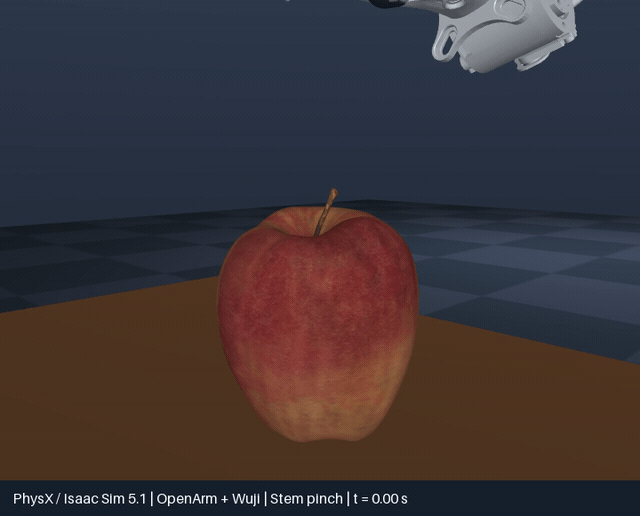
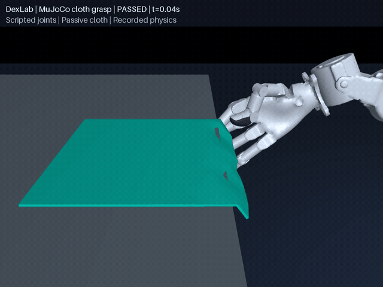
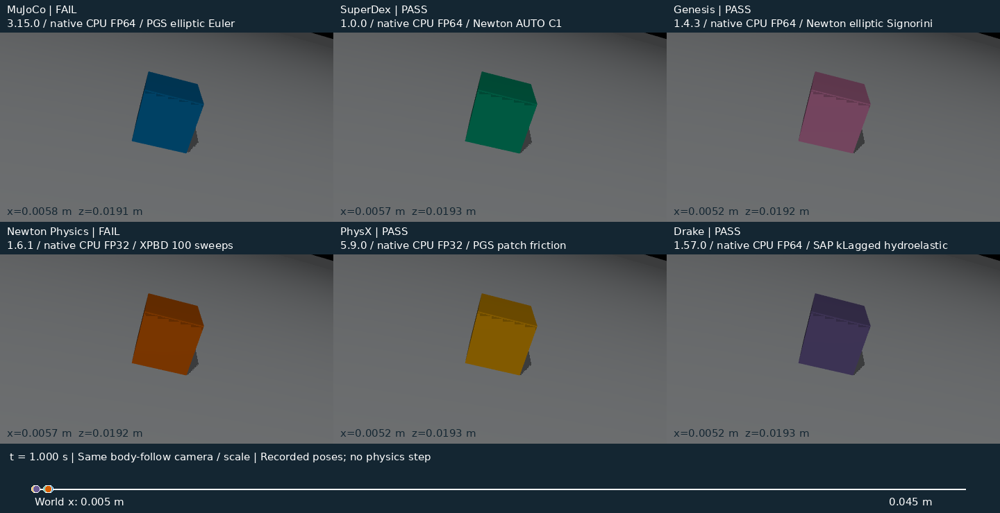
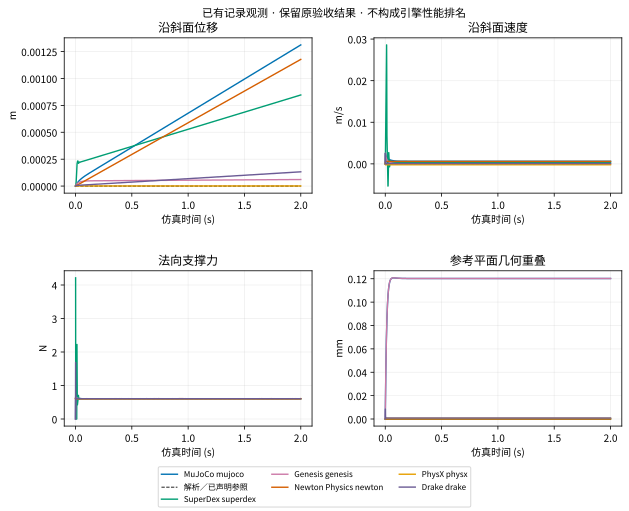
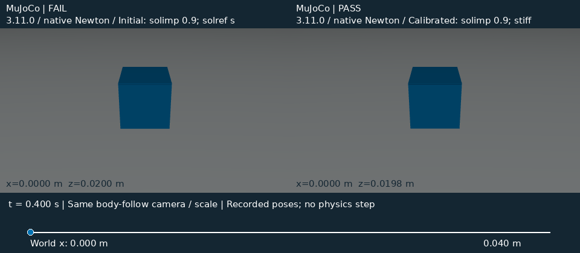
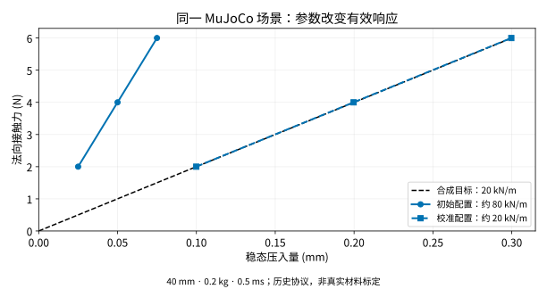
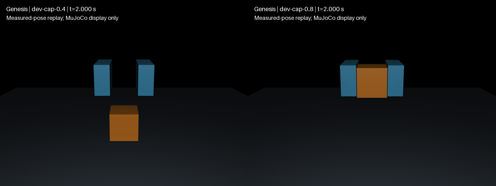
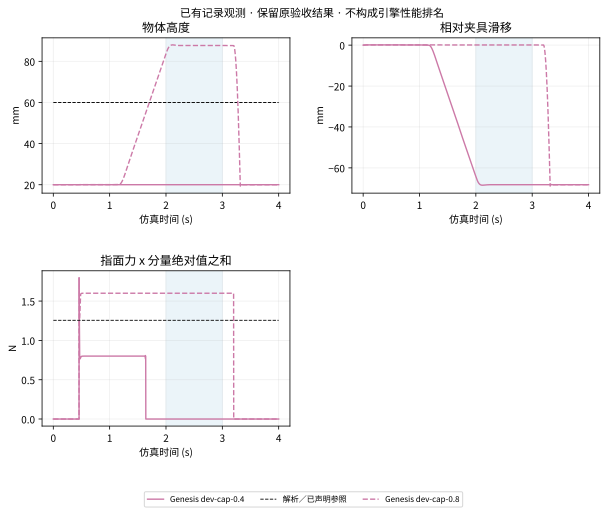
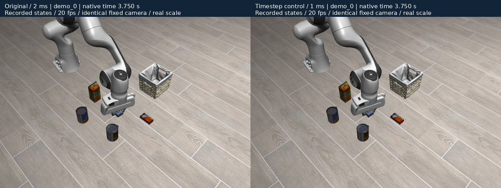
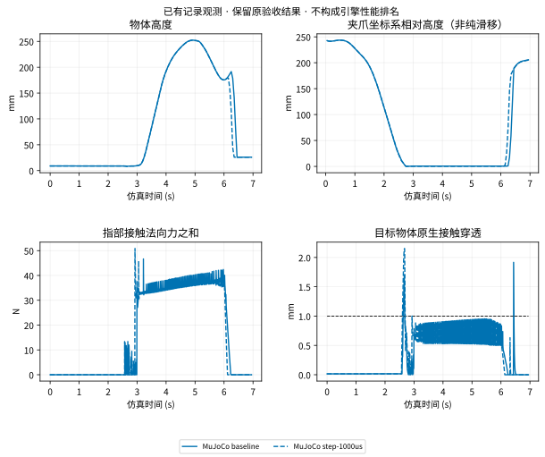

# 实验目录

标准方块[16例力限额实验](https://github.com/huangkiki/Dexlab/blob/main/docs/force-limit-results.zh-CN.md)完成：0.2/0.4 N保持失败，0.8/10 N保持释放通过，±2 mm偏移保持此结果；数值有效性与任务成败分别报告，不代表真机精度。

代码继续使用现有目录，避免改路径破坏资产引用、复现命令或历史证据。每个实验连接问题、配置、原始记录、独立评分、结果报告和失败。

| 实验 | 代码入口 | 研究问题与状态 |
|---|---|---|
| [RSS 擦拭与辅助保持](rss-wiping.md) | [demos/rss-wiping/](https://github.com/huangkiki/Dexlab/tree/main/demos/rss-wiping/) | 原版用 latch 柔顺约束辅助海绵随手运动；固定几何下另测无辅助的接触保持、滑脱和清洁率 |
| [连续切割与刀面推动](cut-push.md) | [demos/tofu-knife-push/](https://github.com/huangkiki/Dexlab/tree/main/demos/tofu-knife-push/) | 豆腐三块、香蕉四块；用记录的刀面接触力解释分离运动，合成材料 |
| [交叉浅划](tofu-scoring.md) | [demos/tofu-cut/](https://github.com/huangkiki/Dexlab/tree/main/demos/tofu-cut/) | 两条浅切、底部连通；区分弹性回弹与原生切割历史 |
| [豆腐状软块对半切](cutting.md) | [demos/tofu-cut/](https://github.com/huangkiki/Dexlab/tree/main/demos/tofu-cut/) | 单次切割 CPU TLMPM、刀具反力闭环与撤刀后分离；独立 BladeMaster 参考实现 |
| 苹果梗抓取 | [demos/apple-stem-grasp/](https://github.com/huangkiki/Dexlab/tree/main/demos/apple-stem-grasp/) | OpenArm 双臂＋Wuji，SDF–SDF 摩擦夹持；默认场景与历史扰动测试分列 |
| 机器人夹布 | [demos/cloth-folding/](https://github.com/huangkiki/Dexlab/tree/main/demos/cloth-folding/) | 夹持、抬升、释放；保留历史桌体相交失败；修复后一个 9 秒开发场景通过，鲁棒性未验证 |
| 接触与驱动 | [demos/contact-benchmark/](https://github.com/huangkiki/Dexlab/tree/main/demos/contact-benchmark/) | 滑动、压入/卸载、载荷与瞬态；合成响应不等于真机标定 |
| 基础布料 | [布料引擎对比](cloth-comparison.md) | 拉伸、下垂、碰撞与折叠下落；各材料与求解器能力单列 |
| PhysX | [demos/physx-contact/](https://github.com/huangkiki/Dexlab/tree/main/demos/physx-contact/) | 原生刚体、SDF、关节和表面布料；不把单例成功外推到留出测试 |
| Genesis | [#42](https://github.com/huangkiki/Dexlab/issues/42) | 刚体限定范围证据已交付；[PBD 薄布诊断](https://github.com/huangkiki/Dexlab/blob/main/docs/genesis-cloth.zh-CN.md)包含失败对照，当前摩擦夹持配置不准入；等时长响应、连通折叠与两个独立偏移位置已记录 |

`src/dexlab/` 保留共享任务注册、评分与记录逻辑；`scripts/` 放安装、复算、文档及研究工具。只有有实际重复或不变量的部分进入共享代码，不另建通用仿真框架。

## 苹果抓梗的控制与动力学

右手拇指和食指夹梗，左臂停放。苹果与梗组成 0.2 kg 自由刚体。动作来自已知位姿、逆运动学与固定关节目标；实际位姿由物理引擎积分，物体无附着或位置驱动。连续保持窗口为 11–14 s，接近阶段允许果身接触。

展示相机跟随记录中的苹果，仅用于回放。没有视觉控制、梗断裂或真机准确性的验证结论。

[抓取实现与参数](https://github.com/huangkiki/Dexlab/blob/main/docs/sdf-backends.zh-CN.md) · [全部任务盘点](https://github.com/huangkiki/Dexlab/blob/main/docs/inventory/README.zh-CN.md)

(apple-replays)=
## 连续近景记录

以下是原固定版本的开发场景回放，不代表留出场景成功率。夹布动图保留了已检出的桌体相交失败。

::::{grid} 1 1 2 2
:gutter: 3
:::{grid-item-card} MuJoCo

:::
:::{grid-item-card} SuperDex FP64

:::
:::{grid-item-card} PhysX

:::
:::{grid-item-card} 夹布：几何失败

:::
::::

## 真机采集准备

双 UR7e 与两个相同 CTAG2F90D 的[采集协议、空模板和日志校验器](https://github.com/huangkiki/Dexlab/blob/main/docs/hardware/README.zh-CN.md)已提供。命令、实测反馈和独立参考分开记录；未知数据保持未知。此功能只读文件，不控制机器人；格式通过不代表真机标定。

## 摩擦响应开发实验

[16 次平面实验报告](https://github.com/huangkiki/Dexlab/blob/main/demos/contact-benchmark/FRICTION_RESPONSE.zh-CN.md)保留 MuJoCo 3.14.0 / SuperDex FP64 全部成对结果、实际初态、速度区间阻力比与成本。全部运行通过现有平面检查，但低速阻力不同；这不是等效材料标定或引擎精度排名。

## 修复后的夹布开发场景


一个 9 秒候选通过固定 v3 标准，自接触穿透仍接近阈值。[指标、失败对照、录像溯源与完整命令](https://github.com/huangkiki/Dexlab/blob/main/demos/cloth-folding/SETTLING.zh-CN.md)。该结果不替换上方历史失败，也不证明鲁棒性。

## Drake 斜面首轮准入

官方 1.57.0 / SAP / kLagged / hydroelastic：静止与零摩擦通过全部六例，滑动三例失败，无地面负例被正确拒绝。初始共面故障保留，1 µm 间隙另立协议；不增加新协议可靠覆盖。 [报告 / Report](https://github.com/huangkiki/Dexlab/blob/main/docs/drake-incline-results.zh-CN.md).

<!-- visual-research:start -->
(full-experiment-catalogue)=
## 完整实验与历史记录

```{raw} html
<div class="experiment-grid">
<article class="experiment-card"><a href="banana-force.html"></a><div class="card-copy"><h3><a href="banana-force.html">香蕉单刀测力：20 次采样与 64× 粒子</a></h3><p class="engines">CPU TLMPM / independent paper-value protocol</p><p>材料力是否对采样、步长、接触尺度和粒子细化稳定？</p><p>20 次基准记账合格；64× 在 0.5 s 内未接触砧板，RMSE 为 2.051，不能支持收敛或真实力精度。</p></div></article>
<article class="experiment-card"><a href="cut-push.html"></a><div class="card-copy"><h3><a href="cut-push.html">最后一刀直接侧推：豆腐与香蕉</a></h3><p class="engines">CPU TLMPM / measured knife contact</p><p>末块分离是否由可见刀面接触产生？</p><p>豆腐三块、香蕉四块；最后一刀直接侧推，逐帧显示接触力与位移。豆腐增加牛顿黏性，并保留纯弹性、半步长及无侧推对照。</p></div></article>
<article class="experiment-card"><a href="cutting.html"></a><div class="card-copy"><h3><a href="cutting.html">历史：豆腐状软块对半切</a></h3><p class="engines">CPU TLMPM / BladeMaster v2 reference</p><p>撤刀后，切开的两块材料能否独立运动？</p><p>三个完整切割均分成两块，各占50%质量；负对照保持连接。力值收敛未验证，未做真实豆腐标定。</p></div></article>
<article class="experiment-card"><a href="cutting-comparison.html"></a><div class="card-copy"><h3><a href="cutting-comparison.html">历史：豆腐连续两刀与三列对比</a></h3><p class="engines">CPU TLMPM / author reference videos</p><p>两刀之后，左块能否独立运动？</p><p>两刀形成三等份；刀面接触后将左块推开，动图显示实际接触力与位移。原作末尾采用初速度输入，双方输入不同。</p></div></article>
<article class="experiment-card"><a href="tofu-scoring.html"></a><div class="card-copy"><h3><a href="tofu-scoring.html">豆腐交叉浅切</a></h3><p class="engines">CPU TLMPM / guided orthogonal scoring</p><p>划出交叉切口后，底部是否仍然连接？</p><p>默认与半步长均形成两条浅切，保持一个原生连通块；未切负例被拒绝。合成材料，非食材标定。</p></div></article>
<article class="experiment-card"><a href="banana-cutting.html"></a><div class="card-copy"><h3><a href="banana-cutting.html">历史：香蕉连续三刀切片</a></h3><p class="engines">CPU TLMPM / persistent cut history</p><p>后续切割会保留之前的切面吗？</p><p>逐刀分离与完整负对照见实验记录；表面和粒子来自相同状态，未做真实香蕉标定。</p></div></article>
<article class="experiment-card"><a href="libero-workflow.html"></a><div class="card-copy"><h3><a href="libero-workflow.html">LIBERO 原生抓取：诊断与改进</a></h3><p class="engines">LIBERO / robosuite 1.4.0 / MuJoCo 2.3.7 · Newton / elliptic</p><p>如何从已有 benchmark 定位问题，再验证修改？</p><p>发现观测陈旧；步长试验保留成功、失败和退化，不把任务成功当作物理验收。</p></div></article>
<article class="experiment-card"><a href="experience.html#normal-response"></a><div class="card-copy"><h3><a href="experience.html#normal-response">法向与瞬态响应</a></h3><p class="engines">MuJoCo · SuperDex · historical PhysX</p><p>压入、卸载与动态响应如何随参数改变？</p><p>静态校准有效，动态响应和质量迁移须分别验证。</p></div></article>
<article class="experiment-card"><a href="visual-comparisons.html#incline"></a><div class="card-copy"><h3><a href="visual-comparisons.html#incline">六引擎斜面与摩擦</a></h3><p class="engines">MuJoCo · SuperDex · Genesis · Newton Physics · PhysX · Drake</p><p>静止、滑动和低摩擦有哪些差异？</p><p>原配置结果与观测有效性分列；全部失败保留。</p></div></article>
<article class="experiment-card"><a href="results.html"></a><div class="card-copy"><h3><a href="results.html">碰撞与接触起始</a></h3><p class="engines">MuJoCo · SuperDex</p><p>步长、刚度及碰撞相位怎样影响瞬态？</p><p>已有相位与刚度扫描；更小步长不自动消除模型差异。</p></div></article>
<article class="experiment-card"><a href="visual-comparisons.html#pinch"></a><div class="card-copy"><h3><a href="visual-comparisons.html#pinch">夹具夹持、抬升与释放</a></h3><p class="engines">Genesis · MuJoCo · SuperDex (separate protocols)</p><p>夹持为什么保持或滑脱？</p><p>Genesis 0.4 N 与 0.8 N 配置呈现不同保持结果。</p></div></article>
<article class="experiment-card"><a href="experiments.html#apple-replays"></a><div class="card-copy"><h3><a href="experiments.html#apple-replays">苹果抓梗 · SDF 接触</a></h3><p class="engines">MuJoCo · SuperDex · historical PhysX</p><p>复杂几何下能否连续保持？</p><p>已有原生连续回放与独立历史验收；不同批次分列。</p></div></article>
<article class="experiment-card"><a href="coverage.html"></a><div class="card-copy"><h3><a href="coverage.html">布料力学与机器人夹布</a></h3><p class="engines">MuJoCo · SuperDex · Newton Physics · Genesis · historical PhysX</p><p>柔性形变、接触与保持何时失效？</p><p>历史柔顺夹布画面；力学、下落与夹布按独立协议记录，保留失败。</p></div></article>
<article class="experiment-card"><a href="experience.html#mass-size-transfer"></a><div class="card-copy"><h3><a href="experience.html#mass-size-transfer">质量／尺寸迁移</a></h3><p class="engines">MuJoCo · SuperDex</p><p>固定参数能否迁移到邻近场景？</p><p>30 条历史迁移记录，联合验收 0/30；失败也是选型依据。</p></div></article>
<article class="experiment-card"><a href="experience.html#transient-cost"></a><div class="card-copy"><h3><a href="experience.html#transient-cost">响应误差与计算成本</a></h3><p class="engines">MuJoCo · SuperDex</p><p>更小误差需要什么计算代价？</p><p>27 条记录区分原生计算、记录和评分成本。</p></div></article>
<article class="experiment-card"><a href="experience.html#framework-path"></a><div class="card-copy"><h3><a href="experience.html#framework-path">原生与框架接入路径</a></h3><p class="engines">MuJoCo / MJWarp · Newton / Isaac Sim</p><p>相同核心为何仍可能出现轨迹差异？</p><p>对齐 CPU 模型后仍有 GPU 字段差异；参数概览图非轨迹证据。</p></div></article>
</div>
```

**待开展／未完成：** 更广推动、手内旋转、主动折布及抓取迁移分别见现有 Issue。已有刀面推动按其单独协议报告；预折叠下落不等于主动折布成功。

## 我们已经知道什么

(experiment-highlight-incline)=
### 六引擎斜面：相同工况，响应不同

40 mm、64 g 方块；比较静止、滑动及名义零摩擦，三个步长。曲线与回放保留原配置的通过、失败和无效记录。





[同步回放、逐步曲线、参数与原始证据](incline)

(experiment-highlight-normal)=
### 法向响应：改参数，还是改 solver？

同一 MuJoCo 场景，从约 80 kN/m 到合成目标 20 kN/m。先看加载窗口的压入曲线，再看完整卸载；成功只属于规定的物理检查与条件。





[同步回放、逐步曲线、参数与原始证据](normal)

(experiment-highlight-pinch)=
### 夹持：0.4 N 滑脱，0.8 N 保持

同一 Genesis 夹具与物体，只改变指关节驱动力限额。对照完整闭合、抬升、保持和释放，并保留张开负例。





[同步回放、逐步曲线、参数与原始证据](pinch)

(experiment-highlight-libero)=
### LIBERO：原任务、步长对照与观测修正

相同动作、初态、Panda 和成功判定；原版 2 ms 与未通过筛查的 1 ms 对照。全部留出任务成功，物理诊断 5/10 对 3/10，成本约翻倍。观测刷新补丁的策略效果未验证。





[同步回放、逐步曲线、参数与原始证据](libero)

## 比较了哪些引擎与 solver

| 引擎 | 已登记配置的角色（非同级算法清单） | 实验版本与路径 |
| --- | --- | --- |
| **MuJoCo** | 约束求解: CG (nonlinear) · Newton · PGS<br>摩擦锥: elliptic · pyramidal<br>积分配置: Euler · implicitfast<br>角色/身份待核实: SolverMuJoCo; algorithm unqualified | 3.11.0, 3.14.0, 3.15.0; native / 历史路径详见矩阵 |
| **SuperDex** | 柔性实现: experimental-shell<br>外层非线性: BFGS · Newton · SR1<br>线性子求解: ASYNC_CG · AUGMENTED_CG · CG · CUDA_CG · CUDA_GMRES · EXPERIMENTAL_CUDA_SPARSE_CHOLESKY · EXPERIMENTAL_CUDA_SPARSE_LDLT · EXPERIMENTAL_CUDA_SPARSE_LU · GMRES · LDLT · LU · MINRES · PARALLEL_CG<br>线性分支选择: AUTO<br>摩擦正则化/模型: C1_REGULARIZED · CINF_REGULARIZED<br>标签中的精度: FP64 | 1.0.0; native / 历史路径详见矩阵 |
| **Genesis** | 柔性实现: PBD<br>约束求解: CG (nonlinear) · Newton<br>摩擦锥: elliptic · pyramidal<br>接触模型: Signorini · convex<br>耦合路径: rigid coupling<br>积分配置: approximate_implicitfast | 1.4.3; native / 历史路径详见矩阵 |
| **Newton Physics** | 实现/系统: Featherstone · Kamino · SemiImplicit · VBD · VBD compliant · VBD legacy · XPBD<br>柔性实现: ImplicitMPM · Style3D<br>动力学求解后端: DVI · PADMM<br>积分配置: Euler<br>更新/预算选项: 100 sweeps | 1.6.1 / Warp 1.18.0, 1.7.0.dev0 @ 2dee3234; native / 历史路径详见矩阵 |
| **PhysX** | 柔性实现: surface cloth<br>约束求解: PGS · TGS<br>摩擦正则化/模型: patch friction<br>更新/预算选项: external forces every iteration · friction every iteration<br>角色/身份待核实: historical readback incomplete (#126) · pending qualification | 5.9.0; native / 历史路径详见矩阵 |
| **Drake** | 约束求解: SAP<br>接触模型: hydroelastic · point<br>离散接触近似: kLagged · kSap · kSimilar<br>角色/身份待核实: not qualified | 1.57.0; native / 历史路径详见矩阵 |

原生与框架 **MJWarp** 另列运行路径及实际核心。Newton Physics 是引擎项目，Newton 也是求解算法名。SuperDex BFGS／SR1 在已测 assembly period=1 时执行 Newton 等价步；配置名不计作独立算法。

本表是研究对象概览，包含失败与未准入项；执行情况、CPU/GPU、精度、完整配置和不支持原因见 [完整矩阵 / Full matrix](coverage.md)。

角色按各引擎的已记录名称解释，不代表这些算法求解同一问题，也不证明任意组合已经执行。AUTO 只是选择策略；未知身份不从默认值补写。

**比较边界：** 系统配置选型与受控算法归因分开；记录完整性、数值一致性、物理参照和任务结果分别阅读，原始评分与失败分母不变。 [分类与证据说明](solver-taxonomy.md)。

细 SDF 几何与材料响应仍需 [#178](https://github.com/huangkiki/Dexlab/issues/178) 资格核验；布料材料、碰撞/耦合与夹持分别由 [#179](https://github.com/huangkiki/Dexlab/issues/179) 补齐基线。既有开发案例通过不等于公平的跨引擎材料比较。

**MJWarp 运行路径对照（归入 MuJoCo 核心）**

| 运行路径 | 实际物理核心 | solver／接触路径 | 任务验收状态 |
| --- | --- | --- | --- |
| Isaac Sim6.1.0 local tag build / Newton1.5.0 / vendor Warp1.16.0 | MuJoCo 3.11.0 | MJWarp Newton / pyramidal / Newton contacts | [not-run](coverage.md) |
| Isaac Sim6.1.0 local tag build / Newton1.5.0 / vendor Warp1.16.0 | MuJoCo 3.11.0 | MJWarp Newton / pyramidal / MJWarp contacts | [not-run](coverage.md) |
| Native matched core / vendor Warp1.16.0; original and four-field aligned | MuJoCo 3.11.0 | MJWarp Newton / pyramidal / MJWarp contacts | [not-run](coverage.md) |

已有模型与时钟诊断；可靠任务验收仍按矩阵状态记录。[路径差异 #152](https://github.com/huangkiki/Dexlab/issues/152) 保留独立研究范围。

<!-- visual-research:end -->
