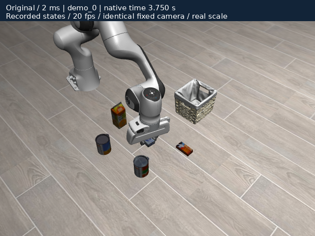

# LIBERO：从原生任务到可验证的改进

在 LIBERO 的奶油奶酪入篮任务里，十条示范回放都完成了任务。物理步长从 **2 ms 减到 1 ms**，十条还是都完成，但通过接触相关诊断的次数从 **5/10 变成 3/10**。对这个场景，任务终点和接触质量回答的是两个问题。



图中两段都是记录的原生示范动作。回放、曲线和接触事件可以逐帧对照。 [查看同步记录](libero)

## 先找穿透发生在哪一步

两种步长使用同样的十组留出示范。额外的诊断线设在 **1 mm** 最大目标接触穿透，并检查物体动量是否能由记录的接触和重力解释。

| 物理步长 | 原生任务完成 | 通过接触相关诊断 | 最大穿透 | 原生步进总耗时 |
| --- | ---: | ---: | ---: | ---: |
| 2 ms | 10/10 | 5/10 | 12.163 mm | 2.239 s |
| 1 ms | 10/10 | 3/10 | 12.212 mm | 4.481 s |

原版最大穿透出现在一条示范的 **2.940 s**。物体还没被提起来，地面和物体的碰撞几何已经重叠 **12.163 mm**。该接触的实际时间常数为 **10.5 ms**，高于 **4 ms** 的安全下限，所以这次异常没有触发该下限。问题最早能定位到抬升前的地面接触，具体是几何、驱动还是接触响应仍待区分。

把相同的动作倒回首次碰撞，再逐步核对几何间隙、驱动、法向冲量和实际物体运动，比只看入篮那一帧更容易判断下一次该改什么。表里的诊断是在这批仿真里冻结的筛查条件，真实物理精度需要独立参照。

```{raw} html
<span id="object"></span>
<span id="id3"></span>
<span id="id4"></span>
<span id="id5"></span>
<span id="id6"></span>
<span id="mask"></span>
<span id="id7"></span>
<span id="scoring-integrity"></span>
<span id="id8"></span>
<span id="id9"></span>
<span id="id10"></span>
<span id="id11"></span>
<span id="id12"></span>
```

## 实验记录

[完整技术报告与其他 Object 任务](libero-workflow-report.md) · [原始记录与补丁说明](https://github.com/huangkiki/Dexlab/blob/main/demos/libero-contact/README.md)
