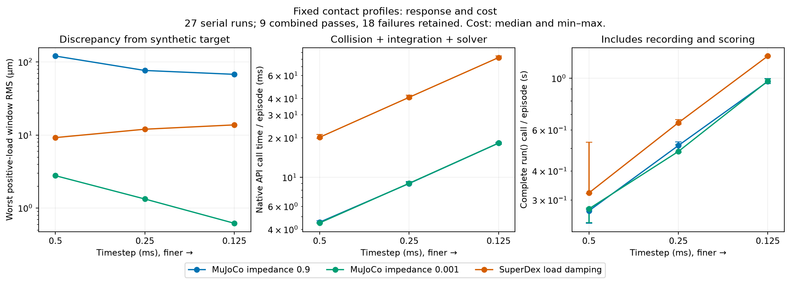
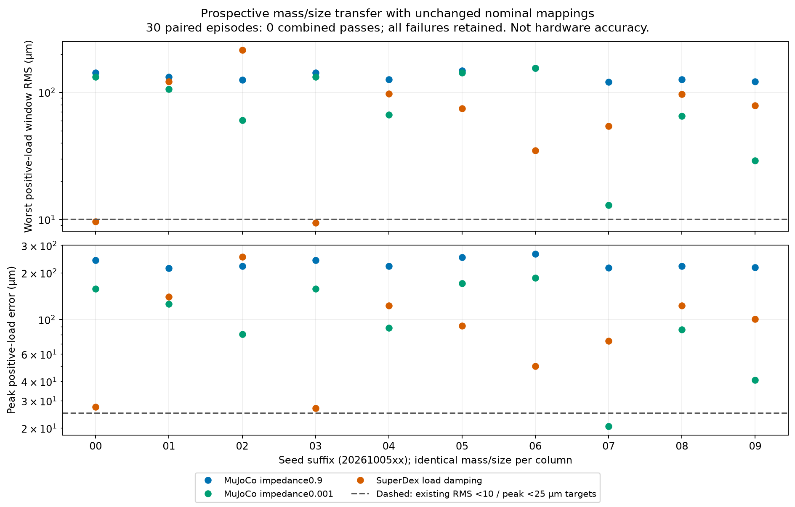

# 对比实验：从画面到判据

每个实验按同一顺序阅读：先看结论与判据，再看同条件的记录 GIF，随后用结果矩阵定位差异。最后才进入协议、解释和边界。

画面采用实物比例；微小变化看局部曲线。虚线是案例声明的解析／工程参照，并不代表真实材料测量。不同历史协议的结果不汇总为引擎排行榜。

(incline)=
## 斜面接触：相同工况，响应不同

40 mm、64 g 方块；比较静止、滑动及名义零摩擦，三个步长。曲线与回放保留原配置的通过、失败和无效记录。

<div class="comparison-summary">
  <p class="comparison-claim"><strong>结论</strong> 九种公开配置中，没有配置通过全部九例。新增记录显示，Chaos 三个名义零摩擦工况通过，Bullet 两个静止工况通过，SOFA 的滑动轨迹接近参考时，接触力仍可能超出门槛。</p>
  <div class="comparison-terms">
    <p><strong>实验条件</strong> MuJoCo 3.15.0、SuperDex 1.0.0、Genesis 1.4.3、Newton Physics 1.6.1、PhysX 5.9.0、Drake 1.57.0 原生斜面；每个 solver 的接触律、精度与适用配置分别记录。</p>
    <p><strong>结论边界</strong> 各批协议和准入范围保持独立；完整配置表给研究范围，不给普遍排名。#157/#159/#163/#165 的数值问题仍未全部解决。</p>
  </div>
</div>

<div class="replay-guide" aria-label="GIF 阅读说明">
  <p><strong>画面顺序</strong> MuJoCo / SuperDex / Genesis / Newton Physics / PhysX / Drake</p>
  <p><strong>看什么</strong> 在同一两秒窗口内，看方块是否保持、转动或失去支撑；每个画面同时标出运行状态。</p>
  <p><strong>不要直接推出</strong> GIF 相似不等于物理等价；通过或失败仍由同时间轴的力、位移和速度判据决定。</p>
</div>

```{raw} html
<div class="gif-evidence">
<div class="visual-hero"></div>
<details class="replay-fallback"><summary>静态图表与完整数据（无需 JavaScript）</summary><ul><li>静止 · 1 ms: <a href="_static/visual/incline-static-0.001.json.gz">JSON.gz</a> · <a href="_static/visual/incline-static-0.001-curves.zh.svg">SVG</a></li><li>静止 · 2 ms: <a href="_static/visual/incline-static-0.002.json.gz">JSON.gz</a> · <a href="_static/visual/incline-static-0.002-curves.zh.svg">SVG</a></li><li>静止 · 0.5 ms: <a href="_static/visual/incline-static-0.0005.json.gz">JSON.gz</a> · <a href="_static/visual/incline-static-0.0005-curves.zh.svg">SVG</a></li><li>滑动 · 1 ms: <a href="_static/visual/incline-sliding-0.001.json.gz">JSON.gz</a> · <a href="_static/visual/incline-sliding-0.001-curves.zh.svg">SVG</a></li><li>滑动 · 2 ms: <a href="_static/visual/incline-sliding-0.002.json.gz">JSON.gz</a> · <a href="_static/visual/incline-sliding-0.002-curves.zh.svg">SVG</a></li><li>滑动 · 0.5 ms: <a href="_static/visual/incline-sliding-0.0005.json.gz">JSON.gz</a> · <a href="_static/visual/incline-sliding-0.0005-curves.zh.svg">SVG</a></li><li>名义零摩擦 · 1 ms: <a href="_static/visual/incline-frictionless-0.001.json.gz">JSON.gz</a> · <a href="_static/visual/incline-frictionless-0.001-curves.zh.svg">SVG</a></li><li>名义零摩擦 · 2 ms: <a href="_static/visual/incline-frictionless-0.002.json.gz">JSON.gz</a> · <a href="_static/visual/incline-frictionless-0.002-curves.zh.svg">SVG</a></li><li>名义零摩擦 · 0.5 ms: <a href="_static/visual/incline-frictionless-0.0005.json.gz">JSON.gz</a> · <a href="_static/visual/incline-frictionless-0.0005-curves.zh.svg">SVG</a></li></ul></details>
</div>
```

<div class="comparison-matrix">
<table>
<caption>固定发布配置的分条件结果（通过数 / 该条件三例）</caption>
<thead><tr>
<th scope="col">引擎与配置</th>
<th scope="col">静止</th>
<th scope="col">滑动</th>
<th scope="col">名义零摩擦</th>
<th scope="col">总计</th>
</tr></thead>
<tbody>
<tr><th scope="row"><strong>MuJoCo</strong><small>3.15 · PGS / elliptic</small></th>
<td><span class="matrix-result fail">0 / 3</span></td>
<td><span class="matrix-result fail">0 / 3</span></td>
<td><span class="matrix-result pass">3 / 3</span></td>
<td><span class="matrix-result fail">3 / 9</span></td>
</tr>
<tr><th scope="row"><strong>SuperDex</strong><small>1.0 · Newton / AUTO / C1</small></th>
<td><span class="matrix-result mixed">2 / 3</span></td>
<td><span class="matrix-result pass">3 / 3</span></td>
<td><span class="matrix-result pass">3 / 3</span></td>
<td><span class="matrix-result mixed">8 / 9</span></td>
</tr>
<tr><th scope="row"><strong>Genesis</strong><small>1.4.3 · Newton / elliptic / Signorini</small></th>
<td><span class="matrix-result pass">3 / 3</span></td>
<td><span class="matrix-result pass">3 / 3</span></td>
<td><span class="matrix-result fail">0 / 3</span></td>
<td><span class="matrix-result mixed">6 / 9</span></td>
</tr>
<tr><th scope="row"><strong>Newton Physics</strong><small>1.6.1 · XPBD / 100 sweeps</small></th>
<td><span class="matrix-result mixed">1 / 3</span></td>
<td><span class="matrix-result invalid">0 / 3†</span></td>
<td><span class="matrix-result invalid">0 / 3†</span></td>
<td><span class="matrix-result invalid">1 / 9†</span></td>
</tr>
<tr><th scope="row"><strong>PhysX</strong><small>5.9.0 · PGS / patch friction</small></th>
<td><span class="matrix-result pass">3 / 3</span></td>
<td><span class="matrix-result mixed">2 / 3†</span></td>
<td><span class="matrix-result mixed">2 / 3</span></td>
<td><span class="matrix-result mixed">7 / 9†</span></td>
</tr>
<tr><th scope="row"><strong>Drake</strong><small>1.57 · SAP / kLagged / hydroelastic</small></th>
<td><span class="matrix-result pass">3 / 3</span></td>
<td><span class="matrix-result fail">0 / 3</span></td>
<td><span class="matrix-result pass">3 / 3</span></td>
<td><span class="matrix-result mixed">6 / 9</span></td>
</tr>
<tr><th scope="row"><strong>Chaos</strong><small>UE 5.7.1 · Linux Editor</small></th>
<td><span class="matrix-result fail">0 / 3</span></td>
<td><span class="matrix-result invalid">0 / 3†</span></td>
<td><span class="matrix-result pass">3 / 3</span></td>
<td><span class="matrix-result mixed">3 / 9†</span></td>
</tr>
<tr><th scope="row"><strong>Bullet</strong><small>PyBullet 3.2.7 · CPU DIRECT</small></th>
<td><span class="matrix-result mixed">2 / 3</span></td>
<td><span class="matrix-result fail">0 / 3</span></td>
<td><span class="matrix-result mixed">1 / 3</span></td>
<td><span class="matrix-result mixed">3 / 9</span></td>
</tr>
<tr><th scope="row"><strong>SOFA</strong><small>26.06.00 · rigid OBB / block GS</small></th>
<td><span class="matrix-result fail">0 / 3</span></td>
<td><span class="matrix-result fail">0 / 3</span></td>
<td><span class="matrix-result fail">0 / 3</span></td>
<td><span class="matrix-result fail">0 / 9</span></td>
</tr>
</tbody>
</table>
</div>
<p class="matrix-note">† 无效记录保留在分母中，不计为通过；不能解释成物理失败。</p>

评分器先核对状态与力的时间和数值，再评估运动是否达标。Chaos 三条滑动在状态与冲量的核对中超限。 {ref}`为什么判无效，查看首次越界和逐步对账 <incline-invalid-records>`。 表中历史无效项另见 [Newton Physics 的位置与速度检查](https://github.com/huangkiki/Dexlab/blob/main/docs/newton-incline-results.zh-CN.md) 和 [PhysX 的法向冲量方向检查](https://github.com/huangkiki/Dexlab/blob/main/docs/physx-incline-results.zh-CN.md)。

GIF 保留原六引擎回放。九引擎曲线使用同一 1 ms 工况，点线标记数值记录无效。

```{raw} html
<p><a href="_static/incline-extension/static-1ms-curves.zh.svg">静止曲线</a> · <a href="_static/incline-extension/sliding-1ms-curves.zh.svg">滑动曲线</a> · <a href="_static/incline-extension/frictionless-1ms-curves.zh.svg">名义零摩擦曲线</a></p>
```

[新增工况报告与原始数据](incline-extension.md)

**条件：** MuJoCo 3.15.0、SuperDex 1.0.0、Genesis 1.4.3、Newton Physics 1.6.1、PhysX 5.9.0、Drake 1.57.0 原生斜面；每个 solver 的接触律、精度与适用配置分别记录。

**观察：** 六引擎已有正例、负例和失败证据；Genesis 名义零摩擦被原生接触抬到 .01，SuperDex BFGS/SR1 在每步重组装设置下等效执行 Newton 步骤。

**解释：** 已验证的有效参数／执行路径差异能改变对同名配置的解释；初始通过率不能替代等预算调参后的比较。

**建议：** 按粘着／滑动、低摩擦和接触尺度筛选候选；同时查看无效记录、物理误差和成本。

**边界：** 各批协议和准入范围保持独立；完整配置表给研究范围，不给普遍排名。#157/#159/#163/#165 的数值问题仍未全部解决。

展示选择：MuJoCo 取冻结清单首项 PGS／elliptic；其余取已发布基线 SuperDex Newton／AUTO／C1、Genesis Newton／elliptic／Signorini、Newton Physics XPBD、PhysX PGS、Drake SAP／kLagged／hydroelastic。未按通过数挑选；其余配置仍在完整矩阵中。

物理参照：不旋转刚体、库仑摩擦、持续接触的理想斜面，滑动加速度 a=g(sinθ−μcosθ)，静止需满足静摩擦不等式。接触切换、几何与模型差异限制此参照；Drake 初始 1 μm 间隙与 Genesis 名义零摩擦的原生下限保留。近景使用相同物体跟随规则及尺度，下方标尺保留世界坐标位移；无效观测的曲线只作诊断。

**证据与全部配置：** [完整 solver 矩阵](coverage.md) · [全部斜面报告](engines.md) · 各播放器数据包含原评分及来源哈希。

(normal)=
## 法向响应：改参数，还是改 solver？

同一 MuJoCo 场景，从约 80 kN/m 到合成目标 20 kN/m。先看加载窗口的压入曲线，再看完整卸载；成功只属于规定的物理检查与条件。

<div class="comparison-summary">
  <p class="comparison-claim"><strong>结论</strong> 参数校准可以把这组夹具的加载响应带到合成目标附近，但固定参数直接迁移到其他质量时会失效；明确写出质量补偿后，两个迁移载荷才重新接近目标。</p>
  <div class="comparison-terms">
    <p><strong>实验条件</strong> 40 mm 方块，0.2 kg，0.5 ms；2/4/6/−1 N 加载。20 kN/m 是合成响应目标。</p>
    <p><strong>结论边界</strong> 仅适用于此恒定阻抗、四点面接触夹具；不是任意几何的公式，也不是真实材料标定。历史 PhysX 核心身份缺失仍见 #126 审计。</p>
  </div>
</div>

<div class="replay-guide" aria-label="GIF 阅读说明">
  <p><strong>画面顺序</strong> 初始 MuJoCo / 校准后 MuJoCo</p>
  <p><strong>看什么</strong> 先看加载窗的压入量，再看卸载、离面段和其他质量下的响应是否仍接近目标。</p>
  <p><strong>不要直接推出</strong> GIF 不能证明材料真实刚度；有效响应只在声明的夹具、载荷和合成目标内成立。</p>
</div>

```{raw} html
<div class="gif-evidence">
<div class="visual-hero"></div>
<details class="replay-fallback"><summary>静态图表与完整数据（无需 JavaScript）</summary><ul><li>初始／校准 · 0.2 kg · 0.5 ms: <a href="_static/visual/normal-calibration.json.gz">JSON.gz</a> · <a href="_static/visual/normal-calibration-curves.zh.svg">SVG</a></li></ul></details>
</div>
```

<div class="comparison-matrix">
<table>
<caption>加载窗口的有效响应（合成目标 20 kN/m）</caption>
<thead><tr>
<th scope="col">阶段</th>
<th scope="col">实测响应</th>
<th scope="col">目标或检查</th>
<th scope="col">读法</th>
</tr></thead>
<tbody>
<tr><th scope="row"><strong>初始配置</strong><small>MuJoCo · 0.2 kg</small></th>
<td>≈80 kN/m</td>
<td>20 kN/m</td>
<td><span class="matrix-result fail">未校准</span></td>
</tr>
<tr><th scope="row"><strong>校准后</strong><small>同一夹具与载荷</small></th>
<td>≈20 kN/m</td>
<td>20 kN/m</td>
<td><span class="matrix-result pass">目标区间</span></td>
</tr>
<tr><th scope="row"><strong>直接迁移</strong><small>0.1 kg / 0.4 kg</small></th>
<td>10.01 / 40.04 kN/m</td>
<td>20 kN/m</td>
<td><span class="matrix-result fail">迁移失败</span></td>
</tr>
<tr><th scope="row"><strong>质量补偿</strong><small>预声明规则</small></th>
<td>20.04 / 19.93 kN/m</td>
<td>20 kN/m</td>
<td><span class="matrix-result pass">重新接近</span></td>
</tr>
</tbody>
</table>
</div>

**条件：** 40 mm 方块，0.2 kg，0.5 ms；2/4/6/−1 N 加载。20 kN/m 是合成响应目标。

**观察：** MuJoCo 初始响应约 80 kN/m；校准后接近 20 kN/m。固定参数迁移到 0.1/0.4 kg 后约为 10.01/40.04 kN/m；事前约定的质量补偿后为 20.04/19.93 kN/m。

**解释：** 已验证：该夹具的参考加速度约束响应与质量和阻抗有关。同名刚度参数不等于跨引擎等效材料刚度。

**建议：** 先用已声明的载荷段检查有效响应，再按明确假设做参数转换，并独立验证其他载荷与质量。

**边界：** 仅适用于此恒定阻抗、四点面接触夹具；不是任意几何的公式，也不是真实材料标定。历史 PhysX 核心身份缺失仍见 #126 审计。

有效参数：相同 solimp=[0.9,0.9,0.001,0.5,2]；初始与校准 solref 及完整原生配置见数据中的 effective_parameters 和原始 run.json。图中保留 −1 N 离面段；加载窗口另图展示，避免离面运动掩盖微小压入。下方成本与迁移图属于各自历史协议，不与本案例合并计数。

**证据与全部配置：** [法向协议、17 条结果与复现](https://github.com/huangkiki/Dexlab/blob/main/demos/contact-benchmark/NORMAL_RESPONSE.zh-CN.md) · [迁移经验](mass-size-transfer) · [成本边界](transient-cost)





(pinch)=
## 夹持：0.4 N 滑脱，0.8 N 保持

同一 Genesis 夹具与物体，只改变指关节驱动力限额。对照完整闭合、抬升、保持和释放，并保留张开负例。

<div class="comparison-summary">
  <p class="comparison-claim"><strong>结论</strong> 在同一夹具中，保持边界位于 0.4 N 与 0.8 N 之间；±2 mm 初态偏移没有改变这条边界。</p>
  <div class="comparison-terms">
    <p><strong>实验条件</strong> Genesis 原生有限夹具、四档力限额和 ±2 mm 初始偏移，共 16 个固定案例。另有 MuJoCo 标准方块夹持与机器人 SDF 历史场景。</p>
    <p><strong>结论边界</strong> 这不是跨引擎统一夹持排名。#145 的惯量／坐标问题和 #132→#134 的共同驱动／594 回合正式研究仍独立开放。</p>
  </div>
</div>

<div class="replay-guide" aria-label="GIF 阅读说明">
  <p><strong>画面顺序</strong> 0.4 N 力限额 / 0.8 N 力限额</p>
  <p><strong>看什么</strong> 依次看闭合、抬升、保持和释放，重点确认物体相对指面是否持续滑移。</p>
  <p><strong>不要直接推出</strong> 抬起或离开画面不等于完成保持；张开负例与原生物体运动共同防止错误成功。</p>
</div>

```{raw} html
<div class="gif-evidence">
<div class="visual-hero"></div>
<details class="replay-fallback"><summary>静态图表与完整数据（无需 JavaScript）</summary><ul><li>保持边界：0.4 N／0.8 N: <a href="_static/visual/pinch-retention.json.gz">JSON.gz</a> · <a href="_static/visual/pinch-retention-curves.zh.svg">SVG</a></li><li>张开负例／0.8 N: <a href="_static/visual/pinch-negative.json.gz">JSON.gz</a> · <a href="_static/visual/pinch-negative-curves.zh.svg">SVG</a></li></ul></details>
</div>
```

<div class="comparison-matrix">
<table>
<caption>指关节驱动力限额与保持结果</caption>
<thead><tr>
<th scope="col">力限额</th>
<th scope="col">保持</th>
<th scope="col">释放检查</th>
<th scope="col">读法</th>
</tr></thead>
<tbody>
<tr><th scope="row"><strong>0.2 N</strong></th>
<td>滑脱</td>
<td>无有效保持</td>
<td><span class="matrix-result fail">失败</span></td>
</tr>
<tr><th scope="row"><strong>0.4 N</strong></th>
<td>滑脱</td>
<td>无有效保持</td>
<td><span class="matrix-result fail">失败</span></td>
</tr>
<tr><th scope="row"><strong>0.8 N</strong></th>
<td>保持</td>
<td>完成释放</td>
<td><span class="matrix-result pass">通过</span></td>
</tr>
<tr><th scope="row"><strong>10 N</strong></th>
<td>保持</td>
<td>完成释放</td>
<td><span class="matrix-result pass">通过</span></td>
</tr>
</tbody>
</table>
</div>

**条件：** Genesis 原生有限夹具、四档力限额和 ±2 mm 初始偏移，共 16 个固定案例。另有 MuJoCo 标准方块夹持与机器人 SDF 历史场景。

**观察：** Genesis 0.2/0.4 N 限额不能保持物体；0.8/10 N 保持并释放。通过范围限于该夹具与驱动。

**解释：** 已验证驱动限额会改变承载边界；摩擦／力矩平衡是诊断起点，不能仅凭接触力残差宣称抓取成功。

**建议：** 从物体载荷、每侧法向力和有效摩擦出发，再检查有限指面接触、滑移和释放；同步核查驱动实际输出。

**边界：** 这不是跨引擎统一夹持排名。#145 的惯量／坐标问题和 #132→#134 的共同驱动／594 回合正式研究仍独立开放。

物理参照：理想静态平指夹持需要 μΣN≥mg，本例 mg/μ≈1.256 N。曲线 Σ|Fx| 是指面力投影代理，不是实测执行器输出；2–3 s 高度阈值 60 mm 只是原验收的一项，全部原检查同时保留。

**证据与全部配置：** [16 个案例、失败与成本](https://github.com/huangkiki/Dexlab/blob/main/docs/force-limit-results.zh-CN.md) · [历史 solver 来源审计](https://github.com/huangkiki/Dexlab/blob/main/docs/genesis-solver-audit.md)

(libero)=
## LIBERO：原任务、步长对照与观测修正

相同动作、初态、Panda 和成功判定；原版 2 ms 与未通过筛查的 1 ms 对照。全部留出任务成功，物理诊断 5/10 对 3/10，成本约翻倍。观测刷新补丁的策略效果未验证。

<div class="comparison-summary">
  <p class="comparison-claim"><strong>结论</strong> 1 ms 没有改善原任务成功率，反而让物理诊断从 5/10 降到 3/10，并使原生步进成本约翻倍。</p>
  <div class="comparison-terms">
    <p><strong>实验条件</strong> 官方 cream-cheese-to-basket，Panda / robosuite 1.4.0 / MuJoCo 2.3.7 Newton elliptic；20 Hz 控制，原版 2 ms。</p>
    <p><strong>结论边界</strong> 只有示范动作执行，未验证固定策略闭环效果、真实材料准确性或中途状态恢复；留出仅为同任务的十条示范，不是新任务泛化。</p>
  </div>
</div>

<div class="replay-guide" aria-label="GIF 阅读说明">
  <p><strong>画面顺序</strong> 原版 2 ms / 对照 1 ms</p>
  <p><strong>看什么</strong> 先确认两种步长都完成原任务，再对照同一动作下的接触重叠、相对高度和法向力。</p>
  <p><strong>不要直接推出</strong> 原任务成功不能替代物理筛查；GIF 也不能唯一解释 5/10 到 3/10 的退化。</p>
</div>

```{raw} html
<div class="gif-evidence">
<div class="visual-hero"></div>
<details class="replay-fallback"><summary>静态图表与完整数据（无需 JavaScript）</summary><ul><li>开发 demo_0：冻结首条示范: <a href="_static/visual/libero-demo0.json.gz">JSON.gz</a> · <a href="_static/visual/libero-demo0-curves.zh.svg">SVG</a></li><li>留出 demo_4：首个诊断退化: <a href="_static/visual/libero-demo4.json.gz">JSON.gz</a> · <a href="_static/visual/libero-demo4-curves.zh.svg">SVG</a></li><li>留出 demo_8：最大原生穿透: <a href="_static/visual/libero-demo8.json.gz">JSON.gz</a> · <a href="_static/visual/libero-demo8-curves.zh.svg">SVG</a></li></ul></details>
</div>
```

<div class="comparison-matrix">
<table>
<caption>原版 2 ms 与 1 ms 的同动作对照</caption>
<thead><tr>
<th scope="col">指标</th>
<th scope="col">原版 2 ms</th>
<th scope="col">对照 1 ms</th>
<th scope="col">读法</th>
</tr></thead>
<tbody>
<tr><th scope="row"><strong>留出原任务</strong></th>
<td>10 / 10</td>
<td>10 / 10</td>
<td><span class="matrix-result mixed">无法区分</span></td>
</tr>
<tr><th scope="row"><strong>物理诊断</strong></th>
<td>5 / 10</td>
<td>3 / 10</td>
<td><span class="matrix-result fail">退化</span></td>
</tr>
<tr><th scope="row"><strong>原生步进成本</strong></th>
<td>2.239 s</td>
<td>4.481 s</td>
<td><span class="matrix-result fail">约翻倍</span></td>
</tr>
</tbody>
</table>
</div>

**条件：** 官方 cream-cheese-to-basket，Panda / robosuite 1.4.0 / MuJoCo 2.3.7 Newton elliptic；20 Hz 控制，原版 2 ms。

**观察：** 原版与 1 ms 留出动作执行均 10/10 完成原任务，物理诊断分别 5/10 与 3/10；步进成本约翻倍。五步静置后旧观测与实际末端位置某坐标相差 4.481 mm。

**解释：** 已验证观测赋值遗漏；正接触时间常数与步长安全下限存在源码确认的耦合。更小步长没有一致改善；最大 floor 接触穿透 12.163 mm 的完整机制仍见 #174。

**建议：** 先修正观测新鲜度，区分控制目标、驱动输出与接触力；保留失败，按具体接触定位受控实验。本轮不推荐新的物理配置。

**边界：** 只有示范动作执行，未验证固定策略闭环效果、真实材料准确性或中途状态恢复；留出仅为同任务的十条示范，不是新任务泛化。

默认是冻结顺序第一条开发示范，不按结果挑选。另展示留出首个诊断退化与最大原版穿透，两者为事后诊断选择；完整十条配对结果均保留。GIF 不再积分物理。

1 mm 虚线只是预设数值筛查；相对高度包含旋转，法向力来自实际接触。原生时间 = 显示时间 + 0.25 s；曲线使用各自积分前／后时刻。

**证据与全部配置：** [原任务、全部配置、失败与复现](libero-workflow.md) · [剩余归因 #174](https://github.com/huangkiki/Dexlab/issues/174)
