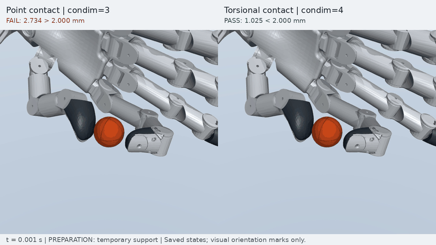
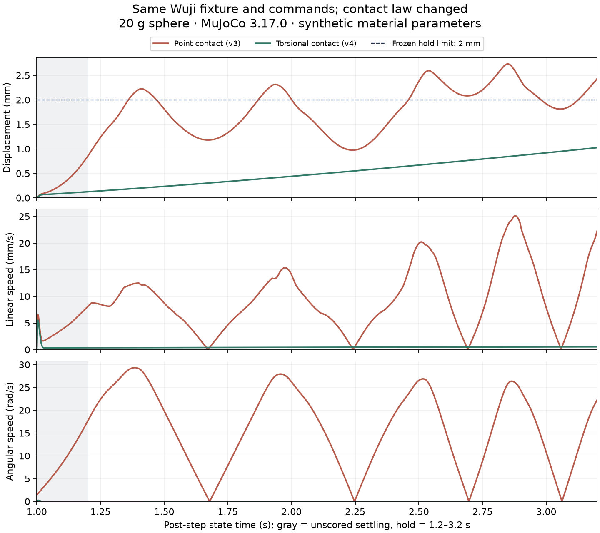

# 两根手指一直夹着，球为什么还会转？

Wuji 的两根手指在整个两秒保持段都贴着球，球还是转了起来，最大移动 **2.734 mm**，超过预先设定的 **2 mm** 门槛。在同一只手和控制器上加入合成抗扭接触后，最大位移降到 **1.025 mm**。两种设置夹住了同一个球，差别在接触能施加什么方向的力矩。



回放保留准备、保持和释放，完整 4.4 秒。十字只标示球的朝向，转速来自每秒 2,000 次的仿真读回。

## 绕哪条线在转？

想象两个指尖在球上各压住一个理想的点。把这两点连成一条线。力可以朝不同方向，施力点都在这条线上。**绕这条线的力矩分量为零。** 这里的图景适用于瞬时的理想点接触，真实指垫有面积，也可能形变。

在点接触的记录中，准备力撤掉后，球心始终离夹持线 **0.310–0.985 mm**，重力对该轴有力矩。两侧指垫接触在保持段一直存在，接触自身的力矩读回始终为零。手指参考点中点只移动约 **0.093 mm**，球相对它最多移动约 **2.696 mm**。这把排查范围缩到了接触提供的力矩，球的运动也可以和整只手的移动分开看。

## 加上抗扭以后

改用 MuJoCo 已有的抗扭接触，滑动摩擦系数沿用原值。保持段最大角速度从 **29.336 rad/s 降到 0.024992 rad/s**，通过原定保持门槛，张指后也完成释放。曲线仍有缓慢漂移，这个结果只覆盖已评分的两秒。



抗扭模型从准备阶段就介入，因此准备结束时的状态也可能改变。这个对照支持该合成夹持配置的改进。真实指垫能提供多大抗扭力矩，需要独立量测。

遇到「指尖一直有接触，物体却在转」，先看实际旋转轴和接触能提供哪些方向的力矩。若要单独估计抗扭项的作用，下一项对照是固定开始保持时的同一状态，再切换接触定律。

```{raw} html
<span id="wuji"></span>
<span id="id5"></span>
```

## 实验记录

[完整实验报告与复算](wuji-contact-report.md) · [原始轨迹与帧映射](https://github.com/huangkiki/Dexlab/blob/main/docs/evidence/wuji-contact/comparison.json)
